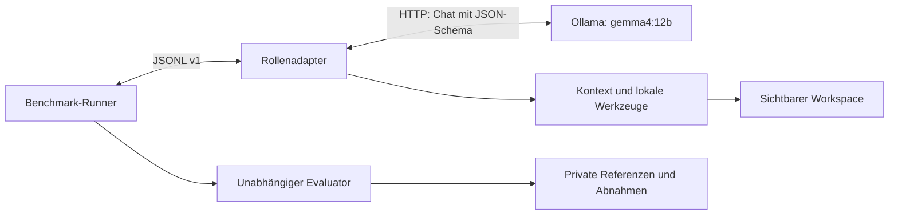

# Konzept: lokale Reviewer- und Developer-Agenten

**Stand:** 10. November 2026. **Status:** Gemeinsamer Unterbau (§5, Schritt 1)
und Reviewer-Kern (§5, Schritt 2) implementiert und offline geprüft;
Reviewer-JSONL-Anschluss im echten EBT-Smoke geprüft; Developer-Kern (§5, Schritt 3)
implementiert und offline geprüft; Developer-Rollenprozess und Wheel-Nachweis
(§5, Schritt 4) implementiert. Tatsächliche Installations-Smokes und ihre
Ergebnisse sind im §5.4-Nachweis dokumentiert; Modellmessreihen bleiben geplant.

Dieses Dokument konkretisiert die Agentenseite des
[Benchmark-Konzepts](BENCHMARK_KONZEPT.md), insbesondere Abschnitte 4, 5 und 7.
Beide Agenten verwenden Ollama mit `gemma4:12b`, arbeiten als eigenständige
JSONL-Prozesse und benötigen keine Änderung an EBT oder RBT. Sie teilen
Providerzugriff, Kontextaufbereitung und Belegführung, erhalten aber getrennte
Prompts, Schreibrechte und Agentenidentitäten. Der Reviewer untersucht einen
eingereichten Stand; der Developer erstellt Tests und Implementierung.
Für einen Benchmark-Lauf ist jeweils nur der ausgewählte Agent erforderlich.

## 1. Ausgangspunkt und Entwurfsentscheidungen

Das vorhandene [Ollama-Beispiel](../examples/ollama-user-benchmark/README.md)
demonstriert einen echten Developer mit zwei Modellaufrufen, festem Dateiziel
und strukturierter Ausgabe. Das [Nutzungsexperiment](EXPERIMENT_Benchmark-10-3.md)
belegt den Nutzen dieser Ausgabegrenzen, aber auch falsche Testorakel und eine
fehlende Reparaturschleife. Die historischen Archive bleiben unverändert.
Die dort beobachtete Ablehnung von `pytest.raises`-Rot ist im aktuellen
[`_pytest.py`](../src/qb_cubie/benchmarks/execution/_pytest.py) bereits ausdrücklich
berücksichtigt; sie ist als Regression zu prüfen, nicht als unverändert offener
Implementierungsfehler zu behandeln.

| Entscheidung | Begründung |
| --- | --- |
| Zwei Prozesse mit gemeinsamer Bibliothek | Rollen und Rechte bleiben prüfbar; HTTP-Client und Validierung werden wiederverwendet. |
| Kleine Zustandsmaschine mit begrenzten Schleifen | Jeder Schritt hat ein Ziel, ein Budget und eine definierte Abgabe. |
| JSON-Schema für Modellantworten | Dateiziele und Aktionen werden validiert; frei erzeugte Shellbefehle sind nicht erforderlich. |
| Lokale Werkzeuge durch den Adapter | Quellenzugriff, Tests und Änderungen werden tatsächlich ausgeführt und protokolliert. |
| Keine gegenseitige Freigabe im Hauptversuch | Gemeinsame Modellfehler dürfen die unabhängige Bewertung nicht ersetzen. |
| Zunächst Python-Standardbibliothek als Unterbau | Anschluss an das existierende Beispiel; kein zusätzliches Agentenframework nötig. |

Die Modellkennung ist auf der offiziellen
[Ollama-Modellseite](https://ollama.com/library/gemma4:12b) dokumentiert.
Ein Tag ist keine unveränderliche Modellversion. Der im Nutzungsexperiment
aufgezeichnete Digest ist ein historischer Messwert und wird nicht ungeprüft
als aktuelle Installation übernommen.

## 2. Gemeinsamer technischer Unterbau

### 2.1 Komponenten und Vertrauensgrenzen



Der gemeinsame Unterbau enthält `OllamaClient`, `ContextBuilder`,
`WorkspacePolicy`, `ToolExecutor`, `BudgetLedger` und `EvidenceWriter` als
Verantwortlichkeiten; eine Klasse je Name ist nicht vorgeschrieben.
Rollenadapter übersetzen zwischen internem Aktionsschema und öffentlichem
Benchmark-Protokoll. Ollama erhält nur die ausgewählten sichtbaren Inhalte.
Private Referenzen, Mutanten und Ergebnisarchive sind keine Werkzeugziele.

Dateizugriffe prüfen relative Pfade, aufgelöste Elternverzeichnisse und Symlinks.
Schreibrechte gelten je Phase und für eine explizite Dateimenge. Änderungen
werden zunächst vorbereitet, geprüft und dann übernommen. Ein fehlerhafter
Mehrdateivorschlag hinterlässt keinen teilweise aktualisierten Stand.
Quelltexte und Werkzeugausgaben werden als Daten in den Kontext aufgenommen;
darin enthaltene Handlungsanweisungen erweitern keine Rechte.

Diese Adaptergrenzen sind keine OS-Isolation. Der aktuelle lokale Runner setzt
vertrauenswürdigen Code voraus. Für fremden generierten Code ist die in
Abschnitt 7.3 des Benchmark-Konzepts geplante Containergrenze separat umzusetzen.
Für den ersten lokalen Durchstich gelten die vorhandenen Vertrauensannahmen.

### 2.2 Modellkonfiguration und Vorprüfung

Vor einem Messlauf ermittelt ein Konfigurationsschritt lokale Modellidentität,
Quantisierung, Ollama-Version und unterstützte Einstellungen. Er friert diese
zusammen mit Adapterversion, Prompt und Werkzeugbeschreibung ein. Die lokale
Modellliste liefert einen Digest; die Liste laufender Modelle liefert unter
anderem VRAM-Belegung und aktive Kontextlänge.
Siehe [Modellliste](https://docs.ollama.com/api/tags) und
[laufende Modelle](https://docs.ollama.com/api/ps).

Als **Kalibrierungswerte**, nicht als Leistungsempfehlung, dienen:

| Einstellung | Reviewer | Developer |
| --- | --- | --- |
| Modell | `gemma4:12b` mit festgehaltenem Digest | derselbe Digest |
| `temperature` / `seed` | `0` / `42` | `0` / `42` |
| `num_ctx` | zunächst 16384, lokal prüfen | zunächst 16384, lokal prüfen |
| `num_predict` pro Aufruf | 2048 | 4096 |
| `think` | `false`, sofern unterstützt | `false`, sofern unterstützt |
| Transport | `stream=false`, JSON-Schema | `stream=false`, JSON-Schema |

Eine Vorprüfung mit unbewertetem Material kontrolliert gültige Schemaausgabe,
verwendbare Kontextgröße und Laufzeit auf der tatsächlichen Hardware. Nicht
unterstützte Einstellungen führen zu einer neuen expliziten Konfiguration;
es gibt keinen stillen Modellwechsel. Temperatur und Seed garantieren keine
identischen Wiederholungen. Messungen laufen zunächst seriell auf derselben
Hardware; Ladezustand und konkurrierende GPU-Nutzung werden erfasst.
Laden und Vorwärmen erfolgen vor der Episode und werden gesondert ausgewiesen.
Der auf fünf Sekunden begrenzte JSONL-Handshake lädt kein Modell und ruft keine
Inferenz auf; er bestätigt die vorbereitete Konfiguration.

Die [Chat-API](https://docs.ollama.com/api/chat) unterstützt `format` als
JSON-Schema und meldet unter anderem Eingabe-/Ausgabetokens sowie Laufzeiten.
Das Schema wird zusätzlich im Prompt erläutert und die Antwort lokal validiert,
wie in [Structured Outputs](https://docs.ollama.com/capabilities/structured-outputs)
beschrieben. Der Adapter prüft außerdem Abschluss und Abbruchgrund; eine wegen
Längenlimit unvollständige Antwort wird nicht durch Abschneiden repariert.

### 2.3 Protokoll, Identität und Nachweise

Verbindlich sind die vorhandenen
[JSONL-Verträge](GUIDE_Benchmark-Custom.md#nachrichten-und-phasen), nicht ein
neues Agentenprotokoll. stdout enthält ausschließlich JSONL; Diagnosen gehen
an stderr. Genau ein Abschlussereignis beantwortet jede Phasenanfrage.
Dateiänderungen erfolgen vor diesem Ereignis; `artifact_hashes` beziehen sich
auf die tatsächlich geschriebenen Bytes. Der Runner prüft sie unabhängig.

| Rolle | `benchmark` / `phase` | Deklarierte Fähigkeiten |
| --- | --- | --- |
| Reviewer | `review_agent` / `review` | `review_output`, `cancel`, `wall_time`, `tool_calls` |
| Developer | `developer_agent` / `test_design`, `red`, `green`, `refactor` | `workspace_changes`, `phased_submission`, `cancel`, `wall_time`, `tool_calls` |

Vorgesehene IDs sind `ollama-gemma4-reviewer` und `ollama-gemma4-developer`.
`cancel` bedeutet Beendbarkeit durch den Runner, kein zusätzliches Cancel-RPC.
`tool_calls` bezieht sich im öffentlichen Vertrag auf Runner-Werkzeuge.
Adapterinterne Modell- und Werkzeugaufrufe erhalten eigene Zähler und Limits.
Der Abbruch einer HTTP-Verbindung beweist keine sofortige Beendigung der
serverseitigen Inferenz; vor dem nächsten Versuch ist der Serverzustand zu prüfen.

Jede Agenten-TOML enthält eine vollständige `[model]`-Deklaration gemäß
[Modellnachweis](GUIDE_Benchmark-Custom.md#modellkonfiguration-nachweisen).
Der Handshake bestätigt sie identisch. `prompt_sha256` bindet ein kanonisches
Paket aus Systemprompt, Rollenvorlage, Ausgabeschema und Werkzeugbeschreibung;
die konkreten Nachrichten werden zusätzlich archiviert. Verschiedene Adapter-
oder Promptstände erhalten verschiedene Versionen und Hashes.

Pro internem Schritt werden Anfrage, Rohantwort, validierte Aktion,
Werkzeugergebnis, betroffene Dateihashes, Dauer und Verbrauch erfasst.
Große Belege liegen in einem separaten Adapterarchiv außerhalb des sichtbaren
Workspaces; stderr enthält dessen Kennung und Hashmanifest. Dieses Archiv muss
zusammen mit dem Runnerarchiv aufbewahrt werden. So überschreitet die
Belegführung nicht die vorhandene stderr-Grenze von 4 MiB. Dieser zusätzliche
Archivexport wird durch den Adapter umgesetzt und zusammen mit den Runnerbelegen
aufbewahrt.

`usage` meldet pro Phase die Summe aller Modellaufrufe einschließlich Reparaturen.
Ein No-op ohne Aufruf meldet einen Tokenverbrauch von `0`; eine fehlende Messung
bleibt JSON-`null`. Kosten bleiben mangels Kostenmodell `null`, auch lokal.
`invalid_output`, `agent_timeout`, `budget_exceeded` und `infrastructure_error`
bleiben von fachlichen `fail`- und `abstain`-Entscheidungen getrennt.

### 2.4 Kontext und begrenzte Ausführung

Der Adapter erfasst zuerst einen sortierten Dateibestand und lädt sichtbaren
Auftrag, Anforderungen, API und passende Framework-Dokumentation. Kontextblöcke
tragen Pfad, Hash und gegebenenfalls Zeilen. Referenzlösungen werden nie geladen.
Werkzeugausgaben werden begrenzt; ausgelassene Bereiche sind kenntlich und
gezielt nachladbar. Prompt und Ausgabe erhalten getrennte Reserven. Bei
Kontextüberschreitung gibt es kein unbemerktes Abschneiden.

Als Startwerte gelten 300 Sekunden pro Review und 1800 Sekunden pro
Entwicklungsepisode; die Runner-Limits für Werkzeugaufrufe bleiben zunächst
20 beziehungsweise 100. Zusätzlich begrenzt der Adapter intern auf höchstens
6 beziehungsweise 12 Modellaufrufe und 12 beziehungsweise 40 lokale
Werkzeugaufrufe je Episode. Eine ungültige Modellantwort darf pro Arbeitsauftrag
einmal mit konkreten Validierungsfehlern korrigiert werden; dieser Aufruf zählt
zu denselben Grenzen. HTTP- und Werkzeugtimeouts werden aus der verbleibenden
Episodezeit abgeleitet. Zeit für Runner-Prüfungen muss übrig bleiben.

Die v1-Anfrage liefert keinen absoluten Runner-Endzeitpunkt. Der Adapter führt
deshalb ab der ersten Anfrage eine konservative eigene Episodenuhr; die harte
Zeitgrenze bleibt beim Runner. Harte Token-/Kostenlimits werden vom aktuellen
Runner abgelehnt. Tokenzahlen werden gemessen, aber nicht als vorhandene harte
Durchsetzung ausgegeben. Nach Kalibrierung werden alle Grenzen eingefroren.

## 3. Reviewer-Agent

### 3.1 Auftrag, Werkzeuge und Ablauf

Der Reviewer beantwortet jedes verlangte Kriterium für genau den eingereichten
Quellstand. Ein bestandenes Testpaket begründet allein noch keine Freigabe.
Stilpräferenzen ohne Bezug zu Anforderungen sind keine Vertragsverletzungen.

Erlaubte interne Werkzeuge sind `list_files`, `read_file`, `search_text` und
`run_visible_tests`. Letzteres führt ausschließlich sichtbare Tests in einer
temporären Kopie aus. Es gibt keine Schreibaktion am Prüfgegenstand; nur der
Adapter darf abschließend `review.json` erzeugen. Testcaches und Zusatzbelege
landen außerhalb des ursprünglichen Baums.

1. **Erfassen:** Sichtbare Originaldateien einschließlich `task.md` inventarisieren
   und hashen. Das spätere Ausgabeziel `review.json` gehört nicht dazu.
2. **Prüfplan:** Kriterien mit betroffenen Symbolen und erforderlichen Belegen
   verbinden; fachliche Grenzen und Dateiwechselwirkungen benennen.
3. **Untersuchen:** Relevante Quellen lesen, Verdachtsfälle durch sichtbare Tests
   oder nachvollziehbare Gegenbeispiele prüfen. Erwartung und tatsächliches
   Verhalten getrennt dokumentieren.
4. **Gegenprüfen:** Jeden vermuteten Fehler auf zulässige Alternativerklärungen
   prüfen; doppelte Befunde zusammenführen. Dies ist Selbstprüfung desselben
   Modells und keine unabhängige Referenzaufnahme.
5. **Abgeben:** Schema, vollständige Kriterienmenge, existierende Pfade/Symbole
   und unveränderte Originalhashes prüfen; Bericht und Abschlussereignis schreiben.

Die interne Befundliste speichert zusätzlich Belegstellen, Gegenbeispiele und
Entscheidungsbegründungen. `pass` verlangt ausreichende Prüfung, `fail` einen
konkreten belegten Verstoß. Bei unauflösbar fehlender fachlicher Evidenz gilt
`abstain`. Ein erschöpftes Zeit-/Aufrufbudget wird dagegen als Unterbrechung
gemeldet und nicht als erfolgreich abgeschlossener Review kaschiert.

### 3.2 Ausgabe und Quellenbindung

Eine gültige Abgabe folgt dem vorhandenen `review_v1`-Format, beispielsweise:

```json
{
  "schema_version": 1,
  "criterion_results": {"free_threshold": "fail"},
  "findings": [{
    "criterion_id": "free_threshold",
    "path": "shipping.py",
    "symbol": "is_free",
    "mechanism": "The strict comparison excludes the threshold itself.",
    "impact": "An order at the free-shipping threshold is charged shipping."
  }],
  "sources": ["shipping.py", "task.md"]
}
```

Das Beispiel illustriert das Format, nicht ein garantiert akzeptiertes
Referenzurteil. `sources` muss derzeit den **vollständigen exportierten
Quellkontext** nennen. Der Adapter liest und hasht diese Dateien tatsächlich;
das zusätzliche Belegprotokoll unterscheidet, welche Inhalte außerdem im
Modellkontext standen. Ein Hash beweist keine inhaltliche Modellprüfung.
Für den ersten Durchstich werden deshalb kleine Aufgaben gewählt, deren
gesamter sichtbarer Quellkontext dem Modell vorgelegt werden kann. Größere
Aufgaben benötigen ein separates, nachweisbares Verfahren für Teilkontexte.

Der Adapter erfindet keine zusätzlichen Pflichtfelder wie eine Gesamtentscheidung.
Die RBT-Integration übernimmt der Runner: ausschließlich `pass` für alle
Kriterien führt zu `ReviewData(passed=True)`. Fehler und Enthaltung bleiben
unterscheidbar. Die Bindung an die Quellen prüft der Runner selbst.

### 3.3 Voraussetzung für eine aussagekräftige Review-Messung

Der aktuelle [`evaluators.py`](../src/qb_cubie/benchmarks/execution/evaluators.py)
vergleicht die Tupel aus `criterion_id`, `path`, `symbol`, `mechanism` und
`impact` exakt. Damit zählen auch fachlich gleichwertige, anders formulierte
Erklärungen als Fehlbefunde. Das genügt für deterministische Protokolltests,
aber nicht für den in Abschnitt 4.2 verlangten semantischen Trefferbegriff.

Der erste Anschlusslauf prüft daher Ausgabe, Quellenbindung und
Kriterienentscheidungen; automatische Finding-Präzision und Recall werden als
exakter Referenzabgleich gekennzeichnet. Für die eigentliche Pilotbewertung
werden freie Befunde anhand der unabhängigen Referenz ohne Kenntnis der
Agentenkonfiguration menschlich zugeordnet. Diese Nachbewertung erhält ein
versioniertes Zusatzartefakt; sie ist noch keine vorhandene Runnerfunktion.
Alternativ kann später ein entsprechender Evaluator implementiert werden.
Referenzformulierungen werden dem Modell nicht zur Erfüllung des Matchers gezeigt.

## 4. Developer-Agent

### 4.1 Auftrag und Prozesssteuerung

Der Developer liefert Produktionscode, aussagekräftige Tests und eine kurze
Nutzungsbeschreibung. Er führt lokale Reparaturschleifen **innerhalb** der
angefragten Phase aus und reicht danach genau einen Stand ein.

Der öffentliche Ablauf ist fest:
`test_design → red → green → refactor`. Eine Episode enthält derzeit eine
solche Sequenz. Der Runner sendet weder Testergebnisse der vorigen Phase noch
einen Rücksprungauftrag. Der in Abschnitt 5.2 gewünschte Ablauf je Inkrement
kann daher zunächst nur mit einem Inkrement je Episode geprüft werden.
Mehrere vom Runner eingefrorene Inkremente und begründete Testrevisionen
erfordern später eine Erweiterung der Phasensteuerung.

| Phase | Erlaubte Änderungen | Lokale Prüfung vor Abgabe |
| --- | --- | --- |
| `test_design` | Neue oder angepasste Agententests; vorhandene Originaldateien bleiben unverändert | Importierbarkeit, begründetes fachliches Rot, Zuordnung zu Anforderungen |
| `red` | Keine Änderungen an Tests oder Originalcode | Eingereichten Teststand unverändert melden; Runner beobachtet Rot selbst |
| `green` | Produktionsmodule und neue Nutzungsdokumentation | Eingefrorene Tests bestehen; bei Fehlern ausschließlich Implementierung reparieren |
| `refactor` | Produktionscode und Nutzungsdokumentation | Verhalten bleibt erhalten; Tests unverändert und weiterhin grün |

Vorhandene README-Dateien werden in `test_design` nicht verändert, weil der
Runner alle Originaldateien kontrolliert. Testzuordnungen stehen zunächst in
Testnamen und im externen Belegprotokoll. Produktions- und Testdateien werden
aus dem sichtbaren Projekt abgeleitet; die Annahme des bisherigen Beispiels,
es gebe genau ein Python-Modul im Projektwurzelverzeichnis, entfällt.

### 4.2 Testentwurf und Reparaturschleife

1. Der Agent zerlegt den Auftrag in prüfbare Eigenschaften und konkrete
   Eingabe-/Erwartungspaare einschließlich Grenzen und Fehlerfällen.
2. Er erzeugt vollständige Inhalte ausschließlich für freigegebene Testdateien.
   Der Adapter prüft JSON, Pfade und Python-Syntax und führt sie in einer
   temporären Projektkopie aus.
3. Import-/Syntaxfehler werden im Testentwurf korrigiert. Bereits vollständig
   grüne Tests zeigen die verlangte fehlende Eigenschaft nicht; der Agent
   überprüft dann den Vertrag und ergänzt einen begründeten fehlenden Fall.
4. Ein fachliches Rot wird mit Originalcodehash, Testhash, Testname und Ursache
   dokumentiert. Fehlende erwartete Exceptions sind fachliche Fehler;
   Installationsfehler oder ein fehlendes Modul erfüllen diese Bedingung nicht.
5. Nach der Abgabe bleiben Tests eingefroren. In Grün erzeugt das Modell
   Implementierungsvorschläge; der Adapter übernimmt nur zulässige Dateien,
   führt die Tests aus und gibt konkrete Fehlschläge für Reparaturen zurück.
6. Nach maximal drei Implementierungsvorschlägen einschließlich Erstversuch
   oder bei ausgeschöpftem Gesamtbudget endet die Schleife. Ein weiterhin roter
   Stand darf als fertige Abgabe untersucht werden, erhält aber keine behauptete
   Prozessfreigabe. Budgeterschöpfung bleibt `budget_exceeded`.

Der aktuelle Runner erkennt in Rot Assertion-Fehler und fehlende erwartete
Exceptions. Ein ungefangenes `NotImplementedError` wird derzeit nicht als
fachliches Rot klassifiziert. Die in Abschnitt 5.2 des Benchmark-Konzepts
vorgesehene Anerkennung dieses Stub-Verhaltens benötigt daher eine gesonderte
Runner-Erweiterung mit Gegenproben. Der Agent darf den Stub nicht vorzeitig
implementieren oder den Test pauschal Fehler schlucken lassen, um diese Grenze
zu umgehen. Bis dahin werden geeignete Ausgangsstände gewählt und die
beobachteten Ausnahmen ausdrücklich protokolliert.

Werkzeuge sind Lesen/Suchen, `write_files` mit Phasenfreigabe und
`run_visible_tests` mit festem Python-/pytest-Kommando ohne Shell.
Der Adapter legt Änderungen erst nach Validierung an. Testprozesse verwenden
Kopien, eine installierte Cubie-Version und eine festgelegte Umgebung; sie
importieren nicht versehentlich den Repository-Checkout. Produktionscode erhält
keinen Zugriff auf Ollama oder das private Belegarchiv als reguläres Werkzeug.
Die tatsächliche OS-Durchsetzung gehört zur geplanten Isolation.

Die Wiederholungen erzeugen keine neuen Benchmark-Versuche und kein Best-of-n.
Alle Vorschläge und Kosten bleiben im selben Versuch; der zuletzt zulässige
Stand wird abgegeben. Ist ein eingefrorener Test fachlich falsch, dokumentiert
der Agent den Widerspruch und ändert ihn nicht heimlich. Dieser Versuch kann
fachlich korrekten Code bei gescheitertem Prozess liefern. Das beobachtete
falsche Rundungsorakel aus dem Nutzungsexperiment ist eine passende Gegenprobe.

### 4.3 Cubie- und pytest-Bedingung

Die v1-Anfrage enthält kein `condition`-Feld. Deshalb werden für den optionalen
Produktvergleich zwei explizite Developer-Konfigurationen mit verschiedenen
IDs und Prompt-Hashes verwendet, etwa `ollama-gemma4-developer-cubie` und
`ollama-gemma4-developer-pytest`. Jedes Set bindet nur die passende Konfiguration
an seine Bedingung. Ein gemeinsamer Adapter wählt den Modus über ein
Kommandoargument; er versucht nicht, ihn aus privaten Runnerdaten abzuleiten.
Im Standardprofil wird ausschließlich die Cubie-Konfiguration benötigt.

Die Cubie-Konfiguration liefert ein festes, öffentliches Dokumentationspaket
zu EBT, WorldState und TempFS. Geeignete Akzeptanzfälle müssen EBT tatsächlich
ausführen und `trace.evaluation is True` prüfen; ein Reporter oder Import allein
ist keine fachliche Assertion. Korrelierte Ein-/Ausgabepaare werden einzeln
parametrisiert. Erwartete Exceptions dürfen mit `pytest.raises` geprüft werden.
Die pytest-Konfiguration erhält entsprechend umfangreiche Dokumentation zu
Assertions, Fixtures, Parametrisierung und `tmp_path`. Aufgaben, Modell, interne
Schrittlimits und Reparaturregeln bleiben gleich.

Refactoring ist optional: Ist keine begründete Verbesserung nötig oder keine
Zeitreserve vorhanden, reicht der Agent den unveränderten Stand ein. Jede
tatsächliche Änderung muss die eingefrorenen Tests erneut bestehen.
Qualität und Prozesskonformität bestimmt weiterhin der unabhängige Runner.

## 5. Umsetzung und Abnahme

Der gemeinsame Adapterunterbau liegt als eigenständiges Beispiel unter
[`examples/ollama-agents/`](../examples/ollama-agents/README.md).
Beide Rollen, versionierte Prompts, Agenten-TOMLs und getrennte Smoke-Sets sind
über den Wheel-Export verfügbar. Das historische Nutzerbeispiel und seine Archive
bleiben als Vergleichsbasis bestehen.

| Schritt | Lieferung | Abnahmekriterium |
| --- | --- | --- |
| 1. Gemeinsamer Unterbau | Ollama-Client, Schemas, Pfadprüfung, Budget- und Belegprotokoll | Offline-Replays prüfen Fehlformate, Längenabbruch, Timeout, Hashes und verbotene Pfade; kein Modell in normalen Tests erforderlich. |
| 2. Reviewer-Durchstich | Kleine vollständige Kontexte, `review.json`, tatsächliche Quellenbelege | Ein konformer und ein fehlerhafter neuer Fall; Enthaltung und Quelländerung werden korrekt behandelt. Semantisch gleiche Befunde werden separat nachbewertet. |
| 3. Developer-Durchstich | Testentwurf, eingefrorene Tests, lokale Grün-Reparaturen, Dokumentation | Gültiges Rot einschließlich `pytest.raises`; korrigierbarer Implementierungsfehler; falsches Testorakel und verbotene Teständerung werden sichtbar. |
| 4. Installationsnachweis | Beispiel und Agentenkonfigurationen aus installiertem Wheel | Handshake, Planung und beide Smoke-Sets laufen außerhalb des Checkouts; Modellmetadaten und interne Aufrufe sind nachprüfbar. |
| 5. Kalibrierung und Pilot | Zwei Kalibrierungs-, danach fünf Messwiederholungen je Bedingung auf ausgewähltem Set | Parameter vorher eingefroren; alle begonnenen Versuche enthalten; offizielle Referenzen unabhängig aufgenommen. |

Für Schritt 1 dokumentiert die
[EBT-Kriterienmatrix mit Schnittstellenvertrag](../tests/AGENTEN_CASES_5_1.md)
die ursprüngliche Rotphase und die implementierte Abnahme. Alle 97 ursprünglichen
Cases und zwölf ergänzende Gegenproben unter `tests/ollama_agents/` bestehen
offline. Diese Replays belegen den Unterbau, keine Modellleistung.

Für Schritt 2 liegen die
[EBT-Abnahmecases für den Reviewer-Durchstich](../tests/AGENTEN_CASES_5_2.md)
vor: zwei neue kleine Quellstände, Enthaltung, Quellenänderungen, tatsächliche
Kontext-/Werkzeugbelege und die getrennte semantische Nachbewertung.
Der Reviewer-Kern unter `examples/ollama-agents/reviewer.py` erfüllt alle
68 ursprünglichen Cases. Mit 22 weiteren Gegenproben bestehen 90 Reviewer-Cases
und die 109 Unterbau-Cases offline. Der zusätzliche echte Pipeline-EBT weist den Reviewer-JSONL-Anschluss mit
Modellmetadaten, unabhängiger Evaluation und RBT-Aufzeichnung für einen konformen
Fall nach. Wheel-Installation und vollständige Smoke-Sets ergänzt Schritt 4.

Für Schritt 3 dokumentieren die
[EBT-Abnahmecases für den Developer-Durchstich](../tests/AGENTEN_CASES_5_3.md)
den expliziten Adaptervertrag: 36 ursprüngliche Cases prüfen fachliches Rot inklusive
`pytest.raises`, eingefrorene Tests, lokale Grün-Reparaturen, Nutzungshinweise,
ein falsches Testorakel und verbotene Teständerungen. Der Developer-Kern unter
`examples/ollama-agents/developer.py` erfüllt alle 36 Cases und neun zusätzliche
Gegenproben. Mit den bisherigen 199 Offline-Agenten-Cases bestehen 244 Cases.
Der Developer-Prozessanschluss, Wheel-Nachweis und echte Developer-Smokes sind
Gegenstand des anschließenden Schritts 4.

Für Schritt 4 dokumentiert der
[Installationsnachweis mit Abnahmematrix](../tests/AGENTEN_CASES_5_4.md)
den Export über `cubie-bench init-ollama`: Das Wheel enthält die Beispielbibliothek,
beide JSONL-Rollenprozesse, einen exportierbaren Leitfaden, eingefrorene
Agentenkonfigurationen und getrennte Reviewer-/Developer-Smoke-Sets.
Handshake und Planung benötigen keine Inferenz. Modell-Digest, Ollama-Version,
Quantisierung, Prompt-Hash, Parameter und Wheel-Hash werden festgehalten.
Der Developer-Prozess erhält Zustand, Budget und eingefrorene Tests über alle
vier Phasen und finalisiert Belege bei Abschluss, Fehler oder EOF.
Die Wheel-Cases laufen außerhalb des Checkouts mit echtem Runner, tatsächlichen
Testprozessen und lokalem HTTP-Replay; die echten Modellversuche werden separat
ausgewiesen. Im tatsächlichen Installationslauf bestehen beide Reviewer-
Kriterienentscheidungen und die vollständige Developer-Episode einschließlich
unabhängiger Qualitäts- und Prozessabnahme. Beim fehlerhaften Review bleibt die
bekannte Grenze des exakten Finding-Abgleichs sichtbar. Der Nachweis ersetzt
weder Kalibrierung noch Pilotbewertung.

Zusätzliche deterministische Gegenproben betreffen Kontextüberlauf,
Symlink-Eltern, mehrteilige Schreibfehler, fehlende Tokenmessungen,
Budgeterschöpfung und frische Sitzungen. Ein Replay belegt dabei nur die
Adapterfunktion. Echte lokale Smoke-Läufe werden separat freigeschaltet und
gelten noch nicht als repräsentativer Modellvergleich.

Der Reviewbericht trennt Kriterienentscheidung, Befundtreffer,
Quellenbelege und Formatgültigkeit. Der Developerbericht trennt unabhängige
Abnahme, beobachtetes Rot/Grün, eingefrorene Tests und Mutantenbefunde.
Beide berichten Dauer, Tokens, interne Aufrufe und Fehlerstatus.
Exitcode oder `completed` allein gelten nicht als Qualitätsnachweis.

Eine spätere Zusammenarbeit beider Rollen ist ein eigener Versuchsarm:
Developer-Abgabe einfrieren, Reviewer auf diesen Stand ansetzen und Reparaturen
in einer neuen Episode prüfen. Der Reviewer ist dabei zusätzliche Rückmeldung;
die privaten Abnahmen und die unabhängige Referenz bleiben ausschlaggebend.
Im Hauptversuch werden Reviewer- und Developer-Leistung getrennt gemessen.
