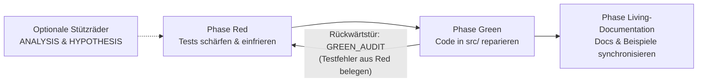

<!-- qb:frame id="CUBIE_DOC_FRAME_1" zone="head" banner="cubie-logo-written.png" -->

# Test-Guided Development (TGD)

Dieses Handbuch erklärt Test-Guided Development (TGD) für Einsteiger und Experten: Warum TGD im Kern TDD mit einer kontrollierten Rückwärtstür für fehlbare Tests ist (Karl Poppers Fallibilismus), wofür die optionalen Stützräder `ANALYSIS` und `HYPOTHESIS` dienen, wie der bewährte Fünf-Schritte-Ablauf funktioniert und warum Living Documentation jeden Zyklus abschließt.

---

> [!Note]  
> qb-cubie anerkennt explizit unsere **erkenntnistheoretischen Grenzen** im Sinne von Karl Poppers kritischem Rationalismus. Jede Aussage über ein System (und damit auch jeder Testfall als formalisierte Soll-Spezifikation) ist grundsätzlich **fehlbar** (*Fallibilismus*).  
>
> **Ein Test ist kein unfehlbares Dogma, sondern eine vorläufig bewährte Falsifikationshypothese.**  
> *Wenn du dein ganzes Leben lang nur weiße Schwäne gesehen hast …  
> ... heißt das dann, dass es keine schwarzen Schwäne gibt?*  
> **Code, Tests und Dokumentation von Cubie befinden sich in aktiver Weiterentwicklung.**

---

[README](../README.md) • [QA-Handbuch](./GUIDE_Quality-Assurance.md) • [DocEnsurance](./services/GUIDE_DocEnsurance.md)  

<!-- /qb:frame -->

## 1. Der Kern von TGD: TDD mit einer kontrollierten Rückwärtstür

Um es auf den Punkt zu bringen: **TGD ist praktisch TDD** – mit einer einzigen, aber entscheidenden Erweiterung.

* **TDD (*Test-Driven Development*)** folgt im Kern einem Zweischritt: **Phase Red** (erst den fehlschlagenden Test schreiben) $\to$ **Phase Green** (dann den Code so lange entwickeln, bis der Test grün wird).
* **TGD (*Test-Guided Development*)** folgt genau demselben Prinzip – aber **während der Phase Green darfst du das Produkt aus Phase Red hinterfragen**. Denn auch die Qualitätssicherung macht Fehler.

TGD ist also im Kern: **Phase Red $\to$ Phase Green + eine kontrollierte Tür, um während der Phase Green Fehler aus der Phase Red aufzudecken und einen Reparatur-Prozess der Test-Suite anzustoßen** – abgeschlossen durch die **Phase Living-Documentation**, damit die Dokumentation sauber bleibt und im nächsten Zyklus wieder zuverlässig genutzt werden kann.

* **Einfach erklärt (für Einsteiger):** Stell dir vor, ein Bauprüfer schreibt zuerst eine Checkliste (**Phase Red**) und ein Handwerker baut danach das Haus (**Phase Green**). Bei strengem TDD ist die Checkliste unantastbar – selbst wenn der Prüfer sich vertippt hat und versehentlich eine 20 cm hohe Haustür fordert. Bei TGD darf der Handwerker die Checkliste zwar trotzdem **nicht heimlich selbst umschreiben** (sonst könnte er sich alles schönreden), aber er hat eine **offizielle Rückwärtstür**: Er dokumentiert den Widerspruch mit klarem Beleg, stößt damit die Reparatur der Test-Suite an und geht geordnet zurück in die **Phase Red**. Wenn zum Schluss Haus und Checkliste zusammenpassen, wird noch der Bauplan aktualisiert (**Phase Living-Documentation**), damit im nächsten Projektabschnitt niemand nach veralteten Plänen arbeitet.
* **Für Experten (Karl Poppers Epistemologie & Fallibilismus):** TGD anerkennt explizit unsere **erkenntnistheoretischen Grenzen** im Sinne von Karl Poppers kritischem Rationalismus. Jede Aussage über ein System – und damit auch jeder Testfall als formalisierte Soll-Spezifikation ($Q_{\text{Soll}}$) – ist grundsätzlich **fehlbar** (*Fallibilismus*). Ein Test ist kein unfehlbares Dogma, sondern eine vorläufig bewährte Falsifikationshypothese. Während die **Phase Green** ein strenges Änderungsverbot auf `tests/` durchsetzt (um stilles *Test-Hacking* und Bestätigungsfehler zu verhindern), öffnet das Eskalations-Protokoll (`GREEN_AUDIT`) einen transparenten, falsifizierbaren Weg zurück in die **Phase Red**, sobald die Implementierung einen reproduzierbaren Widerspruch in der Test-Suite offenlegt.

---

## 2. Optionale Stützräder: Analyse & Hypothese (`ANALYSIS` & `HYPOTHESIS`)

Für einfache, klar umrissene Änderungen genügt der reine TGD-Kern (**Phase Red $\to$ Phase Green (+ Rückwärtstür) $\to$ Phase Living-Documentation**). Bei komplizierten Umbauten – und ganz besonders bei der Arbeit mit KI-Agenten – zeigt die Praxis jedoch, dass zwei vorgeschaltete **Stützräder** die Qualität massiv verbessern:

### Stützrad 1: Analyse (`ANALYSIS`) – erst verstehen, was gerade Sache ist
* **Einfach erklärt:** Bevor eine einzige Zeile Test oder Produktionscode geändert wird, untersucht man in Ruhe das bestehende System und schreibt auf, wie es sich aktuell tatsächlich verhält ($Q_{\text{Ist}}$) und was eigentlich gelten müsste ($Q_{\text{Soll}}$).
* **Warum das besonders Agenten hilft:** Bei komplexen Zusammenhängen neigen KI-Agenten dazu, vorschnell Code zu ändern, ohne alle Abhängigkeiten zu überblicken. Eine dokumentierte Analyse-Phase zwingt dazu, erst Fakten zu sammeln und ein gemeinsames Lagebild herzustellen.

### Stützrad 2: Hypothese (`HYPOTHESIS`) – wissenschaftliche Sprache statt voreiliger Gewissheit
* **Einfach erklärt:** Eine Hypothese ist eine klar formulierte Idee, *was* die eigentliche Ursache sein könnte – zusammen mit weiteren überprüfbaren Ideen, die man ausprobieren kann. Sich bewusst an diese wissenschaftliche Sprache zu halten (*„Hypothese: ...“* statt *„Beweis: ...“*), ist sauberer und robuster: Man könnte ja falsch liegen! So bleibt die Dokumentation stabil, ehrlich und ordentlich, selbst wenn eine Vermutung später widerlegt wird.
* **Wann sie sich lohnt:** Die Hypothesen-Phase ist **rein optional**, aber beim Aufbau eines neuen Testmoduls oft sehr nützlich, weil sie Denkfehler aus der Analyse noch vor der Phase Red abfängt und zu deutlich schärferen Tests führt.
* **Für Experten (Meta-QA-Fragen an die Test-Suite):** Prüfe bestehende und geplante Tests bereits in der Hypothesen-Phase auf **logische Subsumtion** ($Q_{\text{pos}} \implies \neg Q_{\text{neg}}$, bei der ein positives Ziel das Verbot bereits impliziert und das Verbot dadurch ungetestet bleibt), **prädikatenlogische Tautologien** (wie $(y \in \mathbb{Z}) \lor (y \neq 99) \equiv \top$ unter `post="exists"`), **Vacuous Passes** (`0pos/Kneg`) und **überlebende Core-Mutanten** (schlägt wirklich ein Test fehl, wenn eine Kernfunktion wie `evaluate_step_logic()` ungefixt bleibt?).

---

## 3. TGD in der Praxis: Der bewährte Fünf-Schritte-Ablauf

In der praktischen Arbeit am Cubie-Core (etwa bei der Härtung der Quantoren-Semantik) hat sich ein fünfstufiger Ablauf bewährt, der den TGD-Kern mit den optionalen Stützrädern und sauberem Test-Handwerk kombiniert. Die Schritte 1 bis 3 helfen dir, eine tragfähige Test-Suite aufzubauen; die Schritte 4 und 5 bilden den verbindlichen TGD-Kern (`tests/` $\to$ `src/` $\to$ `docs/`):

### Schritt 1 *(optional / Stützräder)*: Baseline, Exploratives Audit & Meta-QA-Hypothesenbildung (`ANALYSIS` & `HYPOTHESIS`)
Bevor eine einzige Zeile Code oder Test geändert wird, wird der Ist-Zustand ($Q_{\text{Ist}}$) gegen das gewünschte Architektur-Gesetz ($Q_{\text{Soll}}$) vermessen und in überprüfbare Hypothesen überführt:
* **Einfach erklärt:** Erst Detektivarbeit leisten (`ANALYSIS`) und überprüfbare Vermutungen samt Prüfplan aufstellen (`HYPOTHESIS`), statt blind im Code herumzuprobieren.
* **Für Experten:** Nutze diese Phase für die oben genannten Meta-QA-Prüffragen (Subsumtion, Tautologien, Vacuous Passes, Mutanten-Überleben) und halte die Ergebnisse als [`CUBIE_DOC_FRAME_2`-Bericht](dev/DEV-GUIDE_Agent-Reports.md) fest, damit die Phase Red auf einer belastbaren Grundlage startet.

### Schritt 2 *(Test-Handwerk)*: Schlanke, zustandsfreie Test-Adapter (`Stateless Adapters`)
Wenn das zu prüfende Subsystem komplexe Report-Objekte mit vielen internen Feldern zurückgibt, sollte der Test nicht an irrelevanten Implementierungsdetails kleben.
* **Einfach erklärt:** Schreibe eine winzige Hilfsfunktion (5–12 Zeilen), die das komplexe Ergebnis auf ein kleines, übersichtliches Python-Dictionary mit den wirklich wichtigen Eckdaten zusammenfasst (z. B. `{"passed": report.passed, "rules": [d.rule_id for d in report.diagnostics]}`). Dadurch bleiben die `WorldState`-Definitionen im `EBT`-Aufruf kurz und auf einen Blick lesbar.

### Schritt 3 *(Test-Handwerk)*: Äquivalenzklassen, Kantenfälle & Lebenszyklus-Invarianten statt Daten-Flut
Zwanzig fast identische Gutwetter-Tests erhöhen nur die Laufzeit, aber nicht die Sicherheit. Entscheidend ist die gezielte Abdeckung der fachlichen Äquivalenzklassen und Zustandsübergänge:
* **Positiv-Invarianz & Schwellenwerte (Off-by-One):** Repräsentative Normalfälle sowie exakte Grenzwerte (z. B. $19$ vs. $20$ Zeichen oder $30$ vs. $31$ Codezeilen).
* **Explizite `STATE-GUARD`s & Python-Typfallen:** Ungültige Konfigurationen müssen vor der Target-Ausführung mit `ValueError` oder `TypeError` (`match="STATE-GUARD"`) abgewiesen werden. Beachte dabei Python-Besonderheiten wie `issubclass(bool, int) is True`: Ein echter `bool`-Guard prüft `type(val) is bool`, damit Zahlen wie `1` oder `0` sowie `None` nicht durchrutschen.
* **Lebenszyklus- & Mutations-Übergänge:** Wenn Objekte wiederverwendet werden (wie ein `EBT`-Fall über mehrere `.run()`-Aufrufe), prüfe den gesamten Zyklus: (1) zweiter Lauf *ohne* Neuzuweisung (Quantor bleibt erhalten), (2) In-Place-Listenmutation `case.post.append(...)` bzw. Attribut-Mutation `ws.expect = False`, und (3) Attribut-Neuzuweisung `case.post = [...]` ohne Wrapper (Quantor springt sauber auf den Standard `"exists"` bzw. `"all"` zurück).

### Schritt 4 *(Kern — Phase Red)*: Test-Suite isoliert schärfen, Red-Nachweis führen & Tests einfrieren
In der Red-Phase wird **ausschließlich `tests/`** bearbeitet (`src/` und `docs/` bleiben unangetastet):
1. **Altlasten ($Q_{\text{Ist}}$) und Meta-Gates bereinigen:** Bestehende Tests, die versehentlich altes Fehlverhalten voraussetzen, werden auf die saubere $Q_{\text{Soll}}$-Deklaration (z. B. `post={"quantor": "all", "states": [...]}`) migriert; statische Wächter (`test_gate_2.py`, `test_gate_3.py`, `test_service_architecture_gate.py`) werden nach der Wächter-Kalibrierungs-Triade (Clean-Probes, Fault-Probes, Repo-Scan) aktualisiert. Alle migrierten Bestands-Tests müssen bereits gegen den aktuellen Core **100 % grün (`PASSED`)** laufen.
2. **Gezielter Red-Nachweis für neue Verträge:** Die neuen Guard-, Invarianten- und Lebenszyklus-Tests werden hinzugefügt und müssen gegen den noch unreparierten Core deterministisch **rot fehlschlagen (`FAILED`)** – das beweist, dass die neuen Tests scharf geschaltet sind und keinen überlebenden Mutanten dulden.
3. **Strikter Test-Freeze:** Sobald dieses exakte Differenzsignal (Bestand grün, neue Verträge kontrolliert rot) steht, wird die Test-Suite **eingefroren**.

### Schritt 5 *(Kern — Phase Green + Rückwärtstür & Phase Living-Documentation)*: Core reparieren & alle Schichten synchronisieren
In der Green-Phase wird zunächst **ausschließlich der Produktionscode in `src/`** repariert:
* **Unantastbarkeit der Tests & Rückwärtstür (`GREEN_AUDIT`):** Während der Core-Reparatur gilt ein striktes Änderungsverbot auf `tests/**/*.py` (keine Edits, kein `skip`, kein Abschwächen von Assertions). Taucht unterwegs der begründete Verdacht auf, dass sich in der Red-Phase ein Denkfehler oder Widerspruch in einen Test eingeschlichen hat, wird der Test **nicht** heimlich umgeschrieben, sondern ein strukturierter Befundbericht (z. B. `tests/GREEN_AUDIT.md`) mit Zeilennummer, Reproduktionsbeleg und Klärungsvorschlag angelegt. Auf Basis dieses Befunds wird der kontrollierte Rücksprung in die **Phase Red** ausgelöst, um die Test-Suite sauber zu reparieren.
* **Code-Härtung unter Stil-Gates:** Der Core wird innerhalb der harten Architektur-Grenzen (`MODULE_LIMIT = 777` Zeilen, `FUNCTION_LIMIT = 12` physische Body-Zeilen, einzeilige Docstrings, `0` Fehler in `ruff`, `pylint` und `mypy --warn-unreachable`) repariert, bis alle zuvor roten Tests auf **`PASSED`** springen.
* **Phase Living-Documentation (`DocEnsurance` & `DocFrame`):** Sobald ein neuer `STATE-GUARD` oder eine geänderte API im Core scharf geschaltet ist, meldet sich automatisch die vierte orthogonale Schicht (`tests/test_doc_ensurance.py::test_docs_code_examples` und `tests/test_doc_frame.py::test_docs_frames`) und zeigt auf jedes Code-Beispiel oder jeden Dokumentrahmen in `docs/`, der noch veraltete Muster nutzt. Erst wenn auch die Handbücher aktualisiert sind und `pytest` über alle Schichten (`EBT`, `Meta-Gates`, `Linter`, `DocEnsurance` / `DocFrame`) komplett grün läuft, ist der TGD-Zyklus abgeschlossen – und die Dokumentation steht im nächsten Zyklus wieder als verlässliche Wahrheitsquelle bereit.

---

> [!TIP]
> **Der gesamte TGD-Fluss durch orchestrierende Agenten benötigt eine starke Orchestrierung.**  
> Gebe den Agenten daher nur einen Schritt auf einmal und orchestriere es selbst, wenn es wirklich eine hohe Qualität erfordert. Dann weißt du, dass alles richtig gemacht wird und kannst flexibel eingreifen.  
>
> **Der Gesamt-Durchlauf durch orchestrierende Agenten sollte noch als experimentell verstanden werden.**

> [!TIP]
> **Der gesamte TGD-Fluss durch voll-autonom agierende Agenten könnte funktionieren.**  
> Ich habe die Details noch nicht genau geprüft, aber es schien ziemlich gut gelaufen zu sein.

---

## 4. Kurzreferenz: Minimaler Kern vs. voller Ablauf mit Stützrädern

| Einsatzfall | Empfohlene Phasen | Ziel |
| :--- | :--- | :--- |
| **Kleine, klar umrissene Änderung** | `Phase Red` $\to$ `Phase Green` (+ `GREEN_AUDIT`-Tür bei Testfehlern) $\to$ `Phase Living-Documentation` | Schneller, sauberer TDD-Zyklus mit ehrlicher Fehlerkultur für Tests und aktueller Doku. |
| **Komplexe Architektur-Änderung oder KI-Agenten-Einsatz** | `ANALYSIS` *(Stützrad)* $\to$ `HYPOTHESIS` *(Stützrad)* $\to$ `Phase Red` (Adapter, Äquivalenzklassen, Freeze) $\to$ `Phase Green` (+ `GREEN_AUDIT`-Tür) $\to$ `Phase Living-Documentation` | Erstes Verständnis absichern, Denkfehler vor dem Testbau abfangen und alle Prüfschichten verlässlich synchron halten. |

<!-- qb:frame id="CUBIE_DOC_FRAME_1" zone="foot" -->

---

---

[↦ | Vertragsaufbau: Eindeutigkeit & Kopplung | ↤](./GUIDE_Contract-Design.md)  
[↦ | Erwartungssteuerung & Safety (`expect`-Flags) | ↤](./GUIDE_Expect-Flags.md)  
[↦ | Qualitätssicherung mit Cubie | ↤](./GUIDE_Quality-Assurance.md)  
[↦ | Fortgeschrittene Quantoren (`all` vs. `exists`) | ↤](./GUIDE_Quantifiers.md)  
[↦ | Test-Guided Development (TGD) | ↤](./GUIDE_TGD.md)  

[↦ | GUIDE: `DocEnsurance` – Lebende und verifizierte Dokumentation | ↤](./services/GUIDE_DocEnsurance.md)  
[↦ | DocFrame (Prototyp) | ↤](./services/GUIDE_DocFrame.md)  

[↦ | Dokumentations-Übersicht | ↤](./README.md)  
[↦ | Core-Dokumentation | ↤](./core/README.md)  
[↦ | Entwicklerdokumentation | ↤](./dev/README.md)  
[↦ | Core-Internals | ↤](./dev/core/README.md)  
[↦ | Hintergrund & Essays | ↤](./misc/README.md)  
[↦ | Feature-Drafts: Virtualisierung | ↤](./feature-drafts/virtualization/README.md)  

<!-- /qb:frame -->
