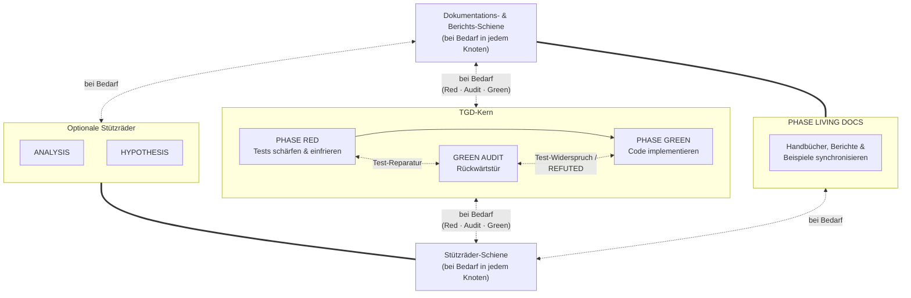

<!-- qb:frame id="CUBIE_DOC_FRAME_1" zone="head" banner="cubie-logo-written.png" -->

# Test-Guided Development (TGD)

Dieses Handbuch erklärt Test-Guided Development (TGD) für Einsteiger und Experten: Warum TGD im Kern TDD mit einer kontrollierten Rückwärtstür für fehlbare Tests ist (Karl Poppers Fallibilismus), wie die optionalen Stützräder (`ANALYSIS` & `HYPOTHESIS`) und die Dokumentations-Ebene (`PHASE LIVING DOCS`) symmetrisch mit jedem Knoten zusammenspielen, wie ein exemplarischer Fünf-Schritte-Ablauf aussieht und wo die operativen [TGD-Knoten-Handbücher (`docs/tgd/`)](tgd/README.md) zu finden sind.

---

> [!NOTE]  
> qb-cubie anerkennt explizit unsere **erkenntnistheoretischen Grenzen** im Sinne von Karl Poppers kritischem Rationalismus. Jede Aussage über ein System (und damit auch jeder Testfall als formalisierte Soll-Spezifikation) ist grundsätzlich **fehlbar** (*Fallibilismus*).  
>
> **Ein Test ist kein unfehlbares Dogma, sondern eine vorläufig bewährte Falsifikationshypothese.**  
> *Wenn du dein ganzes Leben lang nur weiße Schwäne gesehen hast …  
> ... heißt das dann, dass es keine schwarzen Schwäne gibt?*  
> **Code, Tests und Dokumentation von Cubie befinden sich in aktiver Weiterentwicklung.**

---

[README](../README.md) • [QA-Handbuch](./GUIDE_Quality-Assurance.md) • [DocEnsurance](./services/GUIDE_DocEnsurance.md)  

<!-- /qb:frame -->

## 1. Der Kern von TGD: TDD mit einer kontrollierten Rückwärtstür

Um es auf den Punkt zu bringen: **TGD ist praktisch TDD** – mit einer einzigen, aber entscheidenden Erweiterung.

* **TDD (*Test-Driven Development*)** folgt im Kern einem Zweischritt: **Phase Red** (erst den fehlschlagenden Test schreiben) $\to$ **Phase Green** (dann den Code so lange entwickeln, bis der Test grün wird).
* **TGD (*Test-Guided Development*)** folgt genau demselben Prinzip – aber **während der Phase Green darfst du das Produkt aus Phase Red hinterfragen**. Denn auch die Qualitätssicherung macht Fehler.

Der klassische Kernzyklus von TGD besteht daher aus **Phase Red $\to$ Phase Green** – ergänzt um eine **kontrollierte Rückwärtstür (`GREEN_AUDIT`)**, falls sich während der Phase Green ein Denkfehler oder Widerspruch in einem Test aus Phase Red zeigt. Im besten Fall läuft der Kern glatt durch und braucht gar kein `GREEN_AUDIT`.

Flankiert wird dieser Kern symmetrisch von zwei querschnittlichen Bausteinen, die **bei Bedarf mit jedem Knoten** zusammenspielen:
1. **Links — Optionale Stützräder (`ANALYSIS` & `HYPOTHESIS`):** Können jederzeit zugeschaltet werden, wenn der Kontext erst vermessen oder ein Entwurf bzw. eine Test-Suite kritisch durchdacht werden soll.
2. **Rechts — `PHASE LIVING DOCS` (Dokumentation & Berichte):** Einerseits die abschließende Phase zur Synchronisation der Produkt-Handbücher, andererseits eine durchgehende Ebene im gesamten Workflow – denn in jedem Knoten greifen wir auf Dokumentation zurück und halten Erkenntnisse über Berichte oder Protokolle fest.

Wichtig dabei: **TGD ist kein starr verdrahteter Zustandsautomat, sondern ein symmetrischer Baukasten aus klar getrennten Rollen.** Je nach Komplexität der Aufgabe kombinierst du ihn so schlank oder so gründlich, wie es die Situation verlangt.

* **Einfach erklärt (für Einsteiger):** Stell dir eine Baustelle mit drei klaren Bereichen vor. **In der Mitte** passiert die eigentliche Bauarbeit: Zuerst legt der Bauprüfer die verbindliche Checkliste fest (**Phase Red**), dann baut der Handwerker danach (**Phase Green**). Bei strengem TDD wäre die Checkliste selbst dann unantastbar, wenn der Prüfer sich vertippt hat und eine 20 cm hohe Haustür fordert. Bei TGD darf der Handwerker die Checkliste zwar trotzdem **nicht heimlich selbst umschreiben**, hat aber eine **offizielle Rückwärtstür (`GREEN_AUDIT`)**, über die ein belegter Mangel sauber geprüft und repariert wird. **Links** stehen zwei Helfer auf Abruf bereit (**`ANALYSIS`** zum Nachmessen, **`HYPOTHESIS`** zum Durchdenken auf dem Papier), die bei jeder unklaren Stelle dazugerufen werden können. Und **rechts** liegt das Bauplan- und Berichts-Archiv (**`PHASE LIVING DOCS`**): Schon während der Arbeit fließen kurze Notizen und Berichte in den jeweiligen Schritten mit, und zum Abschluss werden die offiziellen Baupläne sauber auf den echten Endstand gebracht.
* **Für Experten (Karl Poppers Epistemologie & Fallibilismus):** TGD anerkennt explizit unsere **erkenntnistheoretischen Grenzen** im Sinne von Karl Poppers kritischem Rationalismus. Jede Aussage über ein System – und damit auch jeder Testfall als formalisierte Soll-Spezifikation ($Q_{\text{Soll}}$) – ist grundsätzlich **fehlbar** (*Fallibilismus*). Ein Test ist kein unfehlbares Dogma, sondern eine vorläufig bewährte Falsifikationshypothese. Während **Phase Green** ein strenges Änderungsverbot auf `tests/` durchsetzt (um stilles *Test-Hacking* und Bestätigungsfehler zu verhindern), öffnet **`GREEN_AUDIT`** einen transparenten, falsifizierbaren Weg zur minimal-invasiven Test-Korrektur (oder zur Widerlegung des Audits via `REFUTED`). Gleichzeitig bilden die optionalen Stützräder (links) und die lebende Dokumentation (rechts) zwei symmetrische Rückkopplungsschienen um den Kern herum.

---

## 2. Die zwei symmetrischen Schienen: Stützräder & Living Docs

Neben dem eigentlichen TGD-Kern (`PHASE RED`, `PHASE GREEN`, `GREEN AUDIT`) sorgen die beiden äußeren Blöcke dafür, dass Wissen sauber entsteht und nicht verloren geht. Beide sind **keine** starren Einzelpositionen an Anfang oder Ende einer Kette, sondern können situativ an jedem Knoten ansetzen.

### Schiene 1 (links / unten): Optionale Stützräder (`ANALYSIS` & `HYPOTHESIS`)

* **Stützrad `ANALYSIS` – erst verstehen, was gerade Sache ist:** Bevor etwas verändert wird, vermisst man in Ruhe den Ist-Zustand ($Q_{\text{Ist}}$) gegen das Ziel ($Q_{\text{Soll}}$). Das verhindert vorschnelles Ändern nicht nur vor dem ersten Test, sondern genauso beim Isolieren eines unerwarteten Fehlschlags in `PHASE GREEN` oder vor einem größeren Umbau in `PHASE LIVING DOCS`.
* **Stützrad `HYPOTHESIS` – wissenschaftliche Sprache statt voreiliger Gewissheit:** Eine Hypothese formuliert eine überprüfbare Vermutung (*„Hypothese: ...“* statt *„Beweis: ...“*) samt Risiko und klarem Falsifikationskriterium. So bleibt die Arbeit selbst dann ehrlich und verwertbar, wenn eine Idee widerlegt wird.
* **Für Experten (Vier-Säulen-Meta-QA):** In der Hypothesen-Arbeit werden geplante oder frisch geschriebene Tests gezielt auf vier formale Schwachstellen abgeklopft:
  1. **Logische Subsumtion** ($Q_{\text{pos}} \implies \neg Q_{\text{neg}}$: Ein positives Ziel impliziert das Verbot bereits, wodurch das Verbot nie eigenständig geprüft wird),
  2. **Prädikatenlogische Tautologien** (z. B. $(y \in \mathbb{Z}) \lor (y \neq 99) \equiv \top$ unter `post="exists"`),
  3. **Vacuous Passes** (`0pos/Kneg`: Ein Test wird grün, weil gar kein relevanter Prüfgegenstand getroffen wurde),
  4. **Überlebende Core-Mutanten** (Schlägt wirklich ein Test fehl, wenn eine Kernfunktion fehlerhaft bleibt?).

### Schiene 2 (rechts / oben): Lebende Dokumentation & Berichte (`PHASE LIVING DOCS`)

Warum verbindet die obere Schiene `PHASE LIVING DOCS` symmetrisch mit **allen** anderen Knoten?

* **Begleitende Berichte & Lese-Basis in jedem Knoten:** In der Praxis aktualisieren oder nutzen wir die Dokumentations-Ebene in fast jedem Schritt: `ANALYSIS` und `HYPOTHESIS` schreiben eigene Berichte, `PHASE RED` liest bestehende Handbücher und Verträge, `PHASE GREEN` prüft Doku-Gates beobachtend (und protokolliert ggf. einen `GREEN_AUDIT`-Bericht), und `GREEN_AUDIT` schließt sein Prüfprotokoll sauber ab.
* **Saubere Trennung bei Produkt-Handbüchern:** Trotz dieser durchgehenden Verknüpfung bleibt die Schreibgrenze jedes Knotens klar geschützt. Während Berichte, Run-Dokumente und Protokolle ihren jeweiligen Knoten begleiten, werden die **produktiven Produkt-Handbücher** und ausführbaren Beispiele erst gezielt in der eigenen Rolle **`PHASE LIVING DOCS`** streng gegen den realen Quellcode (*Code als Wahrheitsquelle*) synchronisiert.

### Zusammenspiel der beiden Schienen in der Praxis

| Knoten / Situation | Einsatz der Stützräder (`ANALYSIS` / `HYPOTHESIS`) | Berührung mit Doku & Berichten (`LIVING DOCS`) |
| :--- | :--- | :--- |
| **Vor oder in `PHASE RED`** | Ist-Vermessung ($Q_{\text{Ist}}$ vs. $Q_{\text{Soll}}$), Design-Alternativen oder *Post-Red-Kritik* zur Härtung frischer Tests. | Bestehende Handbücher als Vertrags-Referenz lesen; ggf. Analyse-/Hypothesenberichte als Grundlage ablegen. |
| **In `PHASE GREEN`** | Bei überraschenden Fehlschlägen erst isoliert analysieren statt blind am Code zu schrauben. | Doku-Gates rein diagnostisch prüfen (Produkt-Handbücher bleiben eingefroren) und bei Test-Widerspruch ein Audit-Protokoll verfassen. |
| **In `GREEN AUDIT`** | Das gemeldete Audit-Protokoll im frischen Kontext selbst als widerlegbare Hypothese prüfen und Alternativen abwägen. | Eigenständige Reproduktion, Urteil (`RESOLVED` / `REFUTED`) und Begründung sauber im Audit-Protokoll dokumentieren. |
| **In `PHASE LIVING DOCS`** | Bei größeren Doku-Umbauten vorab betroffene Handbücher, Querverweise und Drift-Stellen per `ANALYSIS` erfassen. | Produkt-Handbücher, ausführbare Beispiele und Rahmen gegen den realen Code synchronisieren und als neue Wahrheitsquelle bereitstellen. |

---

## 3. TGD in der Praxis: Ein exemplarischer Fünf-Schritte-Ablauf

Der bekannte Ablauf `OPTIONAL: ANALYSIS → OPTIONAL: HYPOTHESIS → PHASE_RED → PHASE_GREEN → OPTIONAL: GREEN_AUDIT → PHASE_LIVING_DOCS` ist kein starres Gesetz, sondern eine **situativ bewährte Zusammenstellung** aus der praktischen Arbeit am Cubie-Core (etwa bei der Härtung der Quantoren-Semantik).

Das folgende Fünf-Schritte-Muster zeigt exemplarisch, wie sich die Stützräder, sauberes Test-Handwerk und der TGD-Kern bei einer anspruchsvollen Aufgabe kombinieren lassen. Bei einfachen Aufgaben überspringst du die optionalen Schritte einfach und startest direkt in Schritt 4.

### Schritt 1 *(optional — situatives Stützrad)*: Baseline, Bestandsaufnahme & Meta-QA-Hypothesen (`ANALYSIS` & `HYPOTHESIS`)
Bei größeren Änderungen lohnt es sich, vor der ersten Zeile Test- oder Produktivcode den Ist-Zustand ($Q_{\text{Ist}}$) gegen das gewünschte Architektur-Gesetz ($Q_{\text{Soll}}$) zu vermessen und in überprüfbare Hypothesen zu überführen:
* **Einfach erklärt:** Erst Detektivarbeit leisten (`ANALYSIS`) und überprüfbare Vermutungen samt Prüfplan aufstellen (`HYPOTHESIS`), statt blind im Code herumzuprobieren.
* **Für Experten:** Nutze diese Phase für die vier Meta-QA-Prüffragen aus Abschnitt 2 (Subsumtion, Tautologien, Vacuous Passes, Mutanten-Überleben) und halte konkurrierende Design-Alternativen mit klaren Falsifikationskriterien fest. Die operativen Leitlinien stehen in [`NODE_ANALYSIS`](tgd/NODE_ANALYSIS.md) und [`NODE_HYPOTHESIS`](tgd/NODE_HYPOTHESIS.md).

### Schritt 2 *(Test-Handwerk)*: Schlanke, zustandsfreie Test-Adapter (`Stateless Adapters`)
Wenn das zu prüfende Subsystem komplexe Report-Objekte mit vielen internen Feldern zurückgibt, sollte der Test nicht an irrelevanten Implementierungsdetails kleben.
* **Einfach erklärt:** Schreibe eine winzige Hilfsfunktion (5–12 Zeilen), die das komplexe Ergebnis auf ein kleines, übersichtliches Python-Dictionary mit den wirklich wichtigen Eckdaten zusammenfasst (z. B. `{"passed": report.passed, "rules": [d.rule_id for d in report.diagnostics]}`). Dadurch bleiben die `WorldState`-Definitionen im `EBT`-Aufruf kurz und auf einen Blick lesbar.

### Schritt 3 *(Test-Handwerk)*: Äquivalenzklassen, Kantenfälle & Lebenszyklus-Invarianten statt Daten-Flut
Zwanzig fast identische Gutwetter-Tests erhöhen nur die Laufzeit, aber nicht die Sicherheit. Entscheidend ist die gezielte Abdeckung der fachlichen Äquivalenzklassen und Zustandsübergänge:
* **Positiv-Invarianz & Schwellenwerte (Off-by-One):** Repräsentative Normalfälle sowie exakte Grenzwerte (z. B. $19$ vs. $20$ Zeichen oder $30$ vs. $31$ Codezeilen).
* **Explizite `STATE-GUARD`s & Python-Typfallen:** Ungültige Konfigurationen müssen vor der Target-Ausführung mit `ValueError` oder `TypeError` (`match="STATE-GUARD"`) abgewiesen werden. Beachte dabei Python-Besonderheiten wie `issubclass(bool, int) is True`: Ein echter `bool`-Guard prüft `type(val) is bool`, damit Zahlen wie `1` oder `0` sowie `None` nicht durchrutschen.
* **Lebenszyklus- & Mutations-Übergänge:** Wenn Objekte wiederverwendet werden (wie ein `EBT`-Fall über mehrere `.run()`-Aufrufe), prüfe den gesamten Zyklus: (1) zweiter Lauf *ohne* Neuzuweisung (Quantor bleibt erhalten), (2) In-Place-Listenmutation `case.post.append(...)` bzw. Attribut-Mutation `ws.expect = False`, und (3) Attribut-Neuzuweisung `case.post = [...]` ohne Wrapper (Quantor springt sauber auf den Standard `"exists"` bzw. `"all"` zurück).

### Schritt 4 *(TGD-Kern — Phase Red)*: Test-Suite isoliert schärfen, Red-Nachweis führen & Tests einfrieren
In der Red-Phase wird ausschließlich die **Test-Suite** bearbeitet (Quellcode und Produkt-Handbücher bleiben unberührt): Bestehende Altlasten ($Q_{\text{Ist}}$) werden auf $Q_{\text{Soll}}$ migriert (Bestand 100 % grün), neue Verträge und Wächter gezielt gegen den noch unreparierten Code **rot** nachgewiesen (Differenzsignal) und anschließend als **Test-Freeze** eingefroren. Bei kritischen Test-Suites kann optional noch vor dem endgültigen Freeze eine kurze `HYPOTHESIS`-Runde (*Post-Red-Kritik*) eingeschoben werden.

👉 **Operativer Knoten-Vertrag (Pre-Flight, Fixture-Hygiene, Wächter-Kalibrierung & Abnahme):** [`NODE_PHASE_RED`](tgd/NODE_PHASE_RED.md)

### Schritt 5 *(TGD-Kern — Phase Green + optionale Rückwärtstür & Phase Living-Documentation)*: Code reparieren & Schichten synchronisieren
Nach dem Test-Freeze folgen die Implementierung und die abschließende Dokumentations-Synchronisation in klar getrennten Rollen:
* **Phase Green (Implementierung unter Freeze):** Ausschließlich der Quellcode wird innerhalb der Architektur-, Linter- und Stil-Gates repariert, bis alle eingefrorenen Verträge grün laufen — ohne stilles Test-Hacking und ohne vorgezogene Edits an Produkt-Handbüchern. Operative Details stehen in [`NODE_PHASE_GREEN`](tgd/NODE_PHASE_GREEN.md).
* **Optionale Rückwärtstür (`GREEN_AUDIT`):** Im Idealfall wird dieser Schritt gar nicht gebraucht. Deckt die Implementierung jedoch einen echten, reproduzierbaren Widerspruch in einem Test aus Phase Red auf, wird der Test nicht heimlich geändert, sondern über ein strukturiertes Audit-Protokoll an den eigenständigen Rücksprung-Knoten [`NODE_GREEN_AUDIT`](tgd/NODE_GREEN_AUDIT.md) übergeben (unabhängige Prüfung mit klarem Ausgang `RESOLVED` oder `REFUTED`).
* **Phase Living-Documentation:** Zum Abschluss synchronisiert [`NODE_LIVING_DOCS`](tgd/NODE_LIVING_DOCS.md) Handbücher, ausführbare Beispiele und Dokumentrahmen strikt nach dem Prinzip *Code als Wahrheitsquelle* (`0` Änderungen an Quellcode und Tests), sodass die Dokumentation im nächsten Zyklus wieder als verlässliche Wahrheitsquelle bereitsteht.

---

> [!TIP]
> **Best-Practice: Manuelle Orchestrierung**  
> Wenn es wirklich eine hohe Qualität erfordert, dann gebe den Agenten nur einen Schritt auf einmal und orchestriere es selbst.  
> Denn dann weißt du, dass alles richtig gemacht wird und kannst flexibel eingreifen.  

> [!TIP]
> **Der gesamte TGD-Fluss durch voll-autonom agierende Agenten könnte funktionieren.**

> [!TIP]
> **Der Gesamt-Durchlauf durch orchestrierende Agenten sollte noch als experimentell verstanden werden.**

---

## 4. Kurzreferenz: Kontextabhängige Wahl & Knoten-Handbücher

Je nach Situation kombinierst du die TGD-Bausteine so schlank oder so gründlich, wie es die Aufgabe verlangt:

| Situation / Komplexität | Typische Baustein-Kombination | Ziel |
| :--- | :--- | :--- |
| **Kleiner, klar umrissener Bugfix oder Mini-Feature** | `Phase Red` $\to$ `Phase Green` $\to$ `Phase Living-Documentation` | Schneller, sauberer TGD-Kern ohne unnötigen Overhead. |
| **Unerwarteter Test-Widerspruch während `Phase Green`** | `Phase Green` $\to$ `GREEN_AUDIT` *(+ ggf. `ANALYSIS`/`HYPOTHESIS`)* $\to$ `Phase Living-Documentation` *(oder zurück zu `Phase Green`)* | Fehler in Tests aus Phase Red ehrlich aufdecken und minimal-invasiv beheben, statt Assertions aufzuweichen. |
| **Komplexer Architektur-Umbau oder mehrschrittiger Agenten-Einsatz** | `ANALYSIS` $\to$ `HYPOTHESIS` $\to$ `Phase Red` *(+ optional Post-Red-`HYPOTHESIS`)* $\to$ `Phase Green` *(+ `GREEN_AUDIT` bei Bedarf)* $\to$ `Phase Living-Documentation` | Erstes Verständnis absichern, Denkfehler vor dem Testbau abfangen und alle Prüfschichten verlässlich synchron halten. |

* **Operative Knoten-Handbücher (für Menschen & KI-Agenten):** [TGD-Knoten-Handbücher (`docs/tgd/`)](tgd/README.md) mit den sechs Einzelverträgen ([`ANALYSIS`](tgd/NODE_ANALYSIS.md), [`HYPOTHESIS`](tgd/NODE_HYPOTHESIS.md), [`PHASE_RED`](tgd/NODE_PHASE_RED.md), [`PHASE_GREEN`](tgd/NODE_PHASE_GREEN.md), [`GREEN_AUDIT`](tgd/NODE_GREEN_AUDIT.md), [`LIVING_DOCS`](tgd/NODE_LIVING_DOCS.md)).
* **Konkretes `qb-cubie`-Projekt-Profil (Kommandos, Minimal-Runs, Gates & `PM1`–`PM8`):** [`DEV-GUIDE: TGD-Workflow-Profil für qb-cubie`](dev/DEV-GUIDE_TGD-Workflow.md).

<!-- qb:frame id="CUBIE_DOC_FRAME_1" zone="foot" -->

---

---

[↦ | Vertragsaufbau: Eindeutigkeit & Kopplung | ↤](./GUIDE_Contract-Design.md)  
[↦ | Erwartungssteuerung & Safety (`expect`-Flags) | ↤](./GUIDE_Expect-Flags.md)  
[↦ | Qualitätssicherung mit Cubie | ↤](./GUIDE_Quality-Assurance.md)  
[↦ | Fortgeschrittene Quantoren (`all` vs. `exists`) | ↤](./GUIDE_Quantifiers.md)  
[↦ | Test-Guided Development (TGD) | ↤](./GUIDE_TGD.md)  

[↦ | Service-Core | ↤](./services/GUIDE_Service-Core.md)  
[↦ | GUIDE: `DocEnsurance` – Lebende und verifizierte Dokumentation | ↤](./services/GUIDE_DocEnsurance.md)  
[↦ | DocFrame (Prototyp) | ↤](./services/GUIDE_DocFrame.md)  

[↦ | Dokumentations-Übersicht | ↤](./README.md)  
[↦ | Core-Dokumentation | ↤](./core/README.md)  
[↦ | Entwicklerdokumentation | ↤](./dev/README.md)  
[↦ | Core-Internals | ↤](./dev/core/README.md)  
[↦ | Hintergrund & Essays | ↤](./misc/README.md)  
[↦ | Feature-Drafts: Virtualisierung | ↤](./feature-drafts/virtualization/README.md)  

<!-- /qb:frame -->