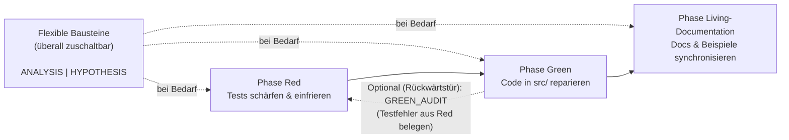

<!-- qb:frame id="CUBIE_DOC_FRAME_1" zone="head" banner="cubie-logo-written.png" -->

# Test-Guided Development (TGD)

Dieses Handbuch erklärt Test-Guided Development (TGD) für Einsteiger und Experten: Warum TGD im Kern TDD mit einer kontrollierten Rückwärtstür für fehlbare Tests ist (Karl Poppers Fallibilismus), wie sich die optionalen Bausteine `ANALYSIS` und `HYPOTHESIS` flexibel in **jeder** Phase zuschalten lassen, wie ein exemplarischer Fünf-Schritte-Ablauf aussieht und wo die operativen [TGD-Knoten-Handbücher (`docs/tgd/`)](tgd/README.md) zu finden sind.

---

> [!NOTE]  
> qb-cubie anerkennt explizit unsere **erkenntnistheoretischen Grenzen** im Sinne von Karl Poppers kritischem Rationalismus. Jede Aussage über ein System (und damit auch jeder Testfall als formalisierte Soll-Spezifikation) ist grundsätzlich **fehlbar** (*Fallibilismus*).  
>
> **Ein Test ist kein unfehlbares Dogma, sondern eine vorläufig bewährte Falsifikationshypothese.**  
> *Wenn du dein ganzes Leben lang nur weiße Schwäne gesehen hast …  
> ... heißt das dann, dass es keine schwarzen Schwäne gibt?*  
> **Code, Tests und Dokumentation von Cubie befinden sich in aktiver Weiterentwicklung.**

---

[README](../README.md) • [QA-Handbuch](./GUIDE_Quality-Assurance.md) • [DocEnsurance](./services/GUIDE_DocEnsurance.md)  

<!-- /qb:frame -->

## 1. Der Kern von TGD: TDD mit einer kontrollierten Rückwärtstür

Um es auf den Punkt zu bringen: **TGD ist praktisch TDD** – mit einer einzigen, aber entscheidenden Erweiterung.

* **TDD (*Test-Driven Development*)** folgt im Kern einem Zweischritt: **Phase Red** (erst den fehlschlagenden Test schreiben) $\to$ **Phase Green** (dann den Code so lange entwickeln, bis der Test grün wird).
* **TGD (*Test-Guided Development*)** folgt genau demselben Prinzip – aber **während der Phase Green darfst du das Produkt aus Phase Red hinterfragen**. Denn auch die Qualitätssicherung macht Fehler.

Der verbindliche Kern von TGD besteht daher aus drei Schritten: **Phase Red $\to$ Phase Green $\to$ Phase Living-Documentation**. Im besten Fall läuft dieser Kern glatt durch und braucht keinerlei Umwege. Wenn sich während der **Phase Green** jedoch herausstellt, dass wir in der **Phase Red** einen Denkfehler gemacht oder eine falsche Annahme festgeschrieben haben, öffnet TGD eine **kontrollierte Rückwärtstür (`GREEN_AUDIT`)**, um den Test sauber zu hinterfragen und zu reparieren – statt ihn heimlich umzuschreiben.

Wichtig dabei: **TGD ist kein starr verdrahteter Zustandsautomat, sondern ein Baukasten aus klar getrennten Rollen.** Je nach Aufgabe und Komplexität wählst du einen ganz schlanken Durchlauf oder schaltest bei Bedarf zusätzliche Denk- und Prüfbausteine (`ANALYSIS` und `HYPOTHESIS`) genau dort dazu, wo sie gerade helfen.

* **Einfach erklärt (für Einsteiger):** Stell dir vor, ein Bauprüfer schreibt zuerst eine Checkliste (**Phase Red**) und ein Handwerker baut danach das Haus (**Phase Green**). Im Idealfall passt alles auf Anhieb und am Ende wird nur noch der Bauplan aktualisiert (**Phase Living-Documentation**). Bei strengem TDD wäre die Checkliste jedoch selbst dann unantastbar, wenn der Prüfer sich vertippt hat und versehentlich eine 20 cm hohe Haustür fordert. Bei TGD darf der Handwerker die Checkliste zwar trotzdem **nicht heimlich selbst umschreiben** (sonst könnte er sich alles schönreden), aber er hat eine **offizielle Rückwärtstür**: Er dokumentiert den Widerspruch mit klarem Beleg und stößt über **`GREEN_AUDIT`** eine gezielte Reparatur der Checkliste an. Und immer wenn auf der Baustelle etwas unklar ist, darf jederzeit kurz nachgemessen (**`ANALYSIS`**) oder ein Plan auf dem Papier durchdacht (**`HYPOTHESIS`**) werden.
* **Für Experten (Karl Poppers Epistemologie & Fallibilismus):** TGD anerkennt explizit unsere **erkenntnistheoretischen Grenzen** im Sinne von Karl Poppers kritischem Rationalismus. Jede Aussage über ein System – und damit auch jeder Testfall als formalisierte Soll-Spezifikation ($Q_{\text{Soll}}$) – ist grundsätzlich **fehlbar** (*Fallibilismus*). Ein Test ist kein unfehlbares Dogma, sondern eine vorläufig bewährte Falsifikationshypothese. Während die **Phase Green** ein strenges Änderungsverbot auf `tests/` durchsetzt (um stilles *Test-Hacking* und Bestätigungsfehler zu verhindern), öffnet das Eskalations-Protokoll (`GREEN_AUDIT`) einen transparenten, falsifizierbaren Weg zurück zur Test-Korrektur, sobald die Implementierung einen reproduzierbaren Widerspruch in der Test-Suite offenlegt.

---

## 2. Flexible Stützräder: Analyse & Hypothese (überall zuschaltbar)

Neben dem TGD-Kern kennt TGD zwei optionale **Stützräder**: **`ANALYSIS`** und **`HYPOTHESIS`**. Beide sind **keine** festen Vorstufen, die man nur ganz am Anfang vor der Phase Red nutzen dürfte. Vielmehr sind es modulare Denk- und Prüfwerkzeuge, die sich **in jedem Knoten und an jeder Stelle des Ablaufs** zuschalten lassen, sobald der Kontext es erfordert.

### Stützrad 1: Analyse (`ANALYSIS`) – erst verstehen, was gerade Sache ist
* **Einfach erklärt:** Bevor etwas verändert wird, schaut man in Ruhe nach, wie der Ist-Zustand tatsächlich aussieht ($Q_{\text{Ist}}$) und was eigentlich gelten müsste ($Q_{\text{Soll}}$). Man misst erst nach, statt blind loszulegen.
* **Warum das überall hilft:** Nicht nur vor dem ersten Test, sondern auch mitten in einer Implementierung oder beim Aufräumen von Dokumentationen neigen Menschen wie KI-Agenten dazu, vorschnell zu handeln, ohne alle Abhängigkeiten zu überblicken. Eine kurze Analyse-Schleife zwingt dazu, erst Belege zu sammeln.

### Stützrad 2: Hypothese (`HYPOTHESIS`) – wissenschaftliche Sprache statt voreiliger Gewissheit
* **Einfach erklärt:** Eine Hypothese ist eine klar formulierte Vermutung, *was* die Ursache eines Problems sein könnte oder *wie* eine Lösung funktionieren sollte – zusammen mit der Frage, woran man merken würde, falls man falsch liegt. Sich bewusst an diese wissenschaftliche Sprache zu halten (*„Hypothese: ...“* statt *„Beweis: ...“*), hält die Arbeit ehrlich und ordentlich, selbst wenn eine Vermutung später widerlegt wird.
* **Für Experten (Meta-QA-Fragen an Verträge & Test-Suiten):** In der Hypothesen-Arbeit werden geplante oder frisch geschriebene Tests gezielt auf vier formale Schwachstellen abgeklopft:
  1. **Logische Subsumtion** ($Q_{\text{pos}} \implies \neg Q_{\text{neg}}$: Ein positives Ziel impliziert das Verbot bereits, wodurch das Verbot nie eigenständig geprüft wird),
  2. **Prädikatenlogische Tautologien** (z. B. $(y \in \mathbb{Z}) \lor (y \neq 99) \equiv \top$ unter `post="exists"`),
  3. **Vacuous Passes** (`0pos/Kneg`: Ein Test wird grün, weil gar kein relevanter Prüfgegenstand getroffen wurde),
  4. **Überlebende Core-Mutanten** (Schlägt wirklich ein Test fehl, wenn eine Kernfunktion fehlerhaft bleibt?).

### Wo sich `ANALYSIS` und `HYPOTHESIS` in der Praxis zuschalten lassen

| Situation im Ablauf | Sinnvoller Baustein | Konkreter Nutzen |
| :--- | :--- | :--- |
| **Vor `Phase Red`** *(bei komplexen Umbauten oder unklaren Bugs)* | `ANALYSIS` $\to$ `HYPOTHESIS` | Bestehende Abhängigkeiten vermessen ($Q_{\text{Ist}}$ vs. $Q_{\text{Soll}}$), Lösungsalternativen abwägen und Denkfehler vor dem ersten Test abfangen. |
| **In oder direkt nach `Phase Red`** *(vor dem endgültigen Test-Freeze)* | `HYPOTHESIS` *(Post-Red-Kritik)* | Frisch geschriebene Tests mit frischem Blick auf Subsumtion, Tautologien, Vacuous Passes und Mutanten-Lücken prüfen und härten. |
| **Mitten in `Phase Green`** *(bei überraschendem Fehlschlag)* | `ANALYSIS` / `HYPOTHESIS` | Statt blind am Code herumzudoktern: erst isoliert prüfen, ob der Fehler im Quellcode oder doch in einer fehlerhaften Test-Annahme (`GREEN_AUDIT`) liegt. |
| **In `GREEN_AUDIT`** *(bei gemeldetem Test-Widerspruch)* | `ANALYSIS` + `HYPOTHESIS` | Das Audit-Protokoll selbst als widerlegbare Hypothese behandeln: unabhängig reproduzieren, Alternativen abwägen und minimal-invasiv entscheiden. |
| **Vor oder in `Phase Living-Documentation`** *(bei größeren Doku-Umbauten)* | `ANALYSIS` | Betroffene Handbücher, Querverweise und Drift-Stellen systematisch erfassen, bevor Texte umgebaut werden. |

---

## 3. TGD in der Praxis: Ein exemplarischer Fünf-Schritte-Ablauf

Der bekannte Ablauf `OPTIONAL: ANALYSIS → OPTIONAL: HYPOTHESIS → PHASE_RED → PHASE_GREEN → OPTIONAL: GREEN_AUDIT → PHASE_LIVING_DOCS` ist kein starres Gesetz, sondern eine **situativ bewährte Zusammenstellung** aus der praktischen Arbeit am Cubie-Core (etwa bei der Härtung der Quantoren-Semantik).

Das folgende Fünf-Schritte-Muster zeigt exemplarisch, wie sich die Stützräder, sauberes Test-Handwerk und der TGD-Kern bei einer anspruchsvollen Aufgabe kombinieren lassen. Bei einfachen Aufgaben überspringst du die optionalen Schritte einfach und startest direkt in Schritt 4.

### Schritt 1 *(optional — situatives Stützrad)*: Baseline, Bestandsaufnahme & Meta-QA-Hypothesen (`ANALYSIS` & `HYPOTHESIS`)
Bei größeren Änderungen lohnt es sich, vor der ersten Zeile Test- oder Produktivcode den Ist-Zustand ($Q_{\text{Ist}}$) gegen das gewünschte Architektur-Gesetz ($Q_{\text{Soll}}$) zu vermessen und in überprüfbare Hypothesen zu überführen:
* **Einfach erklärt:** Erst Detektivarbeit leisten (`ANALYSIS`) und überprüfbare Vermutungen samt Prüfplan aufstellen (`HYPOTHESIS`), statt blind im Code herumzuprobieren.
* **Für Experten:** Nutze diese Phase für die vier Meta-QA-Prüffragen aus Abschnitt 2 (Subsumtion, Tautologien, Vacuous Passes, Mutanten-Überleben) und halte konkurrierende Design-Alternativen mit klaren Falsifikationskriterien fest. Die operativen Leitlinien stehen in [`NODE_ANALYSIS`](tgd/NODE_ANALYSIS.md) und [`NODE_HYPOTHESIS`](tgd/NODE_HYPOTHESIS.md).

### Schritt 2 *(Test-Handwerk)*: Schlanke, zustandsfreie Test-Adapter (`Stateless Adapters`)
Wenn das zu prüfende Subsystem komplexe Report-Objekte mit vielen internen Feldern zurückgibt, sollte der Test nicht an irrelevanten Implementierungsdetails kleben.
* **Einfach erklärt:** Schreibe eine winzige Hilfsfunktion (5–12 Zeilen), die das komplexe Ergebnis auf ein kleines, übersichtliches Python-Dictionary mit den wirklich wichtigen Eckdaten zusammenfasst (z. B. `{"passed": report.passed, "rules": [d.rule_id for d in report.diagnostics]}`). Dadurch bleiben die `WorldState`-Definitionen im `EBT`-Aufruf kurz und auf einen Blick lesbar.

### Schritt 3 *(Test-Handwerk)*: Äquivalenzklassen, Kantenfälle & Lebenszyklus-Invarianten statt Daten-Flut
Zwanzig fast identische Gutwetter-Tests erhöhen nur die Laufzeit, aber nicht die Sicherheit. Entscheidend ist die gezielte Abdeckung der fachlichen Äquivalenzklassen und Zustandsübergänge:
* **Positiv-Invarianz & Schwellenwerte (Off-by-One):** Repräsentative Normalfälle sowie exakte Grenzwerte (z. B. $19$ vs. $20$ Zeichen oder $30$ vs. $31$ Codezeilen).
* **Explizite `STATE-GUARD`s & Python-Typfallen:** Ungültige Konfigurationen müssen vor der Target-Ausführung mit `ValueError` oder `TypeError` (`match="STATE-GUARD"`) abgewiesen werden. Beachte dabei Python-Besonderheiten wie `issubclass(bool, int) is True`: Ein echter `bool`-Guard prüft `type(val) is bool`, damit Zahlen wie `1` oder `0` sowie `None` nicht durchrutschen.
* **Lebenszyklus- & Mutations-Übergänge:** Wenn Objekte wiederverwendet werden (wie ein `EBT`-Fall über mehrere `.run()`-Aufrufe), prüfe den gesamten Zyklus: (1) zweiter Lauf *ohne* Neuzuweisung (Quantor bleibt erhalten), (2) In-Place-Listenmutation `case.post.append(...)` bzw. Attribut-Mutation `ws.expect = False`, und (3) Attribut-Neuzuweisung `case.post = [...]` ohne Wrapper (Quantor springt sauber auf den Standard `"exists"` bzw. `"all"` zurück).

### Schritt 4 *(TGD-Kern — Phase Red)*: Test-Suite isoliert schärfen, Red-Nachweis führen & Tests einfrieren
In der Red-Phase wird ausschließlich die **Test-Suite** bearbeitet (Quellcode und Dokumentation bleiben unberührt): Bestehende Altlasten ($Q_{\text{Ist}}$) werden auf $Q_{\text{Soll}}$ migriert (Bestand 100 % grün), neue Verträge und Wächter gezielt gegen den noch unreparierten Code **rot** nachgewiesen (Differenzsignal) und anschließend als **Test-Freeze** eingefroren. Bei kritischen Test-Suites kann optional noch vor dem endgültigen Freeze eine kurze `HYPOTHESIS`-Runde (*Post-Red-Kritik*) eingeschoben werden.

👉 **Operativer Knoten-Vertrag (Pre-Flight, Fixture-Hygiene, Wächter-Kalibrierung & Abnahme):** [`NODE_PHASE_RED`](tgd/NODE_PHASE_RED.md)

### Schritt 5 *(TGD-Kern — Phase Green + optionale Rückwärtstür & Phase Living-Documentation)*: Code reparieren & Schichten synchronisieren
Nach dem Test-Freeze folgen die Implementierung und die abschließende Dokumentations-Synchronisation in klar getrennten Rollen:
* **Phase Green (Implementierung unter Freeze):** Ausschließlich der Quellcode wird innerhalb der Architektur-, Linter- und Stil-Gates repariert, bis alle eingefrorenen Verträge grün laufen — ohne stilles Test-Hacking und ohne vorgezogene Dokumentations-Edits. Operative Details stehen in [`NODE_PHASE_GREEN`](tgd/NODE_PHASE_GREEN.md).
* **Optionale Rückwärtstür (`GREEN_AUDIT`):** Im Idealfall wird dieser Schritt gar nicht gebraucht. Deckt die Implementierung jedoch einen echten, reproduzierbaren Widerspruch in einem Test aus Phase Red auf, wird der Test nicht heimlich geändert, sondern über ein strukturiertes Audit-Protokoll an den eigenständigen Rücksprung-Knoten [`NODE_GREEN_AUDIT`](tgd/NODE_GREEN_AUDIT.md) übergeben (unabhängige Prüfung mit klarem Ausgang `RESOLVED` oder `REFUTED`).
* **Phase Living-Documentation:** Zum Abschluss synchronisiert [`NODE_LIVING_DOCS`](tgd/NODE_LIVING_DOCS.md) Handbücher, ausführbare Beispiele und Dokumentrahmen strikt nach dem Prinzip *Code als Wahrheitsquelle* (`0` Änderungen an Quellcode und Tests), sodass die Dokumentation im nächsten Zyklus wieder als verlässliche Wahrheitsquelle bereitsteht.

---

> [!TIP]
> **Best-Practice: Manuelle Orchestrierung**  
> Wenn es wirklich eine hohe Qualität erfordert, dann gebe den Agenten nur einen Schritt auf einmal und orchestriere es selbst.  
> Denn dann weißt du, dass alles richtig gemacht wird und kannst flexibel eingreifen.  

> [!TIP]
> **Der gesamte TGD-Fluss durch voll-autonom agierende Agenten könnte funktionieren.**

> [!TIP]
> **Der Gesamt-Durchlauf durch orchestrierende Agenten sollte noch als experimentell verstanden werden.**

---

## 4. Kurzreferenz: Kontextabhängige Wahl & Knoten-Handbücher

Je nach Situation kombinierst du die TGD-Bausteine so schlank oder so gründlich, wie es die Aufgabe verlangt:

| Situation / Komplexität | Typische Baustein-Kombination | Ziel |
| :--- | :--- | :--- |
| **Kleiner, klar umrissener Bugfix oder Mini-Feature** | `Phase Red` $\to$ `Phase Green` $\to$ `Phase Living-Documentation` | Schneller, sauberer TGD-Kern ohne unnötigen Overhead. |
| **Unerwarteter Test-Widerspruch während `Phase Green`** | `Phase Green` $\to$ `GREEN_AUDIT` *(+ ggf. `ANALYSIS`/`HYPOTHESIS`)* $\to$ `Phase Living-Documentation` *(oder zurück zu `Phase Green`)* | Fehler in Tests aus Phase Red ehrlich aufdecken und minimal-invasiv beheben, statt Assertions aufzuweichen. |
| **Komplexer Architektur-Umbau oder mehrschrittiger Agenten-Einsatz** | `ANALYSIS` $\to$ `HYPOTHESIS` $\to$ `Phase Red` *(+ optional Post-Red-`HYPOTHESIS`)* $\to$ `Phase Green` *(+ `GREEN_AUDIT` bei Bedarf)* $\to$ `Phase Living-Documentation` | Erstes Verständnis absichern, Denkfehler vor dem Testbau abfangen und alle Prüfschichten verlässlich synchron halten. |

* **Operative Knoten-Handbücher (für Menschen & KI-Agenten):** [TGD-Knoten-Handbücher (`docs/tgd/`)](tgd/README.md) mit den sechs Einzelverträgen ([`ANALYSIS`](tgd/NODE_ANALYSIS.md), [`HYPOTHESIS`](tgd/NODE_HYPOTHESIS.md), [`PHASE_RED`](tgd/NODE_PHASE_RED.md), [`PHASE_GREEN`](tgd/NODE_PHASE_GREEN.md), [`GREEN_AUDIT`](tgd/NODE_GREEN_AUDIT.md), [`LIVING_DOCS`](tgd/NODE_LIVING_DOCS.md)).
* **Konkretes `qb-cubie`-Projekt-Profil (Kommandos, Minimal-Runs, Gates & `PM1`–`PM8`):** [`DEV-GUIDE: TGD-Workflow-Profil für qb-cubie`](dev/DEV-GUIDE_TGD-Workflow.md).

<!-- qb:frame id="CUBIE_DOC_FRAME_1" zone="foot" -->

---

---

[↦ | Vertragsaufbau: Eindeutigkeit & Kopplung | ↤](./GUIDE_Contract-Design.md)  
[↦ | Erwartungssteuerung & Safety (`expect`-Flags) | ↤](./GUIDE_Expect-Flags.md)  
[↦ | Qualitätssicherung mit Cubie | ↤](./GUIDE_Quality-Assurance.md)  
[↦ | Fortgeschrittene Quantoren (`all` vs. `exists`) | ↤](./GUIDE_Quantifiers.md)  
[↦ | Test-Guided Development (TGD) | ↤](./GUIDE_TGD.md)  

[↦ | Service-Core | ↤](./services/GUIDE_Service-Core.md)  
[↦ | GUIDE: `DocEnsurance` – Lebende und verifizierte Dokumentation | ↤](./services/GUIDE_DocEnsurance.md)  
[↦ | DocFrame (Prototyp) | ↤](./services/GUIDE_DocFrame.md)  

[↦ | Dokumentations-Übersicht | ↤](./README.md)  
[↦ | Core-Dokumentation | ↤](./core/README.md)  
[↦ | Entwicklerdokumentation | ↤](./dev/README.md)  
[↦ | Core-Internals | ↤](./dev/core/README.md)  
[↦ | Hintergrund & Essays | ↤](./misc/README.md)  
[↦ | Feature-Drafts: Virtualisierung | ↤](./feature-drafts/virtualization/README.md)  

<!-- /qb:frame -->