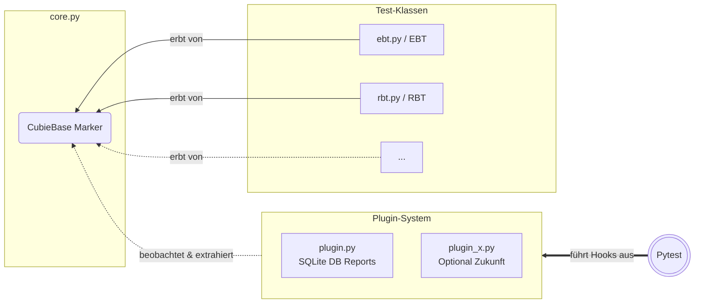

# Cubie Internas: Architektur & Mechanismen

Dieses Dokument bietet einen Überblick über die interne Architektur von Cubie. Es richtet sich an Entwickler (oder an das eigene zukünftige Ich), die an den Kernmechanismen des Frameworks arbeiten.

## 1. Das oberste Gesetz: Usage-Driven Design

Die wichtigste architektonische Regel von Cubie lautet:   
**"We don't break Usage-Patterns."** (in Anlehnung an [Linus Torvalds](https://www.youtube.com/shorts/tKio1sIIhAU))

* **Guides sind harte Vorgaben:** Die in den `GUIDE_....md`-Dateien definierten Schnittstellen und Nutzungsmuster sind in Stein gemeißelt. Sie definieren die User-Experience (UX) und die API-Oberfläche.
* **Internas sind wandelbar:** Die Strukturen, Details und Mechanismen hier im `dev`-Ordner und im `src`-Code sind fließend. Sie dürfen (und sollen) refaktorisiert, optimiert und umgebaut werden, solange sie das nach außen definierte Verhalten der Usage-Patterns strikt erfüllen.

## 2. Architektur & Erweiterbarkeit

Das System ist so konzipiert, dass die verschiedenen Test-Typen eine erweiterbare Menge bilden, die durch das `core`-Fundament gestützt wird. Das Plugin-System dockt von außen an Pytest an und beobachtet diese Menge lediglich, ohne in deren Logik einzugreifen.

## 3. Struktur des `src`-Ordners

* `__init__.py`: Definiert die öffentliche API des Pakets.
* `core.py`: Das Fundament. Hier liegen vorerst alle zentralen Klassen, Utilities und Marker (insbesondere die `CubieBase`-Klasse), bis die Modul-Grenze erreicht wird.
* `ebt.py`: Beinhaltet die Logik für das *Example-Based-Testing*. Hier lebt aktuell auch das `WorldState`-Objekt, da es derzeit domänenspezifisch für EBT-Zustandsdeklarationen und Datei-Hydration genutzt wird.
* `rbt.py`: Beinhaltet die Logik für das *Review-Based-Testing*. Aktuell bewusst als simpler Dummy konzipiert, um die Architektur und das Open-Closed-Principle (OCP) direkt an der Basis zu härten.
* `plugin.py`: Die primäre Pytest-Integration zur Datenspeicherung.

## 4. Die CubieBase & das Open-Closed-Principle (OCP)

Die Klasse `CubieBase` (definiert in `core.py`) ist das architektonische Bindeglied zwischen den Test-Klassen (`EBT`, `RBT` etc.) und dem Plugin-System.

* **Marker-Klasse:** In erster Linie fungiert `CubieBase` als vererbbare Marker-Klasse. Sie erlaubt es dem System, Test-Instanzen eindeutig zu identifizieren.
* **Erweiterbarkeit:** Benötigt das Plugin für alle Test-Typen einheitliche Attribute oder Serialisierungs-Methoden, werden diese zentral in `CubieBase` implementiert. Spezifische Logik bleibt in den abgeleiteten Klassen. Das garantiert das OCP: Neue Test-Typen (wie PBT oder FVT) können hinzugefügt werden, ohne die Kernmechanismen oder Plugins anpassen zu müssen.

## 5. Plugin-System und Unabhängigkeit

Zwar dient das initiale `plugin.py` vorerst ausschließlich dazu, die Pytest-Reports mitsamt der Klassenattribute der jeweiligen Test-Instanz in einer SQLite-DB zu persistieren, jedoch ist das System als **erweiterbare Menge** konzipiert. Die Architektur ist so aufgesetzt, dass in Zukunft weitere optionale Plugins (z. B. für externe Dashboards, erweiterte Analysen oder Live-Logging) sauber andocken können, ohne den Kern zu belasten.

Cubie bleibt dabei komplett unabhängig: Die Registrierung der Plugins ist optional. Die Testklassen (`EBT`, `RBT`) funktionieren auch ohne aktive Plugins vollumfänglich und eigenständig im standardmäßigen Pytest-Ökosystem.