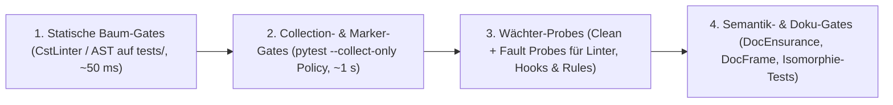

<!-- qb:frame id="CUBIE_DOC_FRAME_2" zone="head" env="Antigravity-CLI" model="Gemini-4-Hydrogen" effort="High" -->
# Lehrstunde 1

**Dokument-Informationen & Herkunft:**
- **Plattform / Umgebung:** Antigravity-CLI
- **Modell:** Gemini-4-Hydrogen
- **Reasoning-Effort:** High
- **Analysedatum:** 18. November 2026, ~17:00 (CET)
- **Synthesebasis:** `docs/GUIDE_Quality-Assurance.md`, `META_QUESTION.md`, `docs/GUIDE_Contract-Semantics.md`, `docs/services/GUIDE_DocFrame.md`, `tests/conftest.py`, `tests/test_lint.py`, `tests/test_default_collection_contract.py`, `tests/test_offline_core.py`, `tests/test_styleguide.py`, `src/qb_cubie/ebt.py`, `src/qb_cubie/linter.py`
- **Stand:** qb-cubie (v0.0.7)
- **Git-Log:** `96cbe7e8b45c32c058972adf06cb39c1be379709` ("We knew about the bugs.", Chronuid, 2026-11-17)

---

```text
commit 96cbe7e8b45c32c058972adf06cb39c1be379709 (HEAD -> main, origin/main)
Author: Chronuid <Dominickwirzba@gmail.com>
Date:   Tue Nov 17 09:22:28 2026 +0100

    We knew about the bugs.
```

* Wie funktioniert die Meta-QA überhaupt im Allgemeinen, wenn wir uns jetzt nicht nur den aktuellen Stand ansehen, sondern das als eine wiederverwendbare Methodik und wiederverwendbare Verfahren betrachten?
* Welche Meta-Gates können wir als zuverlässige, wiederverwenbare und deterministische Prüfungen bauen die automatisiert mit der Test-Suite durchlaufen? Und wie genau würden diese Mechanismen ablaufen?
<!-- /qb:frame -->

## Kurzüberblick: Das Rauchmelder-Prinzip

Eine normale Test-Suite funktioniert wie ein **Rauchmelder** in einer Wohnung: Sie schlägt Alarm, sobald im Produktionscode (`src/`) etwas schiefgeht.

Doch woher wissen wir, dass der Rauchmelder selbst funktioniert? Was passiert, wenn die Batterie leer ist, der Melder nur im Flur hängt, aber nicht im Schlafzimmer, oder wenn zwei Melder widersprüchliche Regeln haben?

Genau dafür gibt es **Meta-QA** (Qualitätssicherung für die Qualitätssicherung):

* **Normale QA** fragt: *„Hält mein Programm die fachlichen Verträge ein?“*
* **Meta-QA** fragt: *„Sind meine Tests logisch scharf, ehrlich, vollständig und tatsächlich scharfgeschaltet – oder könnte ein kaputtes Programm unbemerkt grün durchrutschen?“*

Das Ziel von Meta-QA ist also nicht, einzelne Bugs von gestern nachzuerzählen, sondern **zeitlose, wiederverwendbare Prüfverfahren** zu etablieren, die bei jedem zukünftigen Feature automatisch mitwachsen.

---

## Teil 1: Wie funktioniert Meta-QA als wiederverwendbare Methodik?

Unabhängig vom aktuellen Projektstand lässt sich Meta-QA in **vier grundlegende Verfahren** zerlegen. Jedes dieser Verfahren beantwortet eine andere Frage an deine Test-Suite – genau wie die orthogonalen Schichten aus dem [QA-Handbuch](../../../GUIDE_Quality-Assurance.md).

| Verfahren | Kernfrage an die Test-Suite | Was wird entdeckt? |
| :--- | :--- | :--- |
| **1. Formale Vertrags-Analyse** | Sagt der Test wirklich das, was der Autor meint? | Zu schwache Quantoren, leere Negativ-Prüfungen, redundante Klauseln |
| **2. Wächter-Kalibrierung (Probes & Mutanten)** | Schlägt der Test bei einem echten Fehler garantiert rot an? | Stumme Linter, abgeschaltete Hooks, blinde Flecken in Assertions |
| **3. Metamorphe & isomorphe Gegenprüfung** | Liefern zwei Darstellungen desselben Problems dasselbe Urteil? | Parser-Abweichungen, stilles Auseinanderlaufen zweier Domänen |
| **4. Sammlungs- & Umgebungs-Hygiene** | Laufen alle Tests im richtigen Modulraum und zur richtigen Zeit? | Verschwundene Tests, gespaltene Imports, falsche `fast`/`slow`-Zuordnung |

### Verfahren 1: Formale Vertrags-Analyse (Schärfe prüfen)

Viele Fehler in Test-Suiten entstehen nicht durch falsche Werte, sondern durch **unscharfe Logik**. Die formale Vertrags-Analyse schaut sich nur die *Struktur* der Testverträge an – ganz ohne das Fachproblem auswendig zu kennen:

1. **Kopplungsprüfung (Bijektion statt Los-Topf):**
   Stell dir zwei Schlüssel ($P_1, P_2$) und zwei Schlösser ($Q_1, Q_2$) vor. Ein guter Test prüft, ob Schlüssel $1$ **nur** Schloss $1$ öffnet und Schlüssel $2$ **nur** Schloss $2$. Packt man beide in eine gemeinsame Liste (`pre=[P1, P2]`, `post=[Q1, Q2]`), prüft `EBT` gemäß der [Vertragssemantik](../../../GUIDE_Contract-Semantics.md#endliche-auswertungsregel), ob für jeden Eingang *mindestens eines* der Ergebnisse aus `post` passt. Wenn Schlüssel $1$ und $2$ beide nur noch Schloss $1$ öffnen, bleibt der Test trotzdem grün.
2. **Negativ-Anker (Keine einsamen Verbote):**
   Ein Vertrag, der nur prüft „Das Ergebnis darf *nicht* Fehler X sein“ (`expect=False`), ohne zu sagen, was stattdessen herauskommen muss (`expect=True`), ist gefährlich leicht zu erfüllen (*Vacuous Pass*). Stürzt der Code mit Fehler Y ab, ist er „nicht Fehler X“ – und der Test wird fälschlich grün.
3. **Subsumtion & Nicht-Monotonie:**
   Wenn ein positiver Vertrag exakt den Rückgabewert `42` verlangt, bringt ein zusätzliches `expect=False` für `99` null neue Information – kostet aber doppelte Ausführungszeit. Umgekehrt deckt ein Blick auf Parameter-Kombinationen auf, ob Regeln *nicht-monoton* reagieren (z. B. wenn eine leere Regelliste Standardregeln abschaltet, eine fremde Zusatzregel sie aber plötzlich wieder anschaltet).

### Verfahren 2: Wächter-Kalibrierung (Probes & Mutation Testing)

Einem Prüfwerkzeug, das du noch nie rot gesehen hast, solltest du nicht blind vertrauen. Die Wächter-Kalibrierung dreht den Spieß um und testet den Tester absichtlich mit kaputtem Material:

* **Synthetische Fehlsonden (*Probes*):**
  Bevor man einem Linter oder Sicherheits-Hook glaubt, füttert man ihn mit einem winzigen, garantierten Verstoß (z. B. undefinierte Variable für `ruff`, toter Code für `pylint`/`mypy`, verbotener Netzwerkaufruf für einen Offline-Hook). Nur wenn die Sonde zuverlässig mit dem erwarteten Fehlercode anschlägt, gilt der Wächter als scharf. In Cubie nutzen `tests/test_lint.py` und `tests/test_offline_core.py` genau dieses Muster.
* **Mutation Testing:**
  Dabei verändert ein Automat gezielt winzige Stellen im Produktionscode (z. B. `>` wird zu `>=`, `and` wird zu `or`, eine Rückgabe wird auf `None` gesetzt) und startet danach die Test-Suite. Überlebt ein „Mutant“ (alle Tests bleiben grün), hast du exakt die Stelle gefunden, an der eine Grenzfall-Prüfung fehlt.

### Verfahren 3: Metamorphe & isomorphe Gegenprüfung

Manchmal gibt es keine einfache „richtige Antwort“ zum Vergleichen, oder man will verhindern, dass ein einzelner Parser sich selbst belügt. Dann nutzt man **zwei unterschiedliche Wege zum selben Ergebnis**:

* Man übersetzt eine Eingabe aus Domäne A (z. B. Markdown-Dokumente) verlustfrei in Domäne B (z. B. Python-Code mit Docstrings), lässt auf beiden Domänen die jeweilige Prüf-Engine laufen und verlangt, dass beide Berichte exakt übereinstimmen.
* Ein konkretes Beispiel dafür liegt bereits in `tests/tests_services/tests_doc_ensurance/test_doc_ensurance_isomorphism.py`.

### Verfahren 4: Sammlungs- & Umgebungs-Hygiene

Selbst die beste Test-Suite nützt nichts, wenn Tests beim Umbauen der Ordnerstruktur versehentlich nicht mehr eingesammelt werden, doppelt importiert werden oder teure Integrationsläufe unbemerkt die schnelle Dev-Schleife ausbremsen:

* **Sammlungs-Verträge:** Prüfen über `pytest --collect-only`, dass keine Test-Dateien durch Namensänderungen oder Konfigurationen aus der Sammlung fallen.
* **Namensraum-Hygiene:** Verhindern, dass Python dasselbe Paket zweimal unter verschiedenen Pfaden lädt (etwa `qb_cubie` und `src.qb_cubie`), wodurch `isinstance(...)`-Prüfungen über Modulgrenzen hinweg scheitern.
* **Marker- & Tempo-Disziplin:** Sicherstellen, dass `fast` wirklich schnell bleibt und schwere Läufe sauber als `slow` markiert sind.

---

## Teil 2: Welche deterministischen Meta-Gates können wir in `qb-cubie` bauen?

Ein **Meta-Gate** ist eine automatisierte, **100 % deterministische Prüfung** (kein Zufall, kein KI-Raten, klarer Exit-Code `0` oder `1`), die als regulärer Test unter `pytest -m meta` (oder `make test-meta`) mitläuft.

Für ein gutes Meta-Gate gelten vier Konstruktionsregeln:

1. **Deterministisch:** Gleicher Code + gleiche Konfiguration liefert immer exakt dasselbe Ergebnis.
2. **Schnell & günstig:** Statische Baum-Prüfungen (`ast` / `CstLinter`) laufen in Millisekunden ohne schwere Subprozesse.
3. **Punktgenau:** Jede Meldung nennt Datei, Zeilennummer, Regel-ID und den konkreten Grund.
4. **Ausbruchssicher mit Opt-in:** Wenn ein ungewöhnliches Muster ausnahmsweise absichtlich genutzt wird, muss es explizit markiert werden statt stillschweigend durchzugehen.

Hier sind **sechs konkrete, wiederverwendbare Meta-Gates**, die perfekt zur Architektur von `qb-cubie` passen – inklusive ihres exakten Ablaufs:

---

### Meta-Gate 1: Der Import-Kanonizitäts-Wächter (`CstRule`)

* **Was es schützt:** Verhindert gespaltene Modul-Namensräume (z. B. `from src.qb_cubie...` statt `from qb_cubie...`), weil `tests/conftest.py` bereits `src/` in `sys.path` einhängt.
* **Mechanismus (Ablauf):**
  1. `CstLinter` liest alle `.py`-Dateien unter `tests/` (und optional `src/`).
  2. Eine `CstRule` besucht jeden `Import`- und `ImportFrom`-Knoten im Syntaxbaum.
  3. Beginnt der Modulpfad mit `src.qb_cubie` oder lautet exakt `src`, meldet die Regel die Diagnose `META-CANONICAL-IMPORT` mit Datei und Zeile.
  4. Der Meta-Test prüft `diagnostics == []`.

Das folgende kleine Beispiel zeigt, wie eine solche `CstRule` direkt mit Cubies eigenem `CstLinter` aufgebaut und gegen gültige sowie verbotene Imports geprüft wird:

```python
import libcst as cst
from qb_cubie import CstLinter, CstRule


class CanonicalImportRule(CstRule):
    def visit_ImportFrom(self, node: cst.ImportFrom) -> None:
        mod = self._module.code_for_node(node.module) if (self._module and node.module) else ""
        if mod == "src" or mod.startswith("src.qb_cubie"):
            self.add_diagnostic(node, "META-IMPORT", f"Verwende 'qb_cubie' statt '{mod}'.")


bad_test = "from src.qb_cubie.rbt import RBT\n"
good_test = "from qb_cubie.rbt import RBT\n"
linter = CstLinter(rules=[CanonicalImportRule()])
print("Bad:", [(d.rule_id, d.line) for d in linter.check(bad_test)])
print("Good:", linter.check(good_test))
```

<details>
<summary>Ergebnis</summary>

```text
Bad: [('META-IMPORT', 1)]
Good: []
```
</details>

---

### Meta-Gate 2: Der Kreuzprodukt-Wächter (`META-EBT-CROSS-PRODUCT`)

* **Was es schützt:** Verhindert die Kreuzprodukt-Falle bei `EBT`-Aufrufen – also dass mehrere verschiedene Eingaben (`pre=[P1, P2]`) gemeinsam gegen mehrere verschiedene positive Ergebnisse (`post=[Q1, Q2]`) geprüft werden und dadurch nur noch ein schwaches „irgendein Q passt schon“ getestet wird.
* **Mechanismus (Ablauf):**
  1. Ein `ast`- oder `CstRule`-Scanner durchläuft alle Testdateien in `tests/`.
  2. Bei jedem Aufruf von `EBT(...)` untersucht er die Argumente `pre` und `post`.
  3. Zählt `pre` mehr als `1` Element (Liste/Tupel) **und** enthält `post` gleichzeitig mehr als `1` positives `WorldState`-Objekt (also ohne `expect=False`), schlägt das Gate sofort an.
  4. *Wichtige Feinheit:* Mehrere `pre`-Elemente gegen **genau ein** gemeinsames `post=WorldState(...)` bleiben ausdrücklich erlaubt (z. B. zwei Schreibweisen desselben Eingabewerts, die beide `"text"` liefern sollen). Ebenso bleibt ein `post=[Q_pos, Q_neg_with_expect_false]` erlaubt, da hier nur **ein** positiver Zielzustand existiert.

Das folgende Mini-Gate demonstriert diesen AST-Scanner für zwei typische `EBT`-Schreibweisen in der Praxis:

```python
import ast


def check_ebt_calls(source: str) -> list[str]:
    findings: list[str] = []
    for node in ast.walk(ast.parse(source)):
        if isinstance(node, ast.Call) and getattr(node.func, "id", "") == "EBT":
            kw = {k.arg: k.value for k in node.keywords if k.arg}
            pre_n = len(kw["pre"].elts) if isinstance(kw.get("pre"), (ast.List, ast.Tuple)) else 1
            post_n = len(kw["post"].elts) if isinstance(kw.get("post"), (ast.List, ast.Tuple)) else 1
            if pre_n > 1 and post_n > 1:
                findings.append(f"Zeile {node.lineno}: {pre_n}x{post_n} Kreuzprodukt-Falle")
    return findings


sample = "EBT(target=f, pre=[p1, p2], post=[q1, q2])\nEBT(target=f, pre=[p1, p2], post=q_all)"
print(check_ebt_calls(sample))
```

<details>
<summary>Ergebnis</summary>

```text
['Zeile 1: 2x2 Kreuzprodukt-Falle']
```
</details>

* **Ausbau-Stufe (Laufzeit-Guard):** Zusätzlich zum statischen AST-Scan kann man im `EBT`-Kontext oder in einem Test-Plugin warnen, sobald zur Laufzeit `len(pre_states) > 1` und `len(positive_post_states) > 1` zusammenfallen – das fängt sogar dynamisch gebaute Listen ab.

---

### Meta-Gate 3: Der Einsame-Negation-Wächter (`META-EBT-LONELY-NEGATION`)

* **Was es schützt:** Verhindert *Vacuous Passes*, bei denen ein `EBT`-Vertrag ausschließlich verbietet (`expect=False`), was nicht passieren darf, aber vergisst vorzuschreiben, was stattdessen passieren **muss** (`expect=True`).
* **Mechanismus (Ablauf):**
  1. Der AST-/CST-Scanner prüft bei jedem `EBT(...)`-Aufruf alle `WorldState(...)`-Einträge in `post`.
  2. Besitzt jeder Eintrag in `post` explizit `expect=False` (und auch auf `EBT(...)` ist kein positives Ziel verankert), zählt dieser Test als *einsame Negation*.
  3. Ausnahme: Tests, die explizit als reine Negativ-Invariante dokumentiert sind (z. B. über ein definiertes Tag `tags={"meta:negative-invariant"}` im `EBT`-Aufruf), werden bewusst durchgelassen – alle anderen schlagen mit `META-EBT-LONELY-NEGATION` fehl.

---

### Meta-Gate 4: Das Marker- & Collection-Vertrags-Gate (`test_default_collection_contract.py`)

* **Was es schützt:** Verhindert, dass Tests stillschweigend aus `pytest` verschwinden **und** dass schwere Integrationsläufe durch den Auto-Tagger in `tests/conftest.py` versehentlich auf `fast` landen (wie es etwa bei einem auskommentierten `#@pytest.mark.slow` über `test_docs_code_examples` passiert).
* **Mechanismus (Ablauf):**
  1. **Sammlungs-Check (wie heute schon vorhanden):** Ein Subprozess führt `pytest --collect-only -q -o addopts= tests/` aus und vergleicht gegen explizite historische Pfade.
  2. **Speed-Policy-Check (Erweiterung):** Ein zweiter deterministischer Abgleich sammelt mit `-m slow --collect-only` die Menge `S` aller `slow`-Tests und mit `-m fast --collect-only` die Menge `F` aller `fast`-Tests.
  3. Eine kleine Policy-Tabelle prüft:
     * *Disjunktheit:* Kein Test darf gleichzeitig in `F` und `S` liegen (`F & S == set()`).
     * *Schwergewichts-Schutz:* Teure Repository-Scanner (wie `test_styleguide.py::test_docs_code_examples`, Subprozess-Linter und Skalierungstests) **müssen** in `S` liegen und dürfen **nicht** in `F` rutschen.

---

### Meta-Gate 5: Die Wächter-Kalibrierungs-Triade (`Probe-Gate`)

* **Was es schützt:** Stellt sicher, dass jeder Linter, jeder Audit-Hook und jede benutzerdefinierte Regel (`CstRule`, `DocRule`, `DocFrameRule`) wirklich scharfgeschaltet ist und nicht wegen eines Konfigurations-Typos still `0` Fehler meldet.
* **Mechanismus (Ablauf in 3 Schritten pro Wächter):**
  1. **Grüne Sonde (*Clean Probe*):** Minimaler sauberer Code/Text muss exakt `0` Diagnosen und Exit-Code `0` liefern.
  2. **Rote Sonde (*Fault Probe*):** Minimaler absichtlich defekter Code/Text muss **zwingend** anschlagen und exakt die erwartete `rule_id` melden (wie in `tests/test_lint.py` mit `F821`, `W0101`, `[unreachable]` und in `tests/test_offline_core.py` mit den 6 Offline-Sonden).
  3. **Echtlauf:** Erst wenn Sonde 1 grün und Sonde 2 rot war, wird das echte Ziel (`src/` oder `docs/`) geprüft.

Dieses Drei-Schritt-Muster ist vollständig wiederverwendbar: Jede neue `CstRule` oder `DocRule` sollte ein eigenes kleines Probe-Paar mitbringen.

---

### Meta-Gate 6: Das Skip- & Bitrot-Hygiene-Gate

* **Was es schützt:** Verhindert „tote“ Tests hinter `@pytest.mark.skip`, deren Code im Lauf der Monate still kaputtgeht (z. B. veraltete API-Signaturen oder vergessene Klammern bei `HumanReviewer()`), und verhindert verwaiste Artefakte.
* **Mechanismus (Ablauf):**
  1. **Skip-Begründung & Statik:** Ein AST-Scan über `tests/` prüft jeden `@pytest.mark.skip`- oder `skipif`-Dekorator, ob ein nicht-leerer `reason="..."` vorhanden ist. Gleichzeitig prüft ein Linter (`ruff` / `mypy`) auch übersprungene Testfunktionen statisch – so fällt kaputter Code sofort auf, selbst wenn `pytest` die Funktion nicht ausführt.
  2. **Monotonie-Stichprobe für Regelwerke:** Wenn ein Service wie `DocEnsurance` Standardregeln mit eigenen Regeln kombiniert, prüft ein parametrisierter `EBT`-Vertrag: Das Hinzufügen einer harmlosen `No-Op`-Regel darf niemals plötzlich andere Standardregeln aktivieren oder deaktivieren.

---

## Teil 3: Wie greifen alle Meta-Gates automatisch zusammen?

Die sechs Gates sind absichtlich so aufgebaut, dass sie **nacheinander von schnell nach schwer** laufen. Schnelle Syntax-Fehler stoppen die Pipeline in Millisekunden, bevor überhaupt ein Subprozess oder eine `TempFS`-Arena gestartet wird:



### Empfohlene Aufteilung im Alltag

Damit das tägliche Entwickeln mit `make test` (`not slow`) blitzschnell bleibt, lassen sich die Meta-Gates sauber auf die bestehenden Profile aus [`pyproject.toml`](../../../../pyproject.toml) und [`Makefile`](../../../../Makefile) aufteilen:

* **Immer im schnellen `make test` / `make test-meta` (`fast`):**
  * Meta-Gate 1 (Import-Kanonizität über `CstLinter`)
  * Meta-Gate 2 (AST-Scanner gegen `EBT`-Kreuzprodukte)
  * Meta-Gate 3 (AST-Scanner gegen einsame `expect=False`-Tests)
  * Meta-Gate 4 (Collection- & Marker-Policy-Vertrag)
  * Meta-Gate 6 (Skip-Hygiene-Check)
* **Im gründlichen Lauf (`make test-lint` / `make test-all` / CI mit `slow`):**
  * Meta-Gate 5 (Subprozess-Linter-Probes für `ruff`, `pylint`, `mypy`)
  * Kompletter `DocEnsurance`- & `DocFrame`-Lauf über alle Markdown-Dateien (`test_docs_code_examples` explizit als `slow` markiert)
  * Optionale Mutation-Testing-Läufe auf kritischen Kernmodulen (`ebt.py`, `_execution.py`, `_hydration.py`)

**Merksatz für die Weiterentwicklung:** Jedes Mal, wenn bei einer Code-Analyse ein neuer struktureller Testfehler entdeckt wird, fragen wir nicht nur *„Wie fixe ich diese eine Zeile?“*, sondern *„Welches deterministische Meta-Gate hätte diese Fehlerklasse für immer verhindert?“*

<!-- qb:frame id="CUBIE_DOC_FRAME_2" zone="foot" -->

---

---

<div align="center">


[↦ | Arena-Management | ↤](../../../GUIDE_Arena-Management.md)  
[↦ | Benchmarks: Einstieg, eigene Agenten und Messbetrieb (`GUIDE_Benchmarks.md`) | ↤](../../../GUIDE_Benchmarks.md)  
[↦ | Verbindliche Vertragssemantik | ↤](../../../GUIDE_Contract-Semantics.md)  
[↦ | EBT-Nutzungsmuster | ↤](../../../GUIDE_EBT-Usage-Pattern.md)  
[↦ | Example-Based Testing | ↤](../../../GUIDE_Example-Based-Testing.md)  
[↦ | Linter | ↤](../../../GUIDE_Linter.md)  
[↦ | Qualitätssicherung mit Cubie | ↤](../../../GUIDE_Quality-Assurance.md)  
[↦ | RBT-Nutzungsmuster | ↤](../../../GUIDE_RBT-Usage-Pattern.md)  

[↦ | GUIDE: `DocEnsurance` – Lebende und verifizierte Dokumentation | ↤](../../../services/GUIDE_DocEnsurance.md)  
[↦ | DocFrame (Prototyp) | ↤](../../../services/GUIDE_DocFrame.md)  

[↦ | Entwicklerübersicht & Internals | ↤](../../../dev/DEV-GUIDE_2-0_EXAMPLE-BASED-TESTING.md)  
[↦ | Hintergrund & Essays | ↤](../../../misc/README.md)  
[↦ | Feature-Drafts: Virtualisierung | ↤](../../virtualization/README.md)  
[↦ | Lehrstunde 1 | ↤](./GEMINI.md)  
[↦ | Lehrstunde 1 | ↤](./META_GATES.md)  

</div>
<!-- /qb:frame -->
