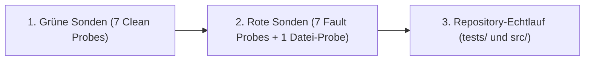

<!-- qb:frame id="CUBIE_DOC_FRAME_2" zone="head" env="Antigravity-CLI" model="Gemini-4-Hydrogen" effort="High" -->
# Meta-Gate 1: Der Import-Kanonizitäts-Wächter

**Dokument-Informationen & Herkunft:**
- **Plattform / Umgebung:** Antigravity-CLI
- **Modell:** Gemini-4-Hydrogen
- **Reasoning-Effort:** High
- **Analysedatum:** 18. November 2026, ~18:30 (CET)
- **Synthesebasis:** `docs/feature-drafts/meta-qa/1/GEMINI.md`, `docs/feature-drafts/meta-qa/1/META_GATES.md`, `src/qb_cubie/linter.py`, `tests/conftest.py`, `tests/test_default_collection_contract.py`, `tests/test_styleguide.py`, `tests/tests_linter/test_linter_cst.py`, `tests/tests_meta/test_gate_1.py`, `pyproject.toml`
- **Stand:** qb-cubie (v0.0.7)
- **Git-Log:** `12304f166f233e146258536674c5db9911ba4d33` ("Questions about the meta-question.", Chronuid, 2026-11-18)

---

```text
commit 12304f166f233e146258536674c5db9911ba4d33 (HEAD -> main, origin/main)
Author: Chronuid <Dominickwirzba@gmail.com>
Date:   Wed Nov 18 17:07:16 2026 +0100

    Questions about the meta-question.
```

---
<!-- /qb:frame -->

## Kurzüberblick: Warum brauchen wir Meta-Gate 1?

Stell dir vor, in deiner Wohnung gibt es zwei verschiedene Haustürschlüssel, die genau zum selben Zimmer führen – einmal durch den Flur und einmal über den Balkon. In Python passiert etwas Ähnliches, wenn ein Paket auf **zwei verschiedenen Wegen** importiert wird:

1. Normalerweise hängt [`tests/conftest.py`](../../../../tests/conftest.py) den Ordner `src/` direkt an den Anfang von `sys.path`. Dadurch lautet der offizielle (*kanonische*) Name des Pakets schlicht `qb_cubie` – zum Beispiel `from qb_cubie.core.rbt import RBT`.
2. Schreibt jemand stattdessen `from src.qb_cubie.core.rbt import RBT`, legt Python im internen Modulregister (`sys.modules`) **ein zweites, getrenntes Modul** unter dem Namen `src.qb_cubie.core.rbt` an.

Das führt zu tückischen Fehlern, dem sogenannten **gespaltenen Modul-Namensraum**:

* Zwei scheinbar identische Klassen (`qb_cubie.core.rbt.RBT` und `src.qb_cubie.core.rbt.RBT`) sind für Python **unterschiedliche Objekte**.
* Prüfungen mit `isinstance(...)` schlagen fehl, obwohl beide Seiten denselben Quelltext meinen.
* Globale Zustände, Registries und Serialisierungen (z. B. mit `cloudpickle` in Arenen) geraten durcheinander.

**Meta-Gate 1** in [`tests/tests_meta/test_gate_1.py`](../../../../tests/tests_meta/test_gate_1.py) ist der automatische Türsteher, der genau diese `src.`-Imports frühzeitig abfängt. Gemäß Auftrag wurde **kein Produktionscode in `src/` verändert**.

---

## Teil 1: Technische Analyse – Was musste das Gate beachten?

Beim genauen Blick auf [`GEMINI.md`](./GEMINI.md) und Cubies eigene Linter-Implementierung in [`src/qb_cubie/linter.py`](../../../../src/qb_cubie/linter.py) zeigten sich **vier wichtige Konstruktionsdetails**:

### 1. Syntaxbaum (`CstRule`) statt Textsuche (`grep`)

Warum nutzen wir `CstLinter` und `CstRule` auf Basis von `libcst` statt einer einfachen Zeichenketten-Suche?

* Eine Textsuche nach `"src.qb_cubie"` würde auch auf Kommentare, Markdown-Strings oder auf Test-Sonden (wie `"from src.qb_cubie.core.rbt import RBT"`) im Gate selbst anschlagen.
* `CstRule` besucht hingegen gezielt echte Import-Knoten im Concrete Syntax Tree (CST) und liefert über den `PositionProvider` von `libcst` automatisch Datei, Zeile und Spalte zurück.

### 2. Beide Import-Formen prüfen (`Import` und `ImportFrom`)

Das kurze Einstiegsbeispiel in `GEMINI.md` zeigte nur `visit_ImportFrom` und nutzte die verkürzte ID `"META-IMPORT"`. Die eigentliche Spezifikation verlangt jedoch ausdrücklich:

* Besuch von **`Import`-Knoten** (`import src`, `import src.qb_cubie`, `import os, src.qb_cubie.core.ebt as ebt`) über `visit_Import` (hier iteriert die Regel über `node.names`, also alle `cst.ImportAlias`-Einträge).
* Besuch von **`ImportFrom`-Knoten** (`from src.qb_cubie.core.rbt import RBT`, `from src import qb_cubie`) über `visit_ImportFrom`.
* Einheitliche Diagnose-ID **`META-CANONICAL-IMPORT`**.

### 3. Saubere Modulgrenzen und relative Imports

Zwei kleine Fallen würden bei einer zu simplen String-Prüfung zu Fehlalarmen führen:

1. **Relative Imports:** Bei `from .src import helper` liefert `code_for_node(node.module)` ebenfalls `"src"`, obwohl ein führender Punkt steht. Deshalb prüft `visit_ImportFrom` zuerst `if node.relative: return`.
2. **Modulgrenze:** Die Hilfsfunktion `_is_non_canonical_module` prüft exakt:
   `module_path == "src" or module_path == "src.qb_cubie" or module_path.startswith("src.qb_cubie.")`.
   So bleibt ein unabhängiger Name wie `import src_helper` erlaubt, während `src`, `src.qb_cubie` und alle Untermodule `src.qb_cubie.*` zuverlässig gefangen werden.

### 4. Wichtige Falle in `CstLinter`: Die leere Standard-Ausschlussliste

Ein Blick in [`src/qb_cubie/linter.py`](../../../../src/qb_cubie/linter.py) zeigt ein entscheidendes Detail:

* `CstLinter` startet mit einer **leeren** Ausschlussliste (`self._excludes = set()`), wenn man `excludes` nicht explizit übergibt.
* Im Ordner `tests/.arenas/` liegen drei vorbereitete virtuelle Python-Umgebungen (`empty_venv`, `cowsay_env`, `linter_env`) mit insgesamt **866 `.py`-Dateien**.

Ohne explizites `excludes=[".arenas", ".venv", "__pycache__", ".git", ".pytest_cache"]` würde `CstLinter` hunderte fremde Bibliotheksdateien in den Arenen mitscannen. Mit der Ausschlussliste prüft das Gate gezielt nur die **100** Testdateien unter `tests/` und die **39** Quelldateien unter `src/` in wenigen Sekunden.

---

## Teil 2: Aufbau des Gates (`tests/tests_meta/test_gate_1.py`)

Das neue Test-Package `tests/tests_meta/` besteht aus [`__init__.py`](../../../../tests/tests_meta/__init__.py) und [`test_gate_1.py`](../../../../tests/tests_meta/test_gate_1.py) und folgt der **Wächter-Kalibrierungs-Triade (Meta-Gate 5)** aus [`META_GATES.md`](./META_GATES.md):



1. **Grüne Sonden (`test_canonical_import_rule_accepts_clean_probes`):**
   7 saubere Fälle (kanonisches `qb_cubie`, `src_helper`, relative `.src`-Imports und String-Literale) müssen über `EBT` exakt `[]` liefern.
2. **Rote Sonden (`test_canonical_import_rule_detects_fault_probes` & `test_canonical_import_rule_reports_file_path_on_disk`):**
   7 verbotene Import-Varianten im Speicher sowie 1 echte Datei auf Platte (`tmp_path`) müssen zwingend mit `rule_id == "META-CANONICAL-IMPORT"`, passender Zeilennummer und konkretem Dateipfad anschlagen.
3. **Repository-Gate (`test_repository_uses_canonical_qb_cubie_imports`):**
   Scant sowohl `tests/` als auch `src/` rekursiv und verlangt `diagnostics == []`.

In [`tests/conftest.py`](../../../../tests/conftest.py) weist `DIR_MARKERS["tests_meta"] = ("meta",)` allen Tests in `tests/tests_meta/` automatisch den Marker `meta` (und mangels `slow`-Marker auch `fast`) zu.

---

## Teil 3: Was ist beim Ausführen passiert? (Beobachtungen)

### 1. Entdeckung im ersten Anlauf: Die Pytest-Sammlung (`tests_gate_1.py` vs. `test_gate_1.py`)

Beim ersten Aufbau hieß die Datei auftragskonform `tests_gate_1.py` (Plural `tests_`). Beim Testen der Verzeichnis-Sammlung zeigte sich sofort ein sehr lehrreicher Effekt:

```text
$ .venv/bin/python -m pytest --collect-only -q tests/tests_meta
no tests collected in 0.01s   (Exit-Code 5)
```

**Warum passiert das?**

1. **Dateinamen-Konvention:** In [`pyproject.toml`](../../../../pyproject.toml) ist kein eigenes `python_files`-Muster konfiguriert. Pytest sucht deshalb standardmäßig nur nach `test_*.py` und `*_test.py` (Einzahl `test_`), **nicht** nach `tests_*.py` (Plural `tests_`).
2. **Verzeichnis-Marker:** In [`tests/conftest.py`](../../../../tests/conftest.py) fehlte in `DIR_MARKERS` noch der Eintrag `"tests_meta": ("meta",)`.

> [!NOTE]
>
> **Warum das so wichtig ist:** Genau dieses Phänomen hatte früher schon dazu geführt, dass historische Dateien wie `tests_mypy.py` unbemerkt aus der Standard-Sammlung fielen – wogegen [`tests/test_default_collection_contract.py`](../../../../tests/test_default_collection_contract.py) überhaupt erst erfunden wurde.

### 2. Ergebnis nach Umsetzung der Infrastruktur-Anpassung

Nach dem Umbenennen zu [`test_gate_1.py`](../../../../tests/tests_meta/test_gate_1.py) und der Ergänzung von `"tests_meta": ("meta",)` in [`tests/conftest.py`](../../../../tests/conftest.py) (ohne manuelles `pytestmark` in der Testdatei) greifen Sammlung und Auto-Tagging nahtlos:

* **Verzeichnis-Sammlung (`.venv/bin/python -m pytest --collect-only -q tests/tests_meta`):** Sammelt automatisch alle **17 Tests** in `0,12 s`.
* **Direkt- & Marker-Lauf (`.venv/bin/python -m pytest -m "meta and fast" -q`):**
  * Alle **17 Testfälle** von Meta-Gate 1 liefen erfolgreich grün durch (7 grüne Sonden, 7 rote In-Memory-Sonden, 1 Datei-Probe sowie der Repository-Scan über `tests/` mit 100 Dateien und `src/` mit 39 Dateien ohne Befund).
  * Nachdem in [`tests/test_styleguide.py`](../../../../tests/test_styleguide.py#L112-L119) auch das fehlende Komma nach `"docs/feature-drafts"` in den `DocEnsurance`-Excludes ergänzt wurde, läuft das gesamte Profil `meta and fast` vollständig grün durch (**72 passed**, geprüft mit `DocEnsurance` auf `META_GATE_1.md` ohne Diagnosen).
* **Linter- & Sammlungsverträge:** `ruff check tests/tests_meta/ tests/conftest.py` meldete **`All checks passed!`**, und `pytest tests/test_default_collection_contract.py` blieb mit **`3 passed`** grün.

### 3. Manueller Mutations-Check (Scharfschaltungs-Nachweis am echten Repository)

Um zweifelsfrei zu belegen, dass nicht nur künstliche String-Sonden, sondern auch ein echter Regelverstoß in der Test-Suite zuverlässig gestoppt wird, wurde eine gezielte manuelle Mutation durchgeführt:

1. **Mutation:** In [`tests/test_core_without_tk.py`](../../../../tests/test_core_without_tk.py#L9) wurde Zeile 9 vorübergehend von `from qb_cubie import EBT, WorldState` auf `from src.qb_cubie import EBT, WorldState` geändert.
2. **Gate-Reaktion (`.venv/bin/python -m pytest -v tests/tests_meta/test_gate_1.py`):** Der Lauf brach erwartungsgemäß mit **1 failed, 16 passed** (`5,84 s`) ab und nannte exakt Datei, Zeile, Regel-ID und Ursache:
   ```text
   AssertionError: Nicht-kanonische Imports in tests/ gefunden:
     /home/symphonie/PycharmProjects/cubie/tests/test_core_without_tk.py:9:0 [META-CANONICAL-IMPORT] Verwende 'qb_cubie' statt 'src.qb_cubie'.
   ```
3. **Rückbau & Gegenprobe:** Nach dem Zurücksetzen der Mutation war die Testdatei wieder sauber (`git diff tests/test_core_without_tk.py` leer), und der erneute Lauf lieferte wieder **17 passed** (`5,74 s`).

---

## Fazit & Ausblick

Meta-Gate 1 (`test_gate_1.py`) läuft nun automatisch in `make test`, `make test-fast` und `make test-meta` mit, kalibriert sich bei jedem Lauf selbst über grüne und rote Sonden und beweist, dass der aktuelle Stand von `tests/` und `src/` frei von gespaltenen `src.`-Imports ist. Als Nächstes lassen sich nach demselben Muster `Meta-Gate 2` (`META-EBT-CROSS-PRODUCT`) und `Meta-Gate 3` (`META-EBT-LONELY-NEGATION`) im selben Package `tests/tests_meta/` ergänzen.

<!-- qb:frame id="CUBIE_DOC_FRAME_2" zone="foot" -->

---

---

<div align="center">


[↦ | Vertragsaufbau: Eindeutigkeit & Kopplung | ↤](../../../GUIDE_Contract-Design.md)  
[↦ | Erwartungssteuerung & Safety (`expect`-Flags) | ↤](../../../GUIDE_Expect-Flags.md)  
[↦ | Qualitätssicherung mit Cubie | ↤](../../../GUIDE_Quality-Assurance.md)  
[↦ | Fortgeschrittene Quantoren (`all` vs. `exists`) | ↤](../../../GUIDE_Quantifiers.md)  
[↦ | Test-Guided Development (TGD) | ↤](../../../GUIDE_TGD.md)  

[↦ | GUIDE: `DocEnsurance` – Lebende und verifizierte Dokumentation | ↤](../../../services/GUIDE_DocEnsurance.md)  
[↦ | DocFrame (Prototyp) | ↤](../../../services/GUIDE_DocFrame.md)  

[↦ | Dokumentations-Übersicht | ↤](../../../README.md)  
[↦ | Core-Dokumentation | ↤](../../../core/README.md)  
[↦ | Entwicklerdokumentation | ↤](../../../dev/README.md)  
[↦ | Core-Internals | ↤](../../../dev/core/README.md)  
[↦ | Hintergrund & Essays | ↤](../../../misc/README.md)  
[↦ | Feature-Drafts: Virtualisierung | ↤](../../virtualization/README.md)  

[↦ | Meta-Gate 3 | ↤](./GEMINI.md)  
[↦ | Lehrstunde 1 | ↤](./META_GATES.md)  
[↦ | Meta-Gate 1: Der Import-Kanonizitäts-Wächter | ↤](./META_GATE_1.md)  
[↦ | Meta-Gate 2: Der Kreuzprodukt-Wächter | ↤](./META_GATE_2.md)  
[↦ | Meta-Gate 3: Der Einsame-Negation-Wächter | ↤](./META_GATE_3.md)  

</div>
<!-- /qb:frame -->