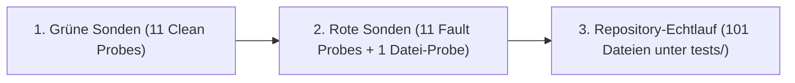

<!-- qb:frame id="CUBIE_DOC_FRAME_2" zone="head" env="Antigravity-CLI" model="Gemini-4-Hydrogen" effort="High" -->
# Meta-Gate 2: Der Kreuzprodukt-Wächter

**Dokument-Informationen & Herkunft:**
- **Plattform / Umgebung:** Antigravity-CLI
- **Modell:** Gemini-4-Hydrogen
- **Reasoning-Effort:** High
- **Analysedatum:** 18. November 2026, ~19:35 (CET)
- **Synthesebasis:** `docs/feature-drafts/meta-qa/1/GEMINI.md`, `docs/feature-drafts/meta-qa/1/META_GATES.md`, `docs/feature-drafts/meta-qa/1/META_GATE_1.md`, `docs/GUIDE_Contract-Semantics.md`, `src/qb_cubie/ebt.py`, `src/qb_cubie/protocols.py`, `src/qb_cubie/linter.py`, `tests/tests_meta/test_gate_1.py`, `tests/tests_meta/test_gate_2.py`, `tests/tests_ebt/test_ebt_quantors.py`, `tests/tests_ebt/test_ebt_run_isolation.py`, `tests/tests_multiprocessors/test_basic_mp.py`, `tests/test_offline_core.py`, `tests/tests_ebt/test_ebt_persistent_reports.py`
- **Stand:** qb-cubie (v0.0.7)
- **Git-Log:** `6c959ab4cae6ede0b019f3d2774bc305e09e39a6` ("Crafted the prototype 'tests/tests_meta/test_gate_1.py'", Chronuid, 2026-11-18)

---

```text
commit 6c959ab4cae6ede0b019f3d2774bc305e09e39a6 (HEAD -> main)
Author: Chronuid <Dominickwirzba@gmail.com>
Date:   Wed Nov 18 18:43:28 2026 +0100

    Crafted the prototype 'tests/tests_meta/test_gate_1.py'
```

---
<!-- /qb:frame -->

## Kurzüberblick: Was ist die Kreuzprodukt-Falle?

Stell dir vor, du möchtest testen, ob ein Getränkeautomat zuverlässig arbeitet:

* Drückst du **Taste 1 (Kaffee)**, soll **Kaffee** herauskommen.
* Drückst du **Taste 2 (Tee)**, soll **Tee** herauskommen.

Schreibst du diesen Test in `EBT` versehentlich in **einem** gemeinsamen Aufruf:

```text
EBT(
    target=automat,
    pre=[WorldState(args="kaffee"), WorldState(args="tee")],
    post=[WorldState(returns="Kaffee"), WorldState(returns="Tee")],
)
```

dann passiert etwas Überraschendes: `EBT` ordnet **nicht** `pre[0]` zu `post[0]` und `pre[1]` zu `post[1]` zu! Stattdessen prüft `EBT` gemäß der [Vertragssemantik](../../../GUIDE_Contract-Semantics.md#endliche-auswertungsregel) für jeden Eingang:

> *„Kommt für diesen Eingang **mindestens eines** der erlaubten Muster aus `post` heraus?“*

Das bedeutet: Wenn der Automat kaputt ist und bei **beiden** Tasten nur noch `"Kaffee"` ausspuckt, bleibt der `2x2`-Test trotzdem **grün** – weil `"Kaffee"` ja in der Liste `post` enthalten ist.

**Meta-Gate 2 (`META-EBT-CROSS-PRODUCT`)** in [`tests/tests_meta/test_gate_2.py`](../../../../tests/tests_meta/test_gate_2.py) erkennt genau solche `N x M`-Verträge frühzeitig im Syntaxbaum – erlaubt sie aber weiterhin, wenn es einen echten fachlichen Grund dafür gibt und dieser **explizit begründet** wird. Gemäß Auftrag wurde **kein Code in `src/` verändert**. Im Anschluss an den ersten Scan wurden alle `4` entdeckten Fundstellen bereinigt: die echte Kreuzprodukt-Falle in [`tests/tests_multiprocessors/test_basic_mp.py`](../../../../tests/tests_multiprocessors/test_basic_mp.py) per `@pytest.mark.parametrize` und die `3` bewussten Matrix-Tests mit expliziten `tags={"meta:cross-product-reason": "..."}`.

---

## Teil 1: Technische Analyse – Welche Fälle müssen sauber unterschieden werden?

Ein guter Wächter darf weder zu lasch sein noch nützliche Schreibweisen blockieren. Beim Abgleich von [`GEMINI.md`](./GEMINI.md), [`src/qb_cubie/ebt.py`](../../../../src/qb_cubie/ebt.py) und [`src/qb_cubie/protocols.py`](../../../../src/qb_cubie/protocols.py) ergaben sich **fünf klare Konstruktionsregeln**:

### 1. Was genau ist ein Kreuzprodukt? (`N > 1` und `M_pos > 1`)

Ein `EBT`-Aufruf gilt nur dann als Kreuzprodukt, wenn **beide** Bedingungen gleichzeitig zutreffen:

1. `pre` enthält mehr als einen Eingang (statisch als Liste oder Tupel mit mindestens `2` Elementen).
2. `post` enthält mehr als ein **positives** `WorldState`-Zielmuster.

Dadurch bleiben drei häufige und völlig gesunde Muster **ausdrücklich erlaubt**:

| Muster | Beispiel | Warum erlaubt? |
| :--- | :--- | :--- |
| **`N x 1` (viele Eingänge, ein Ziel)** | `pre=[p1, p2], post=WorldState(returns="text")` oder `post=[WorldState(returns="text")]` | Alle Eingänge müssen exakt dasselbe eine Ziel erfüllen. |
| **`1 x M` (ein Eingang, mehrere Alternativen)** | `pre=WorldState(args=(x,)), post=[q1, q2]` | Ein einzelner Lauf darf eines von mehreren erlaubten Ergebnissen liefern. |
| **`N x (1 positiv + K negativ)`** | `pre=[p1, p2], post=[WorldState(returns=3), WorldState(returns=99, expect=False)]` | Es gibt nur **ein** positives Zielmuster (`expect=True`); die übrigen Einträge sind Verbote (`expect=False`). |

### 2. Wie erkennt der Scanner negative `WorldState`-Einträge?

In [`src/qb_cubie/protocols.py`](../../../../src/qb_cubie/protocols.py#L68-L75) hat `WorldState` die Signatur `WorldState(args=None, kwargs=None, arena=None, fs=None, returns=UNSPECIFIED, expect=True, ...)`, und in [`src/qb_cubie/ebt.py`](../../../../src/qb_cubie/ebt.py#L645-L649) zählt jeder Zustand mit `not t.post.expect` als negativ.

Die Hilfsfunktion `_is_positive_worldstate` prüft deshalb sowohl das Schlüsselwortargument `expect=...` als auch das Positionsargument an Index `5`: Steht dort `False` (oder `None`), zählt dieser Eintrag **nicht** als positiver Zielzustand. Alle anderen Einträge (inklusive weggelassenem `expect` oder `expect=True`) zählen als positiv.

### 3. Wie funktioniert die explizite Begründung ohne Änderung in `src/`?

Die neue Anforderung aus [`GEMINI.md`](./GEMINI.md) lautet: Ein Kreuzprodukt darf durch das Gate kommen, **wenn eine explizite Begründung angegeben wird**, warum es hier benötigt wird.

Ein Blick in [`src/qb_cubie/ebt.py`](../../../../src/qb_cubie/ebt.py#L94-L98) zeigt ein perfektes vorhandenes Werkzeug: `EBT.__init__` besitzt bereits den Parameter `tags=None` (`self.tags = tags`), ohne den Typ einzuengen. Und [`META_GATES.md`](./META_GATES.md#L195) nutzt genau dasselbe Muster (`tags={"meta:negative-invariant"}`) für Ausnahmen bei Meta-Gate 3.

Für Meta-Gate 2 lautet die explizite Freigabe daher:

```python
from qb_cubie import EBT, WorldState

trace = EBT(
    target=lambda x: x * 2,
    pre=[WorldState(args=1), WorldState(args=2)],
    post=[WorldState(returns=2), WorldState(returns=4)],
    tags={"meta:cross-product-reason": "Prüft bewusst die N:M-Matrix von EBT."},
).run()
print("Evaluation:", trace.evaluation, "| Traces:", len(trace.traces))
```

<details>
<summary>Ergebnis</summary>

```text
Evaluation: True | Traces: 4
```
</details>

**Warum ist `tags={"meta:cross-product-reason": "..."}` ideal?**

* **Keine Änderung an `src/` nötig:** `EBT` akzeptiert `tags=...` bereits heute nativ.
* **Kein leerer Freifahrtschein:** Das Gate prüft über `_extract_cross_product_reason`, dass der Schlüssel `"meta:cross-product-reason"` im `tags`-Dictionary steht **und** sein Wert ein statisches String-Literal mit nicht-leerem Text (`reason.strip() != ""`) ist. Leere Strings (`""`), reiner Leerraum (`"   "`), `True` oder fremde Tag-Schlüssel werden abgelehnt.
* **Vorbereitet für den Laufzeit-Guard:** Anders als ein reiner `#`-Kommentar bleibt `tags` auch zur Laufzeit an `ebt.tags` ablesbar, falls später die Ausbaustufe eines Laufzeit-Guards in `src/` ergänzt wird.

### 4. Vollständige Argument-Erkennung (`CstRule` auf `libcst`)

Genau wie Meta-Gate 1 nutzt Meta-Gate 2 Cubies eigenes [`CstLinter`](../../../../src/qb_cubie/linter.py#L198-L250) mit [`CstRule`](../../../../src/qb_cubie/linter.py#L147-L192) statt einfacher Textsuche:

* Erkennt sowohl `EBT(...)` als auch qualifizierte Aufrufe wie `qb_cubie.EBT(...)`.
* Liest `pre`, `post` und `tags` sowohl über Keyword-Argumente als auch über Positionsargumente (Index `2`, `3`, `9` gemäß `EBT.__init__`) sowie über statische `**{...}`-Dict-Literale.
* Nutzt dieselbe Ausschlussliste `SCAN_EXCLUDES = [".arenas", ".venv", "__pycache__", ".git", ".pytest_cache"]`, sodass fremde Virtuelle Umgebungen unter `tests/.arenas/` nicht mitgescannt werden.

### 5. Bewusste Grenze des statischen Scanners

Der statische `CstRule`-Scanner wertet gezielt literale Listen und Tupel (`[...]`, `(...)`) in `pre` und `post` aus. Dynamisch erzeugte Listen (z. B. List Comprehensions oder Hilfsvariablen wie `pre=cases, post=outcomes`) lassen sich ohne Ausführen des Codes oft nicht sicher zählen – genau dafür ist in [`META_GATES.md`](./META_GATES.md#L185) später optional ein ergänzender Laufzeit-Guard vorgesehen.

---

## Teil 2: Aufbau von [`tests/tests_meta/test_gate_2.py`](../../../../tests/tests_meta/test_gate_2.py)

Auch Meta-Gate 2 folgt der **Wächter-Kalibrierungs-Triade (Meta-Gate 5)** und prüft sich selbst mit `24` Testfällen:



1. **Grüne Sonden (`test_cross_product_rule_accepts_clean_probes`, 11 Fälle):**
   `1x1`, `Nx1` als Einzelobjekt und `1`-Element-Liste, `1xM`, `N x (1 positiv + 1 negativ)`, `N x (0 positiv + 2 negativ)`, begründete `2x2`-Aufrufe (einfach, mehrzeilig verkettet, `qb_cubie.EBT(...)`), Nicht-`EBT`-Aufrufe und String-Literale müssen exakt `[]` liefern.
2. **Rote Sonden (`test_cross_product_rule_detects_fault_probes` & `test_cross_product_rule_reports_file_path_on_disk`, 12 Fälle):**
   Unbegründete `2x2`-Listen und -Tupel, explizites `expect=True`, gemischte `2x3`-Listen (`2` positiv + `1` negativ -> gemeldet als `2x2`), Positionsargumente, `qb_cubie.EBT(...)`, leere oder whitespace-only Begründungen, nicht-String-Begründungen (`True`), falsche Tag-Namen, Zeilenversatz (`3x4` in Zeile `2`) sowie ein echter Dateipfad auf Platte (`tmp_path`) müssen `META-EBT-CROSS-PRODUCT` melden.
3. **Repository-Gate (`test_repository_has_no_unjustified_ebt_cross_products`, 1 Fall):**
   Scant alle `101` Python-Dateien unter `tests/` und schlägt an, sobald ein unbegründetes `EBT`-Kreuzprodukt existiert.

---

## Teil 3: Was ist beim Ausführen passiert? (Echte Funde im Repository!)

### 1. Sammlung, Linter & Kalibrierungs-Sonden

* **Sammlung (`.venv/bin/python -m pytest --collect-only -q tests/tests_meta`):** Sammelt **41 Tests** in `0,15 s` (`17` aus `test_gate_1.py`, `24` aus `test_gate_2.py`).
* **Style & Linter (`.venv/bin/ruff check tests/tests_meta/`):** Nach Beseitigung von 5 Kleinigkeiten (`SIM103` und `ISC004`) meldet Ruff **`All checks passed!`**.
* **Sonden-Lauf (`.venv/bin/python -m pytest -v tests/tests_meta/test_gate_2.py`):**
  Alle **23 Sonden** (11 grüne Sonden, 11 rote In-Memory-Sonden, 1 Datei-Probe) sind **sofort grün (`PASSED`)**.
* **Das Repository-Gate schlug erwartungsgemäß an (`1 failed, 23 passed in 4.43s`)** und förderte **exakt 4 unbegründete Kreuzprodukte in 3 Testdateien** zutage!

### 2. Die 4 konkreten Treffer in `tests/` im Detail

```text
tests/tests_ebt/test_ebt_quantors.py:78:4 [META-EBT-CROSS-PRODUCT] 3x4 EBT-Kreuzprodukt ohne Begründung: Füge tags={'meta:cross-product-reason': '...'} hinzu oder trenne in Einzelverträge.
tests/tests_ebt/test_ebt_quantors.py:95:4 [META-EBT-CROSS-PRODUCT] 2x2 EBT-Kreuzprodukt ohne Begründung: Füge tags={'meta:cross-product-reason': '...'} hinzu oder trenne in Einzelverträge.
tests/tests_ebt/test_ebt_run_isolation.py:60:11 [META-EBT-CROSS-PRODUCT] 2x2 EBT-Kreuzprodukt ohne Begründung: Füge tags={'meta:cross-product-reason': '...'} hinzu oder trenne in Einzelverträge.
tests/tests_multiprocessors/test_basic_mp.py:139:13 [META-EBT-CROSS-PRODUCT] 2x2 EBT-Kreuzprodukt ohne Begründung: Füge tags={'meta:cross-product-reason': '...'} hinzu oder trenne in Einzelverträge.
```

Wenn man diese 4 Stellen genauer ansieht, zeigt sich eine **bemerkenswerte Aufteilung**:

| Fundstelle | Dimension | Bewertung | Warum? |
| :--- | :--- | :--- | :--- |
| [`test_ebt_quantors.py:78`](../../../../tests/tests_ebt/test_ebt_quantors.py#L78-L92) (`test_forall_exists_green`) | `3x4` | **Absichtliches Kreuzprodukt (begründet)** | Testet gezielt die `∀pre ∃post`-Regel von `EBT` (`1*2, 2*2, 3*2` gegen `{2, 4, 6, 8}`); nun mit `tags={"meta:cross-product-reason": ...}`. |
| [`test_ebt_quantors.py:96`](../../../../tests/tests_ebt/test_ebt_quantors.py#L96-L108) (`test_forall_exists_red`) | `2x2` | **Absichtliches Kreuzprodukt (begründet)** | Testet gezielt das Scheitern bei `expect=False`, sobald ein `pre` kein passendes `post` aus `{2, 4}` findet; nun mit `tags={"meta:cross-product-reason": ...}`. |
| [`test_ebt_run_isolation.py:60`](../../../../tests/tests_ebt/test_ebt_run_isolation.py#L60-L69) (`test_repeated_run_has_exactly_current_matrix_and_outcomes`) | `2x2` | **Absichtliches Kreuzprodukt (begründet)** | Testet wiederholte Läufe einer `2x2`-Matrix (`len(result.traces) == 4`) und prüft `[state.returns for state in case._outcome] == [1, 2]`; nun mit `tags={"meta:cross-product-reason": ...}`. |
| [`test_basic_mp.py:138`](../../../../tests/tests_multiprocessors/test_basic_mp.py#L138-L155) (`test_ebt_multiprocessing_with_tempfs`) | `2x2` → **`2 × (1x1)`** | **Echte Kreuzprodukt-Falle (behoben!)** | Per `@pytest.mark.parametrize` in zwei scharfe `1x1`-Verträge zerlegt. |

> [!WARNING]
>
> **Volltreffer & direkte Behebung in [`tests/tests_multiprocessors/test_basic_mp.py`](../../../../tests/tests_multiprocessors/test_basic_mp.py#L138-L155):**
> Ursprünglich standen in `test_ebt_multiprocessing_with_tempfs()` zwei Eingänge (`"file_1.txt"` und `"file_2.txt"`) gegen zwei positive Dateisystem-Ziele (`file_1.txt` existiert ODER `file_2.txt` existiert). Wegen der `∀pre ∃post`-Semantik prüfte der Test **nicht**, dass Auftrag 1 wirklich `file_1.txt` und Auftrag 2 wirklich `file_2.txt` anlegt – hätte `target_mutate_fs` immer nur `file_1.txt` geschrieben, wäre der Test trotzdem grün geblieben!
>
> **Auflösung über `@pytest.mark.parametrize`:** Der Test ist nun mit `("filename", "content")` parametrisiert (`("file_1.txt", "content_a")` und `("file_2.txt", "content_b")`). Jeder Lauf prüft als `1x1`-Vertrag exakt seine eigene Datei **und** deren erwarteten Inhalt (`p.exists() and p.read_text(encoding="utf-8") == content`). Der Lauf von `pytest -v tests/tests_multiprocessors/test_basic_mp.py` endete mit **`8 passed in 1.74s`**.

### 3. Zwei wichtige Gegenproben, die bewusst grün blieben

Genauso lehrreich sind die beiden bestehenden Tests mit `pre=[...]` und `post=[..., ...]`, die das Gate **nicht** gemeldet hat:

1. [`tests/test_offline_core.py:161`](../../../../tests/test_offline_core.py#L161-L165):
   `pre` hat `2` Elemente, `post=[WorldState(returns=3), WorldState(returns=99, expect=False)]` – nur **1** positiver Zielzustand (`returns=3`), der zweite ist negativ (`expect=False`).
2. [`tests/tests_ebt/test_ebt_persistent_reports.py:138`](../../../../tests/tests_ebt/test_ebt_persistent_reports.py#L138-L141):
   `pre` hat `2` Elemente, `post=[WorldState(returns=int), WorldState(returns=2, expect=False)]` – ebenfalls nur **1** positiver Zielzustand.

Beide Tests bestanden die Prüfung auf Anhieb, genau wie in der Spezifikation gewünscht.

### 4. Endstand nach Behebung aller 4 Funde & Gesamtlauf `meta and fast`

* **Begründung der 3 bewussten Matrix-Tests:** In [`test_ebt_quantors.py`](../../../../tests/tests_ebt/test_ebt_quantors.py#L78-L108) und [`test_ebt_run_isolation.py`](../../../../tests/tests_ebt/test_ebt_run_isolation.py#L60-L69) wurden explizite `tags={"meta:cross-product-reason": "..."}`-Einträge ergänzt. Der direkte Lauf `.venv/bin/python -m pytest -q tests/tests_ebt/test_ebt_quantors.py tests/tests_ebt/test_ebt_run_isolation.py` lief mit **`44 passed in 0.28s`** durch.
* **Meta-Gate 2 komplett grün (`.venv/bin/python -m pytest -v tests/tests_meta/test_gate_2.py`):**
  Alle **24 Tests** inklusive `test_repository_has_no_unjustified_ebt_cross_products` über alle `101` Dateien in `tests/` bestehen mit **`24 passed in 4.14s`**.
* **`tests/tests_meta/test_gate_1.py` & `tests/test_default_collection_contract.py`:** Bleiben zusammen grün (**20 passed in 7.17s**).
* **Gesamtlauf `meta and fast` (`.venv/bin/python -m pytest -m "meta and fast" -q`):**
  Alle **96** ausgewählten Tests bestehen vollständig mit **`96 passed, 1396 deselected in 39.50s`**.

---

## Fazit

Meta-Gate 2 (`test_gate_2.py`) ist vollständig kalibriert, schnell (`~4,1 s` inklusive Komplett-Scan über `101` Testdateien) und läuft ab sofort dauerhaft grün im Profil `meta and fast`:

1. **Ohne False Positives:** Alle `Nx1`-, `1xM`- und `N x (1 positiv + negativ)`-Tests passieren sauber.
2. **Echte Falle behoben:** `test_ebt_multiprocessing_with_tempfs` in [`tests/tests_multiprocessors/test_basic_mp.py`](../../../../tests/tests_multiprocessors/test_basic_mp.py#L138-L155) wurde per `@pytest.mark.parametrize` in zwei scharfe `1x1`-Einzelverträge aufgelöst.
3. **Bewusste Matrix-Tests dokumentiert:** Die `3` gezielten Quantor- und Matrix-Isolationstests in [`test_ebt_quantors.py`](../../../../tests/tests_ebt/test_ebt_quantors.py#L78-L108) und [`test_ebt_run_isolation.py`](../../../../tests/tests_ebt/test_ebt_run_isolation.py#L60-L69) tragen nun explizite Begründungen über `tags={"meta:cross-product-reason": "..."}`.

<!-- qb:frame id="CUBIE_DOC_FRAME_2" zone="foot" -->

---

---

<div align="center">


[↦ | Vertragsaufbau: Eindeutigkeit & Kopplung | ↤](../../../GUIDE_Contract-Design.md)  
[↦ | Erwartungssteuerung & Safety (`expect`-Flags) | ↤](../../../GUIDE_Expect-Flags.md)  
[↦ | Qualitätssicherung mit Cubie | ↤](../../../GUIDE_Quality-Assurance.md)  
[↦ | Fortgeschrittene Quantoren (`all` vs. `exists`) | ↤](../../../GUIDE_Quantifiers.md)  
[↦ | Test-Guided Development (TGD) | ↤](../../../GUIDE_TGD.md)  

[↦ | GUIDE: `DocEnsurance` – Lebende und verifizierte Dokumentation | ↤](../../../services/GUIDE_DocEnsurance.md)  
[↦ | DocFrame (Prototyp) | ↤](../../../services/GUIDE_DocFrame.md)  

[↦ | Dokumentations-Übersicht | ↤](../../../README.md)  
[↦ | Core-Dokumentation | ↤](../../../core/README.md)  
[↦ | Entwicklerdokumentation | ↤](../../../dev/README.md)  
[↦ | Core-Internals | ↤](../../../dev/core/README.md)  
[↦ | Hintergrund & Essays | ↤](../../../misc/README.md)  
[↦ | Feature-Drafts: Virtualisierung | ↤](../../virtualization/README.md)  

[↦ | Meta-Gate 3 | ↤](./GEMINI.md)  
[↦ | Lehrstunde 1 | ↤](./META_GATES.md)  
[↦ | Meta-Gate 1: Der Import-Kanonizitäts-Wächter | ↤](./META_GATE_1.md)  
[↦ | Meta-Gate 2: Der Kreuzprodukt-Wächter | ↤](./META_GATE_2.md)  
[↦ | Meta-Gate 3: Der Einsame-Negation-Wächter | ↤](./META_GATE_3.md)  

</div>
<!-- /qb:frame -->
