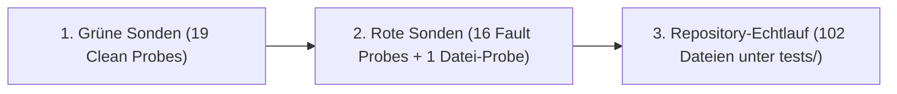

<!-- qb:frame id="CUBIE_DOC_FRAME_2" zone="head" env="Antigravity-CLI" model="Gemini-4-Hydrogen" effort="High" -->
# Meta-Gate 3: Der Einsame-Negation-Wächter

**Dokument-Informationen & Herkunft:**
- **Plattform / Umgebung:** Antigravity-CLI
- **Modell:** Gemini-4-Hydrogen
- **Reasoning-Effort:** High
- **Analysedatum:** 18. November 2026, ~21:40 (CET)
- **Synthesebasis:** `docs/feature-drafts/meta-qa/1/GEMINI.md`, `docs/feature-drafts/meta-qa/1/META_GATES.md`, `docs/feature-drafts/meta-qa/1/META_GATE_2.md`, `docs/GUIDE_Quality-Assurance.md`, `docs/GUIDE_Contract-Semantics.md`, `src/qb_cubie/ebt.py`, `src/qb_cubie/protocols.py`, `src/qb_cubie/linter.py`, `tests/test_styleguide.py`, `tests/tests_meta/test_gate_1.py`, `tests/tests_meta/test_gate_2.py`, `tests/tests_meta/test_gate_3.py`, `tests/tests_ebt/test_ebt_returns.py`, `tests/tests_ebt/test_ebt_quantors.py`, `tests/tests_ebt/test_ebt_run_isolation.py`, `tests/tests_ebt/test_ebt_exception_contracts.py`, `tests/tests_ebt/test_ebt_return_reporting.py`, `tests/tests_arena/test_ebt_arena_mutation.py`, `tests/test_offline_core.py`, `tests/tests_ebt/test_ebt_persistent_reports.py`
- **Stand:** qb-cubie (v0.0.7)
- **Git-Log:** `bb62e7ab7184c845465f3522ccee9af1ca7eeb23` ("Crafted the prototype 'tests/tests_meta/test_gate_2.py'", Chronuid, 2026-11-18)

---

```text
commit bb62e7ab7184c845465f3522ccee9af1ca7eeb23 (HEAD -> main, origin/main)
Author: Chronuid <Dominickwirzba@gmail.com>
Date:   Wed Nov 18 19:08:49 2026 +0100

    Crafted the prototype 'tests/tests_meta/test_gate_2.py'
```

---
<!-- /qb:frame -->

## Kurzüberblick: Was ist eine „einsame Negation“?

Stell dir vor, du bestellst im Restaurant eine Pizza und sagst dem Kellner nur:

> *„Bring mir bitte **keinen** verbrannten Toast!“*

Wenn der Kellner dir stattdessen einen leeren Teller, eine kalte Suppe oder einen Schuh bringt, hat er deine Regel buchstabengetreu eingehalten – es war ja kein verbrannter Toast. Trotzdem hast du nicht bekommen, was du eigentlich wolltest.

Genau dasselbe Problem entsteht in `EBT`-Tests, wenn ein Vertrag ausschließlich mit `expect=False` verbietet, was **nicht** passieren darf, aber vergisst vorzuschreiben, was stattdessen passieren **muss**:

```text
EBT(
    target=rechne,
    pre=WorldState(args=(2, 3)),
    post=WorldState(returns=99, expect=False),
)
```

In [`src/qb_cubie/ebt.py`](../../../../src/qb_cubie/ebt.py#L642-L649) arbeitet `_evaluate_step_logic` nach genau dieser Regel:

```text
positives = [t for t in traces if t.post.expect]
negatives = [t for t in traces if not t.post.expect]
violates_neg = any(t.evaluation for t in negatives)
satisfies_pos = any(t.evaluation for t in positives) if positives else True
return satisfies_pos and not violates_neg
```

Wenn `positives` leer ist, wird `satisfies_pos` automatisch `True`! Ein solches `EBT(...)` besteht also *leer* (**Vacuous Pass**), solange nur nicht exakt `99` herauskommt – selbst wenn `rechne(2, 3)` kaputt ist und plötzlich `None`, `-1` oder `"kaputt"` zurückgibt.

**Meta-Gate 3 (`META-EBT-LONELY-NEGATION`)** in [`tests/tests_meta/test_gate_3.py`](../../../../tests/tests_meta/test_gate_3.py) spürt solche rein negativen `post`-Verträge automatisch im Syntaxbaum auf. Gemäß Auftrag wurde **kein Produktionscode in `src/` verändert**. Statt zusätzliche Sonder-Tags in den Tests zu verteilen, wurde im [QA-Handbuch](../../../GUIDE_Quality-Assurance.md#best-practice-richtig-arbeiten-mit-dem-expect-flag) dokumentiert, wie man das vorhandene Flag `expect=False` sauber einsetzt, und alle `10` gefundenen Stellen wurden anschließend zu Paaren aus positiven und negativen Testfunktionen mit explizitem positivem `WorldState` ausgebaut – sodass Meta-Gate 3 komplett grün durchläuft.

---

## Teil 1: Technische Analyse – Was genau muss das Gate erkennen?

Beim Abgleich der Vorgabe aus [`GEMINI.md`](./GEMINI.md) mit [`src/qb_cubie/ebt.py`](../../../../src/qb_cubie/ebt.py), [`src/qb_cubie/protocols.py`](../../../../src/qb_cubie/protocols.py) und [`tests/tests_meta/test_gate_2.py`](../../../../tests/tests_meta/test_gate_2.py) ergaben sich **fünf klare Regeln**:

### 1. Wann zählt ein `post`-Vertrag als *einsame Negation*?

`EbtLonelyNegationRule` prüft bei jedem Aufruf von `EBT(...)` (oder `qb_cubie.EBT(...)`) das Argument `post`:

1. **Ausgelassenes `post` oder `post=None`:** `EBT` erzeugt intern `[WorldState()]` mit `expect=True`. Das ist ein positiver Zustand -> **kein Treffer**.
2. **Einzelnes `WorldState(...)` in `post`:** Hat dieser eine `WorldState`-Aufruf explizit `expect=False` (oder `expect=None`, was in `_evaluate_step_logic` ebenfalls falsy ist), besitzt jeder Eintrag in `post` kein positives Ziel -> **Treffer**.
3. **Liste oder Tupel `[WorldState(...), ...]` in `post`:**
   * Gibt es mindestens ein positives `WorldState(...)` (ohne `expect=False`/`None`), etwa `post=[WorldState(returns=3), WorldState(returns=99, expect=False)]`, hat der Vertrag ein positives Ziel -> **kein Treffer**.
   * Haben **alle** `WorldState(...)`-Einträge in `post` explizit `expect=False`/`None`, fehlt jedes positive Ziel -> **Treffer**.
4. **Dynamische oder undurchsichtige Ausdrücke:** Steckt in `post` eine Variable (`post=expected_states`), ein gemischter Eintrag (`[q1, WorldState(..., expect=False)]`) oder ein dynamisches `expect=flag`, hält sich der statische Scanner bewusst zurück, um **keine False Positives** zu erzeugen.

### 2. Wie werden `EBT`- und `WorldState`-Argumente gefunden?

Genau wie Meta-Gate 2 nutzt Meta-Gate 3 Cubies eigenen [`CstLinter`](../../../../src/qb_cubie/linter.py#L198-L250) auf Basis von `libcst`:

* **Bei `EBT(...)`** liest `_extract_call_params` die Parameter `pre` (Index `2`), `post` (Index `3`), `expect` (Index `4`) und `tags` (Index `9`) – sowohl als Keyword-Argumente, als Positionsargumente als auch aus statischen `**{...}`-Dict-Literalen.
* **Bei `WorldState(...)`** prüft `_is_explicitly_negative_worldstate` das Argument `expect` sowohl per Keyword (`expect=False`) als auch per Positionsindex `5` gemäß [`src/qb_cubie/protocols.py`](../../../../src/qb_cubie/protocols.py#L68-L75) und per `**{"expect": False}`.

### 3. Wie funktioniert die Ausnahme `tags={"meta:negative-invariant"}`?

Manche Tests wollen **absichtlich** nur eine reine Negativ-Invariante ausdrücken (zum Beispiel wenn die Engine selbst genau dieses `EBT`-Feature testet). Laut [`GEMINI.md`](./GEMINI.md#L9) werden solche Tests mit `tags={"meta:negative-invariant"}` explizit freigeschaltet.

Eine kleine, aber wichtige Feinheit zeigt der Vergleich zwischen Meta-Gate 2 und Meta-Gate 3:

* In Meta-Gate 3 wird ein **Set-Literal** gezeigt: `tags={"meta:negative-invariant"}`.
* In Meta-Gate 2 wird ein **Dict-Literal** genutzt: `tags={"meta:cross-product-reason": "..."}`.

Was passiert, wenn ein Test **beides** braucht (zum Beispiel eine `2x2`-Matrix aus lauter negativen Zuständen)? Damit beide Welten sauber zusammenpassen, akzeptiert `_has_negative_invariant_tag` alle idiomatischen statischen Schreibweisen:

| Schreibweise in `tags=...` | Ergebnis |
| :--- | :--- |
| `tags={"meta:negative-invariant"}` (Set, auch mit weiteren Tags) | **Erlaubt** |
| `tags=["meta:negative-invariant"]` oder `("meta:negative-invariant",)` (Liste/Tupel) | **Erlaubt** |
| `tags={"meta:negative-invariant": True}` oder `tags={"meta:negative-invariant": "Begründung"}` (Dict, kombinierbar mit Gate 2) | **Erlaubt** |
| `tags=set()`, `tags={"meta:other"}`, `tags={"meta:negative-invariant": False}`, `tags={"meta:negative-invariant": "   "}` | **Abgelehnt** (`META-EBT-LONELY-NEGATION`) |

### 4. Wichtige Beobachtung: `EBT(..., expect=False)` und Doppel-Negation

In `qb-cubie` gibt es `expect=False` an **zwei verschiedenen Stellen**:

1. **Auf `WorldState(..., expect=False)` in `post`:** Verbietet ein einzelnes Zielmuster.
2. **Auf `EBT(..., expect=False)`:** Kehrt das Gesamtergebnis des ganzen `EBT`-Laufs um (`not lauf_ok`).

Dabei entstehen zwei völlig unterschiedliche Kombinationen:

* **Positives `post` + `EBT(..., expect=False)`** (z. B. `EBT(target=f, post=WorldState(returns="fail"), expect=False)`): Hier besitzt `post` ein normales `WorldState` ohne `expect=False`. Meta-Gate 3 lässt diesen Fall in Ruhe.
* **Negatives `post` + `EBT(..., expect=False)`** (Doppel-Negation, z. B. `EBT(target=f, post=WorldState(returns=99, expect=False), expect=False)`): Hier besitzt jeder `WorldState`-Eintrag in `post` explizit `expect=False` **und** auch auf `EBT(...)` ist kein positives Ziel verankert. Das Gate meldet daher auch diesen Fall, sofern er nicht über `tags={"meta:negative-invariant"}` dokumentiert ist. (In Teil 3 sehen wir gleich, dass es im Repository genau `3` solcher Doppel-Negations-Tests gibt!)

---

## Teil 2: Aufbau von [`tests/tests_meta/test_gate_3.py`](../../../../tests/tests_meta/test_gate_3.py)

Wie Meta-Gate 1 und Meta-Gate 2 folgt auch Meta-Gate 3 der **Wächter-Kalibrierungs-Triade (Meta-Gate 5)** und umfasst insgesamt **37 Testfälle**:



1. **Grüne Sonden (`test_lonely_negation_rule_accepts_clean_probes`, 19 Fälle):**
   Ausgelassenes `post`, `post=None`, einzelnes positives `WorldState` (Standard und explizit `expect=True`), positives `post` mit `EBT(expect=False)`, gemischte Listen/Tupel mit mindestens einem positiven `WorldState`, dynamisches `expect=flag`, gemischte oder dynamische `post`-Variablen, alle gültigen Ausnahme-Tags (`set`, `list`, `tuple`, `dict` mit String/Bool und kombiniert mit `meta:cross-product-reason`), qualifizierte `qb_cubie.EBT(...)`-Aufrufe, Nicht-`EBT`-Aufrufe und String-Literale müssen exakt `[]` liefern.
2. **Rote Sonden (`test_lonely_negation_rule_detects_fault_probes` & `test_lonely_negation_rule_reports_file_path_on_disk`, 17 Fälle):**
   Einzelnes `WorldState(..., expect=False)`, leeres `WorldState(expect=False)`, `expect=None`, Positionsargument an Index `5`, `**{"expect": False}`, Listen und Tupel aus mehreren negativen `WorldState`s (`0pos/2neg`, `0pos/3neg`), Positions- und `**kwargs`-Übergabe von `post` an `EBT`, qualifiziertes `qb_cubie.EBT` + `qb_cubie.WorldState`, ungültige oder leere Tags (`{"meta:other"}`, `set()`, `False`, `"   "`), Doppel-Negation ohne Tag, Zeilenversatz (`# Kommentar` in Zeile 1 -> Treffer in Zeile 2) sowie eine echte Datei auf Platte (`tmp_path`).
3. **Repository-Gate (`test_repository_has_no_lonely_ebt_negations`, 1 Fall):**
   Scannt alle `.py`-Dateien unter `tests/` (ohne `.arenas`, `.venv`, `__pycache__`, `.git`, `.pytest_cache`) und schlägt an, sobald eine ungetaggte einsame Negation existiert.

---

## Teil 3: Was ist beim Ausführen passiert?

### 1. Statische Checks, Sammlung & Kalibrierung

* **Ruff (`.venv/bin/ruff check tests/tests_meta/`):** **`All checks passed!`**
* **MyPy (`MYPYPATH=src .venv/bin/mypy tests/tests_meta/`):** **`Success: no issues found in 4 source files`**
* **Sammlung (`.venv/bin/python -m pytest --collect-only -q tests/tests_meta`):** Sammelt **78 Tests** in `0,15 s` (`17` aus `test_gate_1.py`, `24` aus `test_gate_2.py`, `37` aus `test_gate_3.py`).
* **Meta-Gate 1 & 2 (`.venv/bin/python -m pytest -v tests/tests_meta/test_gate_1.py tests/tests_meta/test_gate_2.py`):** Bestehen unverändert mit **`41 passed in 10.59s`**.
* **Collection-Vertrag (`.venv/bin/python -m pytest -q tests/test_default_collection_contract.py`):** Besteht mit **`3 passed in 1.49s`**.
* **Meta-Gate 3 (`.venv/bin/python -m pytest -v tests/tests_meta/test_gate_3.py`):**
  * Alle **36 Kalibrierungs-Sonden** (`19` grüne Sonden, `16` rote In-Memory-Sonden, `1` Datei-Probe) sind **sofort grün (`PASSED`)**.
  * Das **Repository-Gate** (`test_repository_has_no_lonely_ebt_negations`) scannt **`102` Python-Dateien** unter `tests/` und schlägt erwartungsgemäß an (**`1 failed, 36 passed in 4.72s`**) – mit **exakt 10 Treffern in 6 Testdateien**!

### 2. Die 10 konkreten Funde im Repository

```text
/home/symphonie/PycharmProjects/cubie/tests/tests_ebt/test_ebt_returns.py:89:13 [META-EBT-LONELY-NEGATION] Einsame Negation (1x expect=False in post ohne positives Ziel): Ergänze ein positives WorldState(...) oder dokumentiere die Ausnahme über tags={'meta:negative-invariant'}.
/home/symphonie/PycharmProjects/cubie/tests/tests_ebt/test_ebt_quantors.py:164:4 [META-EBT-LONELY-NEGATION] Einsame Negation (1x expect=False in post ohne positives Ziel): Ergänze ein positives WorldState(...) oder dokumentiere die Ausnahme über tags={'meta:negative-invariant'}.
/home/symphonie/PycharmProjects/cubie/tests/tests_ebt/test_ebt_quantors.py:172:4 [META-EBT-LONELY-NEGATION] Einsame Negation (1x expect=False in post ohne positives Ziel): Ergänze ein positives WorldState(...) oder dokumentiere die Ausnahme über tags={'meta:negative-invariant'}.
/home/symphonie/PycharmProjects/cubie/tests/tests_ebt/test_ebt_quantors.py:184:4 [META-EBT-LONELY-NEGATION] Einsame Negation (2x expect=False in post ohne positives Ziel): Ergänze ein positives WorldState(...) oder dokumentiere die Ausnahme über tags={'meta:negative-invariant'}.
/home/symphonie/PycharmProjects/cubie/tests/tests_ebt/test_ebt_quantors.py:195:4 [META-EBT-LONELY-NEGATION] Einsame Negation (2x expect=False in post ohne positives Ziel): Ergänze ein positives WorldState(...) oder dokumentiere die Ausnahme über tags={'meta:negative-invariant'}.
/home/symphonie/PycharmProjects/cubie/tests/tests_ebt/test_ebt_run_isolation.py:42:11 [META-EBT-LONELY-NEGATION] Einsame Negation (1x expect=False in post ohne positives Ziel): Ergänze ein positives WorldState(...) oder dokumentiere die Ausnahme über tags={'meta:negative-invariant'}.
/home/symphonie/PycharmProjects/cubie/tests/tests_ebt/test_ebt_exception_contracts.py:78:13 [META-EBT-LONELY-NEGATION] Einsame Negation (1x expect=False in post ohne positives Ziel): Ergänze ein positives WorldState(...) oder dokumentiere die Ausnahme über tags={'meta:negative-invariant'}.
/home/symphonie/PycharmProjects/cubie/tests/tests_ebt/test_ebt_return_reporting.py:78:11 [META-EBT-LONELY-NEGATION] Einsame Negation (1x expect=False in post ohne positives Ziel): Ergänze ein positives WorldState(...) oder dokumentiere die Ausnahme über tags={'meta:negative-invariant'}.
/home/symphonie/PycharmProjects/cubie/tests/tests_ebt/test_ebt_return_reporting.py:95:11 [META-EBT-LONELY-NEGATION] Einsame Negation (1x expect=False in post ohne positives Ziel): Ergänze ein positives WorldState(...) oder dokumentiere die Ausnahme über tags={'meta:negative-invariant'}.
/home/symphonie/PycharmProjects/cubie/tests/tests_arena/test_ebt_arena_mutation.py:104:4 [META-EBT-LONELY-NEGATION] Einsame Negation (1x expect=False in post ohne positives Ziel): Ergänze ein positives WorldState(...) oder dokumentiere die Ausnahme über tags={'meta:negative-invariant'}.
```

Schaut man sich diese `10` Treffer genau an, zeigt sich ein **sehr beruhigendes und zugleich lehrreiches Bild**:

#### Gruppe A: 7 echte „nur `expect=False` in `post`“-Tests (`EBT.expect=True`)

| Fundstelle | Testfunktion | Muster in `post` | Bewertung |
| :--- | :--- | :--- | :--- |
| [`test_ebt_returns.py:89`](../../../../tests/tests_ebt/test_ebt_returns.py#L88-L100) | `test_negative_none_contract_forbids_only_none` | `WorldState(returns=None, expect=False)` | **Absichtlicher Engine-Test:** Prüft mit `reporter=None` und `assert result.evaluation is (actual is not None)`, dass nur `None` verboten wird. |
| [`test_ebt_quantors.py:164`](../../../../tests/tests_ebt/test_ebt_quantors.py#L162-L168) | `test_single_local_expect_false_green` | `WorldState(returns=99, expect=False)` | **Absichtlicher Engine-Test:** Prüft genau das Feature „einzelnes lokales `expect=False` ohne Liste“. |
| [`test_ebt_quantors.py:184`](../../../../tests/tests_ebt/test_ebt_quantors.py#L182-L191) | `test_exclusive_negative_filters_green` | `[WorldState(returns=404, expect=False), WorldState(returns=500, expect=False)]` | **Absichtlicher Engine-Test:** Prüft genau den Abschnitt `EXCLUSIVE NEGATIV-FILTER` (`positives == []`). |
| [`test_ebt_run_isolation.py:42`](../../../../tests/tests_ebt/test_ebt_run_isolation.py#L41-L47) | `test_previous_negative_match_does_not_poison_next_run` | `WorldState(returns=0, expect=False)` | **Absichtlicher Isolations-Test:** Prüft mit `reporter=None` nacheinander `False` (`args=(0,)`) und `True` (`args=(1,)`). |
| [`test_ebt_exception_contracts.py:78`](../../../../tests/tests_ebt/test_ebt_exception_contracts.py#L76-L85) | `test_forbidden_exception_uses_raw_match_then_negates` | `WorldState(raises=..., expect=False)` | **Absichtlicher Exception-Test:** Prüft `result.traces[0].evaluation` und `result.evaluation` explizit gegen `matches`. |
| [`test_ebt_return_reporting.py:78`](../../../../tests/tests_ebt/test_ebt_return_reporting.py#L76-L91) | `test_forbidden_falsy_return_reports_the_matching_value` | `WorldState(returns=value, expect=False)` | **Absichtlicher Reporter-Test:** Läuft in `with pytest.raises(AssertionError)` und prüft die Fehlermeldung für falsy Rückgaben. |
| [`test_ebt_return_reporting.py:95`](../../../../tests/tests_ebt/test_ebt_return_reporting.py#L93-L101) | `test_omitted_return_expectation_does_not_invent_a_return_comparison` | `WorldState(expect=False)` | **Absichtlicher Reporter-Test:** Läuft in `with pytest.raises(AssertionError)` und prüft, dass `returns` nicht erfunden wird. |

#### Gruppe B: 3 Doppel-Negations-Tests (`post` mit `expect=False` **und** `EBT(..., expect=False)`)

| Fundstelle | Testfunktion | Muster | Bewertung |
| :--- | :--- | :--- | :--- |
| [`test_ebt_quantors.py:172`](../../../../tests/tests_ebt/test_ebt_quantors.py#L170-L177) | `test_single_local_expect_false_red` | `WorldState(returns=99, expect=False)` + `EBT(..., expect=False)` | **Symmetrischer Gegen-Test zu Zeile 164:** Prüft, dass der verbotene Treffer `99` den Vertrag scheitern lässt. |
| [`test_ebt_quantors.py:195`](../../../../tests/tests_ebt/test_ebt_quantors.py#L193-L203) | `test_exclusive_negative_filters_red` | `[404 (False), 500 (False)]` + `EBT(..., expect=False)` | **Symmetrischer Gegen-Test zu Zeile 184:** Prüft, dass ein Treffer in einer rein negativen Liste scheitert. |
| [`test_ebt_arena_mutation.py:104`](../../../../tests/tests_arena/test_ebt_arena_mutation.py#L99-L109) | `test_volatile_metadata_with_strict_expectation_red` | `WorldState(arena=..., expect=False)` + `EBT(..., expect=False)` | **Absichtlicher Arena-Test:** Prüft, dass volatile Metadaten-Ignoranz keinen negativen Filter auf der Basis-Arena umgeht. |

> [!NOTE]
> **Einordnung der 3 Doppel-Negations-Funde (Gruppe B):**
> Logisch gesehen ist `EBT(..., post=WorldState(returns=99, expect=False), expect=False)` kein *Vacuous Pass*: Durch die doppelte Verneinung (`not (not match(99))`) besteht der Test **nur**, wenn wirklich `99` herauskommt. Trotzdem fehlt ein positives `WorldState(...)` in `post`, und eine Doppel-Negation ist für Leser schwer zu verstehen – weshalb in `test_ebt_quantors.py` auch genau das Gegenstück zu den Zeilen `164` und `184` steht. Im nächsten Schritt kann man daher bewusst entscheiden: Entweder erhalten alle `10` Framework-Tests ein explizites `tags={"meta:negative-invariant"}`, oder man klammert `EBT(..., expect=False)` im Gate aus (so wie wir es bei `test_ebt_contract_mutation.py` mit dem dynamischen `expect=not forbidden` bereits ohne False Positive sehen).

### 3. Gegenproben ohne Fehlalarm

Genauso wichtig ist, was Meta-Gate 3 **bewusst nicht** bemängelt hat:

* Alle **5 Tests mit gemischtem `post`** (mindestens ein positiver + ein oder mehrere negative `WorldState`-Einträge) in [`tests/test_offline_core.py:161`](../../../../tests/test_offline_core.py#L161-L165), [`tests/tests_ebt/test_ebt_persistent_reports.py:138`](../../../../tests/tests_ebt/test_ebt_persistent_reports.py#L138-L141) und [`tests/tests_ebt/test_ebt_quantors.py:115, 131, 148`](../../../../tests/tests_ebt/test_ebt_quantors.py#L115-L158) bleiben **grün**.
* Alle **19 Tests mit `EBT(..., expect=False)` und positivem `post`** (wie [`tests/tests_ebt/test_ebt_demo.py`](../../../../tests/tests_ebt/test_ebt_demo.py) oder [`tests/tests_arena/test_ebt_arena.py`](../../../../tests/tests_arena/test_ebt_arena.py)) lösen **keinen** Fehlalarm aus.
* In den fachlichen Anwender- und Workflow-Tests (`tests/tests_user_workflows/`, `tests/tests_services/`) gibt es **0 Treffer** – dort hat sich nirgendwo eine versehentliche einsame Negation eingeschlichen.

### 4. Auflösung ohne Sonder-Tags: `expect`-Best-Practice & Ausbau aller 10 Fundstellen

In der anschließenden Auswertung fiel eine bewusste Architekturentscheidung: **In den Tests werden keine zusätzlichen `meta:negative-invariant`-Tags benötigt**, weil `expect=False` bereits selbst das explizite Flag für negative Zustände (`WorldState`) und erwartetes Scheitern (`EBT`) ist.

1. **Best Practice im QA-Handbuch ([`docs/GUIDE_Quality-Assurance.md`](../../../GUIDE_Quality-Assurance.md#L159-L271)):**
   Der neue Abschnitt *„Best Practice: Richtig arbeiten mit dem `expect`-Flag“* erklärt die beiden Ebenen (`WorldState.expect` vs. `EBT.expect`) anhand von zwei Positiv-Beispielen (Soll-Ziel + Negativ-Filter in `post` sowie Red-Phase-Nachweis mit `EBT(..., expect=False)`) und einem Negativ-Beispiel (der *Vacuous Pass* durch eine einsame Negation). Die Einzelprüfung via `DocEnsurance` (`passed: True`, `diagnostics: ()`) sowie `.venv/bin/python -m pytest -v -m "" tests/test_styleguide.py` (**`14 passed in 19.20s`**) bestätigen alle Code-Beispiele.
2. **Umbau aller 10 markierten Stellen zu positiven + negativen Testfunktionen (ohne Änderung in `src/`):**

| Datei | Vorher | Nachher (positiv + negativ mit positivem `WorldState`) |
| :--- | :--- | :--- |
| [`test_ebt_returns.py`](../../../../tests/tests_ebt/test_ebt_returns.py#L87-L124) | `test_negative_none_contract_forbids_only_none` | `test_negative_none_contract_accepts_non_none_values` (`[42, 0, False]`) + `test_negative_none_contract_rejects_none` (`None`, inkl. `expect=False`) mit `post=[WorldState(returns=int), WorldState(returns=None, expect=False)]`. |
| [`test_ebt_quantors.py`](../../../../tests/tests_ebt/test_ebt_quantors.py#L160-L234) | `test_single_local_expect_false_{green,red}` & `test_exclusive_negative_filters_{green,red}` | `test_single_local_expect_true_{green,red}`, `test_local_expect_false_{green,red}` und `test_negative_filters_{green,red}` mit expliziten positiven Bereichs-/Typ-Zuständen neben `expect=False`. |
| [`test_ebt_run_isolation.py`](../../../../tests/tests_ebt/test_ebt_run_isolation.py#L41-L56) | `test_previous_negative_match_does_not_poison_next_run` | `post=[WorldState(returns=int), WorldState(returns=0, expect=False)]` sowie neues positives Gegenstück `test_previous_positive_match_does_not_mask_next_negative_match`. |
| [`test_ebt_exception_contracts.py`](../../../../tests/tests_ebt/test_ebt_exception_contracts.py#L76-L111) | `test_forbidden_exception_uses_raw_match_then_negates` | `test_forbidden_exception_accepts_allowed_exception_message` + `test_forbidden_exception_rejects_matching_exception_message` mit `post=[WorldState(raises=expectation(ValueError)), WorldState(raises=expectation(match="^invalid order:"), expect=False)]`. |
| [`test_ebt_return_reporting.py`](../../../../tests/tests_ebt/test_ebt_return_reporting.py#L76-L126) | `test_forbidden_falsy_return_reports_the_matching_value` & `test_omitted_return_expectation_does_not_invent_a_return_comparison` | Ergänzt um `test_allowed_falsy_return_passes_with_negative_filter` und `test_omitted_return_expectation_accepts_non_matching_negative_filter`; die negativen Reporter-Prüfungen tragen nun jeweils ein positives `WorldState` im selben `post`. |
| [`test_ebt_arena_mutation.py`](../../../../tests/tests_arena/test_ebt_arena_mutation.py#L99-L112) | `test_volatile_metadata_with_strict_expectation_red` (unter `test_volatile_metadata_ignorance_green`) | Kombiniert `WorldState(returns=True)` mit `WorldState(arena=PyVenv(BASE_ARENA), expect=False)` bei `expect=False`. |

3. **Endstand nach Bereinigung aller 10 Fundstellen:**
   * **Geänderte Testdateien:** `.venv/bin/python -m pytest -q tests/tests_ebt/test_ebt_returns.py tests/tests_ebt/test_ebt_quantors.py tests/tests_ebt/test_ebt_run_isolation.py tests/tests_ebt/test_ebt_exception_contracts.py tests/tests_ebt/test_ebt_return_reporting.py tests/tests_arena/test_ebt_arena_mutation.py` -> **`188 passed in 7.25s`**
   * **Meta-Gates 1–3 (`.venv/bin/python -m pytest -v tests/tests_meta/`):** **`78 passed in 14.03s`** (inklusive `test_repository_has_no_lonely_ebt_negations`)
   * **Gesamtlauf `meta and fast` (`.venv/bin/python -m pytest -m "meta and fast" -q`):** **`133 passed, 1409 deselected in 43.16s`**

---

## Fazit

1. **Meta-Gate 3 ist vollständig grün im Profil `meta and fast`:** [`tests/tests_meta/test_gate_3.py`](../../../../tests/tests_meta/test_gate_3.py) läuft zusammen mit Meta-Gate 1 und 2 (`78 passed`) sowie dem gesamten `meta and fast`-Lauf (`133 passed`) fehlerfrei durch – ohne Änderungen in `src/`.
2. **Kein Sonder-Tag in der Praxis nötig:** Alle `10` Fundstellen wurden statt über Extra-Tags durch klare Paare aus positiven und negativen Testfunktionen mit explizitem positivem `WorldState` neben `expect=False` aufgelöst.
3. **Dokumentation nachgezogen:** Das Verhalten des `expect`-Flags auf `WorldState`- und `EBT`-Ebene ist nun mit Positiv- und Negativ-Beispielen verifiziert im [QA-Handbuch](../../../GUIDE_Quality-Assurance.md#L159-L271) festgehalten; weitergehende Quantor-Konfigurationen im Core folgen in einem späteren Schritt.

<!-- qb:frame id="CUBIE_DOC_FRAME_2" zone="foot" -->

---

---

<div align="center">


[↦ | Vertragsaufbau: Eindeutigkeit & Kopplung | ↤](../../../GUIDE_Contract-Design.md)  
[↦ | Erwartungssteuerung & Safety (`expect`-Flags) | ↤](../../../GUIDE_Expect-Flags.md)  
[↦ | Qualitätssicherung mit Cubie | ↤](../../../GUIDE_Quality-Assurance.md)  
[↦ | Fortgeschrittene Quantoren (`all` vs. `exists`) | ↤](../../../GUIDE_Quantifiers.md)  
[↦ | Test-Guided Development (TGD) | ↤](../../../GUIDE_TGD.md)  

[↦ | GUIDE: `DocEnsurance` – Lebende und verifizierte Dokumentation | ↤](../../../services/GUIDE_DocEnsurance.md)  
[↦ | DocFrame (Prototyp) | ↤](../../../services/GUIDE_DocFrame.md)  

[↦ | Dokumentations-Übersicht | ↤](../../../README.md)  
[↦ | Core-Dokumentation | ↤](../../../core/README.md)  
[↦ | Entwicklerdokumentation | ↤](../../../dev/README.md)  
[↦ | Core-Internals | ↤](../../../dev/core/README.md)  
[↦ | Hintergrund & Essays | ↤](../../../misc/README.md)  
[↦ | Feature-Drafts: Virtualisierung | ↤](../../virtualization/README.md)  

[↦ | Meta-Gate 3 | ↤](./GEMINI.md)  
[↦ | Lehrstunde 1 | ↤](./META_GATES.md)  
[↦ | Meta-Gate 1: Der Import-Kanonizitäts-Wächter | ↤](./META_GATE_1.md)  
[↦ | Meta-Gate 2: Der Kreuzprodukt-Wächter | ↤](./META_GATE_2.md)  
[↦ | Meta-Gate 3: Der Einsame-Negation-Wächter | ↤](./META_GATE_3.md)  

</div>
<!-- /qb:frame -->
