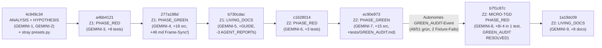

<!-- qb:frame id="CUBIE_DOC_FRAME_2" zone="head" env="Antigravity-CLI" model="Gemini 4 Neon" effort="High" -->
# Analyse: Empirische Git- & Artefakt-Vermessung der TGD-Versuchsreihe (`v0.0.3` bis `HEAD`)

**Dokument-Informationen & Herkunft:**
- **Plattform / Umgebung:** Antigravity-CLI
- **Modell:** Gemini 4 Neon
- **Reasoning-Effort:** High
- **Analysedatum:** 26. November 2026, ~15:45 (CET)
- **Synthesebasis:** `docs/services/GEMINI-10.md`, `docs/GUIDE_TGD.md`, `docs/dev/DEV-GUIDE_Agent-Reports.md`, `docs/services/GEMINI-1.md`..`GEMINI-9.md`, `docs/services/ANALYSIS.md`, `docs/services/HYPOTHESIS.md`, `docs/services/GUIDE_Service-Core.md`, `tests/GREEN_AUDIT.md`, `tests/test_styleguide.py`, `tests/test_doc_frame.py`, `tests/test_doc_ensurance.py`, `tests/tests_core/tests_services/test_service_architecture_gate.py`, `KNOWN_ISSUES.md`, vollständige Git-Historie (`git log --all --full-history v0.0.2..1a19dc09` inkl. historischer `GEMINI*.md`, `ANALYSIS*.md`, `HYPOTHESIS*.md`, `AGENT_REPORT*.md`, `TGD_*.md`, `META_QUESTION.md`)
- **Stand:** qb-cubie (`v0.1.1`, Branch `main`, Commit `1a19dc09`)
- **Git-Log:** `1a19dc09` ("Tried cycle 2, phase Living-Documentation - for the service core")

---

```text
commit 1a19dc0941c49ca08bef1a70b0aef44300021bdf (HEAD -> main)
Author: Chronuid <Dominickwirzba@gmail.com>
Date:   Thu Nov 26 15:28:52 2026 +0100

    Tried cycle 2, phase Living-Documentation - for the service core

Auftrag (docs/services/GEMINI-10.md):
- Stützrad 1 (ANALYSIS): Empirische Git- und Artefakt-Analyse der TGD-Versuchsreihe
  (ab v0.0.3-Sprint bis HEAD) mit Fokus auf dem Service-Core-Doppelzyklus als
  Datengrundlage für künftige knotenspezifische TGD-Handbücher.
- Scope: Rein lesende Bestandsaufnahme (src/, tests/ und bestehende Handbücher
  unverändert; Ausgabe ausschließlich in docs/services/ANALYSIS-POST.md).
```
<!-- /qb:frame -->

## Kurzfassung (Executive Summary)

**Scope:** Rein lesende Git- und Artefakt-Analyse über die gesamte Entwicklungs- und Experimentierhistorie von `v0.0.2`/`v0.0.3` bis `HEAD` (`1a19dc09`) mit Tiefenvermessung des Service-Core-Doppelzyklus (`4c949c34`..`1a19dc09`). Produktivcode unter `src/`, Testcode unter `tests/` sowie bestehende Handbücher blieben vollständig unverändert.

**Kernbefunde (`Ist`):**

1. **`[EVOLUTION]` Vom impliziten Test-First-Sprint (`v0.0.3`–`v0.0.6`) zum zustandslosen Knoten-Automaten (`v0.1.1+`):** Die Git-Historie zeigt vier deutlich abgrenzbare Reifestufen — von frühen Hypothesen-/Studien-Vorläufern (`318c030c`, `8bd7f57b`, `4f05f30d`) über monolithische 850–1.150-Zeilen-Promptpakete (`740f3134`, `d4ea5c1b`, `21c4c65d`) und voll-autonome Single-Pass-TGD-Läufe (`6ce7dca8`, `f9332722`, `0da52794`) hin zu ultrakurzen, zustandslos orchestrierten Einzelschritt-Aufträgen (`docs/services/GEMINI-1.md`..`GEMINI-9.md`, 71–90 Zeilen) im Service-Core-Doppelzyklus.
2. **`[BEWÄHRT]` Erster vollständig autonomer `GREEN_AUDIT` $\to$ `PHASE_RED`-Mikro-TGD-Rücksprung (`ec90e973` $\to$ `b7f1c87c`):** In Zyklus 2 hielt Phase Green das strikte Schreibverbot auf `tests/**/*.py` bei 49/51 grünen Tests ein, protokollierte den reproduzierbaren Fixture-Widerspruch sauber in `tests/GREEN_AUDIT.md`, und ein frischer Kontext in `b7f1c87c` verifizierte den Befund unabhängig per Subprozess-Blocker und reparierte ausschließlich die 16-Zeilen-Fixture (`+8/-4` Zeilen) unter Erhalt aller eingefrorenen Assertions.
3. **`[ABWEICHUNG]` Drei reale Prozess-Reibungen im Service-Core-Lauf:**
   - **Schreibgrenzen-Bruch durch Vor-Commit-Altlast (`4c949c34` $\to$ `277a188d`):** Eine manuelle Änderung an `presets.py:80` (`> [!Note]` $\to$ `> [!NOTE]`) im Analyse-Commit erzwang in Zyklus 1 Phase Green einen Repo-weiten `DocFrame`-Sync über **46 `.md`-Dateien** (`43` unter `docs/`, `3` im Root).
   - **Begriffs- & Commit-Ambiguität (`ec90e973` $\to$ `b7f1c87c`):** Das Auftragsdokument `GEMINI-8.md` deklarierte korrekt `PHASE_RED` als Mikro-TGD-Zyklus, die Commit-Message `b7f1c87c` etikettierte den Rücksprung jedoch erneut als `phase Green - ... Addressed the GREEN_AUDIT-Event`.
   - **Copy-Paste- & Pre-Drafting-Drift in `GEMINI-*.md`:** `GEMINI-4.md:27` erbte ein falsches `# Ziel` aus `GEMINI-3.md`; `GEMINI-1..3.md` enthielten kaputte relative Rahmen-Links; Folge-Prompts (`GEMINI-5`, `GEMINI-7`, `GEMINI-8`, `GEMINI-9`) wurden jeweils bereits im Commit des *Vorgänger*-Knotens mitcommittet.
4. **`[RÜCKKOPPLUNG]` Aktive Gates formen das Design; pausierte Gates zeigen die Grenze impliziter Übertragung:**
   - Das geschärfte Meta-Gate 4 (`FORBIDDEN_IO_ATTR_CALLS` inkl. `"exists"` in `test_service_architecture_gate.py:52`) erzwang real eine Plan-vs.-Code-Anpassung (`WorkspaceView.exists` aus `HYPOTHESIS.md:187` $\to$ `WorkspaceView.has_path` in `a4bb4121`/`277a188d`).
   - Trotz seit `821f0d6d` (`BUG-006`) per `@pytest.mark.skip` pausiertem `test_function_size`-Gate blieben **198 von 208 Funktionen (95,2 %)** über alle 17 Service-Core-/Adapter-Dateien innerhalb von $\le 12$ Body-Zeilen (in Zyklus 2 sogar **80/80 = 100 %**); in Zyklus 1 rutschten dennoch **10 Funktionen** auf 13–21 Zeilen durch.
5. **`[HYPOTHESE]` Auslagerung der Knoten-Regeln reduziert `GEMINI*.md` auf ein 5-Feld-Routing-Ticket:** Sobald Ein-/Austrittsbedingungen ($P$/$Q$), Schreibgrenzen und Meta-QA-Heuristiken in dedizierten Knoten-Handbüchern liegen, genügt pro Schritt ein kurzes, copy-paste-armes Auftragsdokument mit expliziter Knoten-ID, Eingabe-Referenzen, Delta-Entscheidungen und Ziel-Artefakt — idealerweise außerhalb der von `DocFrame` überwachten Produkt-Dokumentation oder explizit über `DOC_EXCLUDES` entkoppelt.

---

## 1. Git-Archäologie der TGD-Versuchsreihe (`v0.0.3`-Sprint bis `HEAD`)

### 1.1 Methodik & dokumentierte Lücken der Git-Historie (`Ist`)

Die Auswertung stützt sich auf `git log --all --full-history --name-status` über sämtliche Branches (`main`, `experimental`, `backup-master-state`) von `v0.0.2` (`e3460edc`, 2026-08-21) bis `HEAD` (`1a19dc09`, 2026-11-26) inklusive `git show <commit>:<pfad>` für gelöschte, verschobene und umbenannte Dateien.

> [!NOTE]
> **Explizite Evidenzlücken (Fallibilismus-Vorbehalt):**
> 1. **Nicht committete Zwischenschritte & Kontext-Resets:** Manuelle `/clear`-Resets, verworfene Zwischenversuche, Chat-Rückfragen in externen Oberflächen (`Gemini-App`) sowie genaue Modellwechsel innerhalb eines einzelnen Commits sind im Git-Log **nicht** sichtbar, sofern sie nicht explizit in einem `CUBIE_DOC_FRAME_2`-Header (z. B. `TGD_CI_STAGE3.md:1,37-44`) oder einer Commit-Nachricht (`f1bf2663`) protokolliert wurden.
> 2. **Vorlaufzeit `v0.0.3`–`v0.0.6` (2026-08-21 bis 2026-11-14):** Im Release-Sprint zu `v0.0.3` (`fadbd0eb`, 2026-09-17) existierten noch **keine** committeten `GEMINI*.md`-, `ANALYSIS*.md`- oder `GREEN_AUDIT*.md`-Dateien. Sichtbare Vorläufer sind `tests/tests_multiprocessors/mp_hypothesis.py` (`318c030c`, 2026-09-16), die systematische Gutachten-Abarbeitung (`2416088f`..`1e07b785`, 2026-11-09/10), die Pilotstudie `experiments/testguided-study/HYPOTHESIS-V6..V8-GEMINI-ARGON-HIGH.md` (`8bd7f57b`, `5976fc90`, `10169e57`, 2026-11-12) sowie der erste explizite `Phase RED` $\to$ `GREEN`-Commit für das `DocRule`-System (`4f05f30d` $\to$ `d59f82d5`, 2026-11-14). Alle Rückschlüsse über die interne Gesprächsführung vor `ff871979` (2026-11-16) bleiben daher unbelegt und werden hier nicht extrapoliert.

### 1.2 Chronologische Gesamtübersicht aller identifizierten TGD-Läufe (`Ist`)

| Lauf | Zeitraum / Release-Kontext | Zentrale Commits | Zielsetzung | Identifizierte Artefakte (inkl. gelöscht/verschoben) | Durchlaufene Knoten-Sequenz | Autonomiegrad & Eingriffe |
| :-: | :--- | :--- | :--- | :--- | :--- | :--- |
| **L0** | 2026-09-16 bis 2026-11-14 (`v0.0.3`–`v0.0.6`) | `318c030c`, `2416088f`, `8bd7f57b`..`08792e32`, `4f05f30d`, `d59f82d5`, `920f26cf` | Vorläufer: Hypothesen-Testmodul (`mp_hypothesis.py`), Gutachten-Sprints, `testguided-study` (Multi-Agenten-Studie), `DocEnsurance`-`DocRule`-System, `META_QUESTION.md` | `tests/tests_multiprocessors/mp_hypothesis.py`, `GUTACHTEN.md`, `experiments/testguided-study/HYPOTHESIS-V6..V8-*.md`, `META_QUESTION.md` (gelöscht in `5c0a4907`) | Informelles `Red -> Green` (`4f05f30d` $\to$ `d59f82d5`), externe Analyse/Hypothese (`Gemini-App`) | Hochgradig manuell/iterativ; noch keine formale Knoten-Trennung im Repo |
| **L1** | 2026-11-16 (`v0.0.7`) | `ff871979`, `03d7a0dd`, `df3714be`, `db8eb74d`, `ce02737d`, `05e9945b`, `7e08e2ac` | Aufbau des neuen Services `DocFrame` (Prototyp) samt Test-Suite | `tests/tests_services/tests_doc_frame/GEMINI.md` (erstellt `ff871979`, überschrieben mit `make test-all`-Logs in `df3714be`/`ce02737d`, gelöscht `7e08e2ac`), `HYPOTHESIS.md` (erstellt `df3714be`, aktualisiert `db8eb74d`, gelöscht `ce02737d`) | `PLAN/DESIGN` $\to$ `step_1` (`src`+`tests`+`docs` gemischt) $\to$ `HYPOTHESIS` (Linter-/Mypy-Fehleranalyse) $\to$ `step_3..5` | Manuelle Schrittsteuerung (`step_1..5`); `GEMINI.md` diente zunächst als Spezifikation, dann als Log-Drop-Box |
| **L2** | 2026-11-17 (Post-Audit) | `96cbe7e8` | Vier parallele Post-Studien-Audits zu `testguided-study`, `DocEnsurance` & `DocFrame` | `experiments/post-analysis/post-analysis-1..4/{GEMINI.md, ANALYSIS_1..4.md}` | Rein lesendes `ANALYSIS` (4×) | Manuell beauftragt; erste Vorlage für wertungsfreie Git-/Artefakt-Audits |
| **L3** | 2026-11-18 (`v0.0.8`) | `12304f16`, `6c959ab4`, `bb62e7ab`, `1e0794d8`, `253da1ed`, `555d4e13`, `7e7dbf84`, `adef18e8`, `ede85c4e`, `bc59a5f7`, `bc297d5b` | Meta-Gates 1–3 (`test_gate_1..3.py`) + explizite EBT-Quantoren-Deklaration + Args-Normalisierung | `docs/feature-drafts/meta-qa/1/GEMINI.md`, `tests/tests_ebt/GEMINI.md` (mehrfach überschrieben, gelöscht `bc297d5b`), `tests/tests_ebt/HYPOTHESIS.md` (erstellt `555d4e13`, gelöscht `ede85c4e`) | `PLAN` $\to$ `RED` (`253da1ed`) $\to$ **Post-Red `HYPOTHESIS` (Meta-QA-Kritik)** (`555d4e13`) $\to$ `RED-HARDENING` (`7e7dbf84`) $\to$ `GREEN` (`adef18e8`) $\to$ `RED_2` (`ede85c4e`) $\to$ `GREEN+DOCS` (`bc59a5f7`) | Sehr feingranular manuell orchestriert; erstmals `CUBIE_DOC_FRAME_2`-Header (`555d4e13`); Prompts teils 1-Zeiler (`adef18e8`: *„Mach mal bitte ... grün.“*) |
| **L4** | 2026-11-19 (`v0.0.9`) | `db96ea4b`, `740f3134`, `905e0a06`, `d4ea5c1b`, `25730b6d`, `21c4c65d`, `861309ad`, `264b0365` | Kritische Core-Reparatur: reine Quantoren-Semantik (`evaluate_step_logic`), `STATE-GUARD`s, Sticky-Quantor-Fix | `tests/GEMINI.md` $\to$ `tests/GEMINI-1.md`, `tests/GEMINI-2..5.md`, `tests/ANALYSIS.md`, `tests/HYPOTHESIS.md` (alle gelöscht in `264b0365`) | **`ANALYSIS` $\to$ `HYPOTHESIS` $\to$ `PHASE_RED` $\to$ `PHASE_GREEN` $\to$ `PHASE_LIVING_DOCS`** (erster vollständiger 5-Knoten-Durchlauf mit strengem Dateischutz pro Commit!) | Stark manuell orchestriert inkl. hybrider Planung (`Gemini-App` + `Antigravity-CLI`); gigantische Arbeitspakete (`GEMINI-3.md`: 1.151 L, `GEMINI-4.md`: 512 L, `GEMINI-5.md`: 858 L); **Geburtsstunde der `GREEN_AUDIT`-Regel** (`d4ea5c1b:tests/GEMINI-4.md` §1.2) |
| **L5** | 2026-11-20 (`v0.0.10`) | `c8beda64`, `6a6f9ac6`, `518cf28f` | Reparatur von `BUG-001` (`PyVenv`-Workspace-Isolation) | `tests/tests_arena/GEMINI.md`, `tests/tests_arena/ANALYSIS.md` (verschoben `8b70f9e5`, gelöscht `0580bcb9`), `tests/tests_arena/TGD_1.md` (verschoben nach `tests/tests_core/tests_arenas/TGD_1.md`) | `ANALYSIS` (`6a6f9ac6`) $\to$ **orchestrierter Gesamt-TGD-Lauf** (`Red + Freeze -> Green -> Living-Docs` in einem Commit `518cf28f`) | Teil-autonomer Orchestrator (`Orchestrator (Neon)`); `ANALYSIS` getrennt, danach `Red -> Green -> Docs` in einem Rutsch mit Protokoll `TGD_1.md` |
| **L6** | 2026-11-20 (`v0.0.10`) | `574282fe`, `f27dfc6d`, `93830b69`, `f1bf2663`, `bf955ea8`, `b550b663` | CI-Matrix-Stärkung in 3 Stufen (`macos-15`, `windows-2022`, CI-Run-Auswertung) | `tests/GEMINI.md`, `tests/ANALYSIS_CI_MATRIX.md` (verschoben nach `docs/misc/lake/`), `tests/TGD_CI_STAGE1..3.md` (gelöscht `8b70f9e5`) | 3× `TGD`-Stufen; Stufe 3 erzwang wegen **Quota-Interrupt (`f1bf2663`)** bewussten Modellwechsel (`Argon -> Neon`) & harten Übergabepunkt nach `Red + Freeze` $\to$ `Green` (`bf955ea8`) | Hoher Autonomiegrad pro Stufe, aber reale Störung (Quota-Interrupt) bewies den Wert sauberer `Red`-Freeze-Checkpoints |
| **L7** | 2026-11-21 (`v0.1.0`) | `8b70f9e5`, `0580bcb9` | Repo-Restrukturierung, Meta-Gate 4 (`Service-Isolation`), Extraktion von `docs/GUIDE_TGD.md` | `GEMINI.md` (Root, gelöscht `0580bcb9`), `docs/GEMINI.md`, `docs/GUIDE_TGD.md` | Direktaufträge (Restrukturierung + Meta-Gate + Doku-Extraktion) | Manuell; kodifizierte erstmals `ANALYSIS`/`HYPOTHESIS` explizit als „Stützräder“ und `GREEN_AUDIT` als „Rückwärtstür“ in `docs/GUIDE_TGD.md` |
| **L8** | 2026-11-24 (`v0.1.1`) | `8489b12a`, `40f43487`, `6ce7dca8`, `f9332722`, `0da52794`, `9273e9de` | `BUG-007` (Epistemic Notice SSOT), `BUG-002` (`python -O`), `BUG-003` (`CstLinter`), verbleibende 4 rote DocFrame-Tests | `GEMINI.md`, `ANALYSIS.md` (gelöscht `6ce7dca8`), `AGENT_REPORT.md` $\to$ `AGENT_REPORT-1..3.md` (gelöscht in `b730cdac`) | `BUG-007`: `ANALYSIS` $\to$ Fix; `BUG-002`, `BUG-003`, Rest-Tests: **3× voll-autonomer TGD-Flow** (alle 5 Schritte in je 1 Commit); `0da52794` korrigierte fehlbare Tests (`AGENT_REPORT-3.md`) | Voll-autonomer Single-Shot-TGD auf kleinen, lokal begrenzten Bugs (`1` `src/`-Datei, `1` `tests/`-Datei); funktionierte stabil bei niedrigem Scope (siehe `[!TIP]` in `6bb00b25`) |
| **L9** | 2026-11-25 bis 2026-11-26 (`v0.1.1+`) | `4c949c34`, `a4bb4121`, `277a188d`, `b730cdac`, `c1628014`, `ec90e973`, `b7f1c87c`, `1a19dc09` | **Service-Core-Doppelzyklus** (`src/qb_cubie/core/service_core/` + Lazy-CLI + Service-Anbindung) | `docs/services/GEMINI-1..9.md`, `ANALYSIS.md`, `HYPOTHESIS.md`, `GUIDE_Service-Core.md`, `tests/GREEN_AUDIT.md` | `ANALYSIS` $\to$ `HYPOTHESIS` $\to$ **Z1** (`Red -> Green -> Living-Docs`) $\to$ **Z2** (`Red -> Green + GREEN_AUDIT -> Micro-TGD Red -> Living-Docs`) | **Zustandslose Knoten-Orchestrierung** (`/clear` pro Knoten); ultrakurze Prompts (`GEMINI-1..9.md`); erstmals vollständig autonom ausgelöster & aufgelöster `GREEN_AUDIT` |

### 1.3 Beobachtete Evolution der Prompt- und Prozessmuster (`Ist`)

Die Längsschnittanalyse über L1 bis L9 zeigt vier klar messbare Entwicklungslinien:

1. **Kompression der Auftragsdokumente (`GEMINI*.md`) durch Auslagerung in Handbücher:**
   - In **L4** (`v0.0.9`, `740f3134`/`d4ea5c1b`/`21c4c65d`) mussten `GEMINI-3.md` (1.151 Zeilen), `GEMINI-4.md` (512 Zeilen) und `GEMINI-5.md` (858 Zeilen) noch sämtliche Prozessregeln, Schreibverbote, Meta-QA-Prüffragen, exakten Code-Snippets und Abnahmekommandos inline mitschleppen.
   - Nach Einführung von `docs/GUIDE_TGD.md` (`0580bcb9`) und `docs/dev/DEV-GUIDE_Agent-Reports.md` schrumpften die Auftragsdokumente in **L9** (`GEMINI-1.md`..`GEMINI-7.md`) auf **71–87 Zeilen** (wovon ~55 Zeilen auf den `CUBIE_DOC_FRAME_1`-Kopf-/Fußrahmen entfallen, also nur **15–30 Zeilen Netto-Prompt**!).
   - Sobald allerdings **neue, noch nicht im Handbuch standardisierte Knoten-Regeln** gebraucht wurden (Mikro-TGD bei `GREEN_AUDIT` in `GEMINI-8.md` = 90 Zeilen; strikte Code-as-Source-of-Truth-Leitplanken in `GEMINI-9.md` = 86 Zeilen; Analyse-Schwerpunkte in `GEMINI-10.md` = 109 Zeilen), wuchsen die Inline-Leitplanken in den `GEMINI-*.md`-Dateien sofort wieder an — ein direkter empirischer Beleg für den Bedarf knotenspezifischer Handbücher.
2. **Wandel des `GEMINI.md`-Namens- und Ablagekonzepts:**
   - L1/L3 (`tests/.../GEMINI.md`): Eine einzige mutierbare Scratchpad-Datei wurde pro Schritt überschrieben (Verlust der Prompt-Chronologie im Working Tree, teils mit kopierten Terminal-Logs befüllt wie in `df3714be`/`ce02737d`).
   - L4 (`tests/GEMINI-1..5.md`) & L9 (`docs/services/GEMINI-1..10.md`): Nummerierte, unveränderliche Schritt-Dokumente sichern volle Nachvollziehbarkeit pro Knoten.
3. **Schärfung des `GREEN_AUDIT`-Mechanismus von der Textregel zum realen Automaten-Übergang:**
   - L4 (`d4ea5c1b:tests/GEMINI-4.md` §1.2) formulierte erstmals das Eskalationsverbot („Hinterfragen JA, Ändern NEIN! Eskalationspflicht über Bericht statt Silent-Edit“).
   - L7 (`0580bcb9:docs/GUIDE_TGD.md`) verankerte `tests/GREEN_AUDIT.md` als offizielle „Rückwärtstür“ im TGD-Handbuch.
   - L8 (`0da52794:AGENT_REPORT-3.md`) nutzte die Rückwärtstür indirekt (Nachtrags-Lauf auf 4 fehlerhaften Alt-Tests nach `BUG-007`, aber innerhalb eines voll-autonomen Laufs ohne separaten `GREEN_AUDIT.md`-Handoff).
   - L9 (`ec90e973` $\to$ `b7f1c87c`) vollzog den ersten **echten, zweistufigen, kontextgetrennten `GREEN_AUDIT`-Handoff** über `tests/GREEN_AUDIT.md`.
4. **Kalibrierung von Autonomie vs. Knoten-Orchestrierung:**
   - Kleine, lokal isolierte Bugfixes (L8: `BUG-002`, `BUG-003`, je 1 Modul + 1 Testdatei) liefen im **voll-autonomen 1-Commit-TGD-Flow** sauber durch.
   - Große Architektur-Umbauten (L4: Core-Quantoren; L9: Service-Core mit 7 neuen Modulen, 128 neuen Tests, 2 Service-Migrationen und Lazy-CLI) profitierten nachweislich von der **zustandslosen Knoten-Trennung mit `/clear` und Commit pro Knoten**, da jeder Knoten unvoreingenommen gegen die Artefakte des Vorgängers prüft.

---

## 2. Tiefenvermessung des Service-Core-Doppelzyklus (Lauf L9)

### 2.1 Vollständiger Zustandsverlauf (`4c949c34` bis `1a19dc09`, `Ist`)



| Schritt | Commit & Zeitstempel (CET) | Ausgeführter Prompt | Im Commit enthaltene `GEMINI*` | Geänderte Dateien (`src` / `tests` / `docs` / `other`) | Netto-Diff | Schreibgrenzen-Befund (`Ist`) |
| :-: | :--- | :--- | :--- | :---: | :---: | :--- |
| **1–2** | `4c949c34` (25.11. 14:39) | `GEMINI-1.md` (`ANALYSIS`) & `GEMINI-2.md` (`HYPOTHESIS`) | `GEMINI-1.md`, `GEMINI-2.md` | `1` / `0` / `4` / `0` | `+905 / -1` | **`[ABWEICHUNG]`** Enthält vorab lokal geändertes `presets.py:80` (`> [!Note]` $\to$ `> [!NOTE]`, bereits in `ANALYSIS.md:261` ehrlich vermerkt). |
| **3** | `a4bb4121` (25.11. 15:52) | `GEMINI-3.md` (`Z1, Phase Red`) | `GEMINI-3.md` | `0` / `8` / `1` / `0` | `+2.369 / -22` | **Sauber:** Ausschließlich `tests/` (4 neue Testmodule, Meta-Gate 4 gehärtet, `test_doc_frame.py` auf `DocFrame.check()` umgestellt) + Prompt. |
| **4** | `277a188d` (25.11. 16:38) | `GEMINI-4.md` (`Z1, Phase Green`) | `GEMINI-4.md`, `GEMINI-5.md` *(vorab)* | `18` / **`0`** / **`43`** / **`3`** | `+1.427 / -519` | **Tests 100 % eingefroren (`0` Edits in `tests/`), aber `[ABWEICHUNG]` bei `docs/`:** 46 `.md`-Dateien per `docframe update` angepasst (Auslöser: `presets.py` aus `4c949c34` + kaputte Rahmen-Links in `GEMINI-1..3.md`). |
| **5** | `b730cdac` (26.11. 12:32) | `GEMINI-5.md` (`Z1, Living-Docs`) | `GEMINI-5.md` *(nachgeschärft)* | `0` / `0` / `46` / `6` | `+717 / -574` | **Sauber:** `GUIDE_Service-Core.md` (+469 L) angelegt, Rahmen-Footer über alle Docs aktualisiert, Altlasten `AGENT_REPORT-1..3.md` bereinigt. |
| **6** | `c1628014` (26.11. 12:53) | `GEMINI-6.md` (`Z2, Phase Red`) | `GEMINI-6.md`, `GEMINI-7.md` *(vorab)* | `0` / `3` / `2` / `0` | `+1.549 / -1` | **Sauber:** Ausschließlich `tests/` (`test_markdown.py`: 33 Tests, `test_cli_spec_and_lazy_cli.py`: 12 Tests, `test_service_architecture_gate.py`: +249 L). |
| **7** | `ec90e973` (26.11. 14:32) | `GEMINI-7.md` (`Z2, Phase Green`) | `GEMINI-8.md` *(vorab)* | `15` / **`1`** *(nur `.md`)* / `1` / `0` | `+875 / -205` | **Musterhaft:** `0` Änderungen an `tests/**/*.py`; autonomes `GREEN_AUDIT`-Event dokumentiert in `tests/GREEN_AUDIT.md` (+66 L) bei 49/51 grünen Cycle-2-Tests. |
| **8** | `b7f1c87c` (26.11. 15:12) | `GEMINI-8.md` (`Z2, GREEN_AUDIT: PHASE_RED`) | `GEMINI-9.md` *(vorab)* | `0` / `2` / `1` / `0` | `+120 / -4` | **Musterhaft:** Ausschließlich `test_cli_spec_and_lazy_cli.py` (`+8/-4` in `_seed_docframe_workspace`, `0` Assertion-Edits) + Abschluss-Sektion in `tests/GREEN_AUDIT.md` (+30 L). |
| **9** | `1a19dc09` (26.11. 15:28) | `GEMINI-9.md` (`Z2, Living-Docs`) | *(keine)* | `0` / `0` / `8` / `0` | `+259 / -81` | **Sauber:** Ausschließlich 8 Handbücher unter `docs/` synchronisiert (`GUIDE_Service-Core.md` +159 L, angrenzende Guides & Dev-Guides). |

### 2.2 Tragfähige Leitplanken vs. beobachtete Reibungen (`Ist`)

#### Was nachweislich sauber getragen hat
1. **Strikte Artefakt-Kette für `/clear`-Kontexte:** Durch die durchgängige Referenzierung `@docs/services/ANALYSIS.md`, `@docs/services/HYPOTHESIS.md`, `@docs/GUIDE_TGD.md` und ab Zyklus 2 `@docs/services/GUIDE_Service-Core.md` benötigte kein Zyklus-Knoten Gesprächshistorie aus vorangegangenen Chats. Die 4 offenen Design-Entscheidungen E1–E4 aus `HYPOTHESIS.md:409-414` (Doppelzyklus, Kompatibilitätsbrücke, strikter `STATE-GUARD` bei ungequoteten Direktiven, Modul-Anpassung erst in Zyklus 2) wurden über alle 7 Folge-Commits konsistent eingehalten.
2. **Meta-QA-Mutanten-Matrix (`HYPOTHESIS.md` §5.4) als direktes Test-Backlog:** Alle 8 vorab definierten Core-Mutanten **M1–M8** wurden 1:1 in ausführbare Phase-Red-Tests übersetzt (Zyklus 1: M1–M4 & M8 in `a4bb4121`; Zyklus 2: M5–M7 in `c1628014` — insgesamt **128 neue Test-Items** unter `tests/tests_core/tests_service_core/` plus gehärtetes Meta-Gate 4).
3. **Explizite Leitplanken in `GEMINI-8.md` und `GEMINI-9.md`:**
   - In `GEMINI-8.md:45-54` verhinderte die Vorgabe *„Behandle `tests/GREEN_AUDIT.md` als widerlegbare Hypothese“* blindes Abnicken: Der Agent prüfte insbesondere Test 2 unabhängig im Subprozess mit `sys.meta_path`-Blocker und wählte statt der in `GREEN_AUDIT.md` empfohlenen Option A (3 Dateien + Assertion-Edits) eigenständig **Option B** (`CUBIE_DOC_FRAME_2`, **0 Assertion-Edits** an den 12 eingefrorenen Tests).
   - In `GEMINI-9.md:48` verhinderte *„Code als Wahrheitsquelle — übernimm Entwürfe aus `HYPOTHESIS.md` nicht ungeprüft“* Doku-Drift gegenüber den realen Zyklus-2-Signaturen (`CommandSpec`, `load_command`, `add_standard_service_args`, `render_command_result`, `extract_fence_prefix`, `is_closing_fence`, `is_horizontal_rule`).

#### Konkrete Reibungen, Ambiguitäten & Drift-Befunde
1. **`[ABWEICHUNG]` Schreibgrenzen-Verletzung durch ungeprüfte Working-Tree-Altlast (`4c949c34` $\to$ `277a188d`):**
   - `4c949c34` committete neben `ANALYSIS.md`/`HYPOTHESIS.md` eine unaufgeräumte Änderung an `src/qb_cubie/core/services/doc_frame/presets.py:80` (`> [!Note]` $\to$ `> [!NOTE]`), ohne `docframe update` auszuführen. Zudem enthielten `GEMINI-1..3.md` fehlerhafte relative Rahmen-Links (`[README](../README.md)` statt `../../README.md`, kopiert aus `docs/GEMINI.md`).
   - Folge: Bei der Vollprüfung in Zyklus 1 Phase Green (`277a188d`) schlug `tests/test_doc_frame.py` auf 46 Markdown-Dateien fehl und zwang den Phase-Green-Agenten faktisch dazu, `docframe update` auszuführen — wodurch Phase Green `docs/` und Root-Markdown massiv mitveränderte statt `src/` isoliert zu halten.
2. **`[RISIKO]` Copy-Paste-Relikte & informelle Freigaben in `GEMINI-*.md`:**
   - `docs/services/GEMINI-4.md:27` (Zyklus 1, Phase Green) trägt noch das falsche `# Ziel`: *„Entwicklung der Test-Suite für einen neuen Service-Core.“* (Copy-Paste aus `GEMINI-3.md:27`; erst `GEMINI-7.md:27` korrigierte dies auf *„Entwicklung des Quell-Codes“*).
   - `docs/services/GEMINI-3.md:45` enthält als einzige Freigabe für die vier Architekturentscheidungen E1–E4 aus `HYPOTHESIS.md` ein unkommentiertes **`Ok.`** — maschinell und für spätere Audits nur schwer als verbindlicher Beschluss erkennbar.
   - `docs/services/GEMINI-10.md:71` vs. `L73` nennt im selben Abschnitt erst `ANALYSIS-POST.md` (Z. 71) und dann `des neu erstellten ANALYSIS.md` (Z. 73).
   - **Pre-Drafting in Vorgänger-Commits:** `GEMINI-5.md` lag bereits im Green-Commit `277a188d` (und wurde dann in `b730cdac` noch um `@docs/dev/DEV-GUIDE_DocFrame-Conventions.md` ergänzt), `GEMINI-7.md` im Red-Commit `c1628014`, `GEMINI-8.md` im Green-Commit `ec90e973` und `GEMINI-9.md` im Audit-Commit `b7f1c87c`. Dadurch vermischen sich in `git show <commit> --stat` die Artefakte des abgeschlossenen Knotens mit dem noch unausgeführten Auftrag des nächsten Knotens.
3. **`[ABWEICHUNG]` Begriffsambiguität Makro- vs. Mikro-TGD (`GEMINI-8.md` & `b7f1c87c`):**
   - `GEMINI-8.md` führte für den Rücksprung `GREEN_AUDIT -> PHASE_RED` das Mikro-TGD-Schema `MICRO-ANALYSIS -> MICRO-HYPOTHESIS -> MICRO-RED -> MICRO-GREEN -> AUDIT-DOCS` ein.
   - Dies erzeugte eine sichtbare Benennungsspannung: Der Makro-Knoten hieß `PHASE_RED` (nur `tests/`), sein Abschluss-Schritt hieß jedoch `MICRO-GREEN` (weil `src/` bereits implementiert war und der Fixture-Fix direkt auf `PASSED` sprang), und die Commit-Nachricht `b7f1c87c` bezeichnete den gesamten Schritt irrtümlich als `Tried cycle 2, phase Green - ... Addressed the GREEN_AUDIT-Event`.
   - **Beobachtung (`Ist`):** `GEMINI-8.md:53` musste diese Spannung bereits explizit durch einen Sonderhinweis abfangen (*„Da `src/` bereits implementiert ist, ist ein direktes `PASSED` nach einem validen Fixture-Fix zulässig“*).
4. **`[RÜCKKOPPLUNG]` Nachgewiesene Plan-vs.-Code-Drift (`HYPOTHESIS.md` vs. `src/`):**

| Bereich | Entwurf in `HYPOTHESIS.md` | Tatsächlicher Stand in `src/` (`1a19dc09`) | Ursache / Bewertung |
| :--- | :--- | :--- | :--- |
| **`WorkspaceView`-API** | `WorkspaceView.exists(rel_or_abs)` (`HYPOTHESIS.md:187`) | **`WorkspaceView.has_path(rel_or_abs)`** (`workspace.py:35`, seit `a4bb4121`) | **Konstruktive Gate-Rückkopplung:** Meta-Gate 4 (`test_service_architecture_gate.py:52`) verbietet AST-seitig jeden `.exists()`-Attributaufruf in reinen Domain-Modulen (`PureDomainIoRule`). Die Methode *musste* umbenannt werden, um Kollision mit dem Gate auszuschließen. |
| **Modul-Budgets (`service_core/`)** | `guards` $\le 80$, `workspace` $\le 180$, `rules` $\le 180$, `markdown` $\le 180$, `cli_spec` $\le 100$ LOC (`HYPOTHESIS.md:318-323`) | `guards` 104, `workspace` 242, `rules` 283, `markdown` 282, `cli_spec` 140, `reporting` 86 LOC | Realistisches Wachstum durch Docstrings, Guards und Hilfsfunktionen; alle Module liegen komfortabel unter dem harten 500-LOC-Service-Limit (`test_service_architecture_gate.py`). |
| **Zusatz-Exporte in `cli_spec.py` & `markdown.py`** | `CommandResult`, `ServiceCommandProtocol`, 3 Flag-Builder (`HYPOTHESIS.md:264-284`) | Zusätzlich `CommandSpec`, `load_command`, `add_standard_service_args`, `render_command_result`, `extract_fence_prefix`, `is_closing_fence`, `is_horizontal_rule`, `execute_file_checks` | Organische Dekomposition für Testbarkeit und kurze Funktionen; dank Leitplanke in `GEMINI-9.md:48` sauber in `GUIDE_Service-Core.md` gespiegelt. |
| **Layout-Angleichung Alt-Services (E4)** | `HYPOTHESIS.md:414` (E4): Modul-Umbenennung (`models.py`/`engine.py`/`adapters.py`) in Zyklus 2 | `doc_frame/adapters.py` (Z1), `doc_ensurance/_source_loader.py` $\to$ `adapters.py` (Z2), beide bekamen `cli.py` + `__main__.py`; `frame_blocks.py`, `_catalog_scanner.py`, `_markdown_scanner.py`, `doc_patterns.py` blieben unumbenannt | Bewusster Pragmatismus gegen unnötigen Refactoring-Lärm; E4 wurde damit nur **teilweise** umgesetzt — ohne dass ein Gate oder Bericht diese Teil-Umsetzung explizit als offene Restarbeit markiert hat. |

### 2.3 Implizite Qualitätsübertragung trotz pausiertem 12-Zeilen-Gate (`Ist`)

`tests/test_styleguide.py::test_function_size` (`FUNCTION_LIMIT = 12` physische Body-Zeilen exkl. Docstrings, Kommentare und Leerzeilen) wurde am 21.11.2026 in Commit `821f0d6d` wegen `BUG-006` per `@pytest.mark.skip` pausiert und blieb über den gesamten Lauf L9 inaktiv. Eine direkte Vermessung aller 17 neuen und überarbeiteten Produktivmodule mit der **exakten `body_lines()`-Funktion aus `tests/test_styleguide.py:66-76`** ergibt:

| Zyklus / Bereich | Gemessene Dateien | Funktionen gesamt | $\le 12$ Body-Zeilen | $> 12$ Body-Zeilen | Konkrete Überschreitungen (Name: Zeilen) |
| :--- | :---: | :---: | :---: | :---: | :--- |
| **Zyklus 1: `service_core/`** (`__init__`, `guards`, `reporting`, `rules`, `workspace`) | 5 | 59 | 54 (**91,5 %**) | 5 | `parse_bool_attr` (14), `parse_int_attr` (13), `FileCheckRunner.run` (16), `crawl_files` (13), `atomic_write_text` (14) |
| **Zyklus 1: Service-Anbindung** (`doc_frame/{adapters,doc_frame,doc_frame_rules}`, `doc_ensurance/doc_ensurance`) | 4 | 69 | 64 (**92,8 %**) | 5 | `DocFrame.check` (21), `DocFrame.run` (15), `_find_broken_route_in_span` (14), `_check_spans_sync` (13), `_run_file_rules` (16) |
| **Zyklus 2: `service_core/` + CLI + Scanner + Adapter** (`cli_spec`, `markdown`, `cli.py`, `doc_frame/{cli,_catalog_scanner}`, `doc_ensurance/{cli,adapters,_markdown_scanner}`) | 8 | 80 | **80 (100,0 %)** | **0** | *Keine* (`max = 12` in `markdown.py`, `_catalog_scanner.py`, `_markdown_scanner.py`; `max = 11` in `cli_spec.py`, `cli.py`, `doc_frame/cli.py`) |
| **Gesamt (L9)** | **17** | **208** | **198 (95,2 %)** | **10** | Alle 10 Überschreitungen stammen aus Zyklus 1 (`277a188d`) |

**Interpretation (`Ist` vs. `Hypothese`):**
- **`Ist`:** Auch ohne aktives Pytest-Gate wurden das 12-Zeilen-Muster (95,2 % gesamt, 100 % in Zyklus 2), einzeilige Docstrings (100 %, aktiv geprüft durch `test_docstrings`), `@dataclass(frozen=True)`-Modellierung, `STATE-GUARD`-Fehlermeldungen und `MODULE_LIMIT = 500/777` (aktiv geprüft) stark eingehalten.
- **`Hypothese`:** Die implizite Übertragung wird durch drei Verstärker getragen: (a) explizite Erwähnung von `FUNCTION_LIMIT = 12` in `docs/GUIDE_TGD.md:92` und `docs/dev/DEV-GUIDE_Services.md`, (b) Vorbildwirkung der bestehenden kurzen Hilfsfunktionen im selben Paket (*In-Context Style Imitation*), und (c) in Zyklus 2 die gezielte Modularisierung durch das vorab erstellte `GUIDE_Service-Core.md`. Dennoch belegen die 10 knappen Überschreitungen (13–21 Zeilen) in Zyklus 1, dass **ein pausiertes Gate langfristig stille Drift zulässt** — Konvention ersetzt kein automatisiertes Gate.

---

## 3. Empirische Rohdaten je TGD-Knoten (Anforderungsprofil für Knoten-Handbücher)

Die folgenden sechs Profile verdichten ausschließlich empirische Befunde aus L1–L9 als Datengrundlage für künftige knotenspezifische TGD-Handbücher. Jede Zelle trennt beobachtete Evidenz (*Ist*) von abgeleiteten Anforderungen (*Hypothese*).

### 3.1 Knoten `ANALYSIS` *(Stützrad 1 — Rein lesende Bestandsaufnahme)*

- **Historische Evidenz:** L2 (`96cbe7e8`: `post-analysis-1..4`), L4 (`db96ea4b`: `tests/ANALYSIS.md`), L5 (`6a6f9ac6`: `tests/tests_arena/ANALYSIS.md`), L6 (`574282fe`: `ANALYSIS_CI_MATRIX.md`), L8 (`8489b12a`: `ANALYSIS.md` zu `BUG-007`), L9 (`4c949c34`: `docs/services/ANALYSIS.md`).
1. **Eintrittsbedingungen & Pflicht-Artefakte ($P$):**
   - Konkrete Problemstellung oder Bug-Referenz (z. B. `KNOWN_ISSUES.md`, `GUTACHTEN.md`, CI-Log `CI-Data.md` oder Ziel-Service-Pfade wie in `GEMINI-1.md:36-37`).
   - Referenz auf `docs/dev/DEV-GUIDE_Agent-Reports.md` (`CUBIE_DOC_FRAME_2`) und `docs/GUIDE_TGD.md`.
   - Sauberer Ausgangs-Commit (oder explizite Dokumentation lokaler Working-Tree-Abweichungen wie in `docs/services/ANALYSIS.md:261`).
2. **Schreibgrenzen & Verbote:**
   - **Beschreibbar:** Ausschließlich der designierte Analysebericht (`ANALYSIS*.md`).
   - **Eingefroren / Verboten:** Null Änderungen in `src/`, `tests/` und bestehenden Handbüchern (`docs/GUIDE_*.md`).
3. **Bewährte Arbeits- & Meta-QA-Heuristiken:**
   - **Quantitative AST-/LOC-/Symbol-Vermessung** direkt am Code statt Schätzungen (`docs/services/ANALYSIS.md:48-69`, `tests/tests_arena/ANALYSIS.md:21`).
   - **Konflikt-Inventar ($Q_{\text{Ist}}$ vs. $Q_{\text{Soll}}$) auf Bestandstests:** In L5 (`6a6f9ac6`) deckte `ANALYSIS.md` vorab 4 brechende Alt-Tests, 3 parametrisierte Fälle und 1 drohenden Vacuous Pass auf, bevor eine Zeile Code geändert wurde.
   - **Systematische Klassifikation** (`[BLOCKER]`, `[RISIKO]`, `[ABWEICHUNG]`, `[HINWEIS]`) und Duplikat-Katalog (`D1`–`D7` in `docs/services/ANALYSIS.md:126-135`).
4. **Typische Fehlerbilder, Kantenfälle & Eskalationspfade:**
   - **Unbemerkte Working-Tree-Verschmutzung (`4c949c34`):** Lokale Edits in `src/` (`presets.py:80`) wurden zusammen mit `ANALYSIS.md` committet und lösten 2 Knoten später einen Schreibgrenzen-Konflikt in Phase Green aus.
   - **Ungeprüfte `DocFrame`-Konformität bei Berichten unter `docs/`:** Ein Bericht ohne `DocFrame`-Sync bricht im nächsten Lauf `test_doc_frame.py`.
5. **Austrittsbedingungen & Abnahme-Gates ($Q$):**
   - Vollständiger `CUBIE_DOC_FRAME_2`-Bericht mit Executive Summary, Commit-/Zeilenbelegen, Ist/Hypothese-Trennung und Verifikationstabelle.
   - `git diff --name-only` zeigt 0 Änderungen in `src/` und `tests/`; `qb-cubie docframe update <bericht>` ist idempotent (`Updated 0 file(s)`); `DocFrame` und `DocEnsurance` laufen auf dem Bericht grün.

---

### 3.2 Knoten `HYPOTHESIS` *(Stützrad 2 — Falsifizierbares Design & Meta-QA vor Phase Red)*

- **Historische Evidenz:** L0 (`8bd7f57b`..`10169e57`: `HYPOTHESIS-V6..V8`), L1 (`df3714be`, `db8eb74d`: `tests_doc_frame/HYPOTHESIS.md`), L3 (`555d4e13`: `tests_ebt/HYPOTHESIS.md` — *Post-Red-Kritik!*), L4 (`740f3134`: `tests/HYPOTHESIS.md`), L9 (`4c949c34`: `docs/services/HYPOTHESIS.md`).
1. **Eintrittsbedingungen & Pflicht-Artefakte ($P$):**
   - Vorliegende empirische `ANALYSIS.md` (oder im Sonderfall L1/L3: ein vorliegendes Fehlerlog bzw. ein erster Red-Entwurf zur Meta-QA-Kritik).
   - Relevante Architektur- und QA-Handbücher (`docs/GUIDE_TGD.md`, `docs/dev/DEV-GUIDE_Services.md`, `docs/dev/DEV-GUIDE_Agent-Reports.md`).
2. **Schreibgrenzen & Verbote:**
   - **Beschreibbar:** Ausschließlich `HYPOTHESIS*.md`.
   - **Eingefroren / Verboten:** Null Änderungen an `src/`, `tests/` und Produkt-Handbüchern.
3. **Bewährte Arbeits- & Meta-QA-Heuristiken:**
   - **Konkurrierende Makro-Konzepte (A vs. B vs. C) mit Entscheidungsmatrix** statt voreiliger Festlegung (`docs/services/HYPOTHESIS.md:65-106`).
   - **Vier-Säulen-Meta-QA vor Phase Red** (entstanden aus `META_QUESTION.md` `920f26cf`, erprobt in L3 `555d4e13` & L4 `740f3134`, standardisiert in L9 `HYPOTHESIS.md:362-402`):
     1. Logische Subsumtion ($Q_{\text{pos}} \implies \neg Q_{\text{neg}}$),
     2. Prädikatenlogische Tautologien (insb. unter `post="exists"`),
     3. Vacuous Passes (`0pos/Kneg`, leere Dateilisten, blinde AST-Gates),
     4. **Mutanten-Überlebens-Matrix (`M1`–`M8`)** mit konkretem Pflicht-Test je hypothetischem Bug.
   - **Generalisierungsprobe gegen einen realen 3. Archetyp** (`coverage` in `HYPOTHESIS.md:345-359`) zur Prüfung der Core-Promotion-Regel.
   - **Explizite Tabelle offener Entscheidungen (`E1`–`E4`)** mit Empfehlung und Auswirkung bei Gegenentscheidung (`HYPOTHESIS.md:409-414`).
4. **Typische Fehlerbilder, Kantenfälle & Eskalationspfade:**
   - **Gate-Selbst-Sabotage:** Sowohl in L4 (`740f3134:tests/HYPOTHESIS.md:241-283`, Konflikt zwischen AP 2 und `test_gate_3.py`) als auch in L9 (`WorkspaceView.exists` vs. `FORBIDDEN_IO_ATTR_CALLS` in `PureDomainIoRule`) drohten neue Tests oder APIs mit den eigenen Meta-Gates zu kollidieren.
   - **Informelle Entscheidungs-Freigabe (`GEMINI-3.md:45`):** Ohne strukturierten Bestätigungsblock für `E1`–`E4` blieb die Freigabe ein bloßes `Ok.`.
   - **Ungetrennte Rolle (Pre-Red vs. Post-Red):** In L3 (`555d4e13`) lief `HYPOTHESIS` *nach* einem ersten `Phase Red`-Entwurf als kritische Test-Suite-Härtung — ein wirksamer Spezialfall, der bei Bedarf explizit benannt werden sollte.
5. **Austrittsbedingungen & Abnahme-Gates ($Q$):**
   - Jede Kernhypothese trägt Ist-Befund, Soll-Skizze, Gegenhypothese/Risiko und ein objektives **Falsifikationskriterium**.
   - Mutanten-Matrix und Meta-QA-Prüfung (Subsumtion, Tautologie, Vacuous Pass) sind vollständig ausgefüllt.
   - Offene Entscheidungen (`E1..En`) sind entscheidungsreif aufbereitet; `DocFrame`/`DocEnsurance` auf `HYPOTHESIS.md` grün; `src/` und `tests/` unverändert.

---

### 3.3 Knoten `PHASE_RED` *(Regulärer Testaufbau, Gate-Kalibrierung & Test-Freeze)*

- **Historische Evidenz:** L3 (`253da1ed`, `7e7dbf84`, `ede85c4e`), L4 (`905e0a06`), L5 (`518cf28f` Phase A), L6 (`574282fe`, `f27dfc6d`, `bf955ea8` Phase A), L8 (`6ce7dca8`, `f9332722`), L9 (`a4bb4121` Zyklus 1, `c1628014` Zyklus 2).
1. **Eintrittsbedingungen & Pflicht-Artefakte ($P$):**
   - Abgenommene Spezifikation: Bei komplexen Vorhaben `ANALYSIS.md` + `HYPOTHESIS.md` inkl. bestätigter Entscheidungen (`E1..En`); bei kleinen Bugs präziser `KNOWN_ISSUES.md`-Eintrag.
   - Bei Folgezyklen (wie Z2 in `c1628014`): aktuelles Handbuch des vorangegangenen Zyklus (`GUIDE_Service-Core.md`) plus reale Bestands-Fixtures aus Z1.
   - Referenzen auf die Test-Vertrags-Guides (`GUIDE_Quality-Assurance.md`, `GUIDE_Contract-Design.md`, `GUIDE_Expect-Flags.md`, `GUIDE_Quantifiers.md`, `GUIDE_TGD.md`).
2. **Schreibgrenzen & Verbote:**
   - **Beschreibbar:** Ausschließlich `tests/**/*.py` (neue Testmodule, Migration von $Q_{\text{Ist}}$-Altlasten, Schärfung von Meta-Gates).
   - **Eingefroren / Verboten:** Null Änderungen an `src/` und `docs/` (Ausnahme in L3 `253da1ed` war noch vor Etablierung des strengen Freeze; ab L4 `905e0a06` und in L9 `a4bb4121`/`c1628014` zu 100 % eingehalten: `src=0`).
3. **Bewährte Arbeits- & Meta-QA-Heuristiken:**
   - **Zweistufiges Differenzsignal vor Freeze:** (1) Migrierte Bestandstests und unveränderte Alt-Tests laufen gegen aktuellen `src/`-Stand **100 % `PASSED`**; (2) exakt die neuen Vertrags-, Guard- und Mutanten-Tests schlagen deterministisch **`FAILED`** fehl (in L4 `905e0a06`: `32 failed, 1724 passed`; in L9 Z2 `c1628014`: `51 failed` erwartet).
   - **Wächter-Kalibrierungs-Triade für Meta-Gates** (Clean-Probes, Fault-Probes mit exakter Zeilennummer, File-Probe auf Platte, Repo-Scan — eingesetzt in L4 `test_gate_2/3.py` und L9 `test_service_architecture_gate.py`).
   - **Subprozess-Isolations-Blocker (`sys.meta_path`)** für Import- und Lazy-CLI-Verträge (`M4` in `a4bb4121`, `M7` in `c1628014`).
   - **Fault-Injection auf `os.replace`** gegen Atomaritäts-Subsumtion (`M2` in `test_workspace.py`).
   - **Stateless Adapters & `1x1`-EBT-Verträge** zur Vermeidung von Kreuzprodukt- und `post="exists"`-Tautologien.
4. **Typische Fehlerbilder, Kantenfälle & Eskalationspfade:**
   - **Synthetische Fixture-Unterdeckung (`c1628014` $\to$ `GREEN_AUDIT`):** In `test_cli_spec_and_lazy_cli.py:32-47` wurde `_seed_docframe_workspace` mit `CUBIE_DOC_FRAME_1` auf nur **1 Datei** (`README.md`) neu geschrieben, statt das reale Preset-Verhalten (`HEADER_QUICK_NAV` verlangt `GUIDE_Quality-Assurance.md` und `GUIDE_DocEnsurance.md`) oder die bewährte Z1-Fixture `_seed_synced_docframe_workspace` (`test_rules_and_docframe.py:123-135`) zu prüfen. Da die neuen CLI-Module in Phase Red noch nicht existierten (`ModuleNotFoundError`), fiel dieser Fixture-Widerspruch in Phase Red nicht auf!
   - **Duplizierte Prosa-Fixtures statt SSOT-Referenz (`40f43487` $\to$ `0da52794`):** In `BUG-007` hardcodierte `test_docframe_presets_and_update.py:15-26` einen veralteten Text-String statt `EPISTEMIC_NOTICE_TEXT` aus `presets.py` als SSOT zu referenzieren $\to$ 4 falsche Fehlschläge.
   - **Statische Hygiene vergessen:** Bereits in L3 (`555d4e13:HYPOTHESIS.md:121`) und L4 (`740f3134:GEMINI-3.md:1080`) zeigte sich, dass `ruff`/`mypy` direkt in Phase Red auf den geänderten Testdateien geprüft werden müssen, damit Phase Green nicht über Test-Lint-Fehler stolpert.
5. **Austrittsbedingungen & Abnahme-Gates ($Q$):**
   - Exaktes Differenzsignal dokumentiert (Anzahl & Namen der gezielt roten neuen Tests; Bestand und bestehende Meta-Gates grün — außer absichtlich scharf geschaltete neue Repo-Scan-Gates wie `META-SERVICE-CORE-NEUTRALITY`/`META-CLI-NO-EAGER-SERVICE-IMPORT`).
   - `ruff check` und `MYPYPATH=src mypy` auf allen neuen/geänderten Testdateien: `0` Fehler.
   - `git diff --name-only` zeigt `0` Dateien unter `src/` und `docs/` (abgesehen vom Commit-Protokoll/Prompt).
   - **Expliziter Freeze-Commit** vor Übergabe an Phase Green (hat in L6 `f1bf2663` $\to$ `bf955ea8` sogar einen Quota-Interrupt verlustfrei überbrückt).

---

### 3.4 Knoten `PHASE_GREEN` *(Implementierung, Freeze-Disziplin & Audit-Auslösung)*

- **Historische Evidenz:** L3 (`adef18e8`), L4 (`25730b6d`), L5 (`518cf28f` Phase B), L6 (`574282fe`, `f27dfc6d`, `bf955ea8` Phase B), L8 (`6ce7dca8`, `f9332722`), L9 (`277a188d` Zyklus 1, `ec90e973` Zyklus 2).
1. **Eintrittsbedingungen & Pflicht-Artefakte ($P$):**
   - Eingefrorener `PHASE_RED`-Commit mit reproduzierbar roten Vertrags-Tests.
   - Referenz auf `docs/GUIDE_TGD.md`, `ANALYSIS.md`, `HYPOTHESIS.md` (und ggf. `GUIDE_Service-Core.md`) sowie saubere Baseline bei `tests/test_doc_frame.py` / `tests/test_doc_ensurance.py` (sonst droht der Effekt aus `277a188d`!).
2. **Schreibgrenzen & Verbote:**
   - **Beschreibbar:** Ausschließlich Produktivcode unter `src/**/*.py` — sowie im Eskalationsfall **genau eine** Audit-Datei `tests/GREEN_AUDIT.md`.
   - **Strikt eingefroren / Verboten:** **Null Edits an `tests/**/*.py`** (kein Umschreiben, kein `@pytest.mark.skip`, kein Abschwächen von Assertions). Ebenso keine fachlichen Änderungen an `docs/**/*.md` (diese gehören in `PHASE_LIVING_DOCS`).
3. **Bewährte Arbeits- & Meta-QA-Heuristiken:**
   - **Inkrementelles Grün-Schalten je Modul/Gate:** Erst neue Unit-Tests (`tests/tests_core/tests_service_core/`), dann Bestandstests (`tests_services/`, `tests_cli/`), dann Architektur- & Meta-Gates (`tests_meta/`, `test_service_architecture_gate.py`), dann statische Linter (`ruff`, `pylint`, `mypy --warn-unreachable`) und `test_styleguide.py`.
   - **Expliziter `GREEN_AUDIT`-Auslöser (`ec90e973`):** Statt bei 49/51 grünen Tests einen Workaround in `src/` einzubauen (z. B. `DocFrameBrokenRoute` aufzuweichen) oder die Testdatei anzufassen, stoppte der Agent sauber, belegte den Widerspruch gegen das bestehende Produktiv-Preset (`presets.py:82-88`) und die Zyklus-1-Referenzfixture (`test_rules_and_docframe.py:123-135`), formulierte zwei Reparatur-Optionen (A & B) und legte `tests/GREEN_AUDIT.md` an.
   - **Aktive Prüfung auch pausierter Stilregeln (`Hypothese`):** Selbst wenn `test_function_size` in `pytest` geskippt ist (`BUG-006`), zahlt sich ein kurzer lokaler Check auf $\le 12$ Body-Zeilen pro neuer Funktion aus (siehe Zyklus 2: 80/80 Funktionen konform).
4. **Typische Fehlerbilder, Kantenfälle & Eskalationspfade:**
   - **Erzwungener `docs/`-Sync während Phase Green (`277a188d`):** Wenn `src/` (wie `presets.py` oder ein neuer `STATE-GUARD` in L4 `25730b6d`) die lebende Dokumentation über `test_doc_frame.py` oder `test_doc_ensurance.py` rot schaltet, entsteht ein Zielkonflikt: *Soll Phase Green die Doku anfassen, oder sind rote Living-Docs-Tests am Ende von Phase Green erwartetes Signal für `PHASE_LIVING_DOCS`?*
     - **Kontrast L4 vs. L9 (`Ist`):** In **L4** (`25730b6d`) ließ Phase Green die 4 roten `DocEnsurance`-Fehler bewusst stehen (`src=3, tests=0, docs=0`) und übergab sie sauber an `GEMINI-5.md` (`Living-Docs` in `861309ad`)! In **L9 Z1** (`277a188d`) hingegen synchronisierte Phase Green 46 `.md`-Dateien mit (`docs=43, other=3`). **Befund:** Das L4-Muster (Living-Docs-Failures in Phase Green als erwartete Übergabe an `PHASE_LIVING_DOCS` zu dokumentieren statt `docs/` anzufassen) wahrt die Schreibgrenze deutlich sauberer.
   - **Falsches `# Ziel` im Prompt (`GEMINI-4.md:27`):** Trotz Copy-Paste-Fehler (*„Entwicklung der Test-Suite“*) erkannte der Agent anhand von `Auftrag: Zyklus 1, Phase Green` korrekt seine Rolle — ein Risiko für schwächere Modelle.
5. **Austrittsbedingungen & Abnahme-Gates ($Q$):**
   - **Regulärer Ausgang (`GREEN`):** Alle funktionalen Tests, Meta-Gates, `ruff`, `pylint`, `mypy --warn-unreachable` und `test_styleguide.py` sind grün (`0` Edits an `tests/**/*.py`). Etwaige durch den neuen Core ausgelöste `test_doc_ensurance.py`/`test_doc_frame.py`-Fehler werden nicht in `docs/` „mitgeflickt“, sondern als explizites Übergabe-Signal für `PHASE_LIVING_DOCS` protokolliert.
   - **Eskalations-Ausgang (`GREEN_AUDIT`):** Alle unstrittigen Tests + Linter + Meta-Gates sind grün; `tests/**/*.py` bleibt 100 % unverändert; `tests/GREEN_AUDIT.md` enthält exakte Dateipfade/Zeilennummern, Reproduktionsbeleg, Gegenüberstellung mit bestehenden Verträgen und mindestens zwei Lösungsoptionen ohne Produktivcode-Aufweichung.

---

### 3.5 Knoten `GREEN_AUDIT` & Rücksprung (`GREEN_AUDIT -> PHASE_RED` als Mikro-TGD-Zyklus)

- **Historische Evidenz:** Theoretisch eingeführt in L4 (`d4ea5c1b:GEMINI-4.md` §1.2) und L7 (`0580bcb9:GUIDE_TGD.md`); informeller Vorläufer in L8 (`0da52794:AGENT_REPORT-3.md`, 4 defekte Alt-Tests); **erster echter autonomer Zwei-Knoten-Durchlauf in L9 (`ec90e973` $\to$ `b7f1c87c`, gesteuert über `GEMINI-8.md` und `tests/GREEN_AUDIT.md`)**.
1. **Eintrittsbedingungen & Pflicht-Artefakte ($P$):**
   - Vorliegende `tests/GREEN_AUDIT.md` aus einem eingefrorenen `PHASE_GREEN`-Commit (`ec90e973`) mit vollständig implementiertem `src/`-Stand.
   - Frischer `/clear`-Kontext (entscheidend gegen Bestätigungsfehler / *Confirmation Bias* des Phase-Green-Agenten!).
   - Referenzen auf `docs/GUIDE_TGD.md`, `ANALYSIS.md`, `HYPOTHESIS.md`, aktuelles Service-Handbuch und `tests/GREEN_AUDIT.md`.
2. **Schreibgrenzen & Verbote:**
   - **Beschreibbar:** Ausschließlich `tests/` (betroffene Testdateien + Abschluss-Sektion in `tests/GREEN_AUDIT.md`).
   - **Strikt eingefroren / Verboten:** `src/` und `docs/` bleiben zu 100 % unverändert (in `b7f1c87c` exakt eingehalten: `src=0`, `tests=2`, `docs=1` nur neuer Prompt `GEMINI-9.md`).
3. **Bewährte Arbeits- & Meta-QA-Heuristiken:**
   - **Epistemische Skepsis (Popper-Regel aus `GEMINI-8.md:47`):** Behandle `tests/GREEN_AUDIT.md` **nicht** als Wahrheit, sondern als **widerlegbare Hypothese**!
   - **Unabhängige Reproduktion vor jeder Änderung (`MICRO-RED`):** Beide Fehlschläge aus `GREEN_AUDIT.md` wurden vor dem Edit reproduziert (`2 failed, 10 passed` in `test_cli_spec_and_lazy_cli.py`), insbesondere Test 2 unabhängig im Subprozess mit aktivem `sys.meta_path`-Blocker geprüft, um auszuschließen, dass hinter dem Fixture-Fehler doch ein versteckter Lazy-Import-Leak in `src/` steckte (`tests/GREEN_AUDIT.md:80`).
   - **Minimal-Invasivitäts-Prinzip (`Null Assertion-Edits`):** Eigenständige Abwägung verwarf die im Audit empfohlene Option A (hätte 3 Dateien + Assertion-Änderungen in 2 Tests erfordert) zugunsten von **Option B** (nur 16-Zeilen-Fixture auf `CUBIE_DOC_FRAME_2` umgestellt $\to$ alle 12 eingefrorenen Test-Assertions blieben unangetastet!).
   - **Lückenlose Rückmeldung in `tests/GREEN_AUDIT.md` (`AUDIT-DOCS`):** Status (`RESOLVED` vs. `REFUTED`), Reproduktionsbeleg, Entscheidungsbegründung und Prüftabelle direkt im Audit-Dokument.
4. **Typische Fehlerbilder, Kantenfälle & Eskalationspfade:**
   - **Terminologie-Konflikt Makro-`PHASE_RED` vs. `MICRO-GREEN`:** Da `src/` bereits fertig vorliegt, führt ein valider Fixture-Fix in `tests/` sofort zu `PASSED` (statt zu einem roten Test wie im regulären `PHASE_RED`). Ohne klare Begriffsabgrenzung im Handbuch verwirrt dies sowohl Agenten als auch die Git-Historie (belegt durch die irreführende Commit-Message `b7f1c87c`: `phase Green - ... Addressed the GREEN_AUDIT-Event`).
   - **Zweiter möglicher Ausgang (`REFUTED` — bisher noch nicht empirisch eingetreten):** Falls die unabhängige Prüfung den Audit-Befund **widerlegt** und einen echten Bug in `src/` nachweist, bleibt `tests/**/*.py` unverändert, `tests/GREEN_AUDIT.md` erhält Status `REFUTED` mit Gegenbeleg, und der Automat springt zurück in `PHASE_GREEN`. Dieser Pfad ist bisher nur theoretisch in `GEMINI-8.md:53` vorgesehen und noch nicht empirisch erprobt.
   - **Verbleib von `tests/GREEN_AUDIT.md`:** Nach `RESOLVED` liegt `tests/GREEN_AUDIT.md` dauerhaft im Repo (`1a19dc09`); es fehlt noch eine Konvention, ob abgeschlossene Audits archiviert, gelöscht oder pro Zyklus überschrieben werden.
5. **Austrittsbedingungen & Abnahme-Gates ($Q$):**
   - **Bei `RESOLVED` (Testfehler bestätigt & behoben):** Betroffene Testdatei + abhängige Suiten + `ruff`/`mypy` + Living Docs laufen **100 % `PASSED`** (`b7f1c87c`: `12 passed` gezielt, `325 passed, 1 skipped` gesamt); `src/` und `docs/` haben `0` Edits; `tests/GREEN_AUDIT.md` ist auf `RESOLVED` abgeschlossen $\to$ direkter Übergang zu `PHASE_LIVING_DOCS` (kein erneuter `PHASE_GREEN`-Lauf nötig, da `src/` unverändert grün ist!).
   - **Bei `REFUTED` (Audit widerlegt, Fehler liegt in `src/`):** `tests/**/*.py` unverändert, `tests/GREEN_AUDIT.md` auf `REFUTED` mit Reproduktionsbeleg $\to$ Rückübergabe an `PHASE_GREEN`.

---

### 3.6 Knoten `PHASE_LIVING_DOCS` *(Dokumentations-Synchronisation & Code-as-Source-of-Truth)*

- **Historische Evidenz:** L4 (`861309ad` über `GEMINI-5.md`), L5 (`518cf28f` Phase C), L8 (`6ce7dca8`, `f9332722`, `0da52794`), L9 (`b730cdac` Zyklus 1 über `GEMINI-5.md`, `1a19dc09` Zyklus 2 über `GEMINI-9.md`).
1. **Eintrittsbedingungen & Pflicht-Artefakte ($P$):**
   - Grüner `PHASE_GREEN`- (oder `GREEN_AUDIT -> RESOLVED`-)Stand für Code, Tests, Meta-Gates und Linter.
   - Zugang zum tatsächlichen `src/`-Stand als Wahrheitsquelle sowie zu `ANALYSIS.md`, `HYPOTHESIS.md`, `docs/dev/DEV-GUIDE_DocFrame-Conventions.md` und ggf. `tests/GREEN_AUDIT.md`.
2. **Schreibgrenzen & Verbote:**
   - **Beschreibbar:** Ausschließlich Dokumentationsdateien (`docs/**/*.md`, `README.md`, `KNOWN_ISSUES.md`, `CHANGELOG.md`).
   - **Eingefroren / Verboten:** `src/` und `tests/` (inkl. `tests/GREEN_AUDIT.md`) bleiben zu 100 % unverändert (in `b730cdac` und `1a19dc09` zu 100 % eingehalten: `src=0`, `tests=0`).
3. **Bewährte Arbeits- & Meta-QA-Heuristiken:**
   - **`Code als Wahrheitsquelle` (`GEMINI-9.md:48`):** API-Namen, Signaturen, Exit-Codes (`0`/`1`/`2`) und Beispiele strikt gegen `src/` abgleichen, nicht blind aus `HYPOTHESIS.md` kopieren (verhinderte effektiv `exists` vs. `has_path`- und `cli_spec`-Drift in `GUIDE_Service-Core.md`).
   - **Orthogonale Vierfach-Abnahme:** `qb-cubie docframe update` (idempotent!) $\to$ `tests/test_doc_frame.py` (`CUBIE_DOC_FRAME_1..3`) $\to$ `tests/test_doc_ensurance.py` (alle Python-Beispiele in `docs/` real ausgeführt!) $\to$ vollständige Test-Suite.
   - **Kontext-Scan angrenzender Handbücher:** Nicht nur das neue Haupt-Handbuch schreiben, sondern auch Nachbar-Guides (`GUIDE_DocEnsurance.md`, `GUIDE_DocFrame.md`, `DEV-GUIDE_Services.md`, `DEV-GUIDE_DocFrame-Conventions.md`, `README.md`-Routing) auf veraltete Muster prüfen (`1a19dc09`: 8 Dateien synchronisiert).
4. **Typische Fehlerbilder, Kantenfälle & Eskalationspfade:**
   - **Massendiff durch neue Handbücher im globalen Router (`b730cdac`):** Das Anlegen von `docs/services/GUIDE_Service-Core.md` veränderte über `DocFrame` den Footer-Router **aller 46 Markdown-Dokumente** im Repository (+1 Zeile überall) — erwartetes, aber beim Review leicht überraschendes Verhalten von `DocFrame`.
   - **Fehlende Referenz auf `DEV-GUIDE_DocFrame-Conventions.md`:** In L9 Z1 fehlte diese Referenz im vorab angelegten `GEMINI-5.md` (`277a188d`) und musste vor Ausführung nachgetragen werden (`b730cdac`).
   - **`DocEnsurance`-Falle in Nicht-Tutorial-Dokumenten:** Jedes Markdown-Dokument unter `docs/`, das nicht in `DOC_EXCLUDES` steht, wird von `DocEnsurance` gescannt — nicht ausführbare Python-Pseudocode-Blöcke (```` ```python ```` statt ```` ```text ````) brechen `test_docs_code_examples`.
5. **Austrittsbedingungen & Abnahme-Gates ($Q$):**
   - `qb-cubie docframe update` meldet im 2. Lauf `Updated 0 file(s); all frames up to date.`
   - `tests/test_doc_frame.py` und `tests/test_doc_ensurance.py` laufen mit `0` Diagnosen grün.
   - Vollständiger Testlauf über betroffene Suiten/Gesamt-Suite ist grün; `src/` und `tests/` unverändert (`0` Diff).

---

## 4. Orchestrierung & Artefakt-Lebenszyklus

### 4.1 Minimalstruktur künftiger Auftragsdokumente (`GEMINI*.md`) (`Hypothese` auf `Ist`-Basis)

Die Evolution von L4 (`1.151` Zeilen inline) zu L9 (`71–90` Zeilen inkl. 55 Zeilen Frame) zeigt klar: **Der überwiegende Teil der wiederholten Prompt-Prosa gehört in knotenspezifische Handbücher** (z. B. `docs/tgd/NODE_ANALYSIS.md`, `NODE_HYPOTHESIS.md`, `NODE_RED.md`, `NODE_GREEN.md`, `NODE_GREEN_AUDIT.md`, `NODE_LIVING_DOCS.md` — *Namensgebung als Hypothese*).

Wenn die Knoten-Regeln (Eintritts-/Austrittsbedingungen $P$/$Q$, Schreibgrenzen, Meta-QA-Heuristiken, Verifikations-Kommandos) im jeweiligen Knoten-Handbuch stehen, benötigt ein einzelnes Auftragsdokument (`GEMINI-<n>.md`) empirisch nur noch **genau 5 knappe Pflichtblöcke** (ca. 15–25 Netto-Zeilen):

```text
1. Knoten & Zyklus-ID:   Eindeutiger Knoten-Verweis (@docs/.../NODE_<X>.md) + Zyklusnummer
                         (verhindert Copy-Paste-Widersprüche wie GEMINI-4.md:27).
2. Konkretes Ziel:       1–2 Sätze fachlicher Scope dieses Zyklus/Bugs (ohne allgemeine Projekt-Historie).
3. Eingabe-Artefakte:    Kuratierte @-Liste der realen Vorgänger-Artefakte (ANALYSIS, HYPOTHESIS,
                         GUIDE_*, GREEN_AUDIT) — keine überflüssigen Alt-Referenzen.
4. Explizite Beschlüsse: Verbindliche Entscheidungstabelle zu offenen Fragen aus dem Vorgänger-Knoten
                         (z. B. "E1=Zwei Zyklen, E2=Brücke, E3=Strict, E4=Z2" statt losem "Ok.").
5. Ziel-Artefakt(e):     Eindeutiger Zielpfad für Output-Berichte (falls der Knoten einen erzeugt)
                         und eventuelle bewusste Ausnahmen (z. B. pausierte Gates).
```

### 4.2 Beobachtete Muster im Lebenszyklus temporärer TGD-Artefakte (`Ist` vs. `Hypothese`)

Die Git-Archäologie legt **vier wiederkehrende, aber bislang nicht formalisierte Lebenszyklus-Muster** für temporäre TGD-Artefakte (`GEMINI*.md`, `ANALYSIS*.md`, `HYPOTHESIS*.md`, `AGENT_REPORT*.md`, `TGD_*.md`, `GREEN_AUDIT*.md`) offen:

| Artefakt-Typ | Beobachtetes Muster in der Git-Historie (`Ist`) | Beobachtete Nebenwirkung / Reibung | Gestaltungshinweis (`Hypothese`) |
| :--- | :--- | :--- | :--- |
| **`GEMINI*.md` (Auftrags-Prompts)** | Wanderten von `tests/.../` (L1, L3, L4, L5, L6) über Root/Docs (L7, L8) nach `docs/services/GEMINI-1..10.md` (L9). Bereinigung erfolgte manuell in Sammel-Commits (`264b0365`, `9273e9de`, `bc297d5b`). | **Starke Kopplung an `DocFrame`:** Da `docs/services/GEMINI-*.md` nicht in `DOC_EXCLUDES` liegen, müssen sie gültige `CUBIE_DOC_FRAME_1`-Rahmen tragen (~55 Zeilen Boilerplate pro Prompt!) und lösen bei kopierten relativen Links (`4c949c34` $\to$ `277a188d`) `DOCFRAME-BROKEN-ROUTE`-Fehler aus. Zudem verwischt das Mit-Committen von `GEMINI-(n+1).md` im Commit von Schritt `n` die Commit-Grenzen. | Temporäre Auftrags-Prompts entweder in einem explizit von `DocFrame`/`DocEnsurance` ausgeschlossenen Arbeitsordner führen (z. B. unter `DOC_EXCLUDES`) oder nach Zyklus-Abschluss gesammelt archivieren/löschen; `GEMINI-(n+1).md` erst im eigenen oder im zugehörigen Ausführungs-Commit ablegen. |
| **`ANALYSIS*.md` & `HYPOTHESIS*.md`** | L1/L3/L4/L5/L8: nach Abschluss gelöscht (`ce02737d`, `ede85c4e`, `264b0365`, `0580bcb9`, `6ce7dca8`). L6/Strategie-Analysen: dauerhaft archiviert unter `docs/misc/lake/` (`011e1ee6`: `ANALYSIS_CI_MATRIX.md`, `ANALYSIS_COVERAGE_OPTIONS.md`). L9: aktuell noch in `docs/services/`. | Zwei widerstreitende Bedürfnisse: Während des Laufs sind sie zentrale Wahrheits- und Handoff-Artefakte; nach Abschluss konkurrieren sie im Produktions-Ordner `docs/services/` optisch mit den dauerhaften Handbüchern (`GUIDE_*.md`). | Klare 3-Zustands-Regel: *Aktiv* (während des Laufs im Zielordner) $\to$ *Abgeschlossen* (bei anhaltendem Architekturwert nach `docs/misc/lake/` archivieren, bei reinen Bug-Sprints nach Living-Docs-Abschluss entfernen — Git bewahrt die Historie vollständig). |
| **`AGENT_REPORT*.md` & `TGD_*.md`** | L5 (`TGD_1.md`) verblieb unter `tests/tests_core/tests_arenas/`; L6 (`TGD_CI_STAGE1..3.md`) gelöscht in `8b70f9e5`; L8 (`AGENT_REPORT-1..3.md` im Root) gelöscht in `b730cdac` (mitten im Cycle-1-Living-Docs-Commit von L9!). | Durch fehlende Cleanup-Regel wurden Altlasten aus L8 erst verzögert im fremden L9-Commit `b730cdac` mitaufgeräumt. | Abschluss-Checkliste von `PHASE_LIVING_DOCS` um einen expliziten Punkt **„Artefakt-Hygiene / Archivierung“** ergänzen. |
| **`tests/GREEN_AUDIT.md`** | Erstmals angelegt in `ec90e973`, abgeschlossen (`RESOLVED`) in `b7f1c87c`, verblieb danach im Working Tree (`1a19dc09`). Da `tests` in `DOC_EXCLUDES` steht, prüft `DocFrame`/`DocEnsurance` diese Datei nicht. | Bei einem künftigen zweiten `GREEN_AUDIT`-Event entsteht ohne Konvention ein Namenskonflikt (Überschreiben vs. Nummerieren `GREEN_AUDIT-2.md` vs. Bereinigung nach Zyklus-Abschluss). | In `NODE_GREEN_AUDIT.md` festlegen: Nach abgeschlossenem Zyklus (`PHASE_LIVING_DOCS`) entweder archivieren (z. B. als Verweis im Zyklus-Bericht) oder nach `RESOLVED` und grünem Zyklus-Abschluss entfernen, damit `tests/GREEN_AUDIT.md` eindeutig „aktives offenes Event“ signalisiert. |

---

## 5. Synthese: Leitfragen für den Entwurf der Knoten-Handbücher (`Hypothese`)

Aus den erhobenen Rohdaten ergeben sich fünf konkrete Gestaltungsentscheidungen für die anschließende `HYPOTHESIS`-Phase der knotenspezifischen TGD-Handbücher:

1. **Einheitliches 6-Knoten-Modell vs. Sonderstellung `GREEN_AUDIT`:** Sollte der Rücksprung `GREEN_AUDIT -> PHASE_RED` ein eigenes Knoten-Handbuch erhalten (das die Mikro-TGD-Semantik und beide Ausgänge `RESOLVED -> PHASE_LIVING_DOCS` und `REFUTED -> PHASE_GREEN` klar von regulärem `PHASE_RED` trennt), um die in `b7f1c87c` beobachtete Begriffsambiguität dauerhaft auszuschließen?
2. **Strenge `PHASE_GREEN`-Umgangsregel mit roten Living-Docs-Tests:** Soll das L4-Muster (`docs/` in Phase Green strikt unberührt lassen; rote `DocEnsurance`/`DocFrame`-Meldungen als geplantes Übergabesignal an `PHASE_LIVING_DOCS` protokollieren) verbindlich festgeschrieben werden, um Massendiffs wie in `277a188d` (46 `.md`-Dateien in Phase Green) zu verhindern?
3. **Verbindlicher Pre-Flight-Check (`git status`) vor jedem Knoten:** Hätte ein 1-Zeilen-Gate (`git status --short` sauber vor Knotenstart) den `presets.py`-Übertrag aus `4c949c34` und die Vermischung von `GEMINI-(n+1)`-Pre-Drafts verhindert?
4. **Umgang mit pausierten Gates (wie `test_function_size` / `BUG-006`):** Sollte `NODE_GREEN` zwischen *harten automatischen Gates* und *pausierten Stil-Regeln (Beratungs-Check)* unterscheiden, damit die in Zyklus 2 erreichte 100-%-Konformität nicht dem Zufall überlassen bleibt?
5. **Ablage- & Lebenszyklus-Konvention für `GEMINI*.md` und `tests/GREEN_AUDIT.md`:** Soll es einen expliziten, `DocFrame`-entkoppelten Lebenszyklus für temporäre Orchestrierungs-Tickets und abgeschlossene Audit-Protokolle geben?

---

## 6. Verifikation & Besonderheiten

> [!NOTE]
> **Arbeitskopie-Besonderheit (`Ist`):** Bei Beginn dieser Analyse befand sich ausschließlich das Auftragsdokument `docs/services/GEMINI-10.md` als lokal gestagete/modifizierte Datei (`AM`) im Arbeitsverzeichnis; `HEAD` stand unverändert auf `1a19dc09`. Es wurden keinerlei Dateien unter `src/`, `tests/` oder bestehende Handbücher verändert.

| Prüfschritt | Kommando | Ergebnis |
| :--- | :--- | :--- |
| **Git-Archäologie (Vollhistorie `v0.0.2..HEAD`)** | `git log --all --full-history --name-status` + `git show <commit>:<pfad>` über alle `GEMINI*`, `ANALYSIS*`, `HYPOTHESIS*`, `GREEN_AUDIT*`, `AGENT_REPORT*`, `TGD_*`, `META_QUESTION*` | 10 Entwicklungs-/TGD-Phasen (`L0`–`L9`) lückenlos katalogisiert; historische Evidenzlücken vor `ff871979` explizit markiert |
| **Schreibgrenzen-Audit (L9 & historische Läufe)** | `git show --name-status` je Commit (`4c949c34`..`1a19dc09` sowie L1–L8) | Exakte Datei-Zählung (`src`/`tests`/`docs`/`other`) verifiziert; `277a188d` (`46` `.md`-Edits) und `b7f1c87c` (`+8/-4` in 1 Fixture) quantifiziert |
| **Funktionslängen-Vermessung (pausiertes Gate `test_function_size`)** | `.venv/bin/python` mit exakter `body_lines()`-Logik aus `tests/test_styleguide.py:66-76` auf 17 L9-Dateien | `198/208` Funktionen $\le 12$ Zeilen (**95,2 %**); Zyklus 2: `80/80` (**100 %**); Zyklus 1: `10` Überschreitungen (13–21 Zeilen) |
| **Test-Inventory (`tests_service_core/`)** | `.venv/bin/python -m pytest --collect-only -q tests/tests_core/tests_service_core/` | `128 tests collected` über 6 Testmodule (`guards`: 37, `markdown`: 33, `workspace`: 21, `rules_and_docframe`: 14, `cli_spec`: 12, `reporting`: 11) |
| **Rahmen-Synchronisation (`ANALYSIS-POST.md`)** | `.venv/bin/python -m qb_cubie docframe update docs/services/ANALYSIS-POST.md` (2×) | 1. Lauf: `Updated 1 file(s): docs/services/ANALYSIS-POST.md`; 2. Lauf idempotent: `Updated 0 file(s); all frames up to date.` |
| **Gezielte `DocFrame`- & `DocEnsurance`-Prüfung** | `.venv/bin/python -m qb_cubie docframe check docs/services/ANALYSIS-POST.md` & `.venv/bin/python -m qb_cubie docensurance check docs/services/ANALYSIS-POST.md` | Beide `OK` (Exit-Code `0`, `0` Diagnosen) |
| **Schreibgrenzen-Prüfung (`ANALYSIS`-Scope)** | `git status -s` | Ausschließlich `?? docs/services/ANALYSIS-POST.md` (neben vorab vorhandenem `AM docs/services/GEMINI-10.md`); `0` Änderungen an `src/`, `tests/` oder bestehenden Handbüchern |

<!-- qb:frame id="CUBIE_DOC_FRAME_2" zone="foot" -->

---

---

<div align="center">


[↦ | Vertragsaufbau: Eindeutigkeit & Kopplung | ↤](../GUIDE_Contract-Design.md)  
[↦ | Erwartungssteuerung & Safety (`expect`-Flags) | ↤](../GUIDE_Expect-Flags.md)  
[↦ | Qualitätssicherung mit Cubie | ↤](../GUIDE_Quality-Assurance.md)  
[↦ | Fortgeschrittene Quantoren (`all` vs. `exists`) | ↤](../GUIDE_Quantifiers.md)  
[↦ | Test-Guided Development (TGD) | ↤](../GUIDE_TGD.md)  

[↦ | Service-Core | ↤](./GUIDE_Service-Core.md)  
[↦ | GUIDE: `DocEnsurance` – Lebende und verifizierte Dokumentation | ↤](./GUIDE_DocEnsurance.md)  
[↦ | DocFrame (Prototyp) | ↤](./GUIDE_DocFrame.md)  

[↦ | Dokumentations-Übersicht | ↤](../README.md)  
[↦ | Core-Dokumentation | ↤](../core/README.md)  
[↦ | Entwicklerdokumentation | ↤](../dev/README.md)  
[↦ | Core-Internals | ↤](../dev/core/README.md)  
[↦ | Hintergrund & Essays | ↤](../misc/README.md)  
[↦ | Feature-Drafts: Virtualisierung | ↤](../feature-drafts/virtualization/README.md)  

</div>
<!-- /qb:frame -->
