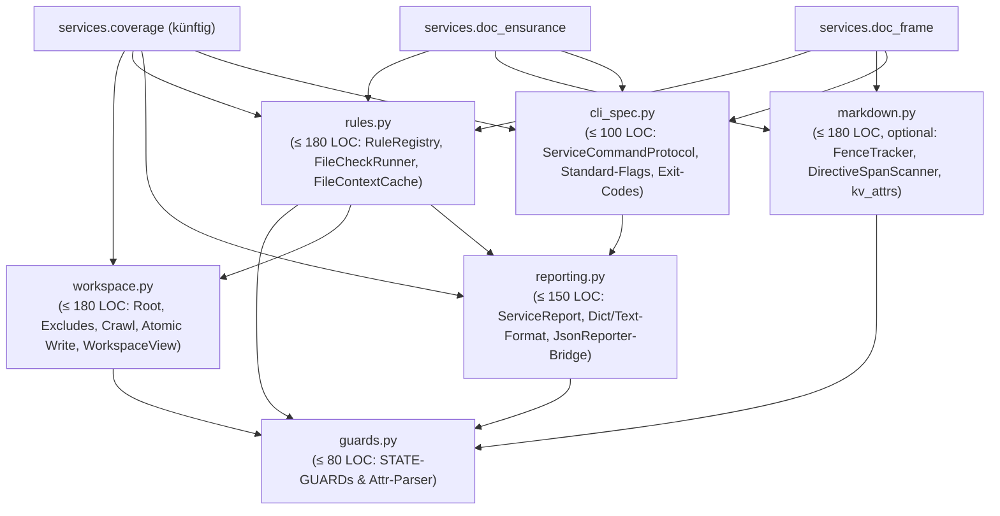

<!-- qb:frame id="CUBIE_DOC_FRAME_2" zone="head" env="Antigravity-CLI" model="Gemini 4 Neon" effort="High" -->
# Hypothesen: Konzepte & Architektur-Design für einen `qb-cubie` Service-Core

**Dokument-Informationen & Herkunft:**
- **Plattform / Umgebung:** Antigravity-CLI
- **Modell:** Gemini 4 Neon
- **Reasoning-Effort:** High
- **Analysedatum:** 25. November 2026, ~14:15 (CET)
- **Synthesebasis:** `docs/services/GEMINI-2.md`, `docs/services/ANALYSIS.md`, `docs/services/GEMINI-1.md`, `docs/GUIDE_TGD.md`, `docs/dev/DEV-GUIDE_Services.md`, `docs/dev/DEV-GUIDE_Agent-Reports.md`, `docs/dev/DEV-GUIDE_DocFrame-Conventions.md`, `docs/dev/DEV-GUIDE_Next-Steps.md`, `docs/misc/lake/ANALYSIS_COVERAGE_OPTIONS.md`, `src/qb_cubie/core/protocols.py`, `src/qb_cubie/core/reporter.py`, `src/qb_cubie/cli.py`, `src/qb_cubie/core/services/__init__.py`, `src/qb_cubie/core/services/doc_ensurance/doc_ensurance.py`, `src/qb_cubie/core/services/doc_ensurance/_source_loader.py`, `src/qb_cubie/core/services/doc_frame/doc_frame.py`, `src/qb_cubie/core/services/doc_frame/doc_frame_rules.py`, `src/qb_cubie/core/services/doc_frame/presets.py`, `src/qb_cubie/core/services/doc_frame/_catalog_scanner.py`, `tests/test_doc_frame.py`, `tests/test_doc_ensurance.py`, `tests/test_styleguide.py`, `tests/tests_core/tests_services/test_service_architecture_gate.py`
- **Stand:** qb-cubie (`v0.1.1`, Branch `main`, Commit `ab65797a`)
- **Git-Log:** `ab65797a` ("Neues GPT-Gutachten")

---

```text
commit ab65797af3bdaa26e04e473574a0d8cb2807c7ed (HEAD -> main, origin/main)
Author: Chronuid <Dominickwirzba@gmail.com>
Date:   Wed Nov 25 11:50:59 2026 +0100

    Neues GPT-Gutachten

Auftrag (docs/services/GEMINI-2.md):
- Stützrad 2 (HYPOTHESIS): Hypothetisierung möglicher Konzepte und eines tragfähigen Designs
  für den Aufbau eines Service-Cores auf Basis von docs/services/ANALYSIS.md.
- Wissenschaftliche Sprache (Fallibilismus nach Popper): klare Hypothesen, Gegenmodelle,
  Falsifikationskriterien und Meta-QA-Prüfung geplanter Tests vor Phase Red.
- Scope: Rein konzeptionelle Hypothesenbildung in docs/services/HYPOTHESIS.md
  (kein Produktiv- oder Testcode unter src/ bzw. tests/ geändert).
```
<!-- /qb:frame -->

## Kurzfassung (Executive Summary)

**Scope:** Rein konzeptionelle Hypothesen- und Design-Phase (*Stützrad 2: `HYPOTHESIS`* gemäß [`docs/GUIDE_TGD.md`](../GUIDE_TGD.md)) auf Basis der empirischen Vermessung in [`docs/services/ANALYSIS.md`](./ANALYSIS.md). Es wurde kein Produktions- oder Testcode unter `src/` oder `tests/` verändert.

**Zentrale Arbeitshypothesen:**

1. **Makro-Konzept (Konzept B bevorzugt gegenüber A & C):** Ein **protokolldominierter, zweigeschichteter Service-Core** unter `src/qb_cubie/core/service_core/` (domänenneutraler Kern + optionale Sub-Schicht `markdown.py`) vereint die Vorteile von Komposition, Striktheit nach Meta-Gate 4 und Zukunftsfähigkeit für nicht-Markdown-Services (`coverage`, `styleguide`) — ohne in die Vererbungs- und Über-Abstraktionsfalle eines schweren Service-Frameworks (Konzept C) zu tappen.
2. **Kern-Hypothese H1 (`[BLOCKER]`-Auflösung):** Die Extraktion eines generischen `FileCheckRunner` + `RuleRegistry` (mit per-File-Parse-Cache) löst die Huckepack-Kopplung `DocFrame` $\leftrightarrow$ `DocEnsurance` vollständig auf, eliminiert alle Dummy-`scan()`/`check()`-Methoden und reduziert das 4×-Parsing in `doc_frame_rules.py` auf 1× pro Datei.
3. **Kern-Hypothese H2 & H3 (Infrastruktur & Reporting):** Zentrale `STATE-GUARD`s, ein einheitlicher `workspace`-Port (inkl. atomarem `atomic_write_text` und reinem `WorkspaceView`-Read-Port gegen `.exists()`-Leaks in Domain-Modulen) sowie ein einheitlicher `ServiceReport`/`JsonReporter`-Pfad beseitigen alle gemessenen Duplikate (D1–D5) und schließen den beobachteten Verhalten-Drift.
4. **Kern-Hypothese H4 & H5 (Markdown-Bausteine & Lazy-CLI):** Vier kleine, komposable Markdown-Lexer-Primitiven (`FenceTracker`, `parse_kv_attrs`, `DirectiveSpanScanner`, `hr`-Erkennung) und eine lazy geladene `ServiceCommandProtocol`-Registry in `src/qb_cubie/cli.py` machen sowohl neue Dokument-Services (`qb:<kind>`) als auch Nicht-Markdown-Services (`qb-cubie coverage`, `qb-cubie styleguide`) ohne Kopplung an Geschwister-Services anschließbar.
5. **Meta-QA-Hypothese H6 (Schutz vor Scheinsicherheit in Phase Red):** Vor dem Einfrieren neuer Tests müssen vier reale Test-Fallen ausgeschlossen werden — u. a. ein bereits im Bestand existierender *Vacuous Pass* in `PureDomainIoRule` (`frame_blocks.py` wird derzeit gar nicht geprüft) sowie Subsumtions- und Mutanten-Lücken bei `atomic_write_text`, `excludes="str"` und Parse-Caching.

---

## 1. Epistemische Einordnung & strukturelle Ursachenhypothese

Die Bestandsaufnahme in [`docs/services/ANALYSIS.md`](./ANALYSIS.md) hat konkretes Datenmaterial geliefert (`DocEnsurance`: 1.529 LOC, `DocFrame`: 1.642 LOC, 7 Duplikat-Klassen D1–D7, 2 Blocker). Bevor daraus ein Service-Core entworfen wird, gilt im Sinne von Karl Poppers *Fallibilismus*: **Nicht jede Code-Ähnlichkeit rechtfertigt eine Abstraktion**, und **ein vorschnelles Framework kann mehr Schaden anrichten als kontrollierte Duplikation**.

### 1.1 Ursachenhypothese (`Hypothese U0`): Warum `DocFrame` eine Projektion blieb

> **Hypothese U0:** Die heutigen Reibungen zwischen `DocEnsurance` und `DocFrame` entstehen *nicht* primär durch fehlende Utility-Funktionen, sondern durch **drei ungetrennte Architektur-Achsen**, die bei jedem dritten Service (z. B. `coverage` aus [`ANALYSIS_COVERAGE_OPTIONS.md`](../misc/lake/ANALYSIS_COVERAGE_OPTIONS.md) oder `styleguide` aus [`DEV-GUIDE_Next-Steps.md`](../dev/DEV-GUIDE_Next-Steps.md)) erneut aufbrechen würden:

1. **Rollen-Vermischung (Domain-Service vs. Verification-Host):** `DocEnsurance` spielt gleichzeitig *Fach-Service* (Markdown-Snippets in `TempFS`-Arenen ausführen) und *generischer Multi-File-Rule-Host* (`_run_file_rules` auf `FileCheckProtocol`).
2. **Ungetrennte Service-Archetypen:** Künftige `qb-cubie`-Services fallen in mindestens **drei unterschiedliche Verhaltens-Archetypen**, die sich **nicht** in eine einzige starre Basisklasse pressen lassen:
   - **Archetyp I — Verification-/Lint-Service (Read-Only):** Scannt Quellen, wertet Regeln aus, liefert `ServiceReport` + `Diagnostic`s (`DocEnsurance`, künftig `styleguide`, `coverage`-Gate).
   - **Archetyp II — Sync-/Transform-Service (2-Pass Read-Write):** Baut zuerst einen Workspace-Katalog/Kontext (Pass 1), berechnet deterministische Änderungen (Pass 2), unterstützt `--check`/`--dry-run` sowie atomare Dateimutationen (`DocFrame`, künftige Auto-Fixer).
   - **Archetyp III — Evidence-/Manifest-Service (Collector + Schema):** Sammelt statische/dynamische Evidenz über Prozessgrenzen und schreibt ein versioniertes JSON-Manifest (`coverage`-Collector).
3. **Fehlende Ports-&-Adapters-Brücke für Dateisystem-Abfragen:** `DEV-GUIDE_Services.md` (§2) verlangt reine Domain-Module (`models`/`protocols`/`engine`/`rules`), aber ohne schlanken Lese-Port (`WorkspaceView`) greifen Fachregeln (`doc_frame_rules.py:66,72,84`, `frame_blocks.py:45,237,275`) direkt auf `Path.exists()` und Service-Konstruktoren zurück.

**Falsifikationskriterium für U0:** Ließe sich ein dritter Service (`coverage` oder `styleguide`) sauber ohne eigenen Rule-Host, ohne CLI-Änderung und ohne `Path.exists()`-Leaks direkt neben `DocEnsurance` und `DocFrame` bauen, wäre U0 ganz oder teilweise widerlegt.

---

## 2. Vergleich von drei konkurrierenden Makro-Design-Konzepten

Statt eine Architektur als alternativlos darzustellen, werden drei strukturell verschiedene Konzepte für den Service-Core als konkurrierende Hypothesen gegeneinander abgewogen.

### 2.1 Konzept A — „Minimalistische Core-Utilities“ (Flache Helper ohne Execution-Schicht)

- **Grundidee:** Keine eigene Service-Core-Schicht. Lediglich die offensichtlichen Duplikate (`find_project_root`, `crawl_files`, `is_excluded`, `validate_choice`, `atomic_write_text`) wandern als kleine Hilfsmodule nach `src/qb_cubie/core/_workspace.py` und `src/qb_cubie/core/protocols.py`.
- **Vorteil:** Minimale neue Abstraktionen, geringstes Risiko von Über-Engineering, sehr schneller Einstieg.
- **Erwartete Bruchstelle (`[BLOCKER]` ungelöst):**
  - Löst **Blocker 1** nicht: `DocFrame` braucht weiterhin `DocEnsurance` als fremden Prüf-Runner (oder implementiert einen zweiten privaten Rule-Runner).
  - Löst **Blocker 2** nicht: `cli.py` koppelt weiter starr an jeden Service.
  - `src/qb_cubie/core/protocols.py` (bereits 337 LOC) droht die 500/777-LOC-Grenze zu sprengen.

### 2.2 Konzept B — „Geschichteter, protokolldominierter Service-Core (`core/service_core/`)“ *(Empfohlene Arbeitshypothese)*

- **Grundidee:** Komposition aus **kleinen, unabhängig importierbaren Bausteinen** unter `src/qb_cubie/core/service_core/`, streng getrennt in:
  1. **Domänenneutraler Service-Kern** (`guards.py`, `workspace.py`, `rules.py`, `reporting.py`, `cli_spec.py`) — nutzbar durch *alle* drei Service-Archetypen (`doc_ensurance`, `doc_frame`, `coverage`, `styleguide`).
  2. **Optionale Dokument-Spezialschicht** (`markdown.py`) — reine CommonMark-/Direktiven-Bausteine (`FenceTracker`, `parse_kv_attrs`, `DirectiveSpanScanner`, `apply_span_replacements`), die von Nicht-Markdown-Services (`coverage`, `styleguide`) **niemals** importiert werden müssen.
- **Kein Vererbungszwang:** Services erben *nicht* von einer monolithischen `BaseService`-Klasse, sondern komponieren nur jene Core-Bausteine, die ihr Archetyp tatsächlich benötigt.
- **Vorteil:** 100 % konform mit der Einbahnstraße `services.* -> core.*` (Meta-Gate 4 bleibt ausnahmefrei scharf), löst Blocker 1 & 2, respektiert die Core-Promotion-Regel (*Regel der Zwei* + *Domänenneutralität*) und bleibt modular unter 200 LOC pro Datei.
- **Risiko (`[RISIKO]`):** Gefahr spekulativer Abstraktion („YAGNI“), wenn Schnittstellen für noch nicht existierende Services (wie `coverage`) zu breit statt minimal-komposabel entworfen werden.

### 2.3 Konzept C — „Inversion-of-Control Service-Framework“ (`BaseService(ABC)` + einheitliche Markdown-AST-IR)

- **Grundidee:** Eine abstrakte Basisklasse `BaseService` mit festem Template-Lifecycle (`discover() -> parse() -> check() -> transform() -> report()`), zentraler Plugin-Registry (Entry-Points) und einer gemeinsamen verlustfreien Markdown-CST/AST-Repräsentation für alle Dokument-Services.
- **Vorteil:** Maximal einheitliche äußere Form aller Services; ein einziger zentraler Parser für Markdown-Dokumente.
- **Erwartete Bruchstelle (`[RISIKO]` / Über-Abstraktion):**
  - Verletzt *Simplex Veri Sigillum* (`DEV-GUIDE_Services.md` §2): Zwingt wesensfremde Archetypen (Arena-Code-Ausführung vs. 2-Pass-Katalog-Rewrite vs. `sys.monitoring`-Coverage-Collector) in leere Template-Hooks — reproduziert damit genau das Dummy-Methoden-Anti-Pattern, das wir aus `FramePattern.scan()` gerade entfernen wollen!
  - Eine volle Markdown-AST-IR mit Offset-Treue (für `DocFrame`) *und* semantischer Block-Klassifikation (für `DocEnsurance`) ist komplex, fehleranfällig und für `coverage`/`styleguide` komplett nutzlos.

### 2.4 Entscheidungsmatrix (Konzept A vs. B vs. C)

| Bewertungskriterium | Konzept A *(Min-Utils)* | **Konzept B *(Protokoll-Service-Core)*** | Konzept C *(IoC-Framework)* |
| :--- | :---: | :---: | :---: |
| **Löst Blocker 1 (Huckepack `DocFrame`/`DocEnsurance`)** | ❌ | **✅ (via `FileCheckRunner`)** | ✅ (mit Vererbungszwang) |
| **Löst Blocker 2 (Starre CLI & Fassaden-Wachstum)** | ❌ | **✅ (via `ServiceCommandProtocol`)** | ✅ |
| **Meta-Gate-4-Konformität (Null Querkopplung)** | ✅ | **✅ (100 % Einbahnstraße)** | ⚠️ (Registry-Kopplung) |
| **Tauglich für Archetyp I, II & III (`coverage`, `styleguide`)** | ⚠️ (Boilerplate) | **✅ (freie Komposition)** | ❌ (Template-Zwang) |
| **Wahrt `Simplex Veri Sigillum` & 500-LOC-Budget** | ✅ | **✅ (6 Module à 80–180 LOC)** | ❌ (schwere Basisklasse/IR) |
| **Inkrementelle, rückwärtskompatible Migration** | ✅ | **✅ (4 isolierte Schnitte)** | ❌ (Big-Bang-Umbau) |

> **Vorläufige Konzept-Empfehlung (`Hypothese`):** **Konzept B** dient als tragfähige Arbeitshypothese für das nachfolgende Hypothesensystem H1–H6.

---

## 3. Konsolidiertes Hypothesensystem (H1–H6)

Jede Hypothese trennt explizit beobachteten **Ist-Befund**, hypothetisches **Soll-Design**, **Gegenhypothese / Risiko** und ein objektives **Falsifikationskriterium** für Phase Red/Green.

### H1 — Entkopplung von Verification-Host (`FileCheckRunner` + `RuleRegistry`) und Fach-Service

- **Beobachteter Ist-Befund (`ANALYSIS.md` §4.2 #1 & #2):** `tests/test_doc_frame.py:16-24` startet `DocEnsurance` als fremden Runner für `CUBIE_DOCFRAME_RULES`. Dadurch schleppen `FramePattern` (`presets.py:47-57`) und alle 4 Regeln (`doc_frame_rules.py:137-252`) Dummy-Methoden (`scan`, `check`) mit; `DocEnsurance` baut eine ungenutzte `TempFS`-Arena auf und parst jede Datei durch `_MarkdownScanner`; zusätzlich ruft `doc_frame_rules.py` `parse_frame_spans(content)` 4× pro Datei auf und unterdrückt Kaskaden ad-hoc (`doc_frame_rules.py:280`).
- **Hypothese H1:** Wenn `RuleRegistry` (Flattening, Autoinstantiierung, `rule_id`-Override, Kollisions-Slots) und ein generischer **`FileCheckRunner`** (mit **per-File-Kontext-Cache** und optionaler Regel-Vorbedingung / Fehler-Kaskaden-Steuerung) nach `core/service_core/rules.py` extrahiert werden, kann:
  1. `DocFrame.check(...)` (und jeder künftige Check-Service wie `styleguide` oder `coverage`) vollständig eigenständig prüfen,
  2. `FramePattern.scan()` und `DocFrame*.check()` ersatzlos entfallen,
  3. jede Datei in `CUBIE_DOCFRAME_RULES` genau **1×** statt **4×** geparst werden,
  4. `DocEnsurance` denselben `RuleRegistry`-Baustein für seine eigenen Regeln wiederverwenden.
- **Design-Skizze (`Soll`):**

```text
# core/service_core/rules.py (konzeptionelle Protokolle, keine ausführbare Implementierung)

RuleProtocol:
    rule_id: str
    severity: str | None          # validiert via validate_severity

FileContextCache:
    get_or_compute(key: str, factory: Callable[[], T]) -> T
    # Lebt exakt für die Dauer EINER Datei innerhalb eines Runner-Laufs
    # -> DocFrame-Regeln teilen sich cache.get_or_compute("frame_spans", ...)

WorkspaceCheckRuleProtocol(Protocol):
    rule_id: str
    severity: str | None
    context_key: str
    depends_on: tuple[str, ...]   # Optional: skippt Regel pro Datei, falls Vorbedingungs-Rule-ID
                                  #           auf derselben Datei bereits Error emittierte
    prepare_workspace(sources: Sequence[FileSource], options: Mapping[str, Any]) -> Any
    check_file(source: FileSource, workspace_ctx: Any, file_cache: FileContextCache) -> Sequence[DiagnosticProtocol]

FileCheckRunner:
    __init__(rules, *, target, glob="*.md", excludes=None, options=None, reporter=PytestReporter())
    run() -> ServiceReport
```

- **Gegenhypothese / Risiko (`[RISIKO]`):**
  - **Kaskaden-Semantik:** Ein pauschales `depends_on=("DOCFRAME-MISSING",)` auf Dateiebene ist nur dann äquivalent zum heutigen Verhalten, wenn `DocFrameOutdated` wirklich *pro Datei* (nicht *pro Span*!) übersprungen werden darf. Im aktuellen Code (`doc_frame_rules.py:280`) prüft `DocFrameOutdated._check_spans_sync` `provenance` und `broken_route` jedoch **pro Span** (`continue`), sodass ein defekter Link in `zone="head"` eine veraltete `zone="foot"` derselben Datei *trotzdem* noch melden könnte!
  - **Abhilfe:** `depends_on` deckt die Dateiebene (`DOCFRAME-MISSING` $\to$ alle anderen) sauber ab; für Span-Granularität speichert `FileContextCache` die bereits ausgewerteten Span-Befunde, sodass kein redundantes Re-Parsing entsteht.
- **Falsifikationskriterium:** H1 ist falsifiziert, wenn (a) `DocFrame.check()` bei per `sys.meta_path` blockiertem `doc_ensurance` fehlschlägt, (b) `parse_frame_spans` bei einem Lauf aller 4 `CUBIE_DOCFRAME_RULES` mehr als 1× je Datei aufgerufen wird, oder (c) `DocFrame` weiterhin Dummy-Methoden (`scan`/`check`) benötigt.

---

### H2 — Domänenneutrale `workspace`-Schicht, zentrale `STATE-GUARD`s & reiner `WorkspaceView`-Port

- **Beobachteter Ist-Befund (`ANALYSIS.md` §2.2, §4.1 D1/D2/D4/D5, §4.2 #3 & #4):**
  - Projekt-Root-Suche, Crawling und Exclude-Matching (~95 LOC) sind zwischen `doc_ensurance/_source_loader.py` und `doc_frame/doc_frame.py` kopiert (`CstLinter` pflegt eine schwächere 3. Variante).
  - `DocEnsurance(excludes="tests")` iteriert über Zeichen (`{'t', 'e', 's'}`) statt `TypeError("STATE-GUARD")` zu werfen (`doc_ensurance.py:131`).
  - `DocFrame.run()` schreibt über `file_path.write_text(...)` (`doc_frame.py:103`) statt atomar wie `JsonReporter._write` (`core/reporter.py:289-301`).
  - `frame_blocks.py` und `doc_frame_rules.py` rufen direkt `Path.exists()` auf, weil kein reiner Lese-Port existiert.
- **Hypothese H2:** Ein zweigeteiltes Fundament aus **`service_core/guards.py`** und **`service_core/workspace.py`** — ergänzt um einen unveränderlichen **`WorkspaceView`**-Port für reine Domain-Module — eliminiert D1, D2, D4 und D5 vollständig, schließt die `excludes="str"`-Lücke, garantiert echtes atomares Schreiben und macht `frame_blocks.py`/`doc_frame_rules.py` zu 100 % I/O-freien, rein in-memory testbaren Domain-Modulen.
- **Design-Skizze (`Soll`):**

```text
# core/service_core/guards.py
validate_choice(value: Any, valid: Sequence[str], field: str) -> str
validate_non_empty_str(value: Any, field: str) -> str
validate_positive_int(value: Any, field: str) -> int
validate_positive_float(value: Any, field: str, *, allow_none: bool = False) -> float | None
validate_str_sequence(value: Any, field: str, *, allow_none: bool = True) -> tuple[str, ...]
parse_bool_attr(raw: str | None, field: str, *, default: bool) -> bool
parse_int_attr(raw: str | None, field: str, *, allow_none: bool = True) -> int | None

# core/service_core/workspace.py
@dataclass(frozen=True)
class FileSource:
    path: str                    # kanonischer Pfad oder "IN_MEMORY"
    rel_path: str                # POSIX-relativ zum Workspace-Root (oder "IN_MEMORY")
    content: str

class WorkspaceView(Protocol):   # Reiner Read-Port für Domain-Logik (kein Path.exists() in rules/blocks!)
    @property
    def root(self) -> Path: ...
    def exists(self, rel_or_abs: str | Path) -> bool: ...

find_project_root(start: Path | None = None, *, markers: Sequence[str] = ("pyproject.toml",), stop_at_cwd: bool = False) -> Path
normalize_excludes(excludes: Any, *, base: Iterable[str] = DEFAULT_EXCLUDES) -> frozenset[str]
is_excluded(rel_path: Path, root_name: str, excludes: AbstractSet[str]) -> bool
crawl_files(root: Path, *, pattern: str = "*.md", excludes: AbstractSet[str] = ()) -> list[Path]
load_sources(target: Any, *, pattern: str = "*.md", excludes: AbstractSet[str] = (), allow_in_memory: bool = False) -> list[FileSource]
atomic_write_text(path: Path, content: str, *, encoding: str = "utf-8", newline: str = "\n") -> None
```

- **Gegenhypothese / Risiko (`[RISIKO]`):**
  - **Verhaltensunterschied bei `looks_like_path`:** `DocEnsurance` erlaubt In-Memory-Markdown als `str` (`allow_in_memory=True`), während `DocFrame` jeden `str` als Dateipfad behandelt (`allow_in_memory=False`). Würde `load_sources` pauschal `looks_like_path` anwenden, könnte ein Tippfehler wie `"nonexistent"` in `DocFrame` versehentlich als In-Memory-Dokument interpretiert werden statt `FileNotFoundError` zu werfen! Das explizite Flag `allow_in_memory: bool = False` verhindert diese Regression.
  - **Windows-Semantik bei `atomic_write_text`:** `NamedTemporaryFile(..., delete=False)` im Zielverzeichnis + `os.replace(tmp, target)` ist auf POSIX atomar und auf Windows (Python 3.13) nach Schließen des Streams zuverlässig, solange `target.parent` existiert und Schreibrechte besitzt (gleiches Muster wie bereits bewährt in `core/reporter.py:289-301`).
- **Falsifikationskriterium:** H2 ist falsifiziert, wenn (a) `DocEnsurance(excludes="tests")` keinen `TypeError("STATE-GUARD")` wirft, (b) `DocFrame(target="not a real file")` keinen `FileNotFoundError` wirft, (c) ein abgebrochener Schreibvorgang (`os.replace` wirft `OSError`) die Zieldatei verändert oder Temp-Dateien liegen lässt, oder (d) `CstLinter` nach Umstellung auf `crawl_files` Teilpfad-Excludes wie `"docs/drafts"` weiterhin ignoriert.

---

### H3 — Einheitliche Report-, Diagnostik- & Reporter-Schicht (`ServiceReport` + `JsonReporter`)

- **Beobachteter Ist-Befund (`ANALYSIS.md` §4.2 #5):** `DocFrame` besitzt keinen `reporter`-Parameter; `PytestReporter._generate_service_report` ignoriert `DocDiagnostic.session_id`; `JsonReporter` lehnt `ServiceReportProtocol` mit `TypeError` ab (`core/reporter.py:275-276`), wodurch `cli.py:66-73` eine eigene JSON-Serialisierung dupliziert.
- **Hypothese H3:** Wenn `service_core/reporting.py` ein domänenneutrales, unveränderliches **`ServiceReport`**-Modell bereitstellt (das `ServiceReportProtocol` erfüllt und optionale Felder `changed_files: tuple[str, ...] = ()` sowie `metadata: Mapping[str, Any] = ...` trägt), `Diagnostic` um ein optionales `context: str | None = None` ergänzt wird (z. B. für `session_id` oder `zone`), und **`JsonReporter`** sowohl `RunTrace` als auch `ServiceReportProtocol` unter stabilem Schema (`schema_version: 1`) serialisiert, entfallen Ad-hoc-Report-Formatter in der CLI und künftige Services (`coverage`, `styleguide`) erhalten sofort vollständige `pytest`- und CI-JSON-Unterstützung.
- **Design-Skizze (`Soll`):**

```text
# core/protocols.py (minimale, abwärtskompatible Erweiterung)
@dataclass(frozen=True)
class Diagnostic:
    file_path: str
    rule_id: str
    line: int
    message: str
    severity: str = "error"
    context: str | None = None    # z. B. session_id, zone, symbol_fqn

# core/service_core/reporting.py
@dataclass(frozen=True)
class ServiceReport:
    service: str                  # z. B. "doc_ensurance", "doc_frame", "coverage"
    target: str
    passed: bool
    diagnostics: tuple[DiagnosticProtocol, ...] = ()
    changed_files: tuple[str, ...] = ()
    files_checked: int = 0
    metadata: tuple[tuple[str, Any], ...] = ()   # hashbar & unveränderlich

# Reporter-Regel nach Service-Archetyp:
# - Prüf-Läufe (DocEnsurance.run(), DocFrame.check(), FileCheckRunner.run()):
#     default reporter = PytestReporter()  (wirft AssertionError bei passed=False, UserWarning bei warning)
# - Mutierende / CLI-Läufe (DocFrame.update(), CLI-Dispatch):
#     default reporter = None              (gibt ServiceReport zurück; CLI setzt Exit-Code 0/1/2)
```

- **Gegenhypothese / Risiko (`[RISIKO]`):**
  - **Exit-Code-Drift in der CLI:** `cli.py:18-24` kennt derzeit nur Exit-Code `0` (Erfolg) und `2` (Guard-/I/O-Exception). Für reine Check-Befehle wie `qb-cubie docframe check` oder `qb-cubie docensurance check` muss ein fachlicher Fehlschlag (`report.passed is False`) sauber von einem Laufzeit-/Config-Fehler unterschieden werden (**Exit-Code `1`** für Prüf-Fehlschlag, **`2`** für `STATE-GUARD`/I/O-Fehler, **`0`** für grün).
  - **Abwärtskompatibilität von `DocReport` und `DocFrameReport`:** Bestehende Tests greifen direkt auf `DocReport.sessions`, `DocFrameReport.updated_files` und `DocFrameReport.catalog` zu. Deshalb dürfen `DocReport` und `DocFrameReport` nicht abrupt gelöscht werden — sie erfüllen weiterhin `ServiceReportProtocol` (und können intern auf gemeinsame Formatierungs-/Serialisierungs-Funktionen aus `service_core/reporting.py` aufsetzen).
- **Falsifikationskriterium:** H3 ist falsifiziert, wenn (a) `JsonReporter(path).report(doc_report)` oder `.report(doc_frame_report)` weiterhin `TypeError` wirft, (b) bestehende `DocReport`/`DocFrameReport`-Zugriffe brechen, oder (c) `cli.py` eigene JSON-Serialisierungslogik statt `reporting.report_to_dict(...)` benötigt.

---

### H4 — Komposable Markdown-Sub-Schicht (`service_core/markdown.py`) statt monolithischer AST-IR

- **Beobachteter Ist-Befund (`ANALYSIS.md` §3.1, §4.1 D3 & D6):** Code-Fence-Tracking ist 3× unabhängig implementiert; `_HTML_WRAP_RE` 2×; `DocEnsurance` und `DocFrame` nutzen zwei inkompatible Attribut-Dialekte (`session=x` ungequotet vs. `id="X"` zwingend gequotet, wobei `order=10` stumm verworfen wird); `_MarkdownScanner` verschluckt `<!-- ... -->` spurlos und klassifiziert `---` als `paragraph`.
- **Hypothese H4:** Eine schlanke, rein funktionale Sub-Schicht **`src/qb_cubie/core/service_core/markdown.py`** (optionaler Import *nur* für Dokument-Services, null Abhängigkeit für `coverage`/`styleguide`) mit exakt **vier orthogonalen Lexer-Primitiven** löst alle grammatikalischen Konflikte ohne die Komplexität eines vollständigen CommonMark-ASTs:
  1. **`FenceTracker`:** Eine einzige, getestete Zustandsmaschine für ```` ``` ```` und `~~~` (inkl. korrekter Längenregel `len(close) >= len(open)` und optionaler Info-String-Extraktion).
  2. **`DirectiveSpanScanner(directive: str)`:** Verallgemeinerung von `_FrameSpanScanner` auf beliebige `<!-- qb:<directive> ... -->` … `<!-- /qb:<directive> -->`-Paare mit zeichengenauen Offsets (`DirectiveSpan`), plus rein funktionales **`apply_span_replacements(content, replacements)`** (Rückwärts-Slicing mit Überlappungs-Guard).
  3. **`parse_kv_attrs(raw: str, *, mode: Literal["quoted", "unquoted_whitelist"], allowed_keys=...)`:** Ein gemeinsamer Attribut-Parser mit **explizitem Fehlerverhalten**: Im `"quoted"`-Modus (HTML-Direktiven `qb:*`) wird ein fehlendes Anführungszeichen wie `order=10` **nicht länger still verworfen**, sondern über einen expliziten `ValueError("STATE-GUARD: ...")` abgewiesen (oder als Diagnose gemeldet).
  4. **Explizite `hr`-Erkennung (`---`, `***`, `___`)** im `_MarkdownScanner` von `DocEnsurance`, damit horizontale Trenner von `DocFrame` niemals fälschlich als `Explanation`-Absatz gezählt werden.
- **Gegenhypothese / Risiko (`[RISIKO]`):**
  - **Mehrzeilige Direktiven-Tags:** Sollten HTML-Direktiven künftig viele Attribute tragen (`<!-- qb:frame\n id="..."\n ... -->`), reicht ein rein zeilenbasiertes `_OPEN_TAG_RE` nicht aus. Hypothese: Für v1 genügt einzeilige Syntax (wie in `DEV-GUIDE_DocFrame-Conventions.md` §2 dokumentiert), aber `DirectiveSpanScanner` sollte einen unvollständigen `<!-- qb:<directive>` ohne `-->` auf derselben Zeile explizit als Fehler/unclosed melden statt ihn stumm zu überlesen.
  - **Relative Pfad-Links (`compute_rel_link`):** Auch Link-Normalisierung (`os.path.relpath` $\to$ POSIX `./...`) kann als kleiner reiner Helfer in `markdown.py` leben, da jeder Markdown-Dokument-Service (`doc_frame`, künftig `doc_toc`, `doc_links`) relative Links berechnet.
- **Falsifikationskriterium:** H4 ist falsifiziert, wenn (a) ein `---`-Trenner in `_MarkdownScanner` noch als `paragraph` geparst wird, (b) `<!-- qb:frame id="CUBIE_DOC_FRAME_1" order=10 -->` (ungequotet) still ignoriert wird, (c) `apply_span_replacements` überlappende Spans korrupt zusammensetzt statt sie per `STATE-GUARD` abzulehnen, oder (d) ein Nicht-Markdown-Service gezwungen wird, `markdown.py` zu importieren.

---

### H5 — Deklarative, lazy geladene CLI-Registry & skalierbare Service-Fassade

- **Beobachteter Ist-Befund (`ANALYSIS.md` §4.2 #6):** `src/qb_cubie/cli.py:11` importiert `doc_frame` eager auf Top-Level; `DocEnsurance` besitzt gar keinen CLI-Einstieg; `src/qb_cubie/core/services/__init__.py` verwaltet 90 flache Re-Exports in 213 LOC mit manueller Dreifach-Pflege.
- **Hypothese H5:** Wenn `service_core/cli_spec.py` ein leichtgewichtiges **`ServiceCommandProtocol`** + Standard-Flag-Builder (`add_target_arg`, `add_exclude_arg`, `add_format_arg`) definiert und `src/qb_cubie/cli.py` eine **lazy Subcommand-Tabelle** nutzt (die erst bei Dispatch das jeweilige `qb_cubie.core.services.<name>.cli`-Modul lädt), gilt:
  1. Jeder Service kapselt seinen CLI-Adapter im eigenen `cli.py` (genau gemäß `DEV-GUIDE_Services.md` §2!).
  2. `qb-cubie docframe check|update` und `qb-cubie docensurance check` (sowie künftig `qb-cubie coverage ...`) teilen dieselbe Flag-, JSON- und Exit-Code-Konvention (`0`/`1`/`2`).
  3. Der Aufruf von `qb-cubie docframe ...` importiert zu keinem Zeitpunkt `doc_ensurance` (oder künftige Geschwister-Services).
  4. In `src/qb_cubie/core/services/__init__.py` bleiben bestehende Re-Exports abwärtskompatibel erhalten, aber **neue Services** exportieren dort ausschließlich ihren **Paketnamen** und ihre **Haupt-Service-Klasse** (Ende des linearen Re-Export-Wachstums).
- **Design-Skizze (`Soll`):**

```text
# core/service_core/cli_spec.py
@dataclass(frozen=True)
class CommandResult:
    exit_code: int                # 0 = ok, 1 = check failed, 2 = guard/io error
    report: ServiceReportProtocol | None = None
    text: str = ""

class ServiceCommandProtocol(Protocol):
    name: str                     # z. B. "docframe", "docensurance", "coverage"
    help: str
    def register(self, subparser: argparse.ArgumentParser) -> None: ...
    def execute(self, args: argparse.Namespace) -> CommandResult: ...

# src/qb_cubie/cli.py (Composition Root — null Top-Level-Service-Imports!)
_COMMAND_SPECS: Final[tuple[tuple[str, str, str], ...]] = (
    ("docframe",     "Document frame synchronization and checks.", "qb_cubie.core.services.doc_frame.cli:COMMAND"),
    ("docensurance", "Verify documentation code examples.",        "qb_cubie.core.services.doc_ensurance.cli:COMMAND"),
)
```

- **Gegenhypothese / Risiko (`[RISIKO]`):**
  - **`--help` auf Subcommands:** Wenn `qb-cubie --help` nur Top-Level-Namen und Hilfetexte aus `_COMMAND_SPECS` anzeigt, ist kein Service-Import nötig. Sobald der Nutzer `qb-cubie docframe --help` aufruft, muss genau *dieses eine* Service-`cli.py` geladen werden, um die Unterbefehle (`update`, `check`) registrieren zu können — weiterhin **ohne** Geschwister-Services zu berühren.
- **Falsifikationskriterium:** H5 ist falsifiziert, wenn `python -m qb_cubie docframe --help` oder `docframe update` das Modul `qb_cubie.core.services.doc_ensurance` in `sys.modules` lädt, ODER `cli.py` weiterhin direkte Service-Imports am Dateikopf benötigt.

---

### H6 — Platzierung in `core/service_core/` & Härtung von Meta-Gate 4 (`test_service_architecture_gate.py`)

- **Beobachteter Ist-Befund (`ANALYSIS.md` §2.2 & §5.1; `test_service_architecture_gate.py:26-30, 434-438`):**
  - `PureDomainIoRule` prüft aktuell nur `PURE_DOMAIN_FILENAMES = {"models.py", "protocols.py", "engine.py", "rules.py"}` sowie `*_rules.py` — und schlägt bei `.exists()`-Aufrufen gar nicht an. Dadurch entgehen `frame_blocks.py`, `presets.py`, `_catalog_scanner.py` und die `.exists()`-Aufrufe in `doc_frame_rules.py:66,72` dem Gate vollständig (realer *Vacuous Pass*!).
  - Es gibt noch keinen Wächter, der verhindert, dass der künftige `service_core` rückwärts in `core/services/*` importiert.
- **Hypothese H6:** Durch Verankerung unter **`src/qb_cubie/core/service_core/`** (statt `core/services/_core/`) und drei gezielte Schärfungen an Meta-Gate 4 wird die Architektur dauerhaft maschinell durchsetzbar:
  1. **`META-SERVICE-CORE-NEUTRALITY`:** Kein Modul in `src/qb_cubie/core/service_core/` darf `qb_cubie.core.services.*` (oder Domänensymbole wie `DocEnsurance`, `DocFrame`, `FramePattern`) importieren oder referenzieren.
  2. **Schärfung von `PureDomainIoRule`:** Erweiterung um Filesystem-Probes (`exists`, `is_file`, `is_dir`, `rglob`, `glob`, `iterdir`, `mkdir`, `unlink`, `stat`, `cwd`) sowie Ausdehnung des Dateifilters (alle Nicht-Adapter-/Nicht-CLI-Module oder explizite Konvention `adapters.py`/`cli.py`/`__init__.py`/`__main__.py` als einzige I/O-Shell).
  3. **Budget- & Azyklizitäts-Gate für `service_core/` selbst:** Jedes Modul unter `src/qb_cubie/core/service_core/` unterliegt denselben harten Grenzen ($\le 500$ LOC, azyklischer interner Import-Graph, einzeilige Docstrings).
- **Gegenhypothese / Risiko (`[RISIKO]`):** Eine sofortige Umstellung von `PureDomainIoRule` auf *alle* bestehenden Dateien in `doc_ensurance` und `doc_frame` schlägt sofort rot fehl, solange `doc_frame/frame_blocks.py` und `doc_frame/doc_frame_rules.py` noch nicht auf `WorkspaceView` migriert sind. Daher muss die Gate-Schärfung synchron mit der `WorkspaceView`-Migration (TGD Phase Red $\to$ Phase Green) erfolgen — nicht als unkoordinierter Vorab-Patch.
- **Falsifikationskriterium:** H6 ist falsifiziert, wenn ein eingeschleuster Rückwärts-Import `from ..services.doc_frame import DocFrame` in `core/service_core/` oder ein `Path(x).exists()` in `doc_frame_rules.py` das geschärfte Meta-Gate 4 passiert.

---

## 4. Konkreter Architektur-Entwurf: Ziel-Topologie & Generalisierungsprobe (`Soll`)

### 4.1 Azyklischer Modul-Graph von `src/qb_cubie/core/service_core/`



### 4.2 Generalisierungsprobe auf 3 verschiedene Service-Archetypen (Domänenneutralitäts-Test)

Um die Core-Promotion-Regel aus `DEV-GUIDE_Services.md` (§3: *Regel der Zwei* + *Domänenneutralität*) gegen Wunschdenken abzusichern, prüft die folgende Matrix die konkrete Nutzung über **zwei bestehende** und **einen real geplanten Nicht-Markdown-Service** (`coverage` aus [`ANALYSIS_COVERAGE_OPTIONS.md`](../misc/lake/ANALYSIS_COVERAGE_OPTIONS.md)):

| `service_core`-Modul | `doc_ensurance` *(Archetyp I: Check + Arena)* | `doc_frame` *(Archetyp II: 2-Pass Sync + Check)* | `coverage` *(Archetyp III: Evidence + Manifest, kein Markdown!)* | Domänenneutral? |
| :--- | :--- | :--- | :--- | :---: |
| **`guards.py`** | `timeout`, `severity`, `excludes` | `zone`, `mode`, `tag`, `order`, `routable`, `excludes` | Profil-Schwellenwerte, `schema_version`, `excludes` | **Ja (3/3)** |
| **`workspace.py`** | `find_project_root`, `load_sources(allow_in_memory=True)` | `find_project_root`, `crawl_files`, `atomic_write_text`, `WorkspaceView` | `find_project_root`, `crawl_files(pattern="*.py")`, `atomic_write_text` (Manifest!) | **Ja (3/3)** |
| **`rules.py`** | `RuleRegistry` (Merging, Overrides) | `FileCheckRunner` + `FileContextCache` (ersetzt `DocEnsurance`-Host!) | Meta-Gate-Regel-Auswertung auf Coverage-Manifest | **Ja (3/3)** |
| **`reporting.py`** | `ServiceReport`, `PytestReporter`, `JsonReporter` | `ServiceReport` (`changed_files`), `PytestReporter`, `JsonReporter` | `ServiceReport` + `JsonReporter` (`schema_version: 1`) | **Ja (3/3)** |
| **`cli_spec.py`** | `qb-cubie docensurance check` | `qb-cubie docframe update \| check` | `qb-cubie coverage collect \| check` | **Ja (3/3)** |
| **`markdown.py`** *(Sub-Schicht)* | `FenceTracker`, `parse_kv_attrs(unquoted_whitelist)` | `FenceTracker`, `DirectiveSpanScanner`, `parse_kv_attrs(quoted)`, `apply_span_replacements` | *Wird nicht importiert (0 Overhead)* | **Ja (2/2 Doc-Services)** |

**Beobachtung:** Jeder einzelne Baustein im Kern wird von **mindestens 3 Services** genutzt; die Markdown-Subschicht wird von **2 Dokument-Services** genutzt und bleibt für Nicht-Dokument-Services komplett unsichtbar. Alles Domänenspezifische (`TempFS`-Session-Execution, `ExamplePattern`, `DocumentCatalog`, `FrameBlocks`, `sys.monitoring`-Tracer) verbleibt strikt im jeweiligen Heimat-Service.

---

## 5. Meta-QA-Prüfung der geplanten Test-Suite vor Phase Red (`GUIDE_TGD.md`)

Gemäß *Stützrad 2* ([`docs/GUIDE_TGD.md`](../GUIDE_TGD.md#L60)) werden die für Phase Red geplanten Tests bereits in der Hypothesen-Phase auf vier formale Test-Defekte abgeklopft, bevor eine einzige Testzeile geschrieben wird:

### 5.1 Prüfung auf logische Subsumtion ($Q_{\text{pos}} \implies \neg Q_{\text{neg}}$)

- **Identifizierte Subsumtions-Falle 1 (`atomic_write_text`):** Ein Test, der nur `target.read_text() == new_content` prüft, subsumiert nicht den Fehlerfall; und ein Test, der zusätzlich `expect=False` auf `old_content` setzt, testet lediglich $x = \text{new} \implies x \neq \text{old}$, also **nicht** die Atomarität!
  - **Scharfe Red-Konstruktion:** Fault-Injection (z. B. `monkeypatch` auf `os.replace` wirft `OSError("disk full")`), gefolgt von einer konjunktiven Prüfung (`post={"quantor": "all", ...}`): (1) Ursprungsdatei hat unverändert `old_content` **und** (2) im Zielordner verbleiben `0` temporäre `.tmp`-Dateien.
- **Identifizierte Subsumtions-Falle 2 (`RuleRegistry` Kollisions-Slots):** Wenn ein Test nur prüft, dass `len(rules) == 2`, bleibt ungetestet, ob die zweite Regel die erste überschrieben oder korrekt per Kollisions-Slot erhalten wurde.
  - **Scharfe Red-Konstruktion:** Rückgabe des Stateless-Adapters als geordnete Struktur `{"rule_ids": [...], "severities": [...], "distinct_instances": int}` — trennt Override-Semantik (gleiche `rule_id` ersetzt Standardregel) sauber von Multi-Linter-Erhalt.

### 5.2 Prüfung auf prädikatenlogische Tautologien (insb. unter `post="exists"`)

- **Identifizierte Tautologie-Falle (`ServiceReport` / `Diagnostic`):** Unter dem Standard-Quantor `post="exists"` erzeugt eine Liste aus zwei schwachen `WorldState`s wie `[WorldState(returns=lambda r: r.passed is False), WorldState(returns=lambda r: len(r.diagnostics) >= 0)]` eine Tautologie ($P \lor \top \equiv \top$).
- **Verbindliche Red-Regel für alle neuen Service-Core-Tests:**
  - Für mehrteilige Nachbedingungen **immer** entweder ein einzelnes normalisiertes Adapter-Dictionary (`Stateless Adapter` nach `GUIDE_TGD.md` Schritt 2) oder explizit `post={"quantor": "all", "states": [...]}` mit nicht-leeren, nicht-trivialen Prädikaten verwenden.
  - Negative Gegenproben (`WorldState(..., expect=False)`) ausschließlich unter `post={"quantor": "all", "states": [...]}` notieren (durch `evaluate_step_logic` und Meta-Gate 3 abgesichert).

### 5.3 Prüfung auf Vacuous Passes (`0pos/Kneg`, leere Mengen & blinde Gates)

- **Bereits im Bestand nachgewiesener Vacuous Pass (`[ABWEICHUNG]`):** `test_repository_service_pure_domain_modules_have_no_io` (`test_service_architecture_gate.py:431-446`) läuft auf `doc_frame` grün, obwohl `frame_blocks.py` drei `.exists()`-Aufrufe und `doc_frame_rules.py` zwei `.exists()`-Aufrufe enthalten — weil `frame_blocks.py` nicht in `PURE_DOMAIN_FILENAMES` liegt und `.exists()` nicht in `FORBIDDEN_IO_ATTR_CALLS` steht!
- **Geplante Gegenmaßnahmen gegen Vacuous Passes in Phase Red:**
  1. **`FileCheckRunner`:** Jeder Test prüft explizit `report.files_checked == N` ($N > 0$); ein Lauf über 0 gematchte Dateien wirft konsistent `ValueError("STATE-GUARD: ...")` statt stumm `passed=True` zurückzugeben.
  2. **Meta-Gate 4 (`PureDomainIoRule` & `ServiceCoreNeutralityRule`):** Vollständige **Wächter-Kalibrierungs-Triade** (Clean-Probes, Fault-Probes inkl. `.exists()`/`rglob()`/Rückwärts-Import, File-Probe auf Platte, Repo-Scan).
  3. **CLI-Isolations-Probe:** Ein isolierter Subprozess prüft nicht nur `returncode == 0`, sondern zusätzlich, dass `qb_cubie.core.services.<sibling>` **nicht** in `sys.modules` geladen wurde (blockiert via `sys.meta_path`-Blocker analog `test_service_architecture_gate.py:453-466`).

### 5.4 Mutanten-Überlebens-Matrix (Mutation-Resilience vor Phase Red)

Jeder zentrale Core-Baustein muss mindestens einen gezielten **Core-Mutanten** haben, der durch einen konkreten Phase-Red-Test deterministisch getötet wird:

| Nr. | Hypothetischer Core-Mutant (absichtlicher Bug im `service_core`) | Welcher Pflicht-Test in Phase Red muss fehlschlagen (`FAILED`)? |
| :-: | :--- | :--- |
| **M1** | `normalize_excludes` vergisst `isinstance(excludes, (str, bytes))`-Guard | `test_normalize_excludes_rejects_bare_string` (`WorldState(raises=ExceptionExpectation(TypeError, match="STATE-GUARD"))`) |
| **M2** | `atomic_write_text` ruft direkt `path.write_text(...)` auf | `test_atomic_write_preserves_original_and_cleans_tmp_on_replace_error` (Fault-Injection auf `os.replace`) |
| **M3** | `FileCheckRunner` ruft `file_cache` pro Regel neu auf (Cache defekt) | `test_file_check_runner_computes_cached_parse_once_per_file` (Aufrufzähler-Probe `calls == 1` über 4 Regeln) |
| **M4** | `DocFrame.check()` delegiert heimlich weiter an `DocEnsurance` | `test_doc_frame_check_runs_with_doc_ensurance_blocked` (Subprozess mit `sys.meta_path`-Blocker für `doc_ensurance`) |
| **M5** | `FenceTracker` prüft `stripped.startswith(fence[0] * 3)` statt `len >= len(fence)` | `test_fence_tracker_keeps_four_backtick_fence_open_on_three_backticks` (CommonMark-Verschachtelungsprobe) |
| **M6** | `parse_kv_attrs(..., mode="quoted")` ignoriert ungequotetes `order=10` still | `test_parse_kv_attrs_quoted_rejects_unquoted_value` (`ValueError`, `match="STATE-GUARD"`) |
| **M7** | `cli.py` importiert `doc_ensurance` eager bei `qb-cubie docframe --help` | `test_cli_docframe_does_not_import_sibling_services` (Subprozess-Blocker-Probe) |
| **M8** | `service_core/rules.py` importiert `qb_cubie.core.services.doc_frame` | `test_service_core_has_no_reverse_service_imports` (Meta-Gate-4-Fault-Probe & Repo-Scan) |

---

## 6. Offene Design-Entscheidungen & empfohlene Schrittfolge vor Phase Red

Bevor in **Phase Red** Tests eingefroren werden, sollten folgende vier Architekturentscheidungen explizit bestätigt werden:

| Nr. | Offene Frage | Empfohlene Antwort (`Soll`) | Auswirkung bei Gegenentscheidung |
| :-: | :--- | :--- | :--- |
| **E1** | **Migrations-Granularität:** Alle 6 Module in einem TGD-Zyklus oder in **zwei kleinen Zyklen**? | **Zwei Zyklen (Empfohlen):** Zyklus 1 = Fundament (`guards`, `workspace`, `rules`, `reporting` + `DocFrame.check()` + Meta-Gate 4); Zyklus 2 = `markdown` + `cli_spec` + `qb-cubie docensurance` + Layout-Bereinigung. | Ein einzelner Mega-Zyklus erschwert Phase Red/Green und erhöht das Risiko von Quereffekten auf 140+ Bestandstests. |
| **E2** | **Rückwärtskompatibilität von `DocEnsurance(rules=CUBIE_DOCFRAME_RULES)`:** Sofort streichen oder über `FileCheckRunner` vorübergehend weiter unterstützen? | **Vorübergehend erhalten (Kompatibilitätsbrücke):** `tests/test_doc_frame.py` wechselt auf `DocFrame.check()`, aber `DocEnsurance` kann weiterhin generische `FileCheckProtocol`-Regeln delegieren (ohne Dummy-Methoden auf `FramePattern`). | Sofortiges Entfernen könnte externe Nutzer brechen, die `DocEnsurance` bereits mit eigenen `FileCheckProtocol`-Regeln kombinieren. |
| **E3** | **Strenge bei ungequoteten `qb:frame`-Attributen (`order=10`):** `STATE-GUARD`-Fehler oder automatische Toleranz? | **Strikter `STATE-GUARD`-Fehler (Empfohlen):** Verhindert stummes Ignorieren fehlerhafter Direktiven (wie bisher) und bleibt 100 % konsistent mit `DEV-GUIDE_DocFrame-Conventions.md`. | Toleranz erzeugt Mehrdeutigkeit bei Werten mit Leerzeichen/Sonderzeichen und erschwert spätere Erweiterungen. |
| **E4** | **Umbenennung interner Module der Alt-Services (`models.py` / `engine.py` / `adapters.py`):** Schon in Zyklus 1 oder erst in Zyklus 2? | **Erst in Zyklus 2 (Empfohlen):** In Zyklus 1 bleiben Dateinamen und alle 90 Re-Exports in `services/__init__.py` stabil, während nur der neue `core/service_core/` ergänzt und angebunden wird. | Frühes Umbenennen erzeugt unnötigen Diff-Lärm während der kritischen Core-Extraktion. |

---

## 7. Verifikation & Besonderheiten

> [!NOTE]
> **Arbeitskopie-Besonderheit:** Wie bereits in [`docs/services/ANALYSIS.md`](./ANALYSIS.md) dokumentiert, enthält der Checkout vorab bestehende, uncommittete Änderungen in `src/qb_cubie/core/services/doc_frame/presets.py`, `docs/services/ANALYSIS.md`, `docs/services/GEMINI-1.md` und `docs/services/GEMINI-2.md`. Im Rahmen dieser Hypothesen-Phase wurde ausschließlich `docs/services/HYPOTHESIS.md` befüllt und über `DocFrame` synchronisiert; Produktiv- und Testcode blieben vollständig unangetastet.

| Prüfschritt | Kommando | Ergebnis |
| :--- | :--- | :--- |
| **Rahmen-Synchronisation (`HYPOTHESIS.md`)** | `.venv/bin/python -m qb_cubie docframe update docs/services/HYPOTHESIS.md --exclude ...` | 1. Lauf: `Updated 1 file(s): docs/services/HYPOTHESIS.md`; 2. Lauf idempotent: `Updated 0 file(s); all frames up to date.` |
| **Gezielte DocFrame- & DocEnsurance-Prüfung auf `HYPOTHESIS.md`** | `.venv/bin/python -c "... DocEnsurance(target='docs/services/HYPOTHESIS.md', pattern=(CUBIE_DOC_STYLE, CUBIE_DOC_FRAME_1..3), rules=(CUBIE_DOC_RULES, CUBIE_DOCFRAME_RULES), excludes=DOC_EXCLUDES, reporter=None).run()"` | `HYPOTHESIS_CHECK: True ()` (`passed=True`, 0 Diagnosen) |

<!-- qb:frame id="CUBIE_DOC_FRAME_2" zone="foot" -->

---

---

<div align="center">


[↦ | Vertragsaufbau: Eindeutigkeit & Kopplung | ↤](../GUIDE_Contract-Design.md)  
[↦ | Erwartungssteuerung & Safety (`expect`-Flags) | ↤](../GUIDE_Expect-Flags.md)  
[↦ | Qualitätssicherung mit Cubie | ↤](../GUIDE_Quality-Assurance.md)  
[↦ | Fortgeschrittene Quantoren (`all` vs. `exists`) | ↤](../GUIDE_Quantifiers.md)  
[↦ | Test-Guided Development (TGD) | ↤](../GUIDE_TGD.md)  

[↦ | Service-Core | ↤](./GUIDE_Service-Core.md)  
[↦ | GUIDE: `DocEnsurance` – Lebende und verifizierte Dokumentation | ↤](./GUIDE_DocEnsurance.md)  
[↦ | DocFrame (Prototyp) | ↤](./GUIDE_DocFrame.md)  

[↦ | Dokumentations-Übersicht | ↤](../README.md)  
[↦ | Core-Dokumentation | ↤](../core/README.md)  
[↦ | Entwicklerdokumentation | ↤](../dev/README.md)  
[↦ | Core-Internals | ↤](../dev/core/README.md)  
[↦ | Hintergrund & Essays | ↤](../misc/README.md)  
[↦ | Feature-Drafts: Virtualisierung | ↤](../feature-drafts/virtualization/README.md)  

</div>
<!-- /qb:frame -->
