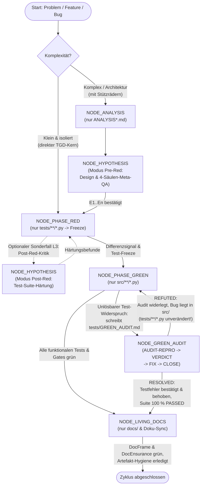

<!-- qb:frame id="CUBIE_DOC_FRAME_2" zone="head" env="Antigravity-CLI" model="Gemini 4 Neon" effort="High" -->
# Hypothesen: Modulare TGD-Knoten-Handbücher (`docs/tgd/`) & Minimal-Orchestrierung

**Dokument-Informationen & Herkunft:**
- **Plattform / Umgebung:** Antigravity-CLI
- **Modell:** Gemini 4 Neon
- **Reasoning-Effort:** High
- **Analysedatum:** 26. November 2026, ~16:30 (CET)
- **Synthesebasis:** `docs/services/GEMINI-11.md`, `docs/services/ANALYSIS-POST.md`, `docs/GUIDE_TGD.md`, `docs/dev/DEV-GUIDE_Agent-Reports.md`, `docs/dev/DEV-GUIDE_DocFrame-Conventions.md`, `docs/dev/DEV-GUIDE_Services.md`, `docs/services/HYPOTHESIS.md`, `tests/GREEN_AUDIT.md`, `docs/services/GEMINI-8.md`, `docs/services/GEMINI-9.md`, `docs/README.md`, `docs/dev/README.md`, `src/qb_cubie/core/services/doc_frame/presets.py`, `tests/test_doc_frame.py`, `tests/test_doc_ensurance.py`, `tests/test_styleguide.py`
- **Stand:** qb-cubie (`v0.1.1`, Branch `main`, Commit `2d512e14`)
- **Git-Log:** `2d512e14` ("... Analyzed the current series of TGD experiments ...")

---

```text
commit 2d512e14a77f833958c848fd1b17272db384e805 (HEAD -> main)
Author: Chronuid <Dominickwirzba@gmail.com>
Date:   Thu Nov 26 16:07:17 2026 +0100

    ... Analyzed the current series of TGD experiments ...

Auftrag (docs/services/GEMINI-11.md):
- Stützrad 2 (HYPOTHESIS): Konzeption, Architektur-Hypothesen, Gegenmodelle,
  Meta-QA-Prüfung und offene Entscheidungsmatrix für knotenspezifische
  TGD-Handbücher unter docs/tgd/ auf Basis von docs/services/ANALYSIS-POST.md.
- Wissenschaftliche Sprache (Fallibilismus nach Popper): klare Trennung von
  Ist-Befund, Hypothese, Gegenhypothese/Risiko und Falsifikationskriterium.
- Scope: Rein konzeptionelle Hypothesenbildung ausschließlich in
  docs/services/HYPOTHESIS-POST.md (src/, tests/ und bestehende Handbücher
  vollständig unverändert).
```
<!-- /qb:frame -->

## Kurzfassung (Executive Summary)

**Scope:** Rein konzeptionelle Hypothesen- und Architekturphase (*Stützrad 2: `HYPOTHESIS`* gemäß [`docs/GUIDE_TGD.md`](../GUIDE_TGD.md)) auf empirischer Basis von [`docs/services/ANALYSIS-POST.md`](./ANALYSIS-POST.md). Produktivcode unter `src/`, Testcode unter `tests/` sowie sämtliche bestehenden Handbücher blieben vollständig unverändert.

**Zentrale Arbeitshypothesen:**

1. **Makro-Konzept (Konzept B bevorzugt gegenüber A & C):** Ein **schichtsauberes Zustandsautomaten-Handbuchset unter `docs/tgd/`** (`README.md` im Preset `CUBIE_DOC_FRAME_3` als Automaten-Hub + 6 operativ einheitliche Knoten-Verträge `NODE_*.md` im Preset `CUBIE_DOC_FRAME_1` mit expliziter `order`-Sortierung) trennt Epistemologie & Einstieg (`docs/GUIDE_TGD.md`, SSOT für das *Warum*) sauber von den maschinenlesbaren Knoten-Verträgen (`docs/tgd/NODE_*.md`, SSOT für das *Wie*), ohne in ein über-formalisiertes Prozess-Framework (Konzept C) abzugleiten.
2. **Kern-Hypothese H1 (6-Knoten-Topologie & `GREEN_AUDIT`-Auflösung):** Die Ausgliederung des Rücksprungs als eigenständiger Knoten **`NODE_GREEN_AUDIT.md`** (getrennt von regulärem `NODE_PHASE_RED.md`) und die Umbenennung der internen Mikro-Schritte in **`AUDIT-REPRO` $\to$ `AUDIT-VERDICT` $\to$ `AUDIT-FIX` $\to$ `AUDIT-CLOSE`** löst die in `GEMINI-8.md` / `b7f1c87c` beobachtete Begriffsambiguität zwischen Makro-`PHASE_RED` und `MICRO-GREEN` auf und modelliert beide Ausgänge explizit: **`RESOLVED` $\to$ `NODE_LIVING_DOCS`** sowie den noch nicht empirisch erprobten Pfad **`REFUTED` $\to$ `NODE_PHASE_GREEN`**.
3. **Kern-Hypothese H2 (Einheitliches 5-Sektionen-Vertragsschema & Lösung der drei Prozess-Konflikte):** Jeder Knoten-Vertrag folgt demselben Hoare-Schema ($P$/Pre-Flight $\to$ Schreibgrenzen $\to$ Arbeits-/Meta-QA-Heuristiken $\to$ Kantenfälle $\to$ $Q$/Abnahme). Dabei werden (a) das **L4-Muster** (keine `docs/`-Edits in `PHASE_GREEN`, rote Living-Docs-Tests als geplantes Übergabesignal), (b) ein verpflichtendes **`git status --short`-Pre-Flight-Gate** (gegen `presets.py`-Altlasten und `GEMINI-(n+1)`-Vermischung) sowie (c) ein **Zwei-Stufen-Gate-Modell** (harte Gates vs. Advisory-Check für pausierte Regeln wie `BUG-006`) plus drei `PHASE_RED`-Fixture-Hygiene-Regeln verbindlich kodifiziert.
4. **Kern-Hypothese H3 & H4 (5-Block-Minimal-Ticket & 3-Zustands-Artefakt-Lebenszyklus):** Ein standardisiertes Minimal-Ticket (`20–30` Netto-Zeilen inkl. expliziter `E1..En`-Bestätigungstabelle statt `"Ok."` und `Knoten`$\leftrightarrow$`# Ziel`-Abgleich) in einem über `DOC_EXCLUDES` entkoppelten Arbeitsordner beseitigt ~55 Zeilen `DocFrame`-Boilerplate pro Prompt und schließt Copy-Paste- sowie Rahmen-Link-Drift aus. Ein 3-Zustands-Lebenszyklus regelt Archivierung (`docs/misc/lake/`) und Bereinigung für `GEMINI*.md`, `ANALYSIS*.md`, `HYPOTHESIS*.md`, `AGENT_REPORT*.md` und `tests/GREEN_AUDIT.md`.
5. **Meta-QA-Hypothese H5 (Selbst-Absicherung & Prozess-Mutanten-Matrix `PM1`–`PM8`):** Durch Übertragung der Vier-Säulen-Meta-QA auf die Handbuchreihe selbst (SSOT-Freiheit, Verbot unprüfbarer Floskeln, `DocFrame`/`DocEnsurance`-Konformität und 8 explizite Prozess-Mutanten `PM1`–`PM8`) werden sämtliche im Service-Core-Lauf beobachteten sowie kritische latente Agenten-Fehlverhalten deterministisch abgefangen.

---

## 1. Epistemische Einordnung & strukturelle Ursachenhypothese (`U0`)

Die empirische Git- und Artefakt-Vermessung in [`docs/services/ANALYSIS-POST.md`](./ANALYSIS-POST.md) über zehn Entwicklungs- und TGD-Läufe (`L0`–`L9`, `v0.0.2` bis `1a19dc09`) belegt einen klaren Reifegewinn: Mit Einführung von [`docs/GUIDE_TGD.md`](../GUIDE_TGD.md) schrumpften Auftragsdokumente von `512–1.151` Zeilen in L4 (`740f3134`, `d4ea5c1b`, `21c4c65d`) auf `15–30` Netto-Zeilen in L9 (`GEMINI-1..7.md`). Zugleich zeigte sich jedoch ein systematischer Rückfall in längere Inline-Leitplanken (`GEMINI-8.md`: 90 Zeilen, `GEMINI-9.md`: 86 Zeilen, `GEMINI-10.md`: 109 Zeilen) sowie drei reale Prozess-Reibungen (`4c949c34` $\to$ `277a188d`, `b7f1c87c`, `GEMINI-4.md:27`).

### 1.1 Ursachenhypothese (`Hypothese U0`): Warum ein einzelnes TGD-Übersichtshandbuch für zustandslose Agenten-Knoten nicht ausreicht

> **Hypothese U0:** Die in `ANALYSIS-POST.md` (§2.2, §4.2) beobachteten Reibungen entstehen *nicht* durch mangelnde Disziplin einzelner Agenten oder zu wenig Prosa in `docs/GUIDE_TGD.md`, sondern durch **drei strukturell vermischte Dokumentations- und Prozess-Achsen**:

1. **Vermischung von Erklärungs-Prosa (*Warum*) und operativem Knoten-Vertrag (*Wie*):** `docs/GUIDE_TGD.md` erfüllt erfolgreich die Rolle als epistemologischer Einstieg (Karl Poppers Fallibilismus, Bauprüfer-Analogie, 5-Schritte-Überblick). Für einen nach `/clear` frisch gestarteten Agenten in einem konkreten Knoten liefert ein monolithisches Übersichtshandbuch jedoch weder isolierte Pre-Flight-Prüfungen noch eindeutige Schreibgrenzen-Allowlists, Kantenfall-Entscheidungsbäume oder exakte Abnahmekommandos. Folglich wanderten fehlende Knoten-Regeln sofort wieder als Inline-Abschnitte in `GEMINI-8.md`..`GEMINI-11.md` zurück (*Inline-Regel-Drift*).
2. **Fehlender expliziter Zustandsübergang für `GREEN_AUDIT`:** In `docs/GUIDE_TGD.md:36-42,91` erscheint `GREEN_AUDIT` lediglich als Rückwärtspfeil von `Phase Green` zu `Phase Red`. Tatsächlich unterscheidet sich der Audit-Rücksprung operativ grundlegend von regulärem `PHASE_RED` (implementiertes `src/`, Popper-Skepsis gegen den Audit-Befund, zulässiges direktes `PASSED`, zwei divergierende Ausgänge `RESOLVED` vs. `REFUTED`). Ohne eigenen Knoten-Vertrag kollidierten die Begriffe `PHASE_RED`, `MICRO-GREEN` und `phase Green` (`b7f1c87c`).
3. **Unentkoppelter Lebenszyklus von Arbeits-Tickets und Produkt-Handbüchern:** Weil `docs/services/GEMINI-1..10.md` direkt im produktiven Dokumentationsordner lagen (nicht in `DOC_EXCLUDES` aus `tests/test_doc_ensurance.py:5-14`), zwang `DocFrame` jedem Wegwerf-Prompt ~55 Zeilen `CUBIE_DOC_FRAME_1`-Rahmen auf und machte kopierte Rahmen-Links (`4c949c34`) zum Auslöser für einen 46-Dateien-Sync in `PHASE_GREEN` (`277a188d`).

**Gegenhypothese / Falsifikationskriterium für U0:** U0 wäre ganz oder teilweise widerlegt, wenn (a) eine bloße Erweiterung von `docs/GUIDE_TGD.md` um je einen Absatz pro Phase ausreichte, um künftige Auftragsdokumente (`GEMINI*.md`) über mindestens zwei komplexe Zyklen stabil unter `30` Netto-Zeilen *ohne* wiederholte Inline-Leitplanken und bei `0` Schreibgrenzen-Verstößen zu halten, oder (b) die Verteilung auf 6 Einzeldateien nachweislich mehr Kontext-Overhead und Widersprüche erzeugt als ein einzelnes Handbuch.

---

## 2. Makro-Konzeptvergleich (Konzept A vs. B vs. C) & SSOT-Rolle von `docs/GUIDE_TGD.md`

### 2.1 Drei konkurrierende Makro-Konzepte für `docs/tgd/`

#### Konzept A — „Minimalistische Checklisten-Karten“
- **Grundidee:** Unter `docs/tgd/` entstehen 6 ultrakurze 1-Seiten-Karten (`30–50` Zeilen reines Bullet-Format: Input, Allowlist, 3 Checkpunkte, Exit). Sämtliche Erklärungen, Kantenfall-Regeln und Meta-QA-Heuristiken verbleiben in `docs/GUIDE_TGD.md` oder werden fallweise in `GEMINI*.md` ergänzt.
- **Vorteil:** Extrem geringer Token-Verbrauch pro frischem `/clear`-Kontext; minimaler Erstellungsaufwand.
- **Erwartete Bruchstelle (`[RISIKO]`):**
  - Kantenfälle, die in L9 real zugeschlagen haben (L4- vs. L9-Regel für rote Living-Docs-Tests in Green, `REFUTED`-Pfad in `GREEN_AUDIT`, Advisory-Check für pausierte Gates, Fixture-Hygiene gegen `HEADER_QUICK_NAV`), passen nicht auf eine 40-Zeilen-Karte.
  - Sobald eine Kantenfall-Regel fehlt, schleicht sie sich beim nächsten Vorfall sofort wieder als Inline-Leitplanke in `GEMINI*.md` ein — das Ursprungsproblem aus `U0` kehrt zurück.

#### Konzept B — „Schichtsaubere Zustandsautomaten-Handbücher (`docs/tgd/`) mit `GUIDE_TGD.md` als schlankem Hub“ *(Empfohlene Arbeitshypothese)*
- **Grundidee:** Strikte Schichttrennung nach Single Source of Truth (SSOT):
  - **`docs/GUIDE_TGD.md`** bleibt der verständliche, stabile Einstieg (Epistemologie nach Popper, Bauprüfer-Analogie, Überblick über Stützräder, Entscheidungskriterium *Single-Shot vs. Knoten-Orchestrierung*) und delegiert alle operativen Knoten-Details per Link an `docs/tgd/README.md`.
  - **`docs/tgd/README.md`** (`CUBIE_DOC_FRAME_3` mit `zone="router"`) bildet den **Automaten-Hub**: Zustandsübergangs-Graph, gemeinsame Knoten-Invarianten (Pre-Flight, Ticket-Minimalformat, Artefakt-Lebenszyklus) und automatisch über `DocFrame` sortierte Knoten-Tabelle.
  - **`docs/tgd/NODE_*.md`** (6 Dateien, `CUBIE_DOC_FRAME_1` mit `order="10"`..`"60"`) sind **eigenständige, schichtsaubere Knoten-Verträge** (`~100–160` Zeilen je Datei) nach einem streng einheitlichen 5-Sektionen-Hoare-Schema ($P$, Schreibgrenzen, Arbeits-/Meta-QA-Heuristiken, Kantenfälle/Eskalation, $Q$).
- **Vorteil:** Ein frischer Agent lädt pro Schritt **exakt ein** Knoten-Handbuch (plus `README.md` nur bei Orchestrierungsfragen), erhält 100 % aller relevanten Regeln, Kantenfälle und Verifikationskommandos ohne Lärm fremder Phasen, und `DocFrame`/`DocEnsurance` schützen den gesamten Ordner automatisch.
- **Risiko (`[RISIKO]`):** Moderate Pflegefläche (7 Dateien unter `docs/tgd/` plus `GUIDE_TGD.md`); bei nachlässiger Abgrenzung droht doppelte Pflege gemeinsamer Regeln (z. B. Pre-Flight oder `DocFrame`-Kommandos) in allen 6 Knoten-Dateien. Gegenmaßnahme: strikte SSOT-Matrix (§2.3).

#### Konzept C — „Stark formalisierte Template-/Meta-Gate-Spezifikation“
- **Grundidee:** Jedes Knoten-Handbuch wird aus einer maschinenlesbaren Spezifikation (YAML/JSON-Zustandsautomat mit Regex-Regeln für Commit-Messages, Pfad-Allowlists und Ticket-Schemas) generiert oder durch ein neues Python-Meta-Gate (`tests/tests_meta/test_tgd_process_gate.py`) gegen Git-Historie und `GEMINI*.md`-Dateien erzwungen.
- **Vorteil:** Maximaler Formalisierungsgrad; maschinelle Prüfung von Prozesskonformität statt reiner Dokumentations-Konvention.
- **Erwartete Bruchstelle (`[RISIKO]` / Über-Abstraktion):**
  - Verletzt *Simplex Veri Sigillum* (`DEV-GUIDE_Services.md` §2): Baut schweren Prozess-Tooling-Code, bevor die 6 Knoten-Verträge auch nur zwei reale Zyklen in der Praxis überstanden haben (hohes YAGNI-Risiko).
  - Starre maschinelle Commit-/Ticket-Gates brechen legitime menschliche Eingriffe (wie die in `GEMINI-11.md:9` dokumentierten kleinen manuellen Prompt-Mutationen oder voll-autonome 1-Commit-Bugfixes wie L8 `BUG-002`/`BUG-003`).

### 2.2 Entscheidungsmatrix (Konzept A vs. B vs. C)

| Bewertungskriterium | Konzept A *(Checklisten-Karten)* | **Konzept B *(Zustandsautomaten-Handbücher)*** | Konzept C *(Formal-Spec & Meta-Gate)* |
| :--- | :---: | :---: | :---: |
| **Token- & Kontext-Effizienz nach `/clear`** | ✅ (sehr kompakt) | **✅ (1 Knoten-Datei ≈ 100–160 L)** | ⚠️ (Schema + Prosa + Gate) |
| **Verhindert Rückkehr langer Inline-Leitplanken (`GEMINI*.md`)** | ❌ (Kantenfälle fehlen) | **✅ (alle Kantenfälle kodifiziert)** | ✅ |
| **SSOT-Redundanzfreiheit zu `docs/GUIDE_TGD.md`** | ⚠️ (Regeln zerrissen) | **✅ (klare Schichtgrenze)** | ⚠️ (Generator-/Sync-Schicht nötig) |
| **Löst `GREEN_AUDIT` (`RESOLVED`/`REFUTED`) & Konflikte 1–3** | ❌ | **✅ (deterministische Entscheidungsregeln)** | ✅ (starr) |
| **Wahrt *Simplex Veri Sigillum* & menschliche Flexibilität** | ✅ | **✅ (reines Markdown + `DocFrame`)** | ❌ (schweres Meta-Tooling) |
| **Kompatibel mit Single-Shot-TGD (L8) & Knoten-Orchestrierung (L9)** | ✅ | **✅ (Hub trennt beide Modi sauber)** | ❌ (starrer Zwang) |

> **Vorläufige Konzept-Empfehlung (`Hypothese`):** **Konzept B** dient als Arbeitshypothese für das gesamte weitere Design.

### 2.3 SSOT-Rollenverteilung & `DocFrame`-Integration (`Ist` vs. `Soll`)

**Ist-Befund (`presets.py:90-101`, `docs/GUIDE_TGD.md`, `docs/dev/README.md`):**
- `GUIDE_ROUTER` (`presets.py:90`) scannt `docs/GUIDE_*.md`; `SERVICE_ROUTER` (`presets.py:91`) scannt `docs/services/GUIDE_*.md`; `CONTEXT_ROUTER` (`presets.py:92-101`) listet statisch 6 Bereichs-Hubs (`docs/README.md`, `docs/core/README.md`, `docs/dev/README.md`, `docs/dev/core/README.md`, `docs/misc/README.md`, `docs/feature-drafts/virtualization/README.md`).
- `AUTO_INDEX_ROUTER` (`presets.py:117-121`) sortiert Dokumente in `CUBIE_DOC_FRAME_3`-Indexseiten nach `order`-Attribut (aufsteigend) und extrahiert automatisch den ersten Absatz unter dem Banner als `summary` (`DEV-GUIDE_DocFrame-Conventions.md:57,65`).

**Soll-SSOT-Matrix (jede Regel hat genau *eine* maßgebliche Quelle):**

| Dokument / Schicht | Preset | Exklusive SSOT-Verantwortung (darf nirgendwo anders dupliziert werden) | Bewusst **nicht** enthalten (nur Link) |
| :--- | :--- | :--- | :--- |
| **`docs/GUIDE_TGD.md`** | `CUBIE_DOC_FRAME_1` | Epistemologie (Popper/Fallibilismus), Einsteiger-Analogie, Rolle der Stützräder, 5-Schritte-Überblick, Entscheidungshilfe *Single-Shot vs. Knoten-Orchestrierung* | Detail-Checklisten je Knoten, Pre-Flight-Kommandos, `GREEN_AUDIT`-Mikro-Schritte, Ticket-Templates |
| **`docs/tgd/README.md`** | `CUBIE_DOC_FRAME_3` (`zone="router"`) | Automaten-Übergangsgraph, **gemeinsame Knoten-Invarianten** (Pre-Flight-Klassifikation, Commit-Tagging, Minimal-Ticket-Template, 3-Zustands-Artefakt-Lebenszyklus) + Auto-Index-Tabelle aller 6 Knoten | Wiederholung knotenspezifischer Heuristiken oder allgemeiner Popper-Essays |
| **`docs/tgd/NODE_*.md`** (6 Dateien) | `CUBIE_DOC_FRAME_1` (`order="10".."60"`) | Exakter operativer Hoare-Vertrag **genau eines Knotens** ($P$, Allowlist/Denylist, knotenspezifische Heuristiken, Kantenfälle, $Q$-Gates) | Regeln anderer Knoten, Ticket-Schema (Link auf `README.md`), Detail-Syntax von `DocFrame`/`EBT` (Links auf jeweilige Guides) |
| **`docs/dev/DEV-GUIDE_*.md`** | `CUBIE_DOC_FRAME_1` | `CUBIE_DOC_FRAME_2`-Provenance-Format (`DEV-GUIDE_Agent-Reports.md`), `DocFrame`-Konventionen (`DEV-GUIDE_DocFrame-Conventions.md`), Service-Architektur (`DEV-GUIDE_Services.md`), Styleguide (`Style-Guide.md`) | TGD-Zustandsübergänge |
| **Auftrags-Ticket (`GEMINI-*.md`)** | *Kein Frame* (über `DOC_EXCLUDES` entkoppelt; vgl. H4) | Laufzeit-Delta genau **eines Schritts** (Knoten-Ref, Zyklus-ID, konkretes Ziel, bestätigte `E1..En`, Eingabe-`@`-Liste, Output-Pfad) | Allgemeine Prozessregeln, Schreibverbote, Verifikations-Checklisten |

**`DocFrame`-Einbindung von `docs/tgd/`:**
1. **`docs/tgd/README.md`** nutzt `CUBIE_DOC_FRAME_3` mit `<!-- qb:frame id="CUBIE_DOC_FRAME_3" zone="router" mode="table" dir="." recursive="false" -->` — exakt analog zu [`docs/dev/README.md`](../dev/README.md#L80-L90).
2. Alle sechs `NODE_*.md`-Dateien tragen `CUBIE_DOC_FRAME_1` mit explizitem `order`-Attribut (`10`, `20`, `30`, `40`, `50`, `60`) sowie einem prägnanten 1-Satz-Summary vor dem ersten `---`, damit `CatalogRouter` sie deterministisch in Automaten-Reihenfolge (statt alphabetisch!) anzeigt.
3. **Globale Navigation (bewusste Abwägung $\to$ offene Entscheidung `E2`):**
   - *Variante 1 (Minimal-Diff):* `docs/tgd/README.md` wird in `docs/GUIDE_TGD.md`, `docs/README.md` und `docs/dev/README.md` verlinkt — **`presets.py` bleibt unverändert** (`0` Footer-Massendiff über bestehende 46 Docs).
   - *Variante 2 (Erster-Klasse-Hub):* `CONTEXT_ROUTER` in `src/qb_cubie/core/services/doc_frame/presets.py:92-101` erhält `("TGD-Knoten-Handbücher", "docs/tgd/README.md")` — dann ist `docs/tgd/` im Footer *jedes* Handbuchs sichtbar, erfordert aber einen kontrollierten 1×-`DocFrame`-Sync über alle ~46 Dokumente (und berührt `src/`, wäre also ein eigener kleiner Code+Docs-Schnitt statt reiner Doku-Änderung).

---

## 3. Konsolidiertes Hypothesensystem (H1–H4)

Jede Hypothese trennt explizit beobachteten **Ist-Befund**, hypothetisches **Soll-Design**, **Gegenhypothese / Risiko** und ein objektives **Falsifikationskriterium**.

### H1 — Knoten-Topologie, Automaten-Übergänge & Auflösung der `GREEN_AUDIT`-Ambiguität *(Leitfrage 1)*

- **Beobachteter Ist-Befund (`ANALYSIS-POST.md` §1.2, §2.2 #3, §3.1–§3.6, `GEMINI-8.md`, `tests/GREEN_AUDIT.md`):**
  - Über L1–L9 kristallisierten sich exakt **sechs** operative Knoten heraus: `ANALYSIS`, `HYPOTHESIS` (inkl. Sonderfall **Post-Red-Kritik** in L3 `555d4e13`), `PHASE_RED`, `PHASE_GREEN`, `GREEN_AUDIT`-Rücksprung (`ec90e973` $\to$ `b7f1c87c`) und `PHASE_LIVING_DOCS`.
  - In `GEMINI-8.md:48,60` kollidierten die Begriffe: Der Makro-Knoten hieß `PHASE_RED`, der interne Abschluss hieß `MICRO-GREEN`, und die Commit-Message `b7f1c87c` benannte den Schritt irrtümlich als `phase Green - ... Addressed the GREEN_AUDIT-Event`.
  - Der Ausgang `REFUTED` (Audit widerlegt $\to$ echter Defekt in `src/` $\to$ Rücksprung zu `PHASE_GREEN`) wurde in `GEMINI-8.md:53` theoretisch vorgesehen, ist aber empirisch **noch nie eingetreten**.

- **Hypothese H1:** Eine flache 6+1-Topologie unter `docs/tgd/` mit **`NODE_GREEN_AUDIT.md` als eigenständigem Automaten-Knoten** und einer **kollisionsfreien Mikro-Terminologie** (`AUDIT-REPRO` $\to$ `AUDIT-VERDICT` $\to$ `AUDIT-FIX` $\to$ `AUDIT-CLOSE`) eliminiert die Makro-/Mikro-Ambiguität vollständig, verankert beide `GREEN_AUDIT`-Ausgänge (`RESOLVED` und `REFUTED`) symmetrisch im Automaten-Graphen und deckt den L3-Sonderfall (*Post-Red-Kritik*) als expliziten zweiten Modus in `NODE_HYPOTHESIS.md` ohne siebte Datei ab.

- **Design-Skizze (`Soll` — Dateitopologie & Benennungskonvention):**

| Datei unter `docs/tgd/` | Preset & `order` | Knoten-ID | Schreib-Domäne | Kurzrolle |
| :--- | :---: | :--- | :--- | :--- |
| `docs/tgd/README.md` | `FRAME_3` (Hub) | — | — | Automaten-Graph, gemeinsame Pre-Flight-/Ticket-/Lebenszyklus-Invarianten, Auto-Index |
| `docs/tgd/NODE_ANALYSIS.md` | `FRAME_1`, `order="10"` | `ANALYSIS` | Nur `ANALYSIS*.md` | Stützrad 1: Rein lesende Ist-Vermessung ($Q_{\text{Ist}}$ vs. $Q_{\text{Soll}}$) |
| `docs/tgd/NODE_HYPOTHESIS.md` | `FRAME_1`, `order="20"` | `HYPOTHESIS` | Nur `HYPOTHESIS*.md` | Stützrad 2: Falsifizierbares Design & 4-Säulen-Meta-QA (*Modus A: Pre-Red*; *Modus B: Post-Red-Kritik* aus L3) |
| `docs/tgd/NODE_PHASE_RED.md` | `FRAME_1`, `order="30"` | `PHASE_RED` | Nur `tests/**/*.py` | Regulärer Testaufbau, Gate-Kalibrierung, Fixture-Hygiene & Test-Freeze |
| `docs/tgd/NODE_PHASE_GREEN.md` | `FRAME_1`, `order="40"` | `PHASE_GREEN` | `src/**/*.py` (+ optional `tests/GREEN_AUDIT.md`) | Code-Implementierung unter Freeze-Disziplin; Eskalation via `GREEN_AUDIT` |
| `docs/tgd/NODE_GREEN_AUDIT.md` | `FRAME_1`, `order="50"` | `GREEN_AUDIT` | Nur `tests/` (betroffene Tests + `tests/GREEN_AUDIT.md`) | Unabhängige Audit-Falsifikation & minimal-invasive Test-Reparatur (`RESOLVED` vs. `REFUTED`) |
| `docs/tgd/NODE_LIVING_DOCS.md` | `FRAME_1`, `order="60"` | `LIVING_DOCS` | Nur Doku (`docs/**/*.md`, `README.md`, `KNOWN_ISSUES.md`, `CHANGELOG.md`) | Code-as-Source-of-Truth-Synchronisation, `DocFrame`/`DocEnsurance`, Artefakt-Hygiene |

- **Zustandsübergangs-Graph (`Soll`):**



- **Auflösung der `GREEN_AUDIT`-Mikro-Semantik (Begriffs-Mapping):**

| Alt (`GEMINI-8.md` — verursachte Ambiguität) | Neu (`NODE_GREEN_AUDIT.md` — eindeutig) | Bedeutung & Schreibgrenze |
| :--- | :--- | :--- |
| Makro `PHASE_RED` + `MICRO-ANALYSIS` + `MICRO-RED` | **`AUDIT-REPRO`** | Frischer `/clear`-Kontext; unabhängige Reproduktion jedes Fehlschlags (inkl. Isolations-Blocker wie `sys.meta_path`), `tests/GREEN_AUDIT.md` als widerlegbare Hypothese behandeln. `0` Edits. |
| `MICRO-HYPOTHESIS` | **`AUDIT-VERDICT`** | Binäre Falsifikationsentscheidung: Liegt der Defekt wirklich in `tests/` (**`CONFIRMED`**) oder doch in `src/` (**`REFUTED`**)? Bei `CONFIRMED`: eigenständige Optionsabwägung nach **Minimal-Invasivitäts-Prinzip** (Null Assertion-Edits bevorzugen, vgl. Option B in `b7f1c87c`). |
| `MICRO-GREEN` *(kollidierte mit Makro-`PHASE_GREEN`!)* | **`AUDIT-FIX`** *(nur bei `CONFIRMED`)* | Gezielte Minimal-Reparatur ausschließlich in den betroffenen `tests/**/*.py`. **Explizit geklärt:** Da `src/` bereits vollständig implementiert vorliegt, ist das sofortige Umspringen von `FAILED` auf `PASSED` das reguläre Zielsignal (kein neuer `PHASE_GREEN`-Lauf nötig). Bei `REFUTED`: Schritt entfällt (`0` Edits an `tests/**/*.py`). |
| `AUDIT-DOCS` | **`AUDIT-CLOSE`** | Abschluss-Sektion in `tests/GREEN_AUDIT.md` mit maschinenlesbarem Status (`Status: RESOLVED` $\to$ Übergabe `NODE_LIVING_DOCS`; oder `Status: REFUTED` $\to$ Übergabe `NODE_PHASE_GREEN` inkl. Gegenbeleg), Prüftabelle und `git diff --name-only`-Nachweis (`src=0`, `docs=0`). |

- **Gegenhypothese / Risiko (`[RISIKO]`):**
  - *Verlust der konzeptionellen Botschaft „Rücksprung in Phase Red“:* Kritiker könnten einwenden, ein eigener Knoten `NODE_GREEN_AUDIT.md` verschleiere, dass Tests weiterhin nur in einer Red-artigen Rolle geändert werden. **Abhilfe:** `NODE_GREEN_AUDIT.md` deklariert im Titel und Kopfsatz explizit *„Kontrollierter Rücksprung aus `PHASE_GREEN` (Test-Reparatur-Rolle)“*, behält also die philosophische Rückwärtstür aus `GUIDE_TGD.md` bei und trennt lediglich die operativen Eintritts-/Austrittsbedingungen sauber ab.
  - *Ungeprüfter `REFUTED`-Pfad:* Da `REFUTED` empirisch noch nie aufgetreten ist (`ANALYSIS-POST.md:296`), könnte der Übergabevertrag `REFUTED -> NODE_PHASE_GREEN` blinde Flecken enthalten (z. B. ob `tests/GREEN_AUDIT.md` vor dem nächsten `PHASE_GREEN`-Lauf bestehen bleibt, damit der Green-Agent den Gegenbeleg sieht). **Design-Antwort:** Bei `REFUTED` **muss** `tests/GREEN_AUDIT.md` bestehen bleiben und dient als Pflicht-Eingabe-Artefakt für den erneuten `NODE_PHASE_GREEN`-Eintritt; löst dieser erneut ein Audit aus, wird ein neuer datierter Abschnitt angehängt statt die Widerlegung zu überschreiben.
- **Falsifikationskriterium:** H1 ist falsifiziert, wenn (a) in einem künftigen `GREEN_AUDIT`-Durchlauf erneut eine Verwechslung zwischen `PHASE_GREEN`, regulärem `PHASE_RED` und `GREEN_AUDIT` im Prompt, Protokoll oder Commit auftritt, oder (b) ein simulierter `REFUTED`-Tabletop-Test nicht ohne Rückfrage eindeutig entscheiden kann, welche Dateien schreibbar sind und welcher Folge-Knoten folgt.

---

### H2 — Einheitliches 5-Sektionen-Vertragsschema & verbindliche Lösung der drei Prozess-Konflikte *(Leitfragen 2, 3 & 4)*

- **Beobachteter Ist-Befund (`ANALYSIS-POST.md` §2.2, §2.3, §3.1–§3.6, §5 #2–#4):**
  - Drei reale Konfliktfelder führten zu Schreibgrenzen-Brüchen, Nacharbeit oder schleichender Drift:
    1. **Rote Living-Docs-Tests in `PHASE_GREEN`:** L4 (`25730b6d`) ließ `docs/` unberührt (`docs=0`, 4 rote `DocEnsurance`-Fehler sauber an Living-Docs übergeben); L9 Z1 (`277a188d`) synchronisierte 46 `.md`-Dateien in Phase Green mit (`docs=43, other=3`).
    2. **Ungeprüfter Working Tree:** `4c949c34` schleppte lokales `presets.py:80` ein; vier Commits (`277a188d`, `c1628014`, `ec90e973`, `b7f1c87c`) mischten vorab angelegte Folge-Prompts (`GEMINI-(n+1).md`) in den Commit des Vorgänger-Knotens.
    3. **Pausierte Stil-Gates & unterdeckte Fixtures:** Bei pausiertem `test_function_size` (`BUG-006`) rutschten in L9 Z1 `10/128` Funktionen auf `13–21` Body-Zeilen durch (Z2: `0/80`); in Z2 führte eine nicht gegen das reale `CUBIE_DOC_FRAME_1`-Preset geprüfte 1-Datei-Fixture (`_seed_docframe_workspace`) zum `GREEN_AUDIT`; in `BUG-007` brachen 4 Alt-Tests durch kopierte Prosa statt SSOT-Import (`EPISTEMIC_NOTICE_TEXT`).

- **Hypothese H2:** Ein für alle 6 `NODE_*.md` **identisches 5-Sektionen-Vertragsschema** kombiniert mit verbindlichen Entscheidungsregeln für alle drei Konfliktfelder schließt die historischen Fehlerbilder deterministisch aus, ohne produktive Flexibilität einzuschränken.

#### 3.2.1 Einheitliches Vertragsschema pro `docs/tgd/NODE_<X>.md`

```text
## 1. Pre-Flight & Eintrittsbedingungen (P)
   - Pflicht-Check: `git status --short` (3-Klassen-Triage gemäß docs/tgd/README.md)
   - Pflicht-Check: Konsistenz zwischen Ticket-`Knoten` und `# Ziel` + bestätigte `E1..En`
   - Erforderliche Eingabe-Artefakte (z. B. ANALYSIS.md, HYPOTHESIS.md, Freeze-Commit, GREEN_AUDIT.md)

## 2. Harte Schreibgrenzen (Allowlist / Denylist)
   - Beschreibbar (Allowlist): exakt benannte Pfade/Globs
   - Strikt eingefroren (Denylist): explizit verbotene Bereiche (z. B. `tests/**/*.py`, `docs/**/*.md`)
   - Bedingte Eskalations-Ausnahme (falls vorhanden, z. B. genau `tests/GREEN_AUDIT.md` in PHASE_GREEN)

## 3. Arbeits- & Meta-QA-Heuristiken
   - Konkrete, prüfbare Arbeitsschritte dieses Knotens (keine leeren Floskeln)
   - Eingebundene Qualitäts- & Hygiene-Regeln (z. B. Fixture-Hygiene F1–F3, Advisory-Gate, Code-as-SSOT)

## 4. Kantenfälle, Konflikte & Eskalationspfade
   - Deterministische Wenn-Dann-Tabelle für bekannte Konflikte dieses Knotens
   - Klare Stop-Bedingung (wann Abbruch / Eskalation statt Workaround)

## 5. Austrittsbedingungen & Abnahme-Gates (Q)
   - Exakte Prüfbefehle (copy-paste-fähig) und erwartete Exit-Codes / Signale
   - Schreibgrenzen-Nachweis (`git status -s` / `git diff --name-only`)
   - Expliziter Folge-Knoten (+ Commit-Empfehlung)
```

#### 3.2.2 Verbindliche Stellungnahme zu den drei empirischen Konfliktstellen

**Konfliktstelle 1 — Rote Living-Docs-Tests in `PHASE_GREEN` (L4-Muster vs. L9-Z1-Muster `277a188d`):**
- **Hypothese & Empfehlung:** **Striktes L4-Muster verbindlich in `NODE_PHASE_GREEN.md` festschreiben (`docs/` bleibt zu 100 % unberührt!).**
- **Begründung:**
  - Ein `PHASE_GREEN`-Commit beweist ausschließlich, dass der neue Produktivcode (`src/`) sämtliche eingefrorenen Verträge (`tests/`) erfüllt. Ein automatischer 46-Dateien-`DocFrame`-Sync mitten in `PHASE_GREEN` (`277a188d`) zerstört die Reviewbarkeit des `src/`-Diffs und verwischt die Verantwortung von `PHASE_LIVING_DOCS`.
  - Die scheinbare Spannung (*„Was, wenn `pytest` am Ende von Green rot ist?“*) lässt sich scharf nach **Fehlerursache** trennen:
    1. **Harte Green-Abnahme:** Sämtliche Unit-, Vertrags-, Architektur-, Meta-Gate-, Linter- (`ruff`, `pylint`, `mypy --warn-unreachable`) und Styleguide-Tests (exkl. der Repo-weiten Doku-Scans `tests/test_doc_frame.py` und `tests/test_doc_ensurance.py`) müssen **100 % `PASSED`** sein.
    2. **Beobachtender Doku-Check in `PHASE_GREEN`:** Danach laufen `tests/test_doc_frame.py` und `tests/test_doc_ensurance.py` **rein diagnostisch**:
       - Schlagen sie fehl, weil ein *bestehendes Dokument unter `docs/`* noch alte APIs, alte `STATE-GUARD`-Beispiele oder veraltete Frame-Blöcke trägt $\to$ **`docs/` NICHT anfassen!** Die exakten Diagnosen werden als geplantes Übergabe-Backlog für `NODE_LIVING_DOCS` protokolliert (L4-Muster).
       - Schlagen sie fehl, weil ein *Bug im neuen `src/`-Code von `DocFrame`/`DocEnsurance`* (z. B. defekter Scanner) vorliegt $\to$ Fix erfolgt in `src/` innerhalb von `PHASE_GREEN` (sichtbar durch Vergleich mit den isolierten Service-Unit-Tests).

**Konfliktstelle 2 — Verbindliches Pre-Flight-Gate (`git status --short`):**
- **Hypothese & Empfehlung:** Jeder Knoten beginnt mit `git status --short` und einer **3-Klassen-Triage** (zentral als SSOT in `docs/tgd/README.md` definiert, in jedem `NODE_*.md` §1 referenziert):

| Klasse in `git status --short` | Beispiel (`ANALYSIS-POST.md`) | Verbindliche Reaktion des Agenten |
| :--- | :--- | :--- |
| **Klasse 1: Aktuelles Auftrags-Ticket** | `AM docs/services/GEMINI-11.md` | **Zulässig:** Kurz im Pre-Flight / Bericht notieren; unverändert lassen. |
| **Klasse 2: Vorab angelegter Folge-Prompt (`GEMINI-(n+1)`)** | `?? .../GEMINI-8.md` während `PHASE_GREEN` | **Unberührt & unstaged lassen:** Nicht in den aktuellen Knoten-Commit aufnehmen; Hinweis im Abschlussbericht. |
| **Klasse 3: Fremde Altlast in `src/`, `tests/` oder `docs/`** | `M src/.../presets.py` (`4c949c34`) | **Harter Stop / Eskalation vor Start:** Agent verändert nichts, meldet den schmutzigen Working Tree sofort dem Orchestrator (Bereinigung/Commit/Stash vor Knotenstart), oder dokumentiert bei expliziter Freigabe die Altlast als *Out-of-Scope-Baseline*, die strikt aus dem Knoten-Diff herausgehalten wird. |

**Konfliktstelle 3 — Pausierte Gates (`BUG-006`) & `PHASE_RED`-Fixture-Hygiene (`_seed_docframe_workspace`, `BUG-007`):**
- **Zwei-Stufen-Gate-Modell in `NODE_PHASE_GREEN.md`:**
  1. **Harte Gates (Blockierend):** Alle aktiven Pytest-Suiten, Meta-Gates 1–4, `test_module_size`, `test_docstrings`, `ruff`, `pylint`, `mypy --warn-unreachable` $\to$ `0` Fehler zwingend.
  2. **Pausierte Stil-Checks (Verbindlicher Advisory-Check auf geänderten Dateien):** Solange ein Stil-Gate in `tests/test_styleguide.py` per `@pytest.mark.skip` pausiert ist (aktuell `test_function_size`, `FUNCTION_LIMIT = 12` wegen `BUG-006`), prüft der Agent **alle in diesem Zyklus neu angelegten oder geänderten `src/`-Dateien** mit einem standardisierten Einzeiler über `tests.test_styleguide.body_lines`. Ergebnis: `0` Überschreitungen als Ziel; jede bewusste Überschreitung ($> 12$ Zeilen) muss im Abschlussbericht knapp begründet werden. So wird die 100-%-Disziplin aus L9 Zyklus 2 systematisch reproduzierbar, ohne Altcode (`ebt.py`) zu blockieren.
- **Drei verbindliche Fixture-Hygiene-Regeln in `NODE_PHASE_RED.md`:**
  - **Regel F1 (Bestands-Fixture-Parität & Preset-Dry-Run):** Vor dem Schreiben einer neuen synthetischen Workspace-Fixture prüft der Agent vorhandene Referenz-Fixtures im selben Testpaket (z. B. `_seed_synced_docframe_workspace` in `test_rules_and_docframe.py:123-135`). Verwendet eine Fixture ein bestehendes Produkt-Preset (wie `CUBIE_DOC_FRAME_1`), muss geprüft werden, welche statischen Ziel-Routen dieses Preset rendert (`HEADER_QUICK_NAV` $\to$ `GUIDE_Quality-Assurance.md`, `GUIDE_DocEnsurance.md`) — alternativ ist ein selbstgenügsames Preset (`CUBIE_DOC_FRAME_2`) zu wählen. Soweit Bestandscode (z. B. `DocFrame.update()` + `DocFrame.check()`) bereits existiert, wird die neue Fixture *noch vor dem Freeze* einmal isoliert dagegen geprüft, damit Fixture-Widersprüche nicht hinter `ModuleNotFoundError` neuer Module verschwinden!
  - **Regel F2 (SSOT-Konstanten-Import statt Prosa-Duplikat — Schutz gegen `BUG-007`):** Tests dürfen mehrzeilige Normtexte, Exclude-Listen oder Preset-IDs niemals als kopierten Literal-String duplizieren, sondern importieren die SSOT-Konstante direkt (z. B. `EPISTEMIC_NOTICE_TEXT` aus `presets.py`, `DOC_EXCLUDES` aus `tests/test_doc_ensurance.py`).
  - **Regel F3 (Statische Test-Hygiene vor Freeze):** `ruff check <neue/geänderte testdateien>` und `MYPYPATH=src mypy <neue/geänderte testdateien>` sind harte Austrittsbedingungen ($Q$) in `NODE_PHASE_RED.md`, nicht erst Nacharbeit in `PHASE_GREEN`.

- **Gegenhypothese / Risiko (`[RISIKO]`):**
  - *Zu viele Pre-Flight-Regeln könnten kleine Bugfixes verlangsamen:* Bei kleinen, lokalen Bugs (wie L8 `BUG-002`/`BUG-003`) bleibt der direkte Single-Shot-TGD-Modus aus `docs/GUIDE_TGD.md` §4 zulässig; das volle 6-Knoten-Protokoll gilt gezielt für mehrschrittige, zustandslos orchestrierte Zyklen.
  - *Advisory-Check auf `body_lines()` veraltet, sobald `BUG-006` gelöst ist:* Sobald `test_function_size` wieder aktiv ist, entfällt der manuelle Advisory-Aufruf automatisch, weil die Regel allgemein formuliert ist (*„für alle derzeit per `@pytest.mark.skip` pausierten Regeln in `tests/test_styleguide.py`“* statt hardcodiert nur für `BUG-006`).
- **Falsifikationskriterium:** H2 ist falsifiziert, wenn im nächsten mehrstufigen Zyklus (a) erneut ein `PHASE_GREEN`-Commit produktive `docs/`-Dateien anfasst, (b) eine Working-Tree-Altlast unbemerkt in einen falschen Knoten-Commit rutscht, (c) neue `src/`-Module unbemerkte $> 12$-Zeilen-Funktionen ohne Begründung einführen, oder (d) eine synthetische Fixture erneut einen `GREEN_AUDIT` auslöst, obwohl sie bereits in `PHASE_RED` gegen ein existierendes Preset hätte geprüft werden können.

---

### H3 — Standardisiertes Minimal-Ticket (`GEMINI*.md`) mit Bestätigungstabelle & Anti-Drift-Schutz *(Leitfrage 5, Teil 1)*

- **Beobachteter Ist-Befund (`ANALYSIS-POST.md` §1.3 #1, §2.2 #2, §4.1):**
  - In L9 enthielten `GEMINI-1..9.md` je ~55 Zeilen `CUBIE_DOC_FRAME_1`-Rahmen plus ~15–30 Zeilen Netto-Auftrag; zusätzlich schlichen sich Copy-Paste-Fehler ein (`GEMINI-4.md:27` erbte `# Ziel` von Phase Red; `GEMINI-10.md:73` schrieb `ANALYSIS.md` statt `ANALYSIS-POST.md`), und die Freigabe für E1–E4 bestand in `GEMINI-3.md:45` aus einem unkommentierten **`Ok.`**.

- **Hypothese H3:** Wenn sämtliche stabilen Prozessregeln in `docs/tgd/NODE_*.md` liegen, genügt für jeden zustandslos orchestrierten Schritt ein **rahmenfreies 5-Block-Minimal-Ticket** (`~20–30` Zeilen Gesamtumfang!) mit expliziter **Knoten-ID**, **Bestätigungstabelle für `E1..En`** und einer **Pre-Flight-Widerspruchsprüfung** zwischen `Knoten` und `# Ziel`.

- **Design-Skizze (`Soll` — Kanonische Vorlage in `docs/tgd/README.md`):**

````markdown
# TGD-Ticket: <Thema> — <Zyklus> / <Knoten-ID>

- **Knoten-Handbuch:** @docs/tgd/NODE_<KNOTEN>.md
- **Run / Zyklus:** `<run-id>` (z. B. `service-core-z2`)
- **Ausgangs-Commit (`HEAD`):** `<kurzer-hash>` ("<Commit-Message>")
- **Ziel-Artefakt:** `<pfad/zum/ziel.md>` *(oder `tests/` / `src/` / `docs/` gemäß Knoten-Handbuch)*

## 1. Ziel (Scope dieses Schritts)
<1–2 präzise Sätze, die fachlich eindeutig zum gewählten Knoten passen.>

## 2. Kontext-Delta (seit letztem Knoten)
<Nur neue Fakten seit dem Vorgänger-Commit — keine wiederholte Projekt-Vorgeschichte.>

## 3. Verbindliche Beschlüsse (`E1..En`) & Ausnahmen
| ID | Entscheidung / Vorgabe | Status |
| :-: | :--- | :---: |
| **E1** | <Konkrete Wahl, z. B. "Konzept B (docs/tgd/)"> | `BESTÄTIGT` |
| **E2** | <Konkrete Wahl oder "Abweichung: ..."> | `GEÄNDERT` |

- **Bewusste Ausnahmen / Pausierte Gates:** *(optional, sonst `Keine`)*

## 4. Eingabe-Artefakte
@docs/tgd/NODE_<KNOTEN>.md
@<reale Vorgänger-Artefakte, z. B. ANALYSIS, HYPOTHESIS, GUIDE_*, GREEN_AUDIT>
````

- **Anti-Copy-Paste-Drift-Mechanismus:**
  1. **Kein redundanter `## Auftrag`-Fußblock am Dateiende:** In `GEMINI-4.md` widersprachen sich `# Ziel` (Zeile 27) und `## Auftrag` (Zeile 60). Im Minimal-Ticket steht die maßgebliche **Knoten-ID + `@docs/tgd/NODE_*.md`** prominent in Zeile 1–3.
  2. **Explizite Pre-Flight-Regel in jedem `NODE_*.md`:** Erkennt der Agent einen Widerspruch zwischen dem referenzierten `NODE_*.md` und `## 1. Ziel` (oder ein fehlendes/unklares `E1..En`-Urteil wie bloßes `Ok.` bei unaufgelösten Optionen), **stoppt er vor der ersten Dateiänderung** und meldet die Inkonsistenz zurück.
  3. **Sichere Einbindung menschlicher Mutationen:** Das Ticket bleibt reines, leicht editierbares Markdown (`~25` Zeilen), sodass der Nutzer Entwürfe aus der `Gemini-App` in Sekunden anpassen kann, ohne Rahmen-HTML oder relative Links zu zerbrechen.

- **Gegenhypothese / Risiko (`[RISIKO]`):**
  - *Verlust von Provenance-Metadaten des Prompts:* Ohne `CUBIE_DOC_FRAME_2`-Kopf auf dem Ticket selbst geht verloren, ob das Ticket aus der `Gemini-App` oder lokal erstellt wurde. **Abhilfe:** Eine optionale Zeile `- **Ticket-Herkunft:** Gemini-App (Gemini 4 Neon, High) / Nutzer-Mutationen` in den Kopf-Bullets bewahrt die volle Herkunftsinformation in **1 Zeile** statt 55 Zeilen Frame-Boilerplate!
- **Falsifikationskriterium:** H3 ist falsifiziert, wenn ein künftiger TGD-Lauf mit Minimal-Tickets dennoch erneut (a) mehr als `35` Zeilen Prozess-Boilerplate im Ticket benötigt, (b) eine mehrdeutige Freigabe für offene Design-Entscheidungen enthält, oder (c) einen Copy-Paste-Widerspruch zwischen Knoten-Typ und `# Ziel` unbemerkt ausführt.

---

### H4 — Artefakt-Lebenszyklus, Ablage & `DocFrame`-Entkopplung *(Leitfrage 5, Teil 2)*

- **Beobachteter Ist-Befund (`ANALYSIS-POST.md` §4.2, `tests/test_doc_ensurance.py:5-14`):**
  - `DOC_EXCLUDES` in `tests/test_doc_ensurance.py:5-14` schließt bereits `tests`, `experiments`, `docs/feature-drafts`, `docs/misc/lake`, `GUTACHTEN.md`, `CHANGELOG.md` und `CI-Data.md` aus — **nicht** jedoch `docs/services/GEMINI-*.md`.
  - Dadurch blieben L9-Tickets (`GEMINI-1..11.md`), Arbeitsberichte (`ANALYSIS*.md`, `HYPOTHESIS*.md`), frühere `AGENT_REPORT-1..3.md` (erst im fremden Commit `b730cdac` gelöscht) und das abgeschlossene `tests/GREEN_AUDIT.md` ohne klare Aufräumregel liegen.

- **Hypothese H4:** Eine strikte **Trennung von produktiver Dokumentation und ephemeren Lauf-Tickets** über `DOC_EXCLUDES` kombiniert mit einem **3-Zustands-Lebenszyklus (*Aktiv $\to$ Archiviert | Bereinigt*)** beseitigt 100 % der `DocFrame`-Kopplungsreibungen bei Tickets und verhindert dauerhafte Dateileichen in Produktordnern sowie Namenskollisionen bei `tests/GREEN_AUDIT.md`.

- **Design-Skizze (`Soll` — Ablage- & Lebenszyklus-Matrix):**

| Artefakt-Typ | Zustand 1: **Aktiv** (während des Laufs) | `DocFrame` / `DocEnsurance` | Zustand 2: **Nach Zyklus-Abschluss** | Namenskollisions- & Hygiene-Regel |
| :--- | :--- | :--- | :--- | :--- |
| **`GEMINI-*.md` (Minimal-Tickets)** | Dedizierter Lauf-Ordner **`docs/misc/runs/<run-id>/`** *(neu in `DOC_EXCLUDES` — oder unter `experiments/tgd-runs/<run-id>/`, bereits in `DOC_EXCLUDES`!)* | **Entkoppelt** (kein 55-L-Frame nötig; keine falschen `DOCFRAME-BROKEN-ROUTE`-Fails) | **Bereinigen** (löschen — Git bewahrt Historie) *oder* bei Forschungs-/Studienläufen gesammelt nach `docs/misc/lake/<run-id>/` verschieben | Strikte Regel: `GEMINI-(n+1).md` niemals im Commit von Schritt `n` mitcommitten. |
| **`ANALYSIS*.md` & `HYPOTHESIS*.md`** | Im Lauf-Ordner `docs/misc/runs/<run-id>/` *(oder temporär im Zielordner `docs/<bereich>/`)* im **`CUBIE_DOC_FRAME_2`**-Format | Gezielte Einzelprüfung via `qb-cubie docframe check <pfad>` und `qb-cubie docensurance check <pfad>` (auch bei Ablage in `runs/`!) | **Archivwürdig** (Architektur-/Grundsatzwert) $\to$ verschieben nach **`docs/misc/lake/`** (mit sprechendem Namen, z. B. `ANALYSIS_SERVICE_CORE.md`). **Reiner Bug-Sprint** $\to$ löschen. | Verhindert visuelle Konkurrenz zu langlebigen `GUIDE_*.md`-Handbüchern im Zielordner (`docs/services/`). |
| **`AGENT_REPORT*.md` & `TGD_*.md`** | Lauf-Ordner `docs/misc/runs/<run-id>/` (bei Single-Shot-TGD) | Entkoppelt (optional `FRAME_2`-Check) | Nach Verifikation und Übernahme relevanter Erkenntnisse in `KNOWN_ISSUES.md` / `GUIDE_*.md` **löschen** (oder bei Studien nach `docs/misc/lake/`) | Verhindert Altlasten wie `AGENT_REPORT-1..3.md` im Repo-Root (`b730cdac`). |
| **`tests/GREEN_AUDIT.md`** | Exakt **`tests/GREEN_AUDIT.md`** (da `tests` bereits in `DOC_EXCLUDES` liegt) | Nicht von `DocFrame` geprüft (bewusst leichtgewichtiges Eskalationsprotokoll) | Nach `Status: RESOLVED` **und** erfolgreichem Abschluss von `NODE_LIVING_DOCS`: entweder nach `docs/misc/lake/GREEN_AUDIT_<run-id>.md` verschieben oder entfernen | **Single-Active-Signal-Invariante:** Die bloße Existenz von `tests/GREEN_AUDIT.md` im Repo signalisiert eindeutig ein *aktives* Audit-Event dieses Zyklus — 0 Namenskonflikte beim nächsten Event! |

- **Subtile Schreibgrenzen-Frage bei `tests/GREEN_AUDIT.md` (`[RISIKO]` $\to$ offene Entscheidung `E5`):**
  - `NODE_LIVING_DOCS` hat die harte Invariante `tests=0` (`ANALYSIS-POST.md:312`). Würde `NODE_LIVING_DOCS` `tests/GREEN_AUDIT.md` löschen oder verschieben, berührte es `tests/`.
  - **Zwei saubere Auflösungen:**
    - *Option E5a (Reine Schreibgrenze, empfohlen):* `NODE_LIVING_DOCS` prüft im Abschnitt *Artefakt-Hygiene* ausschließlich `docs/`-Artefakte und vermerkt ein abgeschlossenes `tests/GREEN_AUDIT.md` (`Status: RESOLVED`) als abschließende 1-Befehl-Cleanup-Aktion des Orchestrators (oder eines dedizierten finalen Hygiene-Commits), sodass `NODE_LIVING_DOCS` strikt `src=0, tests=0` behält.
    - *Option E5b (Eng definierte Allowlist-Ausnahme):* `NODE_LIVING_DOCS` darf explizit `tests/GREEN_AUDIT.md` (und **keine** `.py`-Datei unter `tests/`) nach `docs/misc/lake/` verschieben/entfernen, sobald dort `Status: RESOLVED` steht und `pytest` grün ist.
- **Gegenhypothese / Risiko (`[RISIKO]`):**
  - *Verlust automatischer `DocEnsurance`-Prüfung auf `ANALYSIS*.md`/`HYPOTHESIS*.md` im `runs/`-Ordner:* Wenn Berichte in einem `DOC_EXCLUDES`-Ordner liegen, prüft der globale `pytest tests/test_doc_frame.py` sie nicht automatisch mit. **Abhilfe:** `NODE_ANALYSIS.md` und `NODE_HYPOTHESIS.md` schreiben als hartes Austritts-Gate ($Q$) explizit die Einzelprüfung `qb-cubie docframe check <bericht>` und `qb-cubie docensurance check <bericht>` vor (wie bereits in `ANALYSIS-POST.md:385` erfolgreich praktiziert).
- **Falsifikationskriterium:** H4 ist falsifiziert, wenn nach Einführung des Lebenszyklus (a) ein temporäres `GEMINI*.md`-Ticket erneut `test_doc_frame.py` bricht, (b) nach Abschluss von `NODE_LIVING_DOCS` noch unaufgeräumte `AGENT_REPORT*`/`GEMINI*`-Dateien in produktiven `docs/`-Ordnern verbleiben, oder (c) ein zweites `GREEN_AUDIT`-Event auf eine veraltete `tests/GREEN_AUDIT.md` aus einem früheren Zyklus prallt.

---

## 4. Meta-QA & Prozess-Mutanten-Matrix (`PM1`–`PM8`) vor Umsetzung

### 4.1 Übertragung der Vier-Säulen-Meta-QA (`docs/GUIDE_TGD.md`) auf die Handbuch-Reihe `docs/tgd/`

Analog zur Test-Suite-Meta-QA aus [`docs/GUIDE_TGD.md`](../GUIDE_TGD.md#L60) und [`docs/services/HYPOTHESIS.md`](./HYPOTHESIS.md#L362-L402) müssen die geplanten Handbücher unter `docs/tgd/` **vor** ihrer Freigabe vier formale Selbstprüfungen bestehen:

1. **Säule 1 — Widerspruchsfreiheit & Subsumtions-Check (`GUIDE_TGD.md` $\leftrightarrow$ `docs/tgd/*`):**
   - *Defektbild:* Eine Regel (z. B. Schreibgrenze in `PHASE_GREEN` oder Ausnahmen bei `DocFrame`-Fehlern) steht sowohl in `docs/GUIDE_TGD.md` als auch in `docs/tgd/NODE_PHASE_GREEN.md` — spätere Änderungen an nur einer Stelle erzeugen widersprüchliche Handbücher.
   - *Prüfregel:* Jede normative Detailregel darf exakt **einmal** formuliert sein (SSOT-Matrix §2.3). `docs/GUIDE_TGD.md` verweist bei Schritt 4/5 auf die konkreten `docs/tgd/NODE_*.md`, statt deren Checklisten zu kopieren.
2. **Säule 2 — Verbot tautologischer / unprüfbarer Floskeln:**
   - *Defektbild:* Sätze wie *„Achte auf gute Testqualität“*, *„Prüfe alles sorgfältig“* oder *„Halte den Code sauber“* sind prädikatenlogisch leer ($\equiv \top$) — kein Agent kann sie falsifizieren.
   - *Prüfregel:* Jeder Checkpunkt in §1 (Pre-Flight) und §5 (Austrittsbedingungen $Q$) eines `NODE_*.md` muss an ein **objektives Artefakt oder Kommando** gebunden sein (`git status --short`, `git diff --name-only`, `pytest`-Signal, `ruff`/`pylint`/`mypy`, `qb-cubie docframe check`, `body_lines()`-Check, `Status: RESOLVED|REFUTED`).
3. **Säule 3 — Schutz vor `DocEnsurance`- und `DocFrame`-Fallen (Selbst-Sabotage-Check):**
   - *Defektbild:* Nicht ausführbare Skizzen in ```` ```python ````-Blöcken brechen `tests/test_doc_ensurance.py`; ungeschützte `<!-- qb:frame ... -->`-Beispiele außerhalb von Fences brechen `DirectiveSpanScanner`; falsche Relativpfade oder fehlende `order`-Attribute brechen `DOCFRAME-BROKEN-ROUTE` bzw. die Automaten-Sortierung in `docs/tgd/README.md`.
   - *Prüfregel:* Alle nicht-ausführbaren Skizzen/Templates in `docs/tgd/` verwenden strikt ```` ```text ````, ```` ```markdown ```` (bei verschachtelten Fences vier Backticks ```` ````markdown ````) oder ```` ```mermaid ````. Abnahme zwingend über `qb-cubie docframe update docs/tgd/`, `qb-cubie docframe check docs/tgd/`, `qb-cubie docensurance check docs/tgd/` sowie volles `pytest tests/test_doc_frame.py tests/test_doc_ensurance.py`.
4. **Säule 4 — Prozess-Mutanten-Resilienz (`PM1`–`PM8`):**
   - Jeder reale historische oder kritische potenzielle Agenten-Fehler (Prozess-Mutant) muss durch eine konkrete Regel **und** ein deterministisches Prüf-Gate mindestens eines `NODE_*.md` abgefangen werden.

### 4.2 Prozess-Mutanten-Matrix (`PM1`–`PM8`)

| Nr. | Prozess-Mutant (historisches oder plausibles Agenten-Fehlverhalten) | Empirischer Anker (`Ist` / `Risiko`) | Abfangender Knoten-Vertrag | Deterministisches Prüf-Gate / Abwehrmechanismus |
| :-: | :--- | :--- | :--- | :--- |
| **PM1** | **Stilles Test-Hacking in `PHASE_GREEN`:** Agent schwächt eine Assertion in `tests/**/*.py` ab oder setzt `@pytest.mark.skip`, statt `src/` zu reparieren oder `GREEN_AUDIT` auszulösen. | Kernrisiko von TDD/TGD (`GUIDE_TGD.md:45,91`; bislang in L4 & L9 erfolgreich verhindert) | `NODE_PHASE_GREEN.md` (§2, §5) | Harte Denylist `tests/**/*.py`; verbindliches Abnahme-Gate `git diff --name-only` muss **0 Dateien** unter `tests/**/*.py` ausweisen (einzige erlaubte Datei unter `tests/`: `tests/GREEN_AUDIT.md`). |
| **PM2** | **Blindes Abnicken eines `GREEN_AUDIT` (Confirmation Bias):** Agent übernimmt blind den Reparaturvorschlag aus `tests/GREEN_AUDIT.md` (z. B. Option A inkl. Assertion-Edits), ohne den Fehler unabhängig zu reproduzieren oder einen versteckten `src/`-Bug auszuschließen. | `GEMINI-8.md:47-53`, `tests/GREEN_AUDIT.md:80` (ohne Subprozess-Blocker-Probe hätte Test 2 einen echten Import-Leak kaschieren können) | `NODE_GREEN_AUDIT.md` (§1, §3, §5) | Pflicht-`/clear`-Kontext; `AUDIT-REPRO` mit eigenständiger Reproduktion + Isolations-Probe; Minimal-Invasivitäts-Regel (*0 Assertion-Edits bevorzugen*); `AUDIT-CLOSE` verlangt dokumentierten Reproduktionsbeleg + explizites Urteil (`RESOLVED` vs. `REFUTED`). |
| **PM3** | **`docs/`-Schreibbruch in `PHASE_GREEN`:** Agent führt `qb-cubie docframe update` über das Repo aus, um rote `test_doc_frame.py`/`test_doc_ensurance.py`-Tests grün zu bekommen, und flutet den Green-Commit mit Doku-Diffs. | Real eingetreten in L9 Z1 (`277a188d`: **46 `.md`-Dateien** in Phase Green geändert; Kontrast L4 `25730b6d`: `docs=0`) | `NODE_PHASE_GREEN.md` (§2, §4, §5) | Verbindliches L4-Muster: `docs/**/*.md` strikt eingefroren; Trennung zwischen hartem Funktional-Gate und beobachtendem Doku-Check; `git diff --name-only` muss `0` Dateien unter `docs/` zeigen; rote Doku-Diagnosen werden nur als Handoff-Liste protokolliert. |
| **PM4** | **Übernahme veralteter `HYPOTHESIS`-Signaturen in `PHASE_LIVING_DOCS`:** Agent kopiert Entwurfs-Namen (`WorkspaceView.exists` statt `has_path`, fehlende `cli_spec`-Exporte) aus `HYPOTHESIS.md` ungeprüft in `GUIDE_*.md`. | Real nachgewiesene Plan-vs.-Code-Drift (`ANALYSIS-POST.md` §2.2 #4; abgefangen durch Inline-Leitplanke `GEMINI-9.md:48`) | `NODE_LIVING_DOCS.md` (§3, §5) | Verbindliche `Code-as-Source-of-Truth`-Regel (direkter Abgleich gegen `src/`); orthogonales Abnahme-Gate `qb-cubie docensurance check` führt reale Python-Beispiele in `docs/` aus und wirft bei falschen API-Signaturen deterministisch Fehler. |
| **PM5** | **Unbemerkte Working-Tree-Altlast & Pre-Draft-Vermischung:** Vorhandene lokale Edits (`presets.py:80`) oder vorab angelegte Folge-Prompts (`GEMINI-(n+1).md`) rutschen in den falschen Knoten-Commit. | Real eingetreten in `4c949c34` (`presets.py`) sowie `277a188d`, `c1628014`, `ec90e973`, `b7f1c87c` (`GEMINI-5/7/8/9`) | `docs/tgd/README.md` + alle 6 `NODE_*.md` (§1, §5) | Verbindliches `git status --short`-Pre-Flight-Gate mit 3-Klassen-Triage (Hard-Stop bei fremden `src/`/`tests/`-Edits; Folge-Prompts strikt unstaged/getrennt lassen) + Abschluss-Check via `git status -s`. |
| **PM6** | **Unterdeckte synthetische Fixture & Prosa-Duplikat in `PHASE_RED`:** Neue Fixture verletzt implizit ein Produkt-Preset (`CUBIE_DOC_FRAME_1` ohne `HEADER_QUICK_NAV`-Ziele) oder dupliziert mehrzeiligen Normtext statt SSOT-Import. | Real eingetreten in L9 Z2 (`c1628014` $\to$ `_seed_docframe_workspace` $\to$ `GREEN_AUDIT`) und L8 (`40f43487` $\to$ `BUG-007`, 4 rote Tests) | `NODE_PHASE_RED.md` (§3, §5) | Fixture-Hygiene-Regeln **F1** (Bestands-Fixture-Scan + Preset-Dry-Run gegen Bestandscode vor Freeze), **F2** (SSOT-Konstanten-Import statt kopierter Prosa) und **F3** (`ruff` + `mypy` auf geänderten Testdateien vor Freeze). |
| **PM7** | **Copy-Paste-Ziel-Drift & informelle Freigabe im Auftrags-Ticket:** Ticket trägt widersprüchliches `# Ziel` aus dem Vorgänger-Prompt oder quittiert offene Designfragen nur mit `"Ok."`. | Real eingetreten in `GEMINI-4.md:27` (Red-Ziel in Green-Prompt), `GEMINI-3.md:45` (`Ok.`) und `GEMINI-10.md:73` (`ANALYSIS.md` vs. `ANALYSIS-POST.md`) | `docs/tgd/README.md` + alle 6 `NODE_*.md` (§1) | 5-Block-Minimal-Ticket ohne doppelten `Auftrag`-Fußblock; explizite `E1..En`-Bestätigungstabelle; Pre-Flight-Konsistenzcheck `Knoten-Handbuch` $\leftrightarrow$ `# Ziel` mit Stop-Pflicht bei Widerspruch. |
| **PM8** | **Stille Stil-Drift bei pausierten Gates:** Weil `test_function_size` per `@pytest.mark.skip` pausiert ist (`BUG-006`), wächst neuer Code unbemerkt über `FUNCTION_LIMIT = 12` Body-Zeilen. | Real eingetreten in L9 Z1 (`277a188d`: **10 Funktionen** mit `13–21` Body-Zeilen; `ANALYSIS-POST.md` §2.3) | `NODE_PHASE_GREEN.md` (§3, §5) | Zwei-Stufen-Gate-Modell: Verbindlicher Advisory-Check per `tests.test_styleguide.body_lines` auf allen neu angelegten/geänderten `src/`-Dateien mit Pflicht zum Refactoring oder expliziter Begründung im Abschlussbericht. |

---

## 5. Offene Design-Entscheidungen (`E1`–`E6`) & inkrementelle Umsetzungs-Roadmap

### 5.1 Strukturierte Entscheidungsmatrix vor Umsetzung (`E1`–`E6`)

Bevor die neuen Handbücher unter `docs/tgd/` erstellt werden, sollten folgende sechs Design-Entscheidungen im nächsten Ticket verbindlich (per Status `BESTÄTIGT` / `GEÄNDERT`) festgelegt werden:

| Nr. | Offene Frage | Empfohlene Antwort (`Soll`) | Auswirkung bei Gegenentscheidung |
| :-: | :--- | :--- | :--- |
| **E1** | **Makro-Konzept & Knoten-Topologie:** Konzept B (`docs/tgd/README.md` + 6 `NODE_*.md` inkl. eigenständigem `NODE_GREEN_AUDIT.md`) umsetzen? | **Konzept B mit 6+1 Dateien (Empfohlen):** Maximale Klarheit pro `/clear`-Kontext, saubere Auflösung der `GREEN_AUDIT`-Ambiguität (`RESOLVED` vs. `REFUTED`). | Konzept A lässt Kantenfälle in `GEMINI*.md` zurückdriften; Konzept C erzeugt verfrühtes Meta-Tooling ohne Praxisevidenz. |
| **E2** | **Einbindung in `DocFrame`-Footer (`presets.py`):** Soll `docs/tgd/README.md` in `CONTEXT_ROUTER` (`src/.../presets.py:92-101`) aufgenommen oder vorerst nur über `docs/GUIDE_TGD.md`, `docs/README.md` und `docs/dev/README.md` verlinkt werden? | **Vorerst Verlinkung ohne `presets.py`-Edit (Empfohlen für Stufe 1):** Hält Stufe 1 als reinen Doku-Schnitt (`src=0`, `0` Massendiff auf 46 fremden Docs); Aufnahme in `CONTEXT_ROUTER` bleibt optionaler Folge-Schritt nach Bewährung. | Sofortige Änderung an `presets.py` erfordert einen Code+Doku-Zyklus und verändert den Footer aller ~46 gerahmten Markdown-Dateien im Repo. |
| **E3** | **SSOT-Entschlackung von `docs/GUIDE_TGD.md`:** Sollen die operativen Detail-Checklisten in Schritt 4/5 von `docs/GUIDE_TGD.md` auf Verweise nach `docs/tgd/NODE_*.md` verschlankt werden? | **Ja, gezielt verschlanken (Empfohlen):** `GUIDE_TGD.md` behält Epistemologie, Bauprüfer-Analogie, Stützräder-Überblick und Single-Shot-Hinweis, verweist für operative Knoten-Verträge aber eindeutig auf `docs/tgd/` (verhindert SSOT-Drift). | Doppelte Pflege operativer Regeln in `GUIDE_TGD.md` und `docs/tgd/NODE_*.md` erzeugt mittelfristig Widersprüche. |
| **E4** | **Ablage & `DOC_EXCLUDES`-Entkopplung von `GEMINI*.md`-Tickets:** Eigener, über `DOC_EXCLUDES` entkoppelter Lauf-Ordner (z. B. `docs/misc/runs/<run-id>/`) oder Beibehaltung im Fachordner (`docs/<bereich>/`) mit `CUBIE_DOC_FRAME_1`? | **Dedizierter `DOC_EXCLUDES`-Ordner `docs/misc/runs/` (Empfohlen):** Spart ~55 Zeilen Frame-Boilerplate je Ticket, schließt `DOCFRAME-BROKEN-ROUTE` durch Prompt-Copy-Paste aus und hält Fachordner (`docs/services/`) sauber. | Verbleib in `docs/<bereich>/` hält 55 Zeilen Rahmen-Overhead pro Ticket aufrecht und koppelt Wegwerf-Prompts weiter an `test_doc_frame.py`. |
| **E5** | **Bereinigung von `tests/GREEN_AUDIT.md` nach `RESOLVED`:** Wer räumt `tests/GREEN_AUDIT.md` nach grünem Zyklus-Abschluss auf (Archiv nach `docs/misc/lake/` oder Löschen)? | **Option E5a — Orchestrator-/Abschluss-Hygiene nach `NODE_LIVING_DOCS` (Empfohlen):** `NODE_LIVING_DOCS` behält die ausnahmefreie Schreibgrenze `src=0, tests=0` und meldet `tests/GREEN_AUDIT.md` als fällige Abschluss-Bereinigung. *(Alternative E5b: explizite Einzel-Ausnahme für `tests/GREEN_AUDIT.md` in `NODE_LIVING_DOCS`.)* | Ohne Bereinigungsregel kollidiert das nächste `GREEN_AUDIT`-Event mit der Altdatei aus Zyklus 2. |
| **E6** | **Verbindlichkeit des Advisory-Checks für pausierte Stil-Gates (`BUG-006`):** Verbindlicher `body_lines()`-Check auf neu angelegten/geänderten `src/`-Dateien in `NODE_PHASE_GREEN.md`? | **Verbindlicher Advisory-Check mit Begründungspflicht (Empfohlen):** Sichert das 100-%-Ergebnis aus L9 Zyklus 2 reproduzierbar ab und entfällt automatisch, sobald `BUG-006` behoben ist. | Rein unverbindlicher Hinweis riskiert erneutes Durchrutschen von 13–21-Zeilen-Funktionen wie in L9 Zyklus 1. |

### 5.2 Inkrementelle Umsetzungs-Roadmap (3 schlanke Stufen)

Da es sich bei `docs/tgd/` primär um Prozess- und Dokumentations-Architektur handelt, empfiehlt sich eine risikominimierte Einführung in **drei klar getrennten Stufen**:

1. **Stufe 1 — Aufbau `docs/tgd/` & SSOT-Abgleich (`docs/`-Schnitt, `src=0`, `tests=0`):**
   - Anlegen von `docs/tgd/README.md` (`CUBIE_DOC_FRAME_3`, Automaten-Graph, Pre-Flight-Triage, 5-Block-Ticket-Template, 3-Zustands-Lebenszyklus) sowie aller sechs Knoten-Handbücher `NODE_ANALYSIS.md` (`order="10"`), `NODE_HYPOTHESIS.md` (`order="20"`), `NODE_PHASE_RED.md` (`order="30"`), `NODE_PHASE_GREEN.md` (`order="40"`), `NODE_GREEN_AUDIT.md` (`order="50"`) und `NODE_LIVING_DOCS.md` (`order="60"`).
   - Gezielte SSOT-Synchronisation von `docs/GUIDE_TGD.md` (gemäß `E3`), `docs/README.md` und `docs/dev/README.md`.
   - Vollständige Verifikation via `qb-cubie docframe update docs/tgd/`, `qb-cubie docframe check`, `qb-cubie docensurance check` und `pytest tests/test_doc_frame.py tests/test_doc_ensurance.py`.
2. **Stufe 2 — Ticket-Entkopplung & L9-Artefakt-Hygiene (kleiner `tests/` + `docs/`-Schnitt gemäß `E4`/`E5`):**
   - Aufnahme von `docs/misc/runs` in `tests/test_doc_ensurance.py::DOC_EXCLUDES` (falls `E4` bestätigt; inkl. `DocFrame`-Check) sowie optionale Erweiterung von `presets.py::CONTEXT_ROUTER` (nur falls `E2` zugunsten des globalen Footers entschieden wird).
   - Anwendung der neuen 3-Zustands-Lebenszyklus-Regel auf die abgeschlossenen L9-Arbeitsartefakte (`docs/services/ANALYSIS*.md`, `HYPOTHESIS*.md`, `GEMINI-1..11.md`, `tests/GREEN_AUDIT.md`): archivwürdige Grundsatzberichte nach `docs/misc/lake/`, temporäre Tickets bereinigen.
3. **Stufe 3 — Empirische Falsifikationsprobe im nächsten realen TGD-Zyklus:**
   - Durchführung des nächsten realen Feature- oder Bugfix-Zyklus (z. B. `BUG-006` oder ein neuer Service wie `styleguide`/`coverage`) streng über `@docs/tgd/NODE_*.md` + 5-Block-Minimal-Tickets.
   - Objektive Messung gegen die Falsifikationskriterien aus H1–H4: Ticket-Länge ($\le 35$ Zeilen), `0` Schreibgrenzen-Verstöße (`docs=0` in Green), `0` Copy-Paste-Ziel-Konflikte, `0` unbegründete `> 12`-Zeilen-Funktionen — ergänzt um einen gezielten **Tabletop-/Dry-Run-Test des `GREEN_AUDIT -> REFUTED`-Pfads**, um dessen Übergabe-Lückenfreiheit vor dem ersten realen Auftreten abzusichern.

---

## 6. Verifikation & Besonderheiten

> [!NOTE]
> **Arbeitskopie-Besonderheit (`Ist`):** Beim Pre-Flight-Check (`git status -s`) befand sich ausschließlich das vorab angelegte Auftragsdokument `docs/services/GEMINI-11.md` (`AM`) lokal im Arbeitsverzeichnis; `HEAD` stand unverändert auf `2d512e14`. Im Rahmen dieser Hypothesen-Phase wurde ausschließlich `docs/services/HYPOTHESIS-POST.md` erstellt und synchronisiert; `src/`, `tests/` sowie sämtliche bestehenden Handbücher blieben vollständig unangetastet.

| Prüfschritt | Kommando | Ergebnis |
| :--- | :--- | :--- |
| **Pre-Flight-Prüfung (Ausgangsstand)** | `git status -s && git log -n 1` | `HEAD = 2d512e14`, ausschließlich `AM docs/services/GEMINI-11.md` lokal vorhanden; `0` fremde Änderungen in `src/`/`tests/` |
| **Rahmen-Synchronisation (`HYPOTHESIS-POST.md`)** | `.venv/bin/python -m qb_cubie docframe update docs/services/HYPOTHESIS-POST.md` (2×) | 1. Lauf: `Updated 1 file(s): docs/services/HYPOTHESIS-POST.md`; 2. Lauf idempotent: `Updated 0 file(s); all frames up to date.` |
| **Gezielte `DocFrame`-Prüfung** | `.venv/bin/python -m qb_cubie docframe check docs/services/HYPOTHESIS-POST.md --format text` | `OK` (Exit-Code `0`, `0` Diagnosen) |
| **Gezielte `DocEnsurance`-Prüfung** | `.venv/bin/python -m qb_cubie docensurance check docs/services/HYPOTHESIS-POST.md --format text` | `OK` (Exit-Code `0`, `0` Diagnosen) |
| **Schreibgrenzen-Nachweis (`HYPOTHESIS`-Scope)** | `git status -s` | Ausschließlich `?? docs/services/HYPOTHESIS-POST.md` (neben vorab vorhandenem `AM docs/services/GEMINI-11.md`); `0` Änderungen an `src/`, `tests/` oder bestehenden Handbüchern |

<!-- qb:frame id="CUBIE_DOC_FRAME_2" zone="foot" -->

---

---

<div align="center">


[↦ | Vertragsaufbau: Eindeutigkeit & Kopplung | ↤](../GUIDE_Contract-Design.md)  
[↦ | Erwartungssteuerung & Safety (`expect`-Flags) | ↤](../GUIDE_Expect-Flags.md)  
[↦ | Qualitätssicherung mit Cubie | ↤](../GUIDE_Quality-Assurance.md)  
[↦ | Fortgeschrittene Quantoren (`all` vs. `exists`) | ↤](../GUIDE_Quantifiers.md)  
[↦ | Test-Guided Development (TGD) | ↤](../GUIDE_TGD.md)  

[↦ | Service-Core | ↤](./GUIDE_Service-Core.md)  
[↦ | GUIDE: `DocEnsurance` – Lebende und verifizierte Dokumentation | ↤](./GUIDE_DocEnsurance.md)  
[↦ | DocFrame (Prototyp) | ↤](./GUIDE_DocFrame.md)  

[↦ | Dokumentations-Übersicht | ↤](../README.md)  
[↦ | Core-Dokumentation | ↤](../core/README.md)  
[↦ | Entwicklerdokumentation | ↤](../dev/README.md)  
[↦ | Core-Internals | ↤](../dev/core/README.md)  
[↦ | Hintergrund & Essays | ↤](../misc/README.md)  
[↦ | Feature-Drafts: Virtualisierung | ↤](../feature-drafts/virtualization/README.md)  

</div>
<!-- /qb:frame -->
