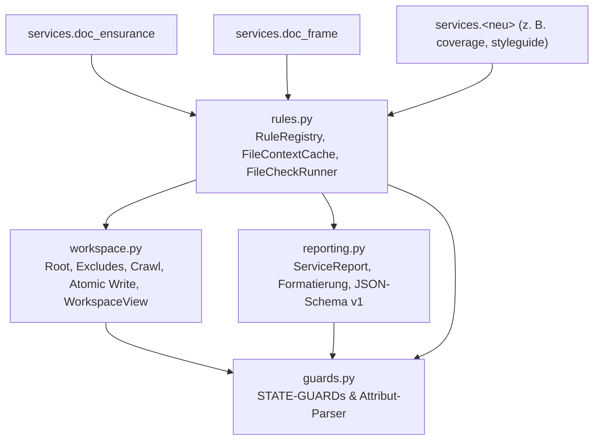

<!-- qb:frame id="CUBIE_DOC_FRAME_1" zone="head" banner="cubie-logo-written.png" label="Service-Core" order="1" -->
<div align="center">

# GUIDE: `Service-Core` – Gemeinsames Fundament für `qb-cubie`-Services


Wenn mehrere Services wie `DocEnsurance`, `DocFrame` und künftige Werkzeuge (`coverage`, `styleguide`) nebeneinander wachsen, entstehen ohne gemeinsames Fundament schnell doppelte Pfad-Crawler, inkonsistente `STATE-GUARD`s und versteckte Querkopplungen. **`qb_cubie.core.service_core`** bündelt alle domänenneutralen Bausteine für Eingabe-Guards (`guards`), Workspace-Discovery und atomares Schreiben (`workspace`), Multi-File-Regelausführung mit Parse-Cache (`rules`) sowie einheitliches Text- und JSON-Reporting (`reporting`) in einem streng isolierten, azyklischen Core-Paket.

---

> [!NOTE]
>
> **Architektur-Status (Zyklus 1 abgeschlossen, Zyklus 2 geplant):**  
> Dieses Handbuch beschreibt den produktiven **Zyklus 1** von `qb_cubie.core.service_core` (`guards`, `workspace`, `rules`, `reporting`), der durch `DocFrame`, `DocEnsurance`, `CstLinter`, `PytestReporter`, `JsonReporter` und Meta-Gate 4 abgesichert ist. Die optionalen Erweiterungen aus **Zyklus 2** (`markdown.py` als Markdown-Lexer-Subschicht und `cli_spec.py` als lazy CLI-Registry gemäß [`HYPOTHESIS.md`](./HYPOTHESIS.md)) sind noch nicht Teil des Pakets und folgen in einem separaten TGD-Zyklus.

---

> [!NOTE]  
> qb-cubie anerkennt explizit unsere **erkenntnistheoretischen Grenzen** im Sinne von Karl Poppers kritischem Rationalismus. Jede Aussage über ein System (und damit auch jeder Testfall als formalisierte Soll-Spezifikation) ist grundsätzlich **fehlbar** (*Fallibilismus*).  
>
> **Ein Test ist kein unfehlbares Dogma, sondern eine vorläufig bewährte Falsifikationshypothese.**  
> *Wenn du dein ganzes Leben lang nur weiße Schwäne gesehen hast …  
> ... heißt das dann, dass es keine schwarzen Schwäne gibt?*  
> **Code, Tests und Dokumentation von Cubie befinden sich in aktiver Weiterentwicklung.**

---

[README](../../README.md) • [QA-Handbuch](../GUIDE_Quality-Assurance.md) • [DocEnsurance](./GUIDE_DocEnsurance.md)  

</div>
<!-- /qb:frame -->

## 1. Warum ein Service-Core? (Einbahnstraße & freie Komposition)

Historisch waren `DocEnsurance` und `DocFrame` getrennt gewachsen: `DocFrame` besaß keinen eigenen Prüf-Runner und musste über `DocEnsurance` huckepack geprüft werden, während Projekt-Root-Suche, Exclude-Matching und Guard-Validatoren mehrfach kopiert wurden (siehe [`ANALYSIS.md`](./ANALYSIS.md)).

**`qb_cubie.core.service_core`** löst diese Probleme nach zwei verbindlichen Design-Gesetzen (siehe [`DEV-GUIDE_Services.md`](../dev/DEV-GUIDE_Services.md)):

1. **Strikte Einbahnstraße (`services.*` $\to$ `core.service_core` $\to$ Core-Kernel):** Der Service-Core liegt bewusst unter `src/qb_cubie/core/service_core/` (nicht unter `core/services/`). Er kennt keinen konkreten Service — `META-SERVICE-CORE-NEUTRALITY` blockiert jeden Rückwärts-Import in `qb_cubie.core.services.*`.
2. **Komposition statt Vererbungszwang:** Es gibt keine monolithische `BaseService`-Klasse. Jeder Service (egal ob Verification-Service, 2-Pass-Sync-Service oder Evidence-Collector) komponiert exakt die Bausteine aus `service_core`, die sein Fachproblem benötigt.



---

## 2. Modul-Übersicht & Import-Fassade (`qb_cubie.core.service_core`)

Alle 32 öffentlichen Symbole von Zyklus 1 lassen sich entweder direkt über die Paketfassade `qb_cubie.core.service_core` oder gezielt aus den vier azyklischen Submodulen importieren — ohne jemals ein Geschwister-Paket aus `qb_cubie.core.services` zu laden:

| Modul | Verantwortlichkeit | Zentrale Exporte |
| :--- | :--- | :--- |
| **`guards.py`** | Typ- und Werte-`STATE-GUARD`s sowie Attribut-Parser | `validate_choice`, `validate_non_empty_str`, `validate_positive_int`, `validate_positive_float`, `validate_str_sequence`, `parse_bool_attr`, `parse_int_attr` |
| **`workspace.py`** | Projekt-Root, Excludes, deterministisches Crawling, `FileSource`, atomares Schreiben & reiner Lese-Port | `DEFAULT_EXCLUDES`, `FileSource`, `WorkspaceView`, `InMemoryWorkspaceView`, `FileSystemWorkspaceView`, `find_project_root`, `normalize_excludes`, `is_excluded`, `crawl_files`, `looks_like_path`, `load_sources`, `atomic_write_text` |
| **`rules.py`** | Geordnete Regel-Registry, pro-Datei-Parse-Cache & generischer Multi-File-Prüf-Host | `RuleProtocol`, `FileContextCache`, `WorkspaceCheckRuleProtocol`, `RuleRegistry`, `execute_file_checks`, `FileCheckRunner` |
| **`reporting.py`** | Einheitlicher `ServiceReport` & Text-/JSON-Serialisierung (`schema_version: 1`) | `SERVICE_REPORT_SCHEMA_VERSION`, `ServiceReport`, `diagnostic_context`, `diagnostic_to_dict`, `format_diagnostic_line`, `report_to_dict`, `format_service_report_text` |

Das folgende Beispiel startet einen frischen Python-Subprozess für `qb_cubie.core.service_core` und bestätigt, dass alle 32 Exporte vollständig ohne Import eines konkreten Services aus `qb_cubie.core.services` geladen werden:

```python
import subprocess, sys

probe = (
    "import sys; from qb_cubie.core import service_core; "
    "svcs = [m for m in sys.modules if m.startswith('qb_cubie.core.services')]; "
    "print(f'Exporte: {len(service_core.__all__)} | Schema: v{service_core.SERVICE_REPORT_SCHEMA_VERSION} | Services geladen: {svcs}')"
)
print(subprocess.check_output([sys.executable, "-c", probe], text=True).strip())
```

<details>
<summary>Ergebnis</summary>

```text
Exporte: 32 | Schema: v1 | Services geladen: []
```
</details>

---

## 3. Eingabe-Guards & Attribut-Parser (`guards.py`)

Alle Validatoren in `guards.py` werfen konsistente `TypeError`- oder `ValueError`-Exceptions mit dem Präfix **`STATE-GUARD:`** und schließen klassische Python-Typfallen explizit aus:

* **Kein `bool`-als-`int`-Schlupfloch:** Weil in Python `isinstance(True, int)` wahr ist, weisen `validate_positive_int` und `validate_positive_float` Booleans (`True`/`False`) strikt mit `TypeError` ab.
* **Endlichkeit & Vorzeichen:** `validate_positive_float` prüft zusätzlich `math.isfinite(number)` und lehnt `NaN`, `inf`, `-inf` und `<= 0` ab.
* **Kein String-als-Sequenz-Schlupfloch:** `validate_str_sequence` lehnt bloße `str`- oder `bytes`-Werte (wie `excludes="tests"`) mit `TypeError` ab, damit sie niemals in Einzelzeichen zerlegt werden.
* **Einheitliches Attribut-Parsing:** `parse_bool_attr` akzeptiert `true`/`1`/`yes` vs. `false`/`0`/`no` (case-insensitiv, mit striktem `type(default) is bool`-Guard); `parse_int_attr` konvertiert Ganzzahl-Strings optional oder verpflichtend (`allow_none=False`).

Das folgende Beispiel demonstriert gültige Normalisierungen über die zentralen Guards und Parser aus `qb_cubie.core.service_core.guards`:

```python
from qb_cubie.core.service_core import (
    parse_bool_attr,
    parse_int_attr,
    validate_choice,
    validate_positive_float,
    validate_positive_int,
    validate_str_sequence,
)

mode = validate_choice("table", ("table", "links"), "mode")
limit = validate_positive_int(30, "max_lines")
timeout = validate_positive_float(2.5, "timeout", allow_none=True)
excludes = validate_str_sequence(["tests", "drafts"], "excludes")
flag = parse_bool_attr("YES", "recursive", default=False)
order = parse_int_attr(" 10 ", "order")
print(f"{mode=} | {limit=} | {timeout=} | {excludes=} | {flag=} | {order=}")
```

<details>
<summary>Ergebnis</summary>

```text
mode='table' | limit=30 | timeout=2.5 | excludes=('tests', 'drafts') | flag=True | order=10
```
</details>

Übergibt ein Aufrufer fälschlich einen bloßen String an `validate_str_sequence` (oder einen `bool` an `validate_positive_int`), stoppt der `STATE-GUARD` sofort mit einem klaren `TypeError`:

```python raises=TypeError
from qb_cubie.core.service_core import validate_str_sequence

validate_str_sequence("tests", "excludes")
```

<details>
<summary>Ergebnis</summary>

```text
TypeError: STATE-GUARD: excludes must be a sequence of strings; received str.
```
</details>

---

## 4. Workspace-Discovery, atomares Schreiben & `WorkspaceView` (`workspace.py`)

`workspace.py` kapselt sämtliche Dateisystem-Operationen für Services und trennt gleichzeitig reine Domänenlogik über das `WorkspaceView`-Protokoll sauber von der Festplatte.

### 4.1 Projekt-Root, Excludes, Crawling & `load_sources`

* **`find_project_root(start=None, *, markers=("pyproject.toml",), stop_at_cwd=False)`:** Sucht vom Startpfad (oder `Path.cwd()`) aufwärts nach dem nächstgelegenen Verzeichnis mit mindestens einer Marker-Datei bzw. einem Marker-Pfad (z. B. `"docs/.assets"`).
* **`normalize_excludes(excludes, *, base=DEFAULT_EXCLUDES)` & `is_excluded(rel_path, root_name, excludes)`:** Validiert `excludes` strikt gegen bare Strings und wertet sowohl reine Segmentnamen (`"drafts"`) als auch relative Teilpfade (`"docs/drafts"`) und Root-präfixierte Pfade (`"<root>/docs/drafts"`) einheitlich aus — genutzt von `DocEnsurance`, `DocFrame` und `CstLinter`.
* **`crawl_files(root, *, pattern="*.md", excludes=frozenset())`:** Liefert eine betriebssystemunabhängig sortierte Liste aller passenden Dateien unter `root`.
* **`load_sources(target, *, pattern="*.md", excludes=frozenset(), allow_in_memory=False)`:** Lädt eine Einzeldatei, ein Verzeichnis oder (nur wenn explizit `allow_in_memory=True` gesetzt ist) einen In-Memory-Text in unveränderliche `FileSource(path, rel_path, content)`-Objekte. Ein leeres Zielverzeichnis ohne Treffer löst einen `ValueError("STATE-GUARD: ...")` aus (Schutz vor *Vacuous Pass*).

Im folgenden Beispiel legen wir ein kleines Verzeichnis mit einer ausgeschlossenen Unterdatei an und laden die verbleibenden Quellen deterministisch über `load_sources`:

```python
from pathlib import Path
from qb_cubie.core.service_core import load_sources, normalize_excludes

root = Path("ws_demo")
(root / "docs/drafts").mkdir(parents=True, exist_ok=True)
(root / "docs/guide.md").write_text("# Guide\n", encoding="utf-8")
(root / "docs/drafts/wip.md").write_text("# WIP\n", encoding="utf-8")

excludes = normalize_excludes(["docs/drafts"])
sources = load_sources(root, pattern="*.md", excludes=excludes)
print([(s.rel_path, s.content.strip()) for s in sources])
```

<details>
<summary>Ergebnis</summary>

```text
[('docs/guide.md', '# Guide')]
```
</details>

### 4.2 Atomares Schreiben (`atomic_write_text`)

Services, die Dateien mutieren (wie `DocFrame.update()` oder `JsonReporter`), schreiben niemals direkt über `Path.write_text()`. Stattdessen erzeugt **`atomic_write_text(path, content, *, encoding="utf-8", newline="\n")`** eine temporäre Datei im selben Zielverzeichnis und tauscht die Zieldatei erst nach vollständigem Schreiben atomar über `os.replace()` aus. Schlägt das Schreiben oder Ersetzen fehl, bleibt die ursprüngliche Datei unbeschädigt und die temporäre Datei wird im `finally`-Block sauber gelöscht.

Das folgende Beispiel schreibt eine Datei atomar über `atomic_write_text` und prüft anschließend, dass keine temporären Hilfsdateien im Zielverzeichnis verbleiben:

```python
from pathlib import Path
from qb_cubie.core.service_core import atomic_write_text

out_dir = Path("atomic_demo")
out_dir.mkdir(exist_ok=True)
target = out_dir / "manifest.txt"
atomic_write_text(target, "version=1\n")
atomic_write_text(target, "version=2\n")

files = sorted(p.name for p in out_dir.iterdir())
print(f"Inhalt: {target.read_text(encoding='utf-8').strip()} | Dateien: {files}")
```

<details>
<summary>Ergebnis</summary>

```text
Inhalt: version=2 | Dateien: ['manifest.txt']
```
</details>

### 4.3 Reiner Read-Port für Domain-Logik (`WorkspaceView`)

Meta-Gate 4 (`META-SERVICE-PURE-DOMAIN-IO`) verbietet in reinen Domain- und Regelmodulen jeden direkten Filesystem-Zugriff — einschließlich `.exists()`, `.is_file()` und `.rglob()`. Um dennoch prüfen zu können, ob ein verlinktes Dokument oder Asset im Projekt vorhanden ist, injiziert die Imperative Shell einen **`WorkspaceView`**-Port (`root: Path`, `has_path(rel_or_abs) -> bool`):

* **`FileSystemWorkspaceView(root)`:** Produktiver Adapter in `adapters.py` (prüft real auf der Festplatte).
* **`InMemoryWorkspaceView(root, paths)`:** Reiner In-Memory-Port für schnelle, festplattenfreie Unit-Tests (indexiert Dateien sowie alle ihre Elternordner und normalisiert relative wie absolute Pfade gegen `root`).

Das folgende Beispiel zeigt, wie reine Prüflogik über `InMemoryWorkspaceView` ohne ein einziges physisches Verzeichnis auf der Festplatte getestet werden kann:

```python
from pathlib import Path
from qb_cubie.core.service_core import InMemoryWorkspaceView, WorkspaceView

view = InMemoryWorkspaceView(
    root=Path("/virtual_repo"),
    paths=("docs/GUIDE_Alpha.md", "docs/.assets/cubie-small.png"),
)
checks = (
    isinstance(view, WorkspaceView),
    view.has_path("docs/GUIDE_Alpha.md"),
    view.has_path("docs/.assets"),
    view.has_path("/virtual_repo/docs/.assets/cubie-small.png"),
    view.has_path("../outside.md"),
)
print(f"WorkspaceView-Checks: {checks}")
```

<details>
<summary>Ergebnis</summary>

```text
WorkspaceView-Checks: (True, True, True, True, False)
```
</details>

---

## 5. Regel-Registry, Parse-Cache & `FileCheckRunner` (`rules.py`)

`rules.py` entkoppelt die generische Multi-File-Prüfausführung vollständig von konkreten Services wie `DocEnsurance`. Dadurch prüft z. B. `DocFrame.check()` nativ über `FileCheckRunner`, ohne `DocEnsurance` jemals zu importieren.

### 5.1 Geordnete Regel-Verwaltung (`RuleRegistry`)

`RuleRegistry(rules=(), *, coerce=None, merge=None)` übernimmt das rekursive Flattening verschachtelter Regel-Sequenzen, die 0-Arg-Klassen-Instanziierung, `RuleProtocol`- und Severity-Prüfung, deterministische `rule_id`-Overrides, `.remove(rule_id)` sowie einen optionalen `merge`-Hook für koexistierende Regeln (wie zwei `CstLinter`-Instanzen in `DocEnsurance`).

```python
from dataclasses import dataclass
from qb_cubie.core.service_core import RuleRegistry


@dataclass(frozen=True)
class SimpleRule:
    rule_id: str = "DEMO-1"
    severity: str = "warning"


registry = RuleRegistry((SimpleRule, (SimpleRule(rule_id="DEMO-2", severity="error"),)))
registry.register(SimpleRule(rule_id="DEMO-1", severity="error"))
print([(r.rule_id, r.severity) for r in registry.rules])
```

<details>
<summary>Ergebnis</summary>

```text
[('DEMO-1', 'error'), ('DEMO-2', 'error')]
```
</details>

### 5.2 Multi-File-Checks mit `FileContextCache` & `depends_on` (`FileCheckRunner`)

Jede neue Multi-File-Prüfregel implementiert **`WorkspaceCheckRuleProtocol`**:
* `rule_id: str`, `severity: str | None`
* `context_key: str`: Regeln mit identischem `context_key` teilen sich exakt einen `prepare_workspace(sources, options)`-Aufruf pro Lauf.
* `depends_on: tuple[str, ...]`: Emittiert eine Vorbedingungs-Regel auf einer Datei bereits eine Diagnose mit `severity="error"`, werden abhängige Regeln für genau diese Datei automatisch übersprungen (Kaskaden-Unterdrückung).
* `check_file(source, workspace_ctx, file_cache)`: Nutzt `file_cache.get_or_compute(key, factory)`, sodass teures Parsing (z. B. `parse_frame_spans` über alle 4 `DocFrame`-Regeln) pro Datei garantiert **genau einmal** stattfindet.

Im ersten Schritt der Session `runner_demo` definieren wir zwei schlanke `WorkspaceCheckRuleProtocol`-Regeln, die sich einen gecachten Zeilen-Parse teilen und über `depends_on` verknüpft sind:

```python session=runner_demo
from collections.abc import Mapping, Sequence
from dataclasses import dataclass
from typing import Any
from qb_cubie.core.protocols import Diagnostic
from qb_cubie.core.service_core import FileCheckRunner, FileContextCache, FileSource

parse_calls = 0

def parse_lines(content: str) -> list[str]:
    global parse_calls
    parse_calls += 1
    return content.splitlines()

@dataclass(frozen=True)
class RequireTitleRule:
    rule_id: str = "DOC-TITLE"
    severity: str = "error"
    context_key: str = "demo"
    depends_on: tuple[str, ...] = ()

    def prepare_workspace(self, sources: Sequence[FileSource], options: Mapping[str, Any]) -> None:
        return None

    def check_file(self, source: FileSource, workspace_ctx: Any, file_cache: FileContextCache) -> list[Diagnostic]:
        lines = file_cache.get_or_compute("lines", lambda: parse_lines(source.content))
        return [] if lines and lines[0].startswith("# ") else [Diagnostic(source.rel_path, self.rule_id, 1, "Kein H1.", self.severity)]

print(f"Regel bereit: {RequireTitleRule().rule_id}")
```

<details>
<summary>Ergebnis</summary>

```text
Regel bereit: DOC-TITLE
```
</details>

Im zweiten Schritt derselben Session ergänzen wir eine zweite Regel mit `depends_on=("DOC-TITLE",)` und starten `FileCheckRunner` auf zwei Beispieldateien (eine valide, eine ohne Titel). Beide Regeln teilen sich denselben `FileContextCache`, sodass jede Datei genau einmal geparst wird und die abhängige Regel bei der fehlerhaften Datei übersprungen wird:

```python session=runner_demo
from pathlib import Path


@dataclass(frozen=True)
class ForbidTodoRule:
    rule_id: str = "DOC-TODO"
    severity: str = "warning"
    context_key: str = "demo"
    depends_on: tuple[str, ...] = ("DOC-TITLE",)

    def prepare_workspace(self, sources: Sequence[FileSource], options: Mapping[str, Any]) -> None:
        return None

    def check_file(self, source: FileSource, workspace_ctx: Any, file_cache: FileContextCache) -> list[Diagnostic]:
        lines = file_cache.get_or_compute("lines", lambda: parse_lines(source.content))
        return [
            Diagnostic(source.rel_path, self.rule_id, idx, "Offenes TODO.", severity=self.severity, context="body")
            for idx, line in enumerate(lines, start=1) if "TODO" in line
        ]


demo_dir = Path("runner_demo_docs")
demo_dir.mkdir(exist_ok=True)
(demo_dir / "ok.md").write_text("# Titel\nTODO: später ergänzen\n", encoding="utf-8")
(demo_dir / "broken.md").write_text("Kein Titel\nTODO: wird wegen depends_on unterdrückt\n", encoding="utf-8")

report = FileCheckRunner(
    rules=(RequireTitleRule(), ForbidTodoRule()), target=demo_dir, service="demo_check", reporter=None,
).run()
print(f"checked={report.files_checked} | parse_calls={parse_calls} | diags={[(d.file_path, d.rule_id) for d in report.diagnostics]}")
```

<details>
<summary>Ergebnis</summary>

```text
checked=2 | parse_calls=2 | diags=[('broken.md', 'DOC-TITLE'), ('ok.md', 'DOC-TODO')]
```
</details>

---

## 6. Einheitliches Reporting & `JsonReporter`-Bridge (`reporting.py`)

Jeder Service liefert einen unveränderlichen, hashbaren Report nach `ServiceReportProtocol` — standardmäßig **`ServiceReport`** (oder ein domänenspezifischer Report wie `DocReport` / `DocFrameReport`, der dasselbe Protokoll erfüllt):

* **`ServiceReport(service, target, passed, diagnostics=(), changed_files=(), files_checked=0, metadata=())`:** Sichert `service` (nicht-leerer String), `passed` (strikt `bool`) und `files_checked` (`int >= 0`, kein `bool`) per `STATE-GUARD` ab.
* **`Diagnostic(..., context=None)`:** Das Core-`Diagnostic` in `qb_cubie.core.protocols` trägt nun optional ein Kontext-Label `context: str | None` (z. B. Session-ID, Zonenname oder Symbol-Pfad). `format_diagnostic_line` hängt den Kontext automatisch als `(<context>)` an und fällt bei `DocDiagnostic` automatisch auf `session_id` zurück.
* **`PytestReporter` & `JsonReporter`:**
  * `PytestReporter` emittiert alle `warning`-Diagnosen als `UserWarning` (inkl. Kontext) und wirft nur bei `passed=False` einen formatierten `AssertionError`.
  * `JsonReporter(path)` akzeptiert nun sowohl EBT-`RunTrace` als auch jedes `ServiceReportProtocol` und persistiert letzteres atomar im stabilen **`schema_version: 1`**-Format über `report_to_dict(...)`.

Das folgende Beispiel erzeugt einen `ServiceReport`, formatiert ihn als Text und persistiert ihn über `JsonReporter` als versionierte JSON-Datei:

```python
import json
from pathlib import Path
from qb_cubie import JsonReporter
from qb_cubie.core.protocols import Diagnostic
from qb_cubie.core.service_core import ServiceReport, format_service_report_text

report = ServiceReport(
    service="style_demo",
    target="docs/",
    passed=True,
    files_checked=3,
    diagnostics=(Diagnostic("docs/a.md", "STYLE-1", 4, "Hinweis", severity="warning", context="head"),),
    metadata=(("profile", "strict"),),
)
out_json = Path("service_report.json")
JsonReporter(out_json).report(report)
loaded = json.loads(out_json.read_text(encoding="utf-8"))
print(format_service_report_text(report))
print(f"JSON schema={loaded['schema_version']} | service={loaded['service']} | ctx={loaded['diagnostics'][0]['context']}")
```

<details>
<summary>Ergebnis</summary>

```text
[STYLE-1] docs/a.md:4: Hinweis (head)
JSON schema=1 | service=style_demo | ctx=head
```
</details>

---

## 7. Bauplan: Einen neuen Service auf Basis des Service-Core aufbauen

Wer einen neuen Service unter `src/qb_cubie/core/services/<name>/` erstellt (z. B. `coverage` oder `styleguide`), folgt diesem kompakten Fünf-Schritte-Bauplan:

1. **Paket nach Ports & Adapters anlegen** (siehe [`DEV-GUIDE_Services.md`](../dev/DEV-GUIDE_Services.md)):
   * `models.py` / `protocols.py`: Unveränderliche `@dataclass(frozen=True)`-DTOs, Eingabe-Validierung mit `service_core.guards`.
   * `rules.py` / `engine.py`: 100 % I/O-freie Domänenlogik; Dateisystem-Prüfungen ausschließlich über `WorkspaceView.has_path(...)`; Multi-File-Regeln nach `WorkspaceCheckRuleProtocol` mit `FileContextCache`.
   * `adapters.py`: Imperative Shell mit `find_project_root`, `normalize_excludes`, `crawl_files`, `FileSystemWorkspaceView` und `atomic_write_text`.
   * `<name>.py` / `__init__.py`: Schlanker Service-Orchestrator (`FileCheckRunner` für Prüfläufe, `reporter=PytestReporter()` als Default für Check-Läufe, `reporter=None` als Default für mutierende Läufe).
2. **Kein Cross-Import, keine Dummy-Methoden:** Importiere ausschließlich Stdlib, zugelassene Drittpakete, `qb_cubie.core.*` und `qb_cubie.core.service_core.*` — niemals Geschwister-Services unter `qb_cubie.core.services.*`.
3. **Einstiegspunkte nach Archetyp trennen:**
   * *Prüf-Service (Read-Only):* `<Service>.check(...) -> ServiceReport` über `FileCheckRunner` (Standard-Reporter: `PytestReporter()`).
   * *Sync-/Transform-Service (Read-Write):* `<Service>.update(...) -> ServiceReport` mit `atomic_write_text` (Standard-Reporter: `None`).
4. **Komposition im Composition Root:** Kombiniere mehrere Services (wie `DocEnsurance` + `DocFrame`) erst in der Test-Suite (`tests/test_doc_ensurance.py`, `tests/test_doc_frame.py`) oder in der CLI.
5. **Meta-Gate 4 & TGD-Verifikation bestehen:**
   * `tests/tests_core/tests_services/test_service_architecture_gate.py` prüft automatisch `META-SERVICE-ISOLATION`, `META-SERVICE-PURE-DOMAIN-IO` (inkl. `.exists()`/`.rglob()`-Verbot in reinen Modulen), `META-SERVICE-CORE-NEUTRALITY`, Azyklizität, das 500-LOC-Modulbudget sowie isolierte Importierbarkeit im Subprozess.

<!-- qb:frame id="CUBIE_DOC_FRAME_1" zone="foot" -->

---

---

<div align="center">


[↦ | Vertragsaufbau: Eindeutigkeit & Kopplung | ↤](../GUIDE_Contract-Design.md)  
[↦ | Erwartungssteuerung & Safety (`expect`-Flags) | ↤](../GUIDE_Expect-Flags.md)  
[↦ | Qualitätssicherung mit Cubie | ↤](../GUIDE_Quality-Assurance.md)  
[↦ | Fortgeschrittene Quantoren (`all` vs. `exists`) | ↤](../GUIDE_Quantifiers.md)  
[↦ | Test-Guided Development (TGD) | ↤](../GUIDE_TGD.md)  

[↦ | Service-Core | ↤](./GUIDE_Service-Core.md)  
[↦ | GUIDE: `DocEnsurance` – Lebende und verifizierte Dokumentation | ↤](./GUIDE_DocEnsurance.md)  
[↦ | DocFrame (Prototyp) | ↤](./GUIDE_DocFrame.md)  

[↦ | Dokumentations-Übersicht | ↤](../README.md)  
[↦ | Core-Dokumentation | ↤](../core/README.md)  
[↦ | Entwicklerdokumentation | ↤](../dev/README.md)  
[↦ | Core-Internals | ↤](../dev/core/README.md)  
[↦ | Hintergrund & Essays | ↤](../misc/README.md)  
[↦ | Feature-Drafts: Virtualisierung | ↤](../feature-drafts/virtualization/README.md)  

</div>
<!-- /qb:frame -->
