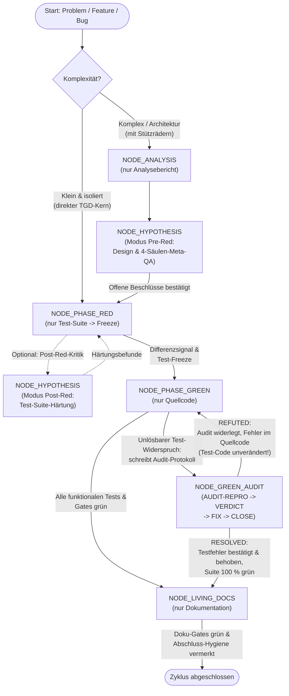

<!-- qb:frame id="CUBIE_DOC_FRAME_3" zone="head" banner="cubie-logo-written.png" -->

# TGD-Knoten-Handbücher (Zustandsautomat)

Universelle, projektübergreifend wiederverwendbare Handbuch-Reihe für die sechs operativen Knoten des Test-Guided Development (TGD) – geschrieben für Einsteiger, Experten und zustandslos orchestrierte KI-Agenten.

---

> [!NOTE]  
> qb-cubie anerkennt explizit unsere **erkenntnistheoretischen Grenzen** im Sinne von Karl Poppers kritischem Rationalismus. Jede Aussage über ein System (und damit auch jeder Testfall als formalisierte Soll-Spezifikation) ist grundsätzlich **fehlbar** (*Fallibilismus*).  
>
> **Ein Test ist kein unfehlbares Dogma, sondern eine vorläufig bewährte Falsifikationshypothese.**  
> *Wenn du dein ganzes Leben lang nur weiße Schwäne gesehen hast …  
> ... heißt das dann, dass es keine schwarzen Schwäne gibt?*  
> **Code, Tests und Dokumentation von Cubie befinden sich in aktiver Weiterentwicklung.**

---

[README](../../README.md) • [QA-Handbuch](../GUIDE_Quality-Assurance.md) • [DocEnsurance](../services/GUIDE_DocEnsurance.md)  

<!-- /qb:frame -->

## 1. Warum TGD als Zustandsautomat?

Das [TGD-Einstiegshandbuch](../GUIDE_TGD.md) erklärt das **Warum** von Test-Guided Development (Karl Poppers Fallibilismus, Bauprüfer-Analogie, Rolle der optionalen Stützräder und das Prinzip der kontrollierten Rückwärtstür). Die sechs Knoten-Handbücher in diesem Ordner bilden das dazugehörige **Wie**: einen schichtsauberen Zustandsautomaten mit klaren Ein- und Austrittsbedingungen.

* **Einfach erklärt (für Einsteiger):** Stell dir ein großes Bauprojekt wie einen Staffellauf mit klaren Zuständigkeiten vor: Erst vermisst jemand den Ist-Zustand (**`ANALYSIS`**), dann entsteht ein geprüfter Bauplan mit Alternativen (**`HYPOTHESIS`**), danach erstellt der Prüfer eine versiegelte Checkliste (**`PHASE_RED`**), erst dann baut der Handwerker (**`PHASE_GREEN`**) — mit einer offiziellen Rückfrage-Tür bei fehlerhafter Checkliste (**`GREEN_AUDIT`**) — und zum Schluss werden die Baupläne auf den realen Endstand gebracht (**`LIVING_DOCS`**). Weil jede Rolle genau weiß, was sie anfassen darf und wann sie übergibt, rutscht nichts durcheinander.
* **Für Experten & KI-Agenten (Hoare-Verträge & zustandslose Übergaben):** Jeder Knoten definiert einen in sich geschlossenen Hoare-Vertrag $\{P\}\ S\ \{Q\}$ mit expliziten Vorbedingungen ($P$), harter Schreibgrenze (Allowlist/Denylist), überprüfbaren Meta-QA-Heuristiken, Kantenfall-Regeln und objektiven Abnahmekriterien ($Q$). Ein nach einem Kontext-Reset frisch gestarteter Mitarbeiter oder KI-Agent lädt genau **ein** Knoten-Handbuch, arbeitet unvoreingenommen gegen die hinterlegten Artefakte des Vorgänger-Knotens und vermeidet so Bestätigungsfehler (*Confirmation Bias*) sowie aufgeblähte Einzel-Aufträge.

> [!NOTE]
> **Single-Shot vs. Knoten-Orchestrierung:** Für kleine, lokal eng begrenzte Bugfixes genügt oft ein direkter Single-Shot-Durchlauf entlang des TGD-Kerns (`PHASE_RED` $\to$ `PHASE_GREEN` $\to$ `LIVING_DOCS`). Das volle 6-Knoten-Protokoll mit Kontext-Trennung entfaltet seine Stärke bei komplexen Architektur-Umbauten, sicherheitskritischen Verträgen und mehrschrittiger Agenten-Orchestrierung.

---

## 2. Zustandsübergangs-Graph (6-Knoten-Topologie)

Der TGD-Automat besteht aus **zwei optionalen Stützrädern** (`ANALYSIS`, `HYPOTHESIS`), **drei verbindlichen Kernknoten** (`PHASE_RED`, `PHASE_GREEN`, `LIVING_DOCS`) sowie einem **eigenständigen Rücksprung-Knoten** (`GREEN_AUDIT`) mit zwei klar getrennten Ausgängen (`RESOLVED` vs. `REFUTED`):

---

## 3. Die sechs Knoten-Handbücher im Überblick

Jedes Knoten-Handbuch ist so aufgebaut, dass **Einsteiger** (anschauliche Erklärung), **Experten** (epistemologische & methodische Einordnung) und **KI-Agenten** (kompakter Steckbrief, harte Schreibgrenzen, objektive Abnahmekriterien) denselben Text ohne Doppelpflege nutzen können:

<!-- qb:frame id="CUBIE_DOC_FRAME_3" zone="router" mode="table" dir="." recursive="false" -->
| Dokument | Inhalt und Geltung |
| :--- | :--- |
| [Knoten: ANALYSIS (Bestandsaufnahme & Ist-Vermessung)](./NODE_ANALYSIS.md) | Rein lesende Bestandsaufnahme (Stützrad 1): Vermisst den realen Ist-Zustand ($Q_{\text{Ist}}$) gegen das fachliche Ziel ($Q_{\text{Soll}}$) mit überprüfbaren Belegen, ohne Quellcode, Test-Suite oder Produkt-Handbücher zu verändern. |
| [Knoten: HYPOTHESIS (Falsifizierbares Design & Meta-QA)](./NODE_HYPOTHESIS.md) | Falsifizierbarer Architekturentwurf und Meta-QA-Prüfung (Stützrad 2): Entwickelt konkurrierende Lösungsmodelle, Mutanten-Matrizen und entscheidungsreife Beschlüsse — im Modus *Pre-Red* vor dem Testbau oder im Modus *Post-Red-Kritik* zur Test-Suite-Härtung. |
| [Knoten: PHASE_RED (Testaufbau, Gate-Kalibrierung & Test-Freeze)](./NODE_PHASE_RED.md) | Erster verbindlicher Kernknoten von TGD: Übersetzt bestätigte Verträge und Mutanten in scharfe, reproduzierbar fehlschlagende Tests, kalibriert statische Wächter und friert die Test-Suite vor der Implementierung ein. |
| [Knoten: PHASE_GREEN (Implementierung unter Test-Freeze)](./NODE_PHASE_GREEN.md) | Zweiter verbindlicher Kernknoten von TGD: Implementiert die Lösung ausschließlich im Quellcode unter striktem Test-Freeze und nutzt bei unbehebbaren Test-Widersprüchen die kontrollierte Rückwärtstür (`NODE_GREEN_AUDIT`). |
| [Knoten: GREEN_AUDIT (Kontrollierter Rücksprung aus Phase Green)](./NODE_GREEN_AUDIT.md) | Eigenständiger Rücksprung-Knoten (Test-Reparatur-Rolle): Prüft ein in Phase Green gemeldetes Audit-Protokoll im frischen Kontext als widerlegbare Hypothese (`AUDIT-REPRO -> AUDIT-VERDICT -> AUDIT-FIX -> AUDIT-CLOSE`) mit eindeutigem Ausgang `RESOLVED` oder `REFUTED`. |
| [Knoten: LIVING_DOCS (Dokumentations-Synchronisation & Hygiene)](./NODE_LIVING_DOCS.md) | Dritter verbindlicher Kernknoten von TGD: Synchronisiert Handbücher, ausführbare Beispiele und Übersichten streng nach dem Prinzip *Code als Wahrheitsquelle*, verifiziert alle Doku-Gates und schließt den Zyklus sauber ab. |
<!-- /qb:frame -->

---

## 4. Gemeinsame Knoten-Invarianten (gelten in jedem Knoten)

Um Redundanz und Widersprüche zwischen den sechs Handbüchern auszuschließen, sind übergreifende Prozessregeln genau einmal hier zentral festgelegt und werden in jedem Knoten im Abschnitt *Eintritt & Pre-Flight* referenziert.

### 4.1 Pre-Flight-Triage des Arbeitsverzeichnisses (3-Klassen-Modell)

Bevor in irgendeinem Knoten die erste Zeile verändert wird, wird der Status des Versionierungssystems (z. B. der Working Tree in Git) geprüft und jede lokale Änderung einer von drei Klassen zugeordnet:

| Klasse im Arbeitsverzeichnis | Typischer Befund | Verbindliche Reaktion |
| :--- | :--- | :--- |
| **Klasse 1: Aktuelles Arbeits-Ticket** | Das laufende Auftragsdokument genau dieses Schritts liegt lokal vor. | **Zulässig:** Kurz im Pre-Flight notieren und unverändert lassen. |
| **Klasse 2: Vorab angelegter Folge-Auftrag** | Ein bereits entworfener Auftrag für den *nächsten* Knoten liegt unversioniert vor. | **Unberührt & getrennt lassen:** Niemals in den Commit des laufenden Knotens aufnehmen; kurz im Abschlussbericht vermerken. |
| **Klasse 3: Fremde Altlast in Code, Tests oder Doku** | Unerwartete lokale Änderungen an Quellcode, Test-Suite oder Handbüchern aus früherer Arbeit. | **Harter Stopp vor Arbeitsbeginn:** Nichts ändern, schmutzigen Zustand sofort an die Orchestrierung melden (Bereinigung/Commit/Stash vor Knotenstart) oder nur bei ausdrücklicher Freigabe als streng isolierte Baseline aus dem eigenen Diff heraushalten. |

### 4.2 Rollen-, Kontext- & Ticket-Disziplin

1. **Frischer Kontext pro Knoten:** Zwischen zwei Knoten (insbesondere vor `NODE_GREEN_AUDIT` und `NODE_LIVING_DOCS`) wird der Gesprächskontext geleert. Alle relevanten Fakten fließen über explizite, versionierte Artefakte — niemals über stilles implizites Erinnerungswissen.
2. **Widerspruchsprüfung am Arbeits-Ticket (Anti-Copy-Paste-Schutz):** Stimmen die angegebene Knoten-Rolle und das fachliche Ziel im Arbeits-Ticket nicht überein (etwa ein Testbau-Ziel in einem Implementierungs-Ticket) oder fehlen verbindliche Antworten auf offene Design-Entscheidungen aus dem Vorgänger-Knoten (bloßes „Ok.“ bei ungeklärten Alternativen reicht nicht), **stoppt der Knoten vor der ersten Änderung** und meldet die Inkonsistenz zurück.
3. **Schlanke Arbeits-Tickets statt Regel-Wiederholung:** Da alle stabilen Prozessregeln in den sechs Knoten-Handbüchern stehen, enthält ein Arbeits-Ticket nur noch das laufzeitspezifische Delta:
   * Knoten-Verweis und Zyklus-Kennung,
   * 1–2 präzise Sätze zum konkreten Ziel dieses Schritts,
   * Kontext-Delta seit dem letzten Knoten,
   * explizit bestätigte Beschlüsse (`BESTÄTIGT` / `GEÄNDERT` / `ZURÜCKGESTELLT`) samt bewussten Ausnahmen,
   * kuratierte Liste der realen Eingabe-Artefakte und des Ziel-Outputs.

### 4.3 Allgemeiner 3-Zustands-Lebenszyklus temporärer Artefakte

Arbeits-Tickets, Analyse-/Hypothesenberichte, Ausführungsprotokolle und Audit-Dateien durchlaufen einen geordneten Lebenszyklus, damit sie während eines Zyklus maximale Orientierung bieten, danach aber keine dauerhaften Dateileichen in produktiven Ordnern hinterlassen:

| Artefakt-Kategorie | Zustand 1: Aktiv (während des Laufs) | Zustand 2: Nach Zyklus-Abschluss (*Archiviert* oder *Bereinigt*) | Hygiene-Invariante |
| :--- | :--- | :--- | :--- |
| **Arbeits-Tickets** | In einem von der Produkt-Dokumentation entkoppelten Lauf-Bereich. | Nach Abschluss bereinigen (Versionierungshistorie bewahrt den Verlauf) oder bei Studien gebündelt archivieren. | Folge-Tickets niemals im Commit des vorherigen Knotens mitcommitten. |
| **Analyse- & Hypothesenberichte** | Als verbindliche Handoff-Anker des laufenden Zyklus (mit Herkunfts- und Verifikationsangaben). | Bei dauerhaftem Architekturwert ins Archiv verschieben; bei reinen Bug-Sprints nach Abschluss entfernen. | Keine dauerhafte visuelle Konkurrenz zu langlebigen Anwender- und Entwickler-Handbüchern. |
| **Audit-Protokoll (`GREEN_AUDIT`)** | Genau eine eindeutige Audit-Datei im Test-Bereich (**Single-Active-Signal-Invariante**). | Bei `REFUTED` zwingend als Eingabe für `PHASE_GREEN` erhalten; nach `RESOLVED` und grünem `LIVING_DOCS` als nachgelagerte Abschluss-Hygiene archivieren oder entfernen. | **Klare Rollentrennung:** `NODE_LIVING_DOCS` behält die ausnahmefreie Schreibgrenze (kein Zugriff auf Quellcode oder Test-Verzeichnis); das Aufräumen abgeschlossener Audit-Dateien erfolgt nachgelagert durch die Orchestrierung. |

---

## 5. Konkrete Projekt-Anbindung & Weiterführendes

Die Handbücher unter `docs/tgd/` sind bewusst **projektneutral** formuliert, damit sie auf beliebige Softwareprojekte übertragbar bleiben.

* **Konkretes Projekt-Profil für `qb-cubie`:** Sämtliche projektspezifischen Pfade, Prüfkommandos, der Advisory-Check für pausierte Stil-Gates, die konkrete Minimal-Ticket-Vorlage, konkrete Ablagepfade sowie das Prozess-Mutanten-Mapping (`PM1`–`PM8`) sind zentral im technischen Dev-Guide [`DEV-GUIDE: TGD-Workflow-Profil für qb-cubie`](../dev/DEV-GUIDE_TGD-Workflow.md) gebündelt.
* **Epistemologie & Einstieg in TGD:** Grundlagen, Bauprüfer-Analogie und den Fünf-Schritte-Überblick findest du im [TGD-Handbuch](../GUIDE_TGD.md).

<!-- qb:frame id="CUBIE_DOC_FRAME_3" zone="foot" -->

---

---

[↦ | Vertragsaufbau: Eindeutigkeit & Kopplung | ↤](../GUIDE_Contract-Design.md)  
[↦ | Erwartungssteuerung & Safety (`expect`-Flags) | ↤](../GUIDE_Expect-Flags.md)  
[↦ | Qualitätssicherung mit Cubie | ↤](../GUIDE_Quality-Assurance.md)  
[↦ | Fortgeschrittene Quantoren (`all` vs. `exists`) | ↤](../GUIDE_Quantifiers.md)  
[↦ | Test-Guided Development (TGD) | ↤](../GUIDE_TGD.md)  

[↦ | Service-Core | ↤](../services/GUIDE_Service-Core.md)  
[↦ | GUIDE: `DocEnsurance` – Lebende und verifizierte Dokumentation | ↤](../services/GUIDE_DocEnsurance.md)  
[↦ | DocFrame (Prototyp) | ↤](../services/GUIDE_DocFrame.md)  

[↦ | Dokumentations-Übersicht | ↤](../README.md)  
[↦ | Core-Dokumentation | ↤](../core/README.md)  
[↦ | Entwicklerdokumentation | ↤](../dev/README.md)  
[↦ | Core-Internals | ↤](../dev/core/README.md)  
[↦ | Hintergrund & Essays | ↤](../misc/README.md)  
[↦ | Feature-Drafts: Virtualisierung | ↤](../feature-drafts/virtualization/README.md)  

[↦ | Knoten: ANALYSIS (Bestandsaufnahme & Ist-Vermessung) | ↤](./NODE_ANALYSIS.md)  
[↦ | Knoten: HYPOTHESIS (Falsifizierbares Design & Meta-QA) | ↤](./NODE_HYPOTHESIS.md)  
[↦ | Knoten: PHASE_RED (Testaufbau, Gate-Kalibrierung & Test-Freeze) | ↤](./NODE_PHASE_RED.md)  
[↦ | Knoten: PHASE_GREEN (Implementierung unter Test-Freeze) | ↤](./NODE_PHASE_GREEN.md)  
[↦ | Knoten: GREEN_AUDIT (Kontrollierter Rücksprung aus Phase Green) | ↤](./NODE_GREEN_AUDIT.md)  
[↦ | Knoten: LIVING_DOCS (Dokumentations-Synchronisation & Hygiene) | ↤](./NODE_LIVING_DOCS.md)  

<!-- /qb:frame -->
