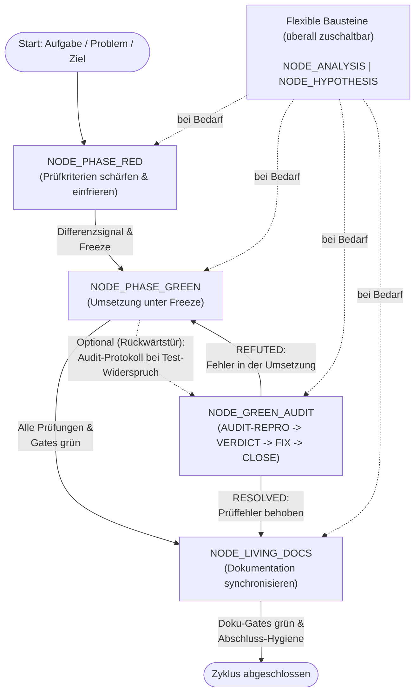

<!-- qb:frame id="CUBIE_DOC_FRAME_3" zone="head" banner="cubie-logo-written.png" -->

# TGD-Knoten-Handbücher (Modularer Rollen-Baukasten)

Universelle, projekt- und plattformunabhängige Handbuch-Reihe für die sechs flexiblen Knoten des Test-Guided Development (TGD) – geschrieben für Einsteiger, Experten, Menschen und beliebige KI-Agenten.

---

> [!NOTE]  
> qb-cubie anerkennt explizit unsere **erkenntnistheoretischen Grenzen** im Sinne von Karl Poppers kritischem Rationalismus. Jede Aussage über ein System (und damit auch jeder Testfall als formalisierte Soll-Spezifikation) ist grundsätzlich **fehlbar** (*Fallibilismus*).  
>
> **Ein Test ist kein unfehlbares Dogma, sondern eine vorläufig bewährte Falsifikationshypothese.**  
> *Wenn du dein ganzes Leben lang nur weiße Schwäne gesehen hast …  
> ... heißt das dann, dass es keine schwarzen Schwäne gibt?*  
> **Code, Tests und Dokumentation von Cubie befinden sich in aktiver Weiterentwicklung.**

---

[README](../../README.md) • [QA-Handbuch](../GUIDE_Quality-Assurance.md) • [DocEnsurance](../services/GUIDE_DocEnsurance.md)  

<!-- /qb:frame -->

## 1. Warum TGD als modularer Knoten-Baukasten?

Das [TGD-Einstiegshandbuch](../GUIDE_TGD.md) erklärt das **Warum** von Test-Guided Development (Karl Poppers Fallibilismus, Bauprüfer-Analogie, flexible Stützräder und die kontrollierte Rückwärtstür). Die sechs Knoten-Handbücher in diesem Ordner liefern das dazugehörige **Wie**: keinen starr verdrahteten Ablauf, sondern einen **modularen Baukasten aus klar getrennten Rollen**, die du je nach Aufgabe und Komplexität frei kombinierst.

* **Einfach erklärt (für Einsteiger):** Stell dir ein Bauprojekt mit klaren Zuständigkeiten vor. Im Kern braucht es genau drei Schritte: Zuerst legt die Prüferin die verbindliche Checkliste fest (**`PHASE_RED`**), dann baut der Handwerker danach (**`PHASE_GREEN`**) und am Ende werden die Baupläne auf den echten Endstand gebracht (**`LIVING_DOCS`**). Im Idealfall läuft das direkt und ohne Umwege durch. Entdeckt der Handwerker jedoch einen echten Fehler in der Checkliste, nutzt er die offizielle Rückwärtstür (**`GREEN_AUDIT`**) statt sie heimlich umzuschreiben. Und immer dann, wenn irgendwo im Projekt etwas unklar oder knifflig ist, lassen sich jederzeit zwei zusätzliche Helfer dazuschalten: erst objektiv nachmessen (**`ANALYSIS`**) oder mögliche Lösungen und Fehlerquellen auf dem Papier durchdenken (**`HYPOTHESIS`**).
* **Für Experten & KI-Agenten (Hoare-Verträge & plattformunabhängige Übergaben):** Jeder Knoten definiert einen in sich geschlossenen Hoare-Vertrag $\{P\}\ S\ \{Q\}$ mit klaren Vorbedingungen ($P$), harter Schreibgrenze (Allowlist/Denylist), überprüfbaren Meta-QA-Heuristiken, Kantenfall-Regeln und objektiven Abnahmekriterien ($Q$). Weil jeder Knoten nur gegen explizite Artefakte arbeitet und keinerlei Werkzeug- oder Plattform-Sondersyntax voraussetzt, können Menschen und beliebige externe Agenten nahtlos zusammenarbeiten — mit frischem Kontext pro Rollenwechsel gegen *Confirmation Bias*.

> [!NOTE]
> **Situative Skalierung statt starrem Pflichtprogramm:** Für kleine, klar umrissene Aufgaben genügt der schlanke TGD-Kern (`PHASE_RED` $\to$ `PHASE_GREEN` $\to$ `LIVING_DOCS`). Erst bei hoher Komplexität, unklaren Abhängigkeiten oder mehrschrittiger Agenten-Orchestrierung schaltest du `ANALYSIS` und `HYPOTHESIS` genau an den Stellen dazu, an denen sie echten Hebel liefern. `GREEN_AUDIT` wird nur im Eskalationsfall gebraucht.

---

## 2. Knoten-Topologie (Kernfluss, Rückwärtstür & zuschaltbare Bausteine)

Die sechs Knoten gliedern sich in **drei verbindliche Kernknoten** (`PHASE_RED`, `PHASE_GREEN`, `LIVING_DOCS`), einen **optionalen Rücksprung-Knoten** (`GREEN_AUDIT`) sowie **zwei überall zuschaltbare Stützräder** (`ANALYSIS`, `HYPOTHESIS`):

* **`ANALYSIS` & `HYPOTHESIS` sind frei positionierbar:** Typische Einsatzpunkte sind vor `PHASE_RED` (Ist-Vermessung & Architekturentwurf), nach einem ersten Test-Entwurf in `PHASE_RED` (*Post-Red-Kritik*), beim Isolieren unerwarteter Fehlschläge in `PHASE_GREEN`, als Prüfdisziplin innerhalb von `GREEN_AUDIT` oder vor größeren Doku-Umbauten in `LIVING_DOCS`.

---

## 3. Die sechs Knoten-Handbücher im Überblick

Jedes Knoten-Handbuch ist so aufgebaut, dass **Einsteiger** (anschauliche Erklärung), **Experten** (epistemologische & methodische Einordnung) und **KI-Agenten** (kompakter Steckbrief, harte Schreibgrenzen, objektive Abnahmekriterien) denselben Text ohne Doppelpflege nutzen können:

<!-- qb:frame id="CUBIE_DOC_FRAME_3" zone="router" mode="table" dir="." recursive="false" -->
| Dokument | Inhalt und Geltung |
| :--- | :--- |
| [Knoten: ANALYSIS (Bestandsaufnahme & Ist-Vermessung)](./NODE_ANALYSIS.md) | Rein lesende Bestandsaufnahme (Stützrad 1): Vermisst den realen Ist-Zustand ($Q_{\text{Ist}}$) gegen das fachliche Ziel ($Q_{\text{Soll}}$) mit überprüfbaren Belegen, ohne Quellcode, Test-Suite oder Produkt-Handbücher zu verändern. |
| [Knoten: HYPOTHESIS (Falsifizierbares Design & Meta-QA)](./NODE_HYPOTHESIS.md) | Falsifizierbarer Architekturentwurf und Meta-QA-Prüfung (Stützrad 2): Entwickelt konkurrierende Lösungsmodelle, Mutanten-Matrizen und entscheidungsreife Beschlüsse — im Modus *Pre-Red* vor dem Testbau oder im Modus *Post-Red-Kritik* zur Test-Suite-Härtung. |
| [Knoten: PHASE_RED (Testaufbau, Gate-Kalibrierung & Test-Freeze)](./NODE_PHASE_RED.md) | Erster verbindlicher Kernknoten von TGD: Übersetzt bestätigte Verträge und Mutanten in scharfe, reproduzierbar fehlschlagende Tests, kalibriert statische Wächter und friert die Test-Suite vor der Implementierung ein. |
| [Knoten: PHASE_GREEN (Implementierung unter Test-Freeze)](./NODE_PHASE_GREEN.md) | Zweiter verbindlicher Kernknoten von TGD: Implementiert die Lösung ausschließlich im Quellcode unter striktem Test-Freeze und nutzt bei unbehebbaren Test-Widersprüchen die kontrollierte Rückwärtstür (`NODE_GREEN_AUDIT`). |
| [Knoten: GREEN_AUDIT (Kontrollierter Rücksprung aus Phase Green)](./NODE_GREEN_AUDIT.md) | Eigenständiger Rücksprung-Knoten (Test-Reparatur-Rolle): Prüft ein in Phase Green gemeldetes Audit-Protokoll im frischen Kontext als widerlegbare Hypothese (`AUDIT-REPRO -> AUDIT-VERDICT -> AUDIT-FIX -> AUDIT-CLOSE`) mit eindeutigem Ausgang `RESOLVED` oder `REFUTED`. |
| [Knoten: LIVING_DOCS (Dokumentations-Synchronisation & Hygiene)](./NODE_LIVING_DOCS.md) | Dritter verbindlicher Kernknoten von TGD: Synchronisiert Handbücher, ausführbare Beispiele und Übersichten streng nach dem Prinzip *Code als Wahrheitsquelle*, verifiziert alle Doku-Gates und schließt den Zyklus sauber ab. |
<!-- /qb:frame -->

---

## 4. Gemeinsame Knoten-Invarianten (gelten in jedem Knoten)

Um Redundanz und Widersprüche zwischen den sechs Handbüchern auszuschließen, sind übergreifende Prozessregeln genau einmal hier zentral festgelegt und werden in jedem Knoten im Abschnitt *Eintritt & Pre-Flight* referenziert.

### 4.1 Pre-Flight-Triage des Arbeitsverzeichnisses (3-Klassen-Modell)

Bevor in irgendeinem Knoten die erste Änderung erfolgt, wird der Status des Arbeitsverzeichnisses (z. B. im Versionierungssystem) geprüft und jede lokale Änderung einer von drei Klassen zugeordnet:

| Klasse im Arbeitsverzeichnis | Typischer Befund | Verbindliche Reaktion |
| :--- | :--- | :--- |
| **Klasse 1: Aktuelles Run-Dokument** | Der laufende Arbeitsauftrag (`RUN`) genau dieses Schritts liegt lokal vor. | **Zulässig:** Kurz im Pre-Flight notieren und unverändert lassen. |
| **Klasse 2: Vorab angelegtes Folge-Run-Dokument** | Ein bereits entworfener Auftrag für einen *späteren* Schritt liegt unversioniert vor. | **Unberührt & getrennt lassen:** Niemals in den Abschluss-Stand des laufenden Knotens aufnehmen; kurz im Abschlussbericht vermerken. |
| **Klasse 3: Fremde Altlast in produktiven Bereichen** | Unerwartete lokale Änderungen an Quellcode, Prüfsystemen oder Handbüchern aus früherer Arbeit. | **Harter Stopp vor Arbeitsbeginn:** Nichts ändern, schmutzigen Zustand sofort an die Orchestrierung melden (Bereinigung/Sicherung vor Knotenstart) oder nur bei ausdrücklicher Freigabe als streng isolierte Baseline aus dem eigenen Diff heraushalten. |

### 4.2 Rollen-, Kontext- & Run-Disziplin

1. **Frischer Kontext bei Rollenwechseln:** Zwischen zwei Knoten (insbesondere vor `NODE_GREEN_AUDIT` und `NODE_LIVING_DOCS`) wird der Arbeits- bzw. Gesprächskontext geleert. Alle relevanten Fakten fließen über explizite, nachvollziehbare Artefakte — niemals über stilles implizites Erinnerungswissen.
2. **Widerspruchsprüfung & *Consent-by-Exception*:**
   * Stimmen die angegebene Knoten-Rolle und das fachliche Ziel im Run-Dokument nicht überein (etwa ein Prüfaufbau-Ziel in einem Umsetzungs-Lauf), **stoppt der Knoten vor der ersten Änderung** und meldet die Inkonsistenz zurück.
   * Offene Entscheidungsfragen (`E1..En`) aus einer vorgelagerten `HYPOTHESIS`-Phase tragen dort stets eine eindeutig markierte **Standard-Empfehlung**. Im nächsten Schritt genügt daher das explizite Signal **`EMPFEHLUNGEN: ALLE`** samt eventuellen konkreten Abweichungen (*Consent-by-Exception*), statt jede Option erneut abschreiben zu müssen. Erst wenn bei offenen Alternativen weder `EMPFEHLUNGEN: ALLE` noch Einzelentscheidungen vorliegen (etwa bei einem ungebundenen, mehrdeutigen „Ok.“), wird vor Arbeitsbeginn kurz nachgefragt.
3. **Schlanke, plattformunabhängige Run-Dokumente (`RUN`):** Da alle stabilen Prozessregeln in den Knoten-Handbüchern stehen, bleibt ein Run-Dokument bewusst minimal und werkzeugneutral (Standard-Markdown-Links statt plattformspezifischer Sondersyntax) und enthält nur das laufzeitspezifische Delta:
   * Knoten-Verweis und Lauf-Kennung,
   * 1–2 präzise Sätze zum konkreten Ziel dieses Schritts,
   * Kontext-Delta seit dem letzten Knoten,
   * Freigabe per `EMPFEHLUNGEN: ALLE` plus eventuelle Abweichungen / Ausnahmen,
   * kuratierte Liste der realen Eingabe-Artefakte und des Ziel-Outputs.

### 4.3 Allgemeiner 3-Zustands-Lebenszyklus temporärer Artefakte

Run-Dokumente, Analyse-/Hypothesenberichte, Ausführungsprotokolle und Audit-Dateien durchlaufen einen geordneten Lebenszyklus, damit sie während eines Durchlaufs maximale Orientierung bieten, danach aber keine dauerhaften Dateileichen in produktiven Ordnern hinterlassen:

| Artefakt-Kategorie | Zustand 1: Aktiv (während des Laufs) | Zustand 2: Nach Zyklus-Abschluss (*Archiviert* oder *Bereinigt*) | Hygiene-Invariante |
| :--- | :--- | :--- | :--- |
| **Run-Dokumente (`RUN`)** | Leichtgewichtig in einem von der Produkt-Dokumentation entkoppelten Lauf-Bereich (Dokumentrahmen rein optional). | Nach Abschluss bereinigen (die Historie des Versionierungssystems bewahrt den Verlauf) oder bei Studien gebündelt archivieren. | Folge-Runs niemals im Commit des vorherigen Knotens mitaufnehmen. |
| **Analyse- & Hypothesenberichte** | Als verbindliche Handoff-Anker des laufenden Durchlaufs (mit Herkunfts- und Verifikationsangaben). | Bei dauerhaftem Grundlagen- oder Architekturwert ins Archiv verschieben; bei reinen Detail-Sprints nach Abschluss entfernen. | Keine dauerhafte visuelle Konkurrenz zu langlebigen Anwender- und Fach-Handbüchern. |
| **Audit-Protokoll (`GREEN_AUDIT`)** | Genau eine eindeutige Audit-Datei im Prüf-Bereich (**Single-Active-Signal-Invariante**). | Bei `REFUTED` zwingend als Eingabe für `PHASE_GREEN` erhalten; nach `RESOLVED` und grünem `LIVING_DOCS` als nachgelagerte Abschluss-Hygiene archivieren oder entfernen. | **Klare Rollentrennung:** `NODE_LIVING_DOCS` behält die ausnahmefreie Schreibgrenze; das Aufräumen abgeschlossener Audit-Dateien erfolgt nachgelagert durch die Orchestrierung. |

---

## 5. Konkrete Projekt-Anbindung & Weiterführendes

Die Handbücher unter `docs/tgd/` sind bewusst **projekt-, werkzeug- und perspektivisch domänenneutral** gehalten, damit sich ihre Prinzipien ohne Plattform-Abhängigkeit auf beliebige Vorhaben übertragen lassen.

* **Konkretes Projekt-Profil für `qb-cubie`:** Sämtliche projektspezifischen Pfade, Prüfkommandos, der Advisory-Check für pausierte Stil-Gates, die konkrete Minimal-Run-Vorlage (`RUN-*.md`), konkrete Ablagepfade sowie das Prozess-Mutanten-Mapping (`PM1`–`PM8`) sind zentral im technischen Dev-Guide [`DEV-GUIDE: TGD-Workflow-Profil für qb-cubie`](../dev/DEV-GUIDE_TGD-Workflow.md) gebündelt.
* **Epistemologie & Einstieg in TGD:** Grundlagen, Bauprüfer-Analogie und den exemplarischen Fünf-Schritte-Überblick findest du im [TGD-Handbuch](../GUIDE_TGD.md).

<!-- qb:frame id="CUBIE_DOC_FRAME_3" zone="foot" -->

---

---

[↦ | Vertragsaufbau: Eindeutigkeit & Kopplung | ↤](../GUIDE_Contract-Design.md)  
[↦ | Erwartungssteuerung & Safety (`expect`-Flags) | ↤](../GUIDE_Expect-Flags.md)  
[↦ | Qualitätssicherung mit Cubie | ↤](../GUIDE_Quality-Assurance.md)  
[↦ | Fortgeschrittene Quantoren (`all` vs. `exists`) | ↤](../GUIDE_Quantifiers.md)  
[↦ | Test-Guided Development (TGD) | ↤](../GUIDE_TGD.md)  

[↦ | Service-Core | ↤](../services/GUIDE_Service-Core.md)  
[↦ | GUIDE: `DocEnsurance` – Lebende und verifizierte Dokumentation | ↤](../services/GUIDE_DocEnsurance.md)  
[↦ | DocFrame (Prototyp) | ↤](../services/GUIDE_DocFrame.md)  

[↦ | Dokumentations-Übersicht | ↤](../README.md)  
[↦ | Core-Dokumentation | ↤](../core/README.md)  
[↦ | Entwicklerdokumentation | ↤](../dev/README.md)  
[↦ | Core-Internals | ↤](../dev/core/README.md)  
[↦ | Hintergrund & Essays | ↤](../misc/README.md)  
[↦ | Feature-Drafts: Virtualisierung | ↤](../feature-drafts/virtualization/README.md)  

[↦ | Knoten: ANALYSIS (Bestandsaufnahme & Ist-Vermessung) | ↤](./NODE_ANALYSIS.md)  
[↦ | Knoten: HYPOTHESIS (Falsifizierbares Design & Meta-QA) | ↤](./NODE_HYPOTHESIS.md)  
[↦ | Knoten: PHASE_RED (Testaufbau, Gate-Kalibrierung & Test-Freeze) | ↤](./NODE_PHASE_RED.md)  
[↦ | Knoten: PHASE_GREEN (Implementierung unter Test-Freeze) | ↤](./NODE_PHASE_GREEN.md)  
[↦ | Knoten: GREEN_AUDIT (Kontrollierter Rücksprung aus Phase Green) | ↤](./NODE_GREEN_AUDIT.md)  
[↦ | Knoten: LIVING_DOCS (Dokumentations-Synchronisation & Hygiene) | ↤](./NODE_LIVING_DOCS.md)  

<!-- /qb:frame -->