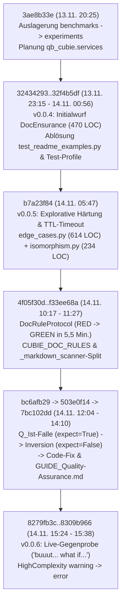

<!-- qb:frame id="CUBIE_DOC_FRAME_2" zone="head" env="Antigravity-CLI" model="Gemini-4-Argon" effort="High" -->
# Post-Hoc Audit 3

**Dokument-Informationen & Herkunft:**
- **Plattform / Umgebung:** Antigravity-CLI
- **Modell:** Gemini-4-Argon
- **Reasoning-Effort:** High
- **Analysedatum:** 17. November 2026, ~ 09:00 (CET)
- **Synthesebasis:**
  - `src/qb_cubie/` (39 Module, 7.196 LOC; insb. `services/doc_ensurance/`, `services/doc_frame/`, `cli.py`, `reporter.py`, `linter.py`, `ebt.py`, `arenas/`)
  - `tests/` (75 Testmodule, 494 `test_*`-Funktionen, 470 `EBT`-Aufrufe; insb. `tests/tests_services/tests_doc_ensurance/` und `tests/tests_services/tests_doc_frame/`, `test_styleguide.py`, `test_lint.py`, `conftest.py`)
  - `docs/` (`GUIDE_Quality-Assurance.md`, `services/GUIDE_DocEnsurance.md`, `services/GUIDE_DocFrame.md`, `dev/services/DEV-GUIDE_DocEnsurance.md`, `dev/services/DEV-GUIDE_DocFrame.md`, `dev/DEV-GUIDE_Next-Steps.md`, `GUTACHTEN.md`, `META_QUESTION.md`, `CHANGELOG.md`)
  - Git-Commit-Historie von `qb-cubie` unter striktem Ausschluss von `experiments/` (insb. die 51 Commits im Service-Entwicklungsfenster `3ae8b33e` vom 13.11.2026 bis `7e08e2ac` vom 16.11.2026; Releases `v0.0.3` $\to$ `v0.0.7`)
- **Stand:** qb-cubie (v0.0.7)
- **Git-Log:** `git log -n 1`
```text
commit 7e08e2ac7a39586fe4ce9dfff209ee11810ea0ca (HEAD -> main, origin/main)
Author: Chronuid <Dominickwirzba@gmail.com>
Date:   Mon Nov 16 08:50:29 2026 +0100

    Double-Check
```

---

---

<!-- /qb:frame -->

## 1. Untersuchungsrahmen, Empirische Grundgesamtheit und Dimensionalitäten

Dieses Post-Studien-Audit untersucht wertungsfrei die Forschungsansätze, die Qualitätssicherungs-Methodik, die Entwicklungspraktiken sowie die realen Arbeitsdynamiken im Paket `src/qb_cubie`, der zugehörigen `tests`-Suite und der begleitenden Methodik-Dokumentation (`docs/`). Gemäß Mandat wurden sämtliche Daten anderer Unterordner innerhalb von `experiments/` vollständig ignoriert.

### 1.1 Quantitative Bestandsaufnahme (`HEAD = 7e08e2ac`, Stand `v0.0.7`)

Die empirische Code- und Testbasis gliedert sich zum Zeitpunkt des Audits (`7e08e2ac`) wie folgt:

| Subsystem / Bereich | Pfad | Module (`.py`) | Umfang (LOC) | Klassen | Funktionen (`def`) | `test_*`-Funktionen | `EBT(...)`-Aufrufe |
| :--- | :--- | ---: | ---: | ---: | ---: | ---: | ---: |
| **Core-Framework** | `src/qb_cubie/` (ohne `services`, `cli`) | 22 | 4.084 | 58 | 309 | – | – |
| **Core-CLI** | `src/qb_cubie/cli.py`, `__main__.py` | 2 | 88 | 0 | 7 | – | – |
| **Services Root & Alias** | `src/qb_cubie/services/__init__.py`, `docframe.py` | 2 | 205 | 0 | 1 | – | – |
| **Service `DocEnsurance`** | `src/qb_cubie/services/doc_ensurance/` | 6 | 1.532 | 28 | 124 | – | – |
| **Service `DocFrame` (Prototyp)** | `src/qb_cubie/services/doc_frame/` | 7 | 1.285 | 26 | 95 | – | – |
| **Summe `src/qb_cubie`** | **`src/qb_cubie/`** | **39** | **7.196** | **112** | **536** | **–** | **–** |
| **Tests: `DocEnsurance`** | `tests/tests_services/tests_doc_ensurance/` | 9 | 4.264 | 10 | 109 | 68 | 131 |
| **Tests: `DocFrame`** | `tests/tests_services/tests_doc_frame/` | 4 | 920 | 0 | 44 | 28 | 25 |
| **Tests: Core & Meta** | `tests/` (ohne `tests_services`, `wheel`) | 62 | 9.812 | 41 | 512 | 398 | 314 |
| **Summe `tests/`** | **`tests/`** | **75** | **14.996** | **51** | **665** | **494** | **470** |

### 1.2 Einordnung der vier untersuchten Dimensionalitäten

Außerhalb des ausgeklammerten `experiments/`-Verzeichnisses lassen sich die empirischen Artefakte des Projekts in vier miteinander rückgekoppelte Dimensionalitäten einordnen:

1. **Dimension I – Architektonische & Funktionale Artefakte (`src/qb_cubie`):**
   Der ausführbare Code des Frameworks. Innerhalb von 62,5 Stunden (zwischen Commit `3ae8b33e` am 13.11.2026 um 20:25 Uhr und Commit `7e08e2ac` am 16.11.2026 um 08:50 Uhr) wuchs über dem bestehenden Core (`ebt`, `rbt`, `arenas`, `linter`, `multiprocessors`, `reporter`) eine neue Service-Schicht (`src/qb_cubie/services/`) heran, die heute **42,0 %** des gesamten Produktionscodes (3.024 von 7.196 LOC) ausmacht.
2. **Dimension II – Empirisch-Deklarative Verifikationsschicht (`tests/`):**
   Die Test-Suite fungiert nicht nur als Regressionsschutz, sondern als Experimentierlabor für die eigene Methodik. Der Vergleich zwischen den älteren `tests_doc_ensurance/`-Modulen (4.264 LOC, 1,93 `EBT`-Aufrufe pro Testfunktion) und den jüngeren `tests_doc_frame/`-Modulen (920 LOC, exakt 1,00 `EBT`-Aufruf pro EBT-Testfunktion) konserviert den methodischen Lernprozess im Code selbst.
3. **Dimension III – Kodifizierte Methodik & Epistemische Selbstreflexion (`docs/`, `GUTACHTEN.md`, `META_QUESTION.md`):**
   Dokumente wie [GUIDE_Quality-Assurance.md](file:///home/symphonie/PycharmProjects/cubie/docs/GUIDE_Quality-Assurance.md), [GUTACHTEN.md](file:///home/symphonie/PycharmProjects/cubie/GUTACHTEN.md) und [META_QUESTION.md](file:///home/symphonie/PycharmProjects/cubie/META_QUESTION.md) protokollieren entdeckte Fehlschlüsse (Charakterisierungs-Falle $Q_{\text{Ist}}$ vs. $Q_{\text{Soll}}$, Quantoren-Kreuzprodukt-Falle $\forall p \in P\ \exists q \in Q^+$, `expect=False`-Subsumtion, Warnungs-vs.-Error-Gates) und übersetzen sie unmittelbar in verbindliche Entwicklungsregeln (Test-Guided Development, TGD).
4. **Dimension IV – Prozess- & Interaktionsspur in der Git-Historie (`git log`):**
   Die 51 Commits zwischen `3ae8b33e` und `7e08e2ac` zeigen im Minutentakt das Zusammenspiel zwischen menschlicher Steuerung (manuelle Gegenproben, gezielte Fault-Injection in `README.md` und `GUIDE_Quality-Assurance.md`, radikale Kürzung nicht-evidenzbasierter Abschnitte) und KI-gestützter Code-/Test-Synthese.

---

## 2. Git-Historien-Audit Phase I: Entstehung und Härtung von `DocEnsurance` (`v0.0.4` bis `v0.0.6`)

Die Entwicklung von `DocEnsurance` vollzog sich zwischen dem **13. November 2026 (20:25 Uhr)** und dem **14. November 2026 (15:38 Uhr, Release `v0.0.6`)** in vier abgrenzbaren Evolutionsschüben, gefolgt von einer strukturellen Paket-Rekonsolidierung am **16. November 2026 (`6e5a6843` bis `db8eb74d`)**.



### 2.1 Architektonischer Freischnitt und Initialwurf (`3ae8b33e` bis `32f4b5df` – `v0.0.4`)

* **`3ae8b33e` (13.11.2026, 20:25 Uhr – *"Drafted a plan for the next steps and degraded the -Package to 'experiments'."*):**
  Der Entwickler trennte zunächst das im vorangegangenen Wettbewerbs-Sprint gewachsene `benchmarks`-Paket aus `src/qb_cubie/benchmarks` heraus (-13.237 Zeilen in 458 Dateien) und formulierte in [DEV-GUIDE_Next-Steps.md](file:///home/symphonie/PycharmProjects/cubie/docs/dev/DEV-GUIDE_Next-Steps.md) eine explizite Drei-Phasen-Strategie: **Erst** den neuen Zweig `qb_cubie.services` (`DocEnsurance` + Linter-Services) als wiederverwendbares Prüfwerkzeug aufbauen (Phase 1), **danach** mit diesen Werkzeugen die Sprint-Artefakte bereinigen (Phase 2) und schließlich die Core-Befunde aus `GUTACHTEN.md` abarbeiten (Phase 3).
* **`32434293` (13.11.2026, 23:15 Uhr – *"Crafted the new Service-Feature-Package and the new Service 'DocEnsurance'."*):**
  Knappe 2 Stunden und 50 Minuten nach dem Planungs-Commit entstand der erste vollständige Wurf von `src/qb_cubie/services/doc_ensurance.py` (470 LOC) und `src/qb_cubie/services/protocols.py` (99 LOC) samt `test_doc_ensurance.py` (615 LOC) und `test_doc_ensurance_arenas.py` (201 LOC).
  * **Architektur-Muster:** `DocEnsurance` übertrug das Hoare-Tripel $\{P\}\ S\ \{Q\}$ aus `EBT` als strukturelles Nachbarschaftsmuster (`CUBIE_DOC_STYLE`: `Explanation(min_chars=20)` $\to$ `CodeSnippet(lang="python")` $\to$ `CollapsibleResult()`) auf Markdown-Dateien.
  * **Sofortiges Dogfooding:** Im selben Commit wurde der alte, hartkodierte `tests/test_readme_examples.py` gelöscht, `DocEnsurance` in `tests/test_styleguide.py::test_docs_code_examples` scharfgeschaltet und sämtliche bestehenden Markdown-Guides (`README.md`, `GUIDE_Arena-Management.md`, `GUIDE_Benchmarks.md`, `GUIDE_EBT-Usage-Pattern.md`, `GUIDE_Linter.md`, `GUIDE_RBT-Usage-Pattern.md`, `DEV-GUIDE_2-2`, `DEV-GUIDE_2-4`, `FP-OOP-Isomorphismus.md`) so umgebaut, dass ihre Code-Beispiele in echten `TempFS`-Arenen durchliefen.
* **`f1b785c2` (23:39 Uhr), `c5ea5538` (14.11., 00:19 Uhr) & `a338ba85` (00:45 Uhr):**
  Unmittelbar nach dem Code folgte `docs/services/GUIDE_DocEnsurance.md` (271 LOC). Nur 40 Minuten später (`c5ea5538`) wurde am Kopf von `GUIDE_DocEnsurance.md` ein prominenter methodischer Disclaimer ergänzt (*„keine generelle Testabdeckung und keine Garantie für die inhaltliche Korrektheit“*) sowie `test_doc_ensurance_configs.py` (155 LOC) für `target=None`, `excludes` und Pfad-Heuristiken nachgezogen. In `a338ba85` wurden die `pytest`-Marker-Profile (`fast` vs. `slow` via `pyproject.toml` und `tests/conftest.py`) eingeführt und `test_docs_code_examples` in `tests/test_styleguide.py` zunächst mit `@pytest.mark.slow` markiert.

### 2.2 Erste explorative Härtung und Metamorphe Isomorphie (`b7a23f84` – `v0.0.5`)

Zwischen `v0.0.4` (00:56 Uhr) und `v0.0.5` (`b7a23f84`, 05:47 Uhr) wurde `DocEnsurance` einer ersten systematischen Grenzfall-Analyse unterzogen (+1.185 / -94 Zeilen):

1. **Reaktivierung der Styleguide-Schranke:** In [tests/test_styleguide.py](file:///home/symphonie/PycharmProjects/cubie/tests/test_styleguide.py#L10) wurde der während des früheren Wettbewerbs-Sprints (`83577ec7`) gesetzte `@pytest.mark.skip` auf `test_module_size` entfernt und `MODULE_LIMIT = 777` (neben `FUNCTION_LIMIT = 12`) wieder scharfgeschaltet.
2. **Zehn Äquivalenzklassen in `test_doc_ensurance_edge_cases.py` (614 LOC):**
   Absicherung von 4-Backtick-Codeblöcken (```` ````markdown ````), Tilde-Fences (`~~~`), eingerückten Code-Blöcken mit Multiline-Strings (selektives Dedenting statt pauschalem `textwrap.dedent`), Ausschluss von Listen/Tabellen/Blockquotes als `Explanation`, Isolierung ungeschlossener `<details>`-Tags gegen das Verschlucken nachfolgender Beispiele, Wortgrenzen-Regex `\b(session|raises)=`, `BaseException`/`SystemExit`-Abfang über MRO-Klassennamen sowie `PyVenv`-Ausführung mit `CloudpickleCodec` und `timeout=10.0` (TTL).
3. **Metamorphe / Isomorphe Verifikation (`test_doc_ensurance_isomorphism.py`, 234 LOC):**
   Als struktureller Nachweis, dass die Ausführungs- und Diagnose-Engine von `DocEnsurance` unabhängig von der konkreten Markdown-Oberflächensyntax arbeitet, wurde ein Funktor `_md_to_literate_py` implementiert, der Markdown-Dokumente in valide Python-Module mit Docstring-Literalen transformiert, und über ein duales `PyDocstringPattern` geprüft, dass beide Domänen kommutieren (`md_summary == py_summary`).

### 2.3 Das `DocRuleProtocol`, die $Q_{\text{Ist}}$-vs.-$Q_{\text{Soll}}$-Falle und ihre Reparatur (`4f05f30d` bis `82893aba`)

Der aufschlussreichste Entwicklungszyklus der gesamten `DocEnsurance`-Historie ereignete sich am **14. November 2026 zwischen 10:17 Uhr und 14:42 Uhr** in sechs aufeinanderfolgenden Commits:

| Commit | Zeit (14.11.) | Δ LOC (`src` / `tests` / `docs`) | Empirischer Vorgang in der Git-Historie |
| :--- | :--- | :--- | :--- |
| **`4f05f30d`** | 10:17:14 | `+403` / `+529` / `0` | *„Crafted the design for the new DocRule-Protokoll-System, added the testmodule and integrated the first example codes. Phase RED. Going to make it GREEN.“* – Entwurf von `DocRuleProtocol`, `ExplanationRule`, `CodeRule`, `OutputRule`, `DocLinterRule`, `MissingOutputRule` und `test_doc_ensurance_rules.py`. |
| **`d59f82d5`** | 10:22:44 | `+22` / `+12` / `0` | *„DocRule-System Green for now. Going to do some explorative Experiments soon.“* – **5 Minuten und 30 Sekunden** nach `4f05f30d`: Korrektur von 4 kleinen Integrationsstellen (Zeilen-Offset `max(1, diag.line)`, Filterung von `severity == "error"` im Reporter, Tippfehler `" asserted"` $\to$ `"asserted"` im Test-Adapter). |
| **`f33ee68a`** | 11:27:37 | `+467` / `+339` / `+430` | *„Established the pluggable rules and the CUBIE_DOC_RULES for the DocEnsurance-Service.“* – Da `doc_ensurance.py` durch das Regel-System an das 777-Zeilen-Limit stieß, erfolgte die Aufteilung in `_markdown_scanner.py` (128 LOC) und `doc_rules.py` (180 LOC: `NoOutput`, `HighComplexity`, `LargeOutput`, `RawTraceback`). In `test_styleguide.py` wurde `#@pytest.mark.slow` auskommentiert und `rules=CUBIE_DOC_RULES` aktiviert; 9 Markdown-Guides wurden an das 30-Zeilen-Snippet-Limit angepasst. |
| **`bc6afb29`** | 12:04:13 | **`0`** / `+583` / `0` | *„Found and Fixed some Edge-Cases through the new CUBIE_DOC_RULES.“* – **Diskrepanz zwischen Commit-Message und Diff:** Obwohl die Commit-Nachricht *„Found and Fixed“* lautet, wurde **keine einzige Zeile in `src/` geändert**! Stattdessen wurden in `test_doc_rule_edge_cases.py` (498 LOC) und `test_doc_ensurance_configs.py` rund 15 explorativ gefundene Bugs des Scanners und der Regel-Engine mit dem Standardwert **`expect=True` ($Q_{\text{Ist}}$-Charakterisierung)** als bestandene Tests festgeschrieben. |
| **`503e0f14`** | 13:00:48 | **`0`** / `+528` / `0` | *„Reworked the Service-Testsuite. Prepared some updates.“* – Wiederum **0 Zeilen Änderung in `src/`**, aber fundamentale Korrektur der Test-Suite: Die in `bc6afb29` fälschlich mit `expect=True` aufgezeichneten Fehlersymptome wurden ohne Umbau der Szenarien über **`expect=False` (Vertrags-Inversion)** in echte Red-Phase-Tests gedreht und um 7 weitere Fehlerszenarien (Befunde 1–7) ergänzt. Gleichzeitig wurden die Modul-Docstrings von `"""Verifies ..."""` auf `"""Tries to verify ..."""` geändert. |
| **`7bc102dd`** | 14:10:44 | `+1.181` / `+693` / `+334` | *„Updated the Testsuite and evolved the source code.“* – Eigentliche Green-Phase im Produktionscode: Auslagerung von `doc_patterns.py` (386 LOC), Behebung aller invertierten Befunde in `_markdown_scanner.py`, `doc_ensurance.py`, `_hydration.py` (`normalize_fs`), `linter.py` (`AstLinter.name`) und `multiprocessors.py` (`LokyProcessor`-Fallback für lokale Funktionen), Aufbau von `test_doc_linter_feedback.py` (409 LOC) sowie Niederschrift von `docs/GUIDE_Quality-Assurance.md` (+328 Zeilen). |
| **`82893aba`** | 14:42:23 | `+30` / `+219` / `0` | *„Meow :3“* – Feinschliff an `_unique_rule_key` (Kollisionsschutz bei mehreren `DocLinterRule`-Instanzen), `info`-Severity-Mapping und Verschärfung der Modul-Docstrings in 7 Testdateien auf `"""**Tries to** verify ..."""`. |

#### Detail-Rekonstruktion der Charakterisierungs-Falle (`bc6afb29` $\to$ `503e0f14` $\to$ `7bc102dd`)

In Commit `bc6afb29` (12:04 Uhr) wurden bei explorativen Tests zahlreiche reale Defekte in `DocEnsurance` entdeckt, im Testcode jedoch unreflektiert als erwarteter `post`-Zustand (`expect=True`) notiert:
* In `test_doc_ensurance_configs.py` wurden `"Hello"` und `"Read/write operations in Python."` (einzeiliger Fließtext ohne `.md`-Endung) in die `pre`-Liste von `test_ebt_missing_string_or_path_targets_raise_file_not_found` eingetragen – der Test verlangte also positiv (`expect=True`), dass `DocEnsurance` normalen englischen Fließtext mit `FileNotFoundError` ablehnt! Umgekehrt verlangte `test_ebt_spaced_filename_without_slash_falls_back_to_in_memory` positiv (`expect=True`), dass ein Tippfehler bei einer Datei mit Leerzeichen (`"my guide.md"`) stillschweigend als `IN_MEMORY` mit `passed=True` durchläuft.
* In `test_doc_rule_edge_cases.py` verlangten die Tests in `bc6afb29` positiv (`expect=True`), dass:
  1. das Hinzufügen einer einzelnen `CodeRule` die Standardregel `DOC-OUT-MISSING` stillschweigend löscht (`rule_ids: ["DOC-OUT", "C1"]`),
  2. eine `DOC-PRE`-Warnung bei kurzer Erklärung nachfolgende `ExplanationRule`-Checks (`EXP-CAP`) komplett überspringt,
  3. eine Session in `TaggedScope` trotz `DOC-PRE`-Error `session_passed: [True]` meldet,
  4. ein Absatz direkt nach einem Listenpunkt (`_LAZY_LIST_CONTINUATION_DOC`), ein GitHub-Alert (`> [!NOTE]`) oder ein HTML-Kommentar (`<!-- comment -->`) vor dem Codeblock mit `DOC-PRE` fehlschlagen,
  5. ein `raise KeyboardInterrupt('ctrl-c')` im Doku-Snippet ungefangen aus `DocEnsurance` ausbricht,
  6. `raises=builtins.ValueError` mit `DOC-RAISE` fehlschlägt und
  7. führende Leerzeichen in der ersten Ausgabezeile eines `<details>`-Blocks abgeschnitten werden (`"indented_first\n  indented_second"`).

In `503e0f14` (13:00 Uhr) wurde dieser methodische Fehler erkannt: Durch bloßes Anhängen von `expect=False` an genau diese `WorldState`-Objekte wurden sämtliche Fehl-Charakterisierungen in scharfe Negativ-Spezifikationen (Red-Phase) überführt und um sieben zusätzliche `expect=False`-Tests ergänzt (Befund 1: isolierter `MyPy`-Lauf auf mehrstufigen Sessions meldet `name-defined`; Befund 2: zwei `CstLinter`-Instanzen überschreiben sich über dieselbe `rule_id="DOC-LINT:CST-Linter"`; Befund 3: `<summary>` oder `</details>` im Konsolen-Output korrumpiert den `<details>`-Scanner; Befund 4: `compile(..., f"<doc_line_{line}>")` macht `SyntaxError`-Outputs abhängig von der Markdown-Zeilennummer; Befund 5: `WorldState(fs=[...])`-Listen-Kurzform scheitert in `DocEnsurance` mit `AttributeError: 'list' object has no attribute 'items'`; Befund 6: `excludes=("docs/guide.md",)` schließt durch ein fehlerhaftes `removeprefix` auch `docs/tutorials/guide.md` aus; Befund 7: `EBT(multiprocessing=True)` in einem Doku-Snippet crasht bei lokalen Funktionen im `PickleProcessor` ohne `LokyProcessor`-Fallback).

In `7bc102dd` (14:10 Uhr) wurden alle diese Punkte im Quellcode behoben (u. a. durch Cross-Step Session-Linting `_lint_joined_steps`, `_merge_linter_rules`, fence-bewusstes `_partition_details_lines`, zeileninvariantes `compile(..., "<doc>", "exec")`, Auslagerung von `normalize_fs` nach `arenas/_hydration.py` und `LokyProcessor`-Fallback in `multiprocessors.py`) und das Erlebnis unmittelbar als **Abschnitt 2 („Die gefährlichste Falle der Qualitätssicherung: Charakterisierung $Q_{\text{Ist}}$ vs. Spezifikation $Q_{\text{Soll}}$“)** in `docs/GUIDE_Quality-Assurance.md` verewigt.

### 2.4 Die `HighComplexity`-Gegenprobe (`8279fb3c` – *"Verify it yourself"*)

Nur 42 Minuten nach `82893aba` folgte mit Commit **`8279fb3c`** (14.11.2026, 15:24:37 Uhr) unter der sprechenden Commit-Nachricht:
> *„The system could maybe work. But I am just talking. Verify it yourself.“*

ein weiteres prägnantes Ereignis:
* **Auslöser:** Um zu prüfen, ob `DocEnsurance` mit `CUBIE_DOC_RULES` tatsächlich überlange Code-Beispiele in den Guides verhindert, hatte der Entwickler das Einstiegsbeispiel in `docs/GUIDE_Quality-Assurance.md` manuell um einen 140-zeiligen Dummy-String (`"""\nbuuut...\n\nyou know ...\n\nwhat if ...\n...\n"""`, insgesamt 153 Zeilen) aufgebläht und die Test-Suite ausgeführt.
* **Beobachtung:** Der Testlauf lief **grün (`PASSED`)** durch, weil `HighComplexity` in `f33ee68a` mit `severity="warning"` konfiguriert worden war und `PytestReporter` für Warnungen lediglich eine `UserWarning` ausgab, ohne `AssertionError` zu werfen.
* **Reaktion in `8279fb3c`:**
  1. In `src/qb_cubie/services/doc_rules.py` wurde `HighComplexity` von `severity="warning"` auf **`severity="error"`** hochgestuft.
  2. Das exakt bei der manuellen Gegenprobe verwendete 153-zeilige Dokument inklusive des `"buuut... you know ... what if ..."`-Strings wurde als Konstante `_QA_GUIDE_SECTION_1_EXAMPLE_DOC` und Test `test_ebt_high_complexity_fails_on_oversized_qa_guide_example` dauerhaft in [test_doc_rules.py](file:///home/symphonie/PycharmProjects/cubie/tests/tests_services/tests_doc_ensurance/test_doc_rules.py#L249-L306) verankert.
  3. In [GUIDE_Quality-Assurance.md](file:///home/symphonie/PycharmProjects/cubie/docs/GUIDE_Quality-Assurance.md#L218) (Leitlinie 3) wurde die Warnung ergänzt: *„Nutze Warnungen als konstruktiven Kompass – aber verwechsle sie nicht mit harten Gates: [...] Eine `UserWarning` lässt `pytest` weiterhin grün (`Exit-Code 0`) und fällt in Kurz- oder IDE-Ausgaben leicht durchs Raster. Regeln, die verlässlich blockieren müssen (wie `HighComplexity` ab $> 30$ Zeilen), gehören deshalb explizit auf `severity="error"`.“*

---

## 3. Evolution der QA-Methodik, Meta-QA und Mensch-Maschine-Dynamik (`14.11.` bis `15.11.2026`)

Zwischen dem Release `v0.0.6` (`8309b966`, 14.11.2026, 15:38 Uhr) und dem Start der `DocFrame`-Entwicklung (`30eda081`, 16.11.2026, 01:50 Uhr) fand eine intensive Phase methodischer Selbstprüfung statt.

### 3.1 Die `divmod`-Quantoren-Ironie: Vom Positiv-Beispiel zum Anti-Pattern-Lehrstück

Eine besonders bemerkenswerte Entwicklung in der Git-Historie betrifft das erste Code-Beispiel in `docs/GUIDE_Quality-Assurance.md`:

1. **Entstehung als vermeintliches Positiv-Beispiel (`7bc102dd`, 14.11.2026, 14:10 Uhr):**
   Beim ersten Entwurf des neuen QA-Handbuchs in `7bc102dd` wurde in Abschnitt 1 folgendes Beispiel als *„Grundmuster eines deklarativen `EBT`-Vertrags anhand der Standardfunktion `divmod` für zwei Eingabepaare“* eingefügt:
   ```python
   trace = EBT(
       target=divmod,
       pre=[WorldState(args=(17, 5)), WorldState(args=(20, 4))],
       post=[WorldState(returns=(3, 2)), WorldState(returns=(5, 0))],
       reporter=None,
   ).run()
   print(f"Vertrag erfüllt: {trace.evaluation} | Geprüfte Paare: {len(trace.traces)}")
   # Ergebnis: Vertrag erfüllt: True | Geprüfte Paare: 4
   ```
   Obwohl die Ausgabe `Geprüfte Paare: 4` (statt `2`) bereits im `<details>`-Block stand, fiel zunächst nicht auf, dass genau dieser Aufruf die in `GUTACHTEN.md` (Abschnitt 3.3) kritisierte Quantoren-Schwäche ($\forall p \in P\ \exists q \in Q^+$) reproduzierte. Dasselbe Muster wurde gleichzeitig in über 25 Tests innerhalb von `tests_doc_ensurance/` verwendet.
2. **Aufdeckung durch Meta-QA (`920f26cf`, 14.11.2026, 16:54 Uhr – `META_QUESTION.md`):**
   Auf die Frage des Entwicklers (*„Gibt es eigentliche bewährte Verfahren/Methoden aus der Qualitäts-Sicherung, um eine Test-Suite wie die von Cubie selbst zu prüfen und die Fälle gegen Widersprüche und Ähnliches zu untersuchen?“*) dokumentierte [META_QUESTION.md](file:///home/symphonie/PycharmProjects/cubie/META_QUESTION.md) sieben systematische Schwachstellen der damaligen Test-Suite:
   * **Befund 1 (Kreuzprodukt-Falle / Disjunktive Abschwächung):** Packt man $n$ Eingaben aus verschiedenen Äquivalenzklassen in `pre=[...]` und $n$ paarweise disjunkte Ergebnisse in `post=[...]`, prüft `EBT` statt der Bijektion $\bigwedge_i \{P_i\} S \{Q_i\}$ nur die schwache Disjunktion $\forall i: \{P_i\} S \{\bigvee_j Q_j\}$ und führt $n^2$ statt $n$ Arena-Subprozesse aus.
   * **Befund 2 (Isolierte `expect=False`-Tests ohne positiven Anker / *Vacuous Pass*):** In `503e0f14` waren beim Umdrehen auf `expect=False` teilweise keine positiven Soll-Zustände (`passed=True`) ergänzt worden, sodass jeder beliebige andere Fehler den Test grün bestehen ließ.
   * **Befund 3 (Logische Subsumtion redundanter `expect=False`-Klauseln):** In `test_doc_linter_feedback.py` standen neben einem exakten positiven Match (`post[0]`) zusätzliche `expect=False`-Zustände (`post[1]`, `post[2]`), die bei deterministischem Ziel bereits durch $Q_{\text{pos}} \implies \neg Q_{\text{neg}}$ impliziert waren.
   * **Befund 4–7:** Auskommentiertes `#@pytest.mark.slow` in `test_styleguide.py`, gespaltener Modul-Namespace (`from src.qb_cubie` vs. `from qb_cubie`), Nicht-Monotonie bei `rules=()` vs. `rules=[custom_noop]` sowie verwaiste `.pyc`-Dateien.
3. **Umwidmung in drei Iterationen (`d653e99d`, `b3ac272c`, `5dafc2da`, 15.11.2026, 23:16–23:47 Uhr):**
   Am späten Abend des 15.11.2026 baute der Entwickler Abschnitt 1 von `GUIDE_Quality-Assurance.md` in drei kurz aufeinanderfolgenden Commits (`d653e99d` um 23:16 Uhr, `b3ac272c` um 23:33 Uhr, `5dafc2da` um 23:47 Uhr) komplett um:
   * Das ursprüngliche Multi-`pre`/Multi-`post`-Beispiel wurde explizit unter die Überschrift **„Anti-Pattern: Gedankenlose Quantoren-Kombination (Unterspezifikation)“** gestellt und durch die einfachere Funktion `double(x)` (`3 -> 6`, `5 -> 10`, `Geprüfte Paare: 4`) ersetzt.
   * Davor wurde als **„Best Practice: Ein Vertrag pro Wertepaar in klaren Test-Funktionen“** die saubere Einzelprüfung (`test_double_three`, `test_double_five` sowie `@pytest.mark.parametrize`, jeweils mit `Geprüfte Paare: 1`) gestellt.

### 3.2 Epistemische Hygiene durch radikales Kürzen (`6cb7487e`, `c7d70722`, `30eda081`)

Ein wiederkehrendes Muster in der Git-Historie ist das entschlossene Löschen umfangreicher, sprachlich polierter Dokumentationsabschnitte durch den Maintainer, sobald diese als empirisch noch nicht hinreichend belastbar eingestuft wurden:
* **`6cb7487e` (14.11.2026, 22:42 Uhr):** Kürzung von `docs/GUIDE_Benchmarks.md` um **1.554 Zeilen** (von 1.578 auf 24 Zeilen; Commit-Message: *„Made the disclaimer more obvious and summarized the contents in order to reduce complexity and increase understandability.“*).
* **`c7d70722` (15.11.2026, 17:04 Uhr):** Kürzung von `docs/GUIDE_Quality-Assurance.md` um **225 Zeilen** (Entfernung des gesamten Kapitels 4 *„Praxis-Tutorials: Vom Einsteiger zum Experten“* sowie der ersten `normalize_tag`-Session; Commit-Message: *„Die Beispiele und Tutorials waren nicht gut genug und sollten ordentlich mit Versuchen und Experimenten untermauert werden, ehe man sowas öffentlich macht. Habe es daher rausgekürzt.“*).
* **`30eda081` (16.11.2026, 01:50 Uhr):** Kürzung von `README.md` um **127 Zeilen** zur Fokussierung auf den gesicherten Core.

### 3.3 Die Meta-Episode `klarstellung-commit-historie.md` (`43ab3efb` bis `a8b22b57`)

Zwischen dem 14.11.2026 (23:37 Uhr, `43ab3efb`) und dem 15.11.2026 (00:58 Uhr, `a8b22b57`) legte der Maintainer über die GitHub-Web-UI (`165155248+Chronuid@users.noreply.github.com`) vorübergehend die Datei `docs/misc/klarstellung-commit-historie.md` an, mutierte sie in sieben weiteren Commits (`b9dfd8c6`, `fe08aa29`, `2783df88`, `df3a1d32`, `14cfd589`, `8bc2c32a`, `03bdcadf`) und löschte sie nach 81 Minuten wieder (`a8b22b57`).

Die in dieser Commit-Sequenz (insb. `2783df88` und `03bdcadf`) hinterlegten *Human Notes* liefern eine direkte Primärquelle zur realen Arbeitsdynamik des Projekts:
1. **Erzeugung von Code und Text vs. Ausführung von Git-Commits:**
   In `03bdcadf` hält der Maintainer fest: *„Der Code entstand gefühlt zu 99% durch KI-Agenten und gefühlt 1% habe ich selber drinnen herumgewurstelt. Ca. 95% der Commits habe ich manuell abgegeben. Ungefähr 5% der Commits fanden durch KI-Agenten statt, aber eng von mir begleitet.“*
2. **Erklärung der nummerierten Hochfrequenz-Commits (`2783df88`):**
   Die Serien-Commits mit nahezu identischen Nachrichten (wie `Gutachten-Empfehlung Nr. 1.1` bis `3.5` oder später `doc_frame development, step_1` bis `step_5`) entstanden dadurch, dass der Entwickler nach jedem geprüften Zwischenschritt im Terminal per Pfeiltaste nach oben (`↑`) den letzten `git commit`-Befehl aufrief und lediglich die Schrittnummer inkrementierte.
3. **Stilistische Inversion der Commit-Nachrichten:**
   Formale *Conventional Commits* (`chore(release): prepare v0.0.5`, `ci(release): automate GitHub release...`) stammen überwiegend aus eng begleiteten Agenten-Schritten, während informelle, reflektierende oder humorvolle Commit-Nachrichten (`"Meow :3"`, `"Double-Check"`, `"The system could maybe work. But I am just talking. Verify it yourself."`, `"Die Beispiele und Tutorials waren nicht gut genug..."`) die unmittelbaren manuellen Eingriffe und Prüfungen des Maintainers markieren.

---

## 4. Git-Historien-Audit Phase II: Der `DocFrame`-Prototyp (`30eda081` bis `7e08e2ac` – `v0.0.7`)

Im Gegensatz zu `DocEnsurance` (das über mehrere Tage explorativ nachgehärtet wurde) entstand der `DocFrame`-Prototyp am **16. November 2026 zwischen 01:50 Uhr und 08:50 Uhr** (innerhalb von exakt 7 Stunden) in einem hochgradig strukturierten, dokumentations- und testgetriebenen Blitz-Zyklus:

```mermaid
flowchart LR
    D0["30eda081 (01:50)<br/>Spec-First Draft<br/>GUIDE_DocFrame.md<br/>(in excludes)"] --> D1["6e5a6843..157c2997 (02:48-03:11)<br/>Subpaket doc_ensurance/<br/>& DEV-GUIDE_DocEnsurance"]
    D1 --> D2["0eec79d9 (03:20)<br/>Manuelles Tagging<br/>von 35 Docs mit<br/>qb:frame-Kommentaren"]
    D2 --> D3["174b048f (04:11)<br/>Gap-Analyse & 2-Pass-Design<br/>in DEV-GUIDE_DocFrame.md<br/>(+ CUBIE_DOC_FRAME_3)"]
    D3 --> D4["ff871979 (04:25)<br/>TGD-Testplan in<br/>tests_doc_frame/GEMINI.md<br/>(Altlasten-Sperre)"]
    D4 --> S1["03d7a0dd (05:09)<br/>step_1: Implementierung<br/>doc_frame (1.477 LOC)<br/>+ 22 EBT-Tests (825 LOC)"]
    S1 --> S2["df3714be (05:24)<br/>step_2: make test-all Log<br/>(2 Lint-Fails) &<br/>HYPOTHESIS.md (H1-H4)"]
    S2 --> S3["db8eb74d (06:08)<br/>step_3: Rollout auf 37 Docs<br/>+ Refactoring aller<br/>tests_doc_ensurance-Tests"]
    S3 --> S45["ce02737d..05e9945b (06:26-06:41)<br/>step_4 & step_5: Finalisierung<br/>DEV-GUIDE & GUIDE_DocFrame"]
    S45 --> R7["23b083af..7e08e2ac (07:10-08:50)<br/>v0.0.7, CI-Fault-Injection<br/>(red-is-sometimes-good.md)<br/>& Core-CLI qb-cubie"]
```



### 4.1 Tabellarische Chronologie der `DocFrame`-Entwicklung (16.11.2026)

| Commit | Uhrzeit (16.11.) | Dauer seit Vor-Commit | Geänderte Dateien (ohne `experiments`) | Empirischer Inhalt & Methodische Rolle |
| :--- | :--- | ---: | :--- | :--- |
| **`30eda081`** | 01:50:18 | – | 5 (`+280 / -127`) | **Spec-First Feature-Draft:** Anlage von `docs/services/GUIDE_DocFrame.md` (258 LOC) als ausführbare Ziel-Spezifikation. Da das Modul `qb_cubie.services.docframe` noch nicht existiert, wird `docs/services/GUIDE_DocFrame.md` in `tests/test_styleguide.py` temporär mit `# Reason: Feature-Draft` exkludiert. Der Erstentwurf sieht nur `CUBIE_DOC_FRAME_1` und `FRAME_2` sowie statische Routen-Tupel (`CORE_ROUTES`, `SERVICE_ROUTES`) vor. |
| **`6e5a6843`** | 02:48:29 | 58 Min. | 12 (`+116 / -34`) | **Architektur-Vorbereitung:** Umzug der bisherigen Service-Module in das Unterpaket `src/qb_cubie/services/doc_ensurance/`; Anlage leerer 0-Byte-Platzhalter für `DEV-GUIDE_DocEnsurance.md` und `DEV-GUIDE_DocFrame.md`. |
| **`157c2997`** | 03:11:55 | 23 Min. | 1 (`+467 / -0`) | Ausformulierung von `docs/dev/services/DEV-GUIDE_DocEnsurance.md` (467 LOC) als Blaupause für die Schichten-Dokumentation. |
| **`0eec79d9`** | 03:20:07 | 8 Min. | 35 (`+701 / -205`) | **Vorab-Normalisierung des Bestands:** Alle 35 aktiven Markdown-Dateien (`README.md` + 34 Dateien in `docs/`) erhalten öffnende und schließende `<!-- qb:frame id="CUBIE_DOC_FRAME_1" zone="head|foot" -->`-Kommentarblöcke und einheitliche `<div align="center">`-Wrapper. |
| **`174b048f`** | 04:11:49 | 52 Min. | 12 (`+273 / -0`) | **Empirische Design-Revision:** Umzug der `DocEnsurance`-Tests nach `tests/tests_services/tests_doc_ensurance/`. Gleichzeitig wird in `docs/dev/services/DEV-GUIDE_DocFrame.md` (273 LOC) dokumentiert, warum der statische Entwurf aus `30eda081` an den 35 realen Dateien scheitert (Orphan Pages in `docs/misc/`, fehlende `DEV-GUIDE`-Navigation, Bedarf an Index-Tabellen im Rumpf) und durch das **2-Pass-Zero-Config-Modell (`DocumentCatalog` + `FolderRouter`/`SiblingRouter`/`CatalogRouter` + `CUBIE_DOC_FRAME_3` mit `zone="router"`)** ersetzt wird. |
| **`ff871979`** | 04:25:48 | 14 Min. | 2 (`+250 / -0`) | **TGD-Testplanung mit Altlasten-Sperre:** Anlage von `tests/tests_services/tests_doc_frame/GEMINI.md` (250 LOC). Verankert explizit den Vorrang von `GUIDE_Quality-Assurance.md` vor älteren `tests_doc_ensurance`-Mustern (Verbot des Quantoren-Kreuzprodukts, 1 Vertrag pro Wertepaar, zustandsfreie Adapter, 5 Äquivalenzklassen, Aufteilung in 3 Module $< 500$ Zeilen). |
| **`03d7a0dd`** | 05:09:51 | 44 Min. | 15 (`+2.627 / -167`) | **`doc_frame development, step_1`:** Vollständige Implementierung von `src/qb_cubie/services/doc_frame/` (`protocols.py`, `_catalog_scanner.py`, `frame_blocks.py`, `doc_frame_rules.py`, `doc_frame.py`, `__init__.py` = 1.477 LOC) + Kurz-Alias `docframe.py` + `DocEnsurance`-Kopplung (`_split_patterns`, `_flatten_rules`, `_run_document_rules`) + 3 Testmodule (`test_docframe_catalog_and_routing.py`, `test_docframe_presets_and_update.py`, `test_docframe_rules_and_guards.py` = 825 LOC, 22 EBT-Verträge). Entfernung des `GUIDE_DocFrame.md`-Excludes aus `test_styleguide.py`. |
| **`df3714be`** | 05:24:39 | 15 Min. | 2 (`+127 / -250`) | **`doc_frame development, step_2`:** Der Testplan in `tests_doc_frame/GEMINI.md` wird durch den Konsolen-Output von `make test-all` (`2 failed, 1428 passed in 395.56s`) überschrieben: Alle 22 neuen `DocFrame`-Tests sind auf Anhieb grün, aber `test_src_lint[ruff]` (`F401` ungenutzter Import `Linter` in `doc_ensurance.py`) und `test_src_lint[mypy]` (`[unreachable]` wegen `isinstance(items, (str, bytes))` nach `Sequence[FramePattern]`-Typverengung in `doc_frame.py` sowie `[return-value]` bei `hasattr` in `doc_ensurance.py`) schlagen fehl. Anlage von `tests_doc_frame/HYPOTHESIS.md` (52 LOC) mit 4 Hypothesen (H1–H4). |
| **`db8eb74d`** | 06:08:29 | 44 Min. | 69 (`+1.490 / -1.251`) | **`doc_frame development, step_3`:** Umsetzung aller 4 Hypothesen aus `HYPOTHESIS.md`:<br>1. **H1:** Fix der `ruff`- und `mypy`-Befunde in `doc_ensurance.py`, `protocols.py` (`@runtime_checkable` auf `DocPatternProtocol`) und `doc_frame.py`.<br>2. **H2:** Erster produktiver Lauf von `DocFrame.update()` über alle 37 Markdown-Dokumente des Repositorys (ersetzt u. a. `![Error while trying to load the image]` durch `![Cubie]`, generiert die Index-Tabellen in `docs/README.md` und `docs/misc/README.md` und klappt die Geschwister-Routen in `docs/dev/` auf); Aktivierung von `CUBIE_DOCFRAME_RULES` in `test_styleguide.py`.<br>3. **H3 & H4:** Systematische Bereinigung der historischen Kreuzprodukt-Aufrufe (`pre=[...]`/`post=[...]`), isolierten `expect=False`-Tests und redundanten Subsumtionen in **allen 9 `tests_doc_ensurance/`-Modulen** sowie 18 weiteren Core-Testdateien (`test_headless_reviewer.py`, `test_rbt_demo.py`, `test_ebt_*.py`, `test_mp_*.py`). |
| **`ce02737d`** | 06:26:11 | 18 Min. | 3 (`+356 / -219`) | **`doc_frame development, step_4`:** Aktualisierung von `tests_doc_frame/GEMINI.md` mit dem grünen `make test-all`-Protokoll (`1433 passed, 11 skipped, 6 warnings in 406.64s`), Löschung der erledigten `HYPOTHESIS.md` und Ausbau von `DEV-GUIDE_DocFrame.md` auf 549 Zeilen. |
| **`05e9945b`** | 06:41:12 | 15 Min. | 2 (`+512 / -97`) | **`doc_frame development, step_5`:** Ausbau von `docs/services/GUIDE_DocFrame.md` auf 702 Zeilen; erneutes Auskommentieren von `#@pytest.mark.slow` über `test_docs_code_examples` in `tests/test_styleguide.py`. |
| **`23b083af`** | 07:10:07 | 29 Min. | 44 (`+78 / -53`) | **`chore(release): prepare v0.0.7 (Meow :3)`:** Version-Bump auf `0.0.7`, explizite Kennzeichnung von `DocFrame` als **Prototyp (`pending evaluation and hardening`)** in Docstrings, Guides und `CHANGELOG.md`, erneutes `DocFrame.update()` über alle Guides – **plus eine manuelle Editierung von `README.md` Zeile 20** (`+ • [DocFrame (Prototyp)](./docs/services/GUIDE_DocFrame.md)`). |
| **`09ef9783`** | 07:29:39 | 19 Min. | 1 (`+70 / -0`) | **Live-Beweis der CI-Schranke (`red-is-sometimes-good.md`):** Der Push von `23b083af` löste in GitHub Actions exakt die neue Regel `DOCFRAME-OUTDATED` auf `README.md:1` aus (`1 failed, 1432 passed`). Der Maintainer dokumentierte diesen beabsichtigten Fehlschlag in `docs/misc/red-is-sometimes-good.md` (*„The v0.0.7 Release is from DocFrame. I've mutated the README.md by hand. CI on Github said: ... Red is sometimes good.“*). |
| **`3448ddea`** | 07:40:58 | 11 Min. | 1 (`+1 / -1`) | Manuelles Entfernen des Links `• [DocFrame (Prototyp)]` aus `README.md` via GitHub-Web-UI. |
| **`7e08e2ac`** | 08:50:29 | 69 Min. | 14 (`+255 / -96`) | **`Double-Check`:** Löschung der temporären Artefakte `docs/misc/red-is-sometimes-good.md` und `tests/tests_services/tests_doc_frame/GEMINI.md`, Bereinigung des überzähligen Leerzeichens in `README.md` sowie Implementierung des Core-CLI-Einstiegspunkts `qb-cubie docframe update` (`src/qb_cubie/cli.py`, `src/qb_cubie/__main__.py`, `src/qb_cubie/services/doc_frame/__main__.py`, Lazy-Export `__getattr__` in `services/__init__.py` gegen `runpy`-`RuntimeWarning`, `test_docframe_cli.py` und Wheel-Smoketest in `tests/wheel/smoke_installed.py`). |

---

## 5. Synthese der Entwicklungs-, Methodik- und Architektur-Muster

Aus der empirischen Untersuchung des Codebestands (`src/qb_cubie`), der Test-Suite (`tests/`) und der Git-Trajektorie lassen sich sechs strukturbildende Muster identifizieren:

### Muster 1: Reflexive Dogfooding-Kaskade (Tooling $\to$ Selbst-Anwendung $\to$ Methodik-Kodifizierung)

Jedes neu entwickelte Subsystem wird noch im selben Entwicklungszyklus über `tests/test_styleguide.py::test_docs_code_examples` als verbindliches Gate über das eigene Repository gelegt:
1. Als `DocEnsurance` in `32434293` entstand, deckte es veraltete Code-Beispiele in 10 bestehenden Markdown-Guides auf.
2. Als `CUBIE_DOC_RULES` (`HighComplexity`, `NoOutput`) in `f33ee68a` und `8279fb3c` hinzukamen, erzwangen sie die Zerlegung überlanger Doku-Snippets in mehrstufige `session=<id>`-Ketten.
3. Als `DocFrame` und `CUBIE_DOCFRAME_RULES` in `03d7a0dd`–`db8eb74d` hinzukamen, deckten sie 4 verwaiste Essays in `docs/misc/` („Orphan Pages“), 8 nicht verlinkte `DEV-GUIDE`-Dokumente, 35 defekte Bild-Alt-Texte (`![Error while trying to load the image]`) sowie die methodischen Altlasten in `tests_doc_ensurance/` auf.
4. Jede dabei durchlaufene Krise (wie die $Q_{\text{Ist}}$-Charakterisierungs-Falle in `bc6afb29`, die `severity="warning"`-Falle in `8279fb3c` oder die Quantoren-Kreuzprodukt-Falle in `META_QUESTION.md`) floss unmittelbar als kanonische Regel in `docs/GUIDE_Quality-Assurance.md` und von dort als Pflichtvorgabe in den nächsten Entwicklungszyklus (`tests_doc_frame/GEMINI.md`) zurück.

### Muster 2: Strukturelle Größen-Limits (`12 LOC / Funktion`, `777 LOC / Modul`) als Architektur-Treibsatz

Die in `tests/test_styleguide.py` hart durchgesetzten Schranken (`FUNCTION_LIMIT = 12` physische Codezeilen ohne Docstring/Kommentare, `MODULE_LIMIT = 777` Zeilen, einzeilige Docstrings) prägen die gesamte Code-Topologie von `DocEnsurance` und `DocFrame`:
* **Mikro-Ebene (Funktionsschnitt):** Im gesamten Paket `src/qb_cubie/services/` (220 Funktionen über 15 Dateien) besitzt keine einzige Funktion mehr als 12 Codezeilen. Komplexe Abläufe wie das `<details>`-Parsing (`_MarkdownScanner._build_details_block` $\to$ `_partition_details_lines` $\to$ `_step_details_fence` $\to$ `_trim_details_close` $\to$ `_merge_details_lines`) oder das Cross-Step-Session-Linting (`_run_session_linters` $\to$ `_lint_joined_steps` $\to$ `_step_line_ranges` $\to$ `_map_session_diag`) sind in kleine, zustandslose Hilfsfunktionen (`@staticmethod`/`@classmethod`) mit sprechenden Namen zerlegt.
* **Makro-Ebene (Schichten- & Subpaket-Schnitt):** Sobald ein Einzelmodul durch neue Features an die 500–777-Zeilen-Schranke stößt (wie `doc_ensurance.py` in `f33ee68a` und `7bc102dd`), erzwingt der Styleguide die horizontale Schichtung nach Verantwortlichkeiten:
  * **Ebene 0 (Zustandslose Scanner):** `_markdown_scanner.py` (213 LOC) bzw. `_catalog_scanner.py` (178 LOC).
  * **Ebene 1 (Atomare Lego-Bausteine):** `doc_patterns.py` (386 LOC) bzw. `frame_blocks.py` (410 LOC).
  * **Ebene 2 (Pluggable Diagnose-Regeln):** `doc_rules.py` (180 LOC) bzw. `doc_frame_rules.py` (256 LOC).
  * **Ebene 3 (Protokolle & Frozen DTOs):** `protocols.py` (138 LOC bzw. 168 LOC).
  * **Ebene 4/5 (Stateful Orchestrator):** `doc_ensurance.py` (526 LOC) bzw. `doc_frame.py` (340 LOC).

### Muster 3: Kontrast zwischen explorativer Nachhärtung (`DocEnsurance`) und Spec-First-Konstruktion (`DocFrame`)

Ein direkter Vergleich der Metriken und Git-Verläufe von `DocEnsurance` und `DocFrame` zeigt zwei komplementäre Entwicklungsmodi:

| Merkmal | `DocEnsurance` (`v0.0.4` $\to$ `v0.0.6`) | `DocFrame`-Prototyp (`v0.0.7`) |
| :--- | :--- | :--- |
| **Primärer Entwicklungsmodus** | Code-First $\to$ Explorative Grenzfall-Suche $\to$ Iterative Nachhärtung | Spec-First (`GUIDE` $\to$ Bestands-Normalisierung $\to$ `DEV-GUIDE` $\to$ Testplan $\to$ Code) |
| **Commits bis zur Reife** | ~15 Commits über ~40 Stunden (inkl. 3 Refactoring-Runden an der Testsuite) | 5 strukturierte Sprint-Steps (`step_1`..`step_5`) in **91 Minuten** + 1 CLI-Commit |
| **Produktionscode-Umfang** | 6 Module, **1.532 LOC** | 8 Module (inkl. `docframe.py`), **1.296 LOC** |
| **Testsuite-Umfang** | 9 Module, **4.264 LOC** (68 `test_*`-Funktionen, 131 `EBT`-Aufrufe) | 4 Module, **920 LOC** (28 `test_*`-Funktionen, 25 `EBT`-Aufrufe) |
| **Verhältnis Test-LOC : Code-LOC** | **2,78 : 1** (stark geprägt durch explorative Regressions-Korpora) | **0,71 : 1** (kompakte Partitionierung in orthogonale Äquivalenzklassen) |
| **`EBT`-Aufrufe pro EBT-Testfunktion** | **1,93** (in `test_doc_rule_edge_cases.py`: **3,50**) | **1,00** (in allen 3 EBT-Modulen exakt 1 `EBT`-Aufruf pro `test_*`-Funktion) |
| **Auftreten der $Q_{\text{Ist}}$- oder Kreuzprodukt-Falle** | Hoch in `bc6afb29`/`503e0f14`, erst nachträglich in `db8eb74d` bereinigt | **0** (durch Vorab-Kodifizierung in `tests_doc_frame/GEMINI.md` von Beginn an vermieden) |

### Muster 4: Manuelle Fehlerinjektion („Fault-Injection by Hand“) als empirischer Vertrauensanker

Obwohl die automatisierte Test-Suite hunderte `EBT`-Verträge umfasst, verlässt sich der Maintainer an kritischen Übergängen nicht allein auf grüne Testläufe, sondern führt **manuelle Sabotage-Experimente am lebenden Objekt** durch:
* In `8279fb3c` (14.11.) injizierte der Entwickler 140 Zeilen `"buuut... you know ... what if ..."` in `docs/GUIDE_Quality-Assurance.md`, um zu prüfen, ob `DocEnsurance` den Build tatsächlich rot abbricht – und deckte damit auf, dass `HighComplexity(severity="warning")` als Gate wirkungslos war.
* In `23b083af` / `09ef9783` (16.11.) mutierte der Entwickler beim Release `v0.0.7` absichtlich die Kopf-Navigation von `README.md` von Hand, ließ den Commit gegen die echte GitHub-Actions-CI laufen und verifizierte anhand des roten CI-Abbruchs (`[DOCFRAME-OUTDATED] README.md:1`), dass die neue `DocFrame`-Schranke im realen Release-Betrieb greift (*„Red is sometimes good“*).

### Muster 5: Ephemere Kontext-Dateien im Repository als Arbeitsgedächtnis

Während intensiver Entwicklungsphasen werden Markdown-Dateien direkt im Zielverzeichnis angelegt (`tests/tests_services/tests_doc_frame/GEMINI.md`, `tests/tests_services/tests_doc_frame/HYPOTHESIS.md`, `docs/misc/red-is-sometimes-good.md`, `docs/misc/klarstellung-commit-historie.md`), um:
1. Leitprinzipien und Testpläne vorab zu fixieren (`ff871979`),
2. rohe Terminal-Ausgaben von Testläufen (`make test-all`) für die nächste Analyse-Runde zwischenzuspeichern (`df3714be`, `ce02737d`),
3. explizite Hypothesen-Tabellen (H1–H4) mit messbaren Prüf-Gates zu formulieren (`df3714be`) und
4. diese Arbeitsgerüste nach erfolgreichem Abschluss (`ce02737d`, `7e08e2ac`) wieder rückstandsfrei aus dem Repository zu entfernen (während übergeordnete Erkenntnisse wie `META_QUESTION.md` als gerahmte `CUBIE_DOC_FRAME_2`-Berichte mit `routable="false"` im Repository verbleiben).

---

## 6. Technisches Code- und Test-Audit des Ist-Stands (`7e08e2ac`)

Gemäß dem Hinweis im Audit-Auftrag (*„Der `DocEnsurance`-Service wurde bereits durch diverse explorative Experimente gehärtet, könnte aber noch diverse Fehler haben. Der `DocFrame`-Service ist erst noch ein Prototyp und wurde nach der Design-Phase innerhalb von kürzester Zeit hochgezogen.“*) wurden `src/qb_cubie/services/doc_ensurance/`, `src/qb_cubie/services/doc_frame/`, die angrenzenden Core-Module und `tests/` einer eingehenden statischen und logischen Prüfung unterzogen.

Dabei wurden **neun konkrete technische Befunde und Kantenfälle** identifiziert (4 in `DocFrame`, 3 in `DocEnsurance`, 2 im Zusammenspiel mit `tests/` und Core):

### 6.1 Befunde im `DocFrame`-Prototyp (`src/qb_cubie/services/doc_frame/`)

#### Befund DF-1: Pass-1/Pass-2-Katalog-Divergenz verletzt die 1-Lauf-Idempotenz bei `head`-Updates
* **Ort:** [doc_frame.py](file:///home/symphonie/PycharmProjects/cubie/src/qb_cubie/services/doc_frame/doc_frame.py#L201-L212) (`DocFrame.run`) in Verbindung mit [_catalog_scanner.py](file:///home/symphonie/PycharmProjects/cubie/src/qb_cubie/services/doc_frame/_catalog_scanner.py#L22-L35) (`extract_doc_meta`) und [frame_blocks.py](file:///home/symphonie/PycharmProjects/cubie/src/qb_cubie/services/doc_frame/frame_blocks.py#L339-L396) (`TitleSlot`, `ProvenanceBlock`).
* **Mechanismus:** `DocFrame.run()` erstellt in Zeile 204 zuerst über `catalog = self.build_catalog()` den `DocumentCatalog` (Pass 1) aus dem *ungeänderten* Dateibestand und rendert danach in Zeile 206–211 alle Dateien (Pass 2). Wenn Pass 2 jedoch den `zone="head"`-Block einer Datei verändert, entstehen zwei Divergenzen:
  1. **Bei `CUBIE_DOC_FRAME_2` (`ProvenanceBlock`):** Hat eine neu angelegte Berichtsdatei im `head` vor dem ersten `DocFrame.update()`-Lauf noch keine `**Dokument-Informationen & Herkunft:**`-Zeile (wie in `docs/services/GUIDE_DocFrame.md` Zeile 303–308!), liest Pass 1 beim ersten Lauf den ersten Bullet-Punkt (`- **Analysedatum:** 16. November 2026`) als `DocMeta.summary` aus und schreibt diesen in die `CatalogRouter`-Tabelle von `docs/README.md` (sichtbar im dokumentierten Output von [GUIDE_DocFrame.md](file:///home/symphonie/PycharmProjects/cubie/docs/services/GUIDE_DocFrame.md#L357)). Gleichzeitig schreibt Pass 2 in `Report.md` die Kopfzeile `**Dokument-Informationen & Herkunft:**` samt Pflichtfeldern hinein. Beim *zweiten* Aufruf von `DocFrame.update()` (oder bei einer nachfolgenden Prüfung durch `DocFrameOutdated`!) liest `extract_doc_meta` nun den aktualisierten `head`-Block von `Report.md` und extrahiert `**Dokument-Informationen & Herkunft:** - **Plattform / Umgebung:** CLI ...` als `summary`. Folglich ist `docs/README.md` direkt nach dem ersten `DocFrame.update()`-Lauf gegenüber dem neuen Dateizustand **`DOCFRAME-OUTDATED`** und wird bei einem zweiten `DocFrame.update()`-Lauf erneut umgeschrieben (`updated_files != ()`).
  2. **Bei `title="..."`-Marker-Attributen (`TitleSlot`):** `TitleSlot.render()` ([frame_blocks.py](file:///home/symphonie/PycharmProjects/cubie/src/qb_cubie/services/doc_frame/frame_blocks.py#L349-L350)) generiert eine `# H1`-Überschrift aus `ctx.span.attrs["title"]`, falls im `inner_content` noch keine `# `-Zeile stand. `extract_doc_meta()` ([_catalog_scanner.py](file:///home/symphonie/PycharmProjects/cubie/src/qb_cubie/services/doc_frame/_catalog_scanner.py#L28-L29)) berücksichtigt `attrs.get("title")` in Pass 1 jedoch *nicht*, sondern fällt auf den Dateinamen-Stamm (`Path(fallback_path).stem`) zurück. Dadurch verlinken sämtliche Router im ersten Lauf den Dateinamen statt des Titels und werden erst in einem zweiten `DocFrame.update()`-Lauf korrigiert.

#### Befund DF-2: Stiller Datenverlust in `ProvenanceBlock` bei mehrzeiligen Metadaten oder Code-Blöcken
* **Ort:** [frame_blocks.py](file:///home/symphonie/PycharmProjects/cubie/src/qb_cubie/services/doc_frame/frame_blocks.py#L364-L385) (`ProvenanceBlock.render` und `_parse_existing_bullets`).
* **Mechanismus:** `_parse_existing_bullets` iteriert zeilenweise über `_split_by_dividers(inner_content.splitlines())[0]` und übernimmt ausschließlich Zeilen, die auf den Regex `_PROV_BULLET_RE = re.compile(r"^-\s*\*\*([^*]+?):\*\*\s*(.*)$")` passen. Alle Zeilen vor dem ersten `---`, die keine `- **Key:** Value`-Zeile und keine `# H1`-Überschrift sind – wie eingerückte Unterlisten unter `- **Synthesebasis:**` oder mehrzeilige Code-Fences unter `- **Git-Log:**` (exakt wie im `CUBIE_DOC_FRAME_2`-Kopf des vorliegenden `ANALYSIS_3.md`-Templates!) –, werden beim Aufruf von `DocFrame.update()` **ersatzlos gelöscht**. Zudem ignoriert `_split_by_dividers` ([frame_blocks.py](file:///home/symphonie/PycharmProjects/cubie/src/qb_cubie/services/doc_frame/frame_blocks.py#L68-L76)) Code-Fences, sodass ein `---` innerhalb eines Code-Blocks im `head` oder `PromptSlot` als Zonen-Trennlinie fehlinterpretiert wird.

#### Befund DF-3: Whitespace-Divergenz zwischen `DocFrameOutdated` (`.strip()`) und `DocFrame.update()`
* **Ort:** [doc_frame_rules.py](file:///home/symphonie/PycharmProjects/cubie/src/qb_cubie/services/doc_frame/doc_frame_rules.py#L240) vs. [doc_frame.py](file:///home/symphonie/PycharmProjects/cubie/src/qb_cubie/services/doc_frame/doc_frame.py#L209-L211).
* **Mechanismus:** `DocFrameOutdated._check_spans_sync` prüft `if span.inner_content.strip() != expected.strip():`. Durch beidseitiges `.strip()` werden signifikante Leerzeichen am Anfang und Ende des Zonen-Inhalts ignoriert – insbesondere die zwei abschließenden Leerzeichen (`"  "` für Markdown-Zeilenumbruch), die `CompactNav.render()` ([frame_blocks.py](file:///home/symphonie/PycharmProjects/cubie/src/qb_cubie/services/doc_frame/frame_blocks.py#L141)) und `_format_route_lines()` ([frame_blocks.py](file:///home/symphonie/PycharmProjects/cubie/src/qb_cubie/services/doc_frame/frame_blocks.py#L52)) am Ende jeder Zone erzeugen, sowie die Anzahl führender Leerzeilen (`lead_nl = "\n\n" if span.zone == "foot" else "\n"` in `doc_frame.py:237`). `DocFrame.update()` prüft hingegen `if new_content != content:`. Dies trat in Commit `3448ddea` $\to$ `7e08e2ac` real an `README.md` auf: Nach dem manuellen Edit in `3448ddea` standen am Ende der Quick-Nav-Zeile in `README.md` drei statt zwei Leerzeichen; `DocFrameOutdated` meldete keinen Fehler, während `DocFrame.update()` in `7e08e2ac` die Datei modifizierte.

#### Befund DF-4: Vorzeitiger Abbruch (`return [...]`) in `CUBIE_DOCFRAME_RULES` und ignorierte Waisen-Tags
* **Ort:** [doc_frame_rules.py](file:///home/symphonie/PycharmProjects/cubie/src/qb_cubie/services/doc_frame/doc_frame_rules.py#L147-L243) sowie [_catalog_scanner.py](file:///home/symphonie/PycharmProjects/cubie/src/qb_cubie/services/doc_frame/_catalog_scanner.py#L141-L145).
* **Mechanismus:**
  1. Sowohl `DocFrameProvenanceIncomplete.check_document` (Zeile 151), `DocFrameBrokenRoute.check_document` (Zeile 189) als auch `DocFrameOutdated._check_spans_sync` (Zeile 242) beenden ihre Schleife beim **ersten** gefundenen Befund in einer Datei sofort per `return [DocDiagnostic(...)]`. Fehlen in einem `CUBIE_DOC_FRAME_2`-Dokument mehrere Pflichtfelder, enthält ein Rahmen mehrere tote Links oder sind in einer Datei sowohl `head` als auch `foot` veraltet, wird pro Regel und Datei jeweils nur der erste Treffer gemeldet.
  2. In `_FrameSpanScanner._consume_line` ([_catalog_scanner.py](file:///home/symphonie/PycharmProjects/cubie/src/qb_cubie/services/doc_frame/_catalog_scanner.py#L143)) wird ein schließendes Tag (`elif _CLOSE_TAG_RE.match(stripped) and self.active_open is not None:`) nur dann beachtet, wenn zuvor ein öffnendes Tag aktiv war. Ein verwaistes `<!-- /qb:frame -->` (etwa wenn das öffnende Tag einen Tippfehler wie `<!-- qb:frame ...` ohne `id` oder ein `>` im Attributwert enthielt) wird lautlos ignoriert. Umgekehrt verwirft `DocFrame._render_file_frames` ([doc_frame.py](file:///home/symphonie/PycharmProjects/cubie/src/qb_cubie/services/doc_frame/doc_frame.py#L216): `spans, _ = parse_frame_spans(content)`) ungeschlossene Tags während `DocFrame.update()` stillschweigend, ohne eine Diagnose in `DocFrameReport.diagnostics` einzutragen.

---

### 6.2 Befunde im `DocEnsurance`-Service (`src/qb_cubie/services/doc_ensurance/`)

#### Befund DE-1: Stilles Überspringen aller `check_document`-Regeln bei `IN_MEMORY`-Strings
* **Ort:** [doc_ensurance.py](file:///home/symphonie/PycharmProjects/cubie/src/qb_cubie/services/doc_ensurance/doc_ensurance.py#L314-L326) (`DocEnsurance._run_document_rules`).
* **Mechanismus:** Zeile 317 bricht mit `if not doc_rules or not self._sources or self._sources[0][0] == "IN_MEMORY": return` ab. Übergibt ein Aufrufer einen mehrzeiligen Markdown-String im Speicher an `DocEnsurance(target=raw_markdown_str, rules=CUBIE_DOCFRAME_RULES, reporter=None).run()`, werden sämtliche `CUBIE_DOCFRAME_RULES` (`DOCFRAME-MISSING`, `DOCFRAME-PROVENANCE-INCOMPLETE` usw.) ungeprüft übersprungen und der Lauf kehrt mit `passed=True, diagnostics=()` zurück.

#### Befund DE-2: Stiller Wegfall der Code-Beispiel-Prüfung und mehrerer `ExamplePattern`s in `_split_patterns`
* **Ort:** [doc_ensurance.py](file:///home/symphonie/PycharmProjects/cubie/src/qb_cubie/services/doc_ensurance/doc_ensurance.py#L170-L183) (`DocEnsurance._split_patterns`).
* **Mechanismus:**
  1. Übergibt ein Nutzer in `DocEnsurance(pattern=(CUBIE_DOC_FRAME_1, CUBIE_DOC_FRAME_2), rules=(CUBIE_DOC_RULES, CUBIE_DOCFRAME_RULES))` nur die `FramePattern`-Objekte (in der Annahme, `CUBIE_DOC_STYLE` bleibe als Standard-Code-Pattern aktiv), ist `doc_pats` leer. Zeile 181 setzt daraufhin `primary = frame_pats[0]` (`CUBIE_DOC_FRAME_1`). Da `FramePattern.scan()` ([doc_frame.py](file:///home/symphonie/PycharmProjects/cubie/src/qb_cubie/services/doc_frame/doc_frame.py#L57-L62)) als No-op `return [], []` implementiert ist, schaltet dies die gesamte Code-Beispiel-Extraktion und Arena-Ausführung von `DocEnsurance` **stillschweigend ab**!
  2. Übergibt ein Nutzer zwei verschiedene `ExamplePattern`-Objekte (z. B. `pattern=(pattern_py, pattern_text)`), verwirft `primary = doc_pats[0]` alle weiteren `ExamplePattern`-Einträge (`doc_pats[1:]`) ohne Warnung oder `STATE-GUARD`.
  3. Eine leere Sequenz `DocEnsurance(pattern=())` löst im Gegensatz zu `DocFrame(pattern=())` keinen `ValueError("STATE-GUARD: ...")` aus, sondern fällt still auf `CUBIE_DOC_STYLE` zurück.

#### Befund DE-3: String-Gleichheit statt Subklassen-/MRO-Prüfung für `SyntaxError` in `_run_session_linters`
* **Ort:** [doc_ensurance.py](file:///home/symphonie/PycharmProjects/cubie/src/qb_cubie/services/doc_ensurance/doc_ensurance.py#L488-L498) (`DocEnsurance._run_session_linters`).
* **Mechanismus:** Während der Arena-Worker in `_classify_step_exception` ([doc_ensurance.py](file:///home/symphonie/PycharmProjects/cubie/src/qb_cubie/services/doc_ensurance/doc_ensurance.py#L83-L94)) für `raises=` sowohl Subklassen entlang der MRO (`IndentationError`, `TabError` $\subset$ `SyntaxError`) als auch vollqualifizierte Namen (`builtins.SyntaxError`) akzeptiert, trennt `_run_session_linters` bei mehrstufigen Sessions fehlerhafte Syntax-Snippets nur über den exakten String-Vergleich `s.expected_raises != "SyntaxError"` ab. Ein Session-Schritt mit `raises=IndentationError` oder `raises=builtins.SyntaxError` verbleibt in `valid`, wird in `_lint_joined_steps` mit den anderen Session-Schritten konkateniert und bringt den CST-/AST-Parser für die gesamte Session zum Absturz.

---

### 6.3 Befunde im Zusammenspiel von `tests/` und `src/qb_cubie`

#### Befund TC-1: Oszillation des `@pytest.mark.slow`-Markers in `tests/test_styleguide.py`
* **Ort:** [tests/test_styleguide.py](file:///home/symphonie/PycharmProjects/cubie/tests/test_styleguide.py#L107) vs. [tests/README.md](file:///home/symphonie/PycharmProjects/cubie/tests/README.md#L5) und [tests/conftest.py](file:///home/symphonie/PycharmProjects/cubie/tests/conftest.py#L81-L82).
* **Mechanismus:** In der Git-Historie wurde `@pytest.mark.slow` über `test_docs_code_examples()` viermal umgeschaltet:
  1. `a338ba85` (14.11., 00:45 Uhr): `@pytest.mark.slow` hinzugefügt.
  2. `f33ee68a` (14.11., 11:27 Uhr): `#@pytest.mark.slow` auskommentiert.
  3. `db8eb74d` (16.11., 06:08 Uhr, `step_3`): `@pytest.mark.slow` gemäß `META_QUESTION.md` (Befund 4) und `HYPOTHESIS.md` (H4) wieder aktiviert.
  4. `05e9945b` (16.11., 06:41 Uhr, `step_5`): `#@pytest.mark.slow` **erneut auskommentiert**.
  * **Hintergrund der Oszillation:** Da `pyproject.toml` standardmäßig `addopts = "--strict-markers -m 'not slow'"` setzt, führt ein gesetztes `@pytest.mark.slow` dazu, dass ein direkter Aufruf von `pytest tests/test_styleguide.py` (z. B. per IDE-Run-Button) `test_docs_code_examples` überspringt (`1 deselected`). Durch das Auskommentieren erhält `test_docs_code_examples` über `conftest.py` jedoch automatisch das Marker-Attribut `fast` und läuft bei jedem `make test` / `make test-fast` mit, was dem in `tests/README.md` dokumentierten Schnellstart-Vertrag widerspricht.

#### Befund TC-2: Vererbung von `GUTACHTEN.md` Befund B2 (`assert` unter `python -O`) auf `ServiceReportProtocol`
* **Ort:** [src/qb_cubie/reporter.py](file:///home/symphonie/PycharmProjects/cubie/src/qb_cubie/reporter.py#L38-L52) (`PytestReporter.report`).
* **Mechanismus:** Während `DocEnsurance` und `DocFrame` den Befund B3 aus `GUTACHTEN.md` (stilles Ignorieren nicht existierender Pfade in `CstLinter.check`) von Beginn an durch explizite `FileNotFoundError`- und `ValueError`-`STATE-GUARD`s vermieden haben, übernahm die Erweiterung von `PytestReporter.report` für Services (`assert trace.passed, self._generate_service_report(trace)` in Zeile 46) die in `GUTACHTEN.md` (Befund B2) kritisierte `assert`-Anweisung statt `if not trace.passed: raise AssertionError(...)`. Unter `python -O` laufen daher auch fehlgeschlagene `DocEnsurance`- und `CUBIE_DOCFRAME_RULES`-Prüfungen mit aktivem `PytestReporter` ohne Exception durch.

<!-- qb:frame id="CUBIE_DOC_FRAME_2" zone="foot" -->

---

---

<div align="center">


[↦ | Arena-Management | ↤](../../../docs/GUIDE_Arena-Management.md)  
[↦ | Benchmarks: Einstieg, eigene Agenten und Messbetrieb (`GUIDE_Benchmarks.md`) | ↤](../../../docs/GUIDE_Benchmarks.md)  
[↦ | Verbindliche Vertragssemantik | ↤](../../../docs/GUIDE_Contract-Semantics.md)  
[↦ | EBT-Nutzungsmuster | ↤](../../../docs/GUIDE_EBT-Usage-Pattern.md)  
[↦ | Example-Based Testing | ↤](../../../docs/GUIDE_Example-Based-Testing.md)  
[↦ | Linter | ↤](../../../docs/GUIDE_Linter.md)  
[↦ | Qualitätssicherung mit Cubie | ↤](../../../docs/GUIDE_Quality-Assurance.md)  
[↦ | RBT-Nutzungsmuster | ↤](../../../docs/GUIDE_RBT-Usage-Pattern.md)  

[↦ | GUIDE: `DocEnsurance` – Lebende und verifizierte Dokumentation | ↤](../../../docs/services/GUIDE_DocEnsurance.md)  
[↦ | DocFrame (Prototyp) | ↤](../../../docs/services/GUIDE_DocFrame.md)  

[↦ | Entwicklerübersicht & Internals | ↤](../../../docs/dev/DEV-GUIDE_2-0_EXAMPLE-BASED-TESTING.md)  
[↦ | Hintergrund & Essays | ↤](../../../docs/misc/README.md)  
[↦ | Feature-Drafts: Virtualisierung | ↤](../../../docs/feature-drafts/virtualization/README.md)  

</div>
<!-- /qb:frame -->
