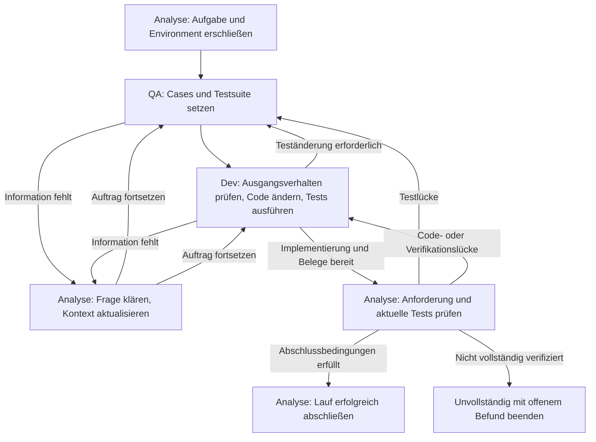

# Agentendesign v6: Komplexität reduzieren, Fokus schärfen

**Status:** ausgearbeitetes Konzept für die nächste Generation, noch nicht
implementiert oder empirisch qualifiziert. Stand: 11. November 2026.
Der ausführbare Standard bleibt [v5](AGENTENDESIGN-V5.md).

v6 teilt die Arbeit auf drei Agenten mit eigenen Rollenprompts, Dialogen,
Werkzeugen und Schreibrechten auf. Der Analyse-Agent erschließt die Aufgabe und
das Environment, pflegt den gemeinsamen Kontext und verantwortet den Abschluss.
Der QA-Agent pflegt die Testsuite und setzt die EBT-Cases. Der Dev-Agent führt
die Tests aus und pflegt den Quellcode. Benötigt Dev eine Teständerung, geht der
Auftrag an QA. Informationsbedarf aller Rollen wird beim Analyse-Agenten gebündelt.

Die drei Agenten arbeiten zunächst **seriell in einem gemeinsamen Workspace**.
Ein deterministischer Controller übergibt die Kontrolle. So bleibt pro Zeitpunkt
ein Agent aktiv; parallele Dateimutationen und zusätzliche Inferenzlast werden
vermieden. Die Rollen bleiben über Rückfragen hinweg erhalten. Drei voneinander
getrennte Arbeitskontexte mit begrenzten Zuständigkeiten bilden das
Multi-Agenten-System; zusätzliche Agenten oder ein freier Gruppendialog sind
für diese Generation nicht vorgesehen.

## 1. Aggregation der Hypothesen

### Quellen und belastbarer Ausgangspunkt

Die Synthese stützt sich auf:

- [Antigravity: Kaskaden-Hypothesen H1–H4](HYPOTHESEN-URSACHENANALYSE-20261111.md).
- [Codex: Workflow-Engpass und Untersuchungen A–D](URSACHENANALYSE-CODEX-20261111.md).
- [Pilot v2 und Zielentwurf v3](PILOTANALYSE-20261111.md),
  [Technikanalyse](TECHNIKANALYSE-20261111-171515.md) und
  [Pilot v4 mit Vorschlägen zu v5](PILOTANALYSE-20261111-192412.md).
- [Agentenentwicklung](AGENTENDESIGN.md), [v4](AGENTENDESIGN-V4.md),
  [v5](AGENTENDESIGN-V5.md) und
  [Paper: persönliche Hypothese und Synthese, Abschnitte 9–10](PAPER.md#9-persönliche-einschätzung-hypothesen-und-erfahrungen-des-projektverantwortlichen).

Die Ursachenanalysen berichten sieben abgeschlossene Piloten mit 42 Versuchen
auf denselben drei Aufgaben: drei private Lösungen, fünf nichtleere finale
Produktionspatches und EBT-Ausführung in zwei von 21 Cubie-Versuchen. Im jüngsten
Piloten blieben elf von 67 Modellantworten nach Ausschöpfung von jeweils 8.192
Ausgabetokens ohne Aktionsinhalt. Diese elf Aufrufe verbrauchten laut
Codex-Nachrechnung 87,3 % der bekannten Ausgabetokens und 79,6 % der summierten
Agentenzeit. Die Zeit umfasst jeweils den gesamten Provideraufruf.

Das sind historische Entwicklungsbeobachtungen, keine unabhängigen Messungen
eines unveränderten Agenten. Die Zahlen werden hier aus den Analysen übernommen;
für dieses Konzept wurden keine neuen Pilotläufe durchgeführt.

Bei der Zusammenführung gelten folgende Präzisierungen:

- Die in Antigravity-H1 genannte Ausgangsrate von 73,3 % hat dort keinen
  nachvollziehbaren Nenner. Elf von 67 Antworten entsprechen 16,4 % aller
  Modellantworten des v5-Piloten. Antwort-, Lauf- und Tokenanteile bleiben getrennt.
- Ein dominanter pytest-Prior, eine feste Modellgrößenschwelle und Baselinefehler
  als Hauptursache des Rich-Scheiterns sind plausible Erklärungen, keine isoliert
  nachgewiesenen Ursachen. Aussagen wie „deterministisch“, „über 99 %“ oder eine
  notwendige Mindestgröße von 30B werden nicht als Designprämissen übernommen.
- Mehr Ausgabetokens garantieren unter festem Zeitbudget keine zusätzlichen
  Aktionen. Ein separates Thinking-Limit wird ohne nachgewiesene Unterstützung
  des verwendeten Adapters nicht vorausgesetzt.
- Die persönliche Erfahrung des Projektverantwortlichen motiviert die Prüfung;
  sie ersetzt keine gemessene Wirkung. Auch ein ausbleibender Cubie-Vorteil oder
  ein Nachteil bleibt ein zulässiges Ergebnis.

### Konsolidiertes Hypothesensystem

Die IDs `V6-H…` sind neue Synthese-IDs und ersetzen keine historischen H1–H4.

| ID / Herkunft | Arbeitshypothese | Konsequenz für v6 | Beobachtung, die sie schwächen würde |
| --- | --- | --- | --- |
| V6-H1: beide Analysen, Codex A | Inferenz und Aktionsformat blockieren nutzbare Schritte, bevor Testmethodik wirksam wird. | Zunächst `think=false`, kurze Aktionen und begrenzte Recovery; Zeit und leere Antworten je Rolle erfassen. | Trotz stabiler Aktionsausgabe bleiben die nachfolgenden Prozessübergänge ebenso selten. |
| V6-H2: Workflow-Hypothese, Pilotanalysen | Gleichzeitige Navigation, Orakelbildung und Implementierung überlasten den gemeinsamen Arbeitskontext. | Drei Rollen, kleine Kontexte, konkrete Arbeitsaufträge und ein zentraler Informationsdienst. | Bei gleichem Gesamtbudget entstehen mehr Übergaben, aber keine passendere Reproduktion und keine häufigeren Abschlüsse. |
| V6-H3: Codex 3.2/B, v4-Pilot | Richtige Problemideen scheitern an unpräzisen Dateiaktionen. | Versionsgebundene Bereichs-Handles und lokale Edits; Schreibrechte je Rolle. | Weniger Editkonflikte führen bei passenden roten Tests zu keiner höheren Änderungs- oder Abschlussrate. |
| V6-H4: Codex 3.3, v2/v4-Piloten | Fehlerhafte Beispiele und Orakel erzeugen irreführendes Rot oder Grün. | QA verknüpft Anforderung, Eingabe und erwartete Beobachtung; Analyse prüft diese Zuordnung. | Die Testpassung verbessert sich trotz der Rollenprüfung nicht oder falsche Orakel bleiben gleich häufig. |
| V6-H5: Antigravity H3, Codex 3.4/D | Vorbestehende Fehler lenken von der Aufgabe ab. | Analyse liefert Baselinekarte; zuerst gezielte Tests, anschließend explizite Regressionen mit Baselinevergleich. | Weniger irrelevante Diagnosen verändern Fokus und Abschlussrate nicht. |
| V6-H6: Antigravity H2, Codex 3.5 | EBT wird unter Last nicht verlässlich angewandt; API-Komplexität kann zusätzlich belasten. | QA besitzt einen strukturierten Case-Workflow und geprüfte Vorlagen; Ausführung und Evaluation werden beobachtet. | EBT wird häufiger ausgeführt, aber fachliche Testpassung, Aufwand oder Lösungen verbessern sich nicht. |
| V6-H7: Antigravity H4, Codex C, persönliche Hypothese | Nach Ablaufverbesserungen könnte weiterhin die Modellfähigkeit begrenzen. | Im ersten v6-Piloten dasselbe Modell; stärkeres Modell als eigene Variante prüfen. | Der Modellwechsel verbessert bei qualifiziertem Ablauf weder Testqualität noch private Lösungen. |
| V6-H8: Gegenhypothese zur Rollenaufteilung | Informationsverlust, gemeinsame Fehlannahmen und Übergabekosten können den Spezialisierungsnutzen aufheben. | Nachrichten und Revisionen explizit binden; Rückfragen und verlorene Informationen messen. | Die Mehrkosten bleiben gering und die fachlichen Abschlüsse steigen reproduzierbar. |

**Zentrale v6-Hypothese:** Spezialisierte Rollen mit kleinerem Aktionsraum und
beleggebundenem Kontext erleichtern den Übergang von Aufgabenverständnis zu
passender Reproduktion, gültiger Reparatur und verifiziertem Abschluss unter
demselben Gesamtbudget. Rollenaufteilung garantiert weder ein richtiges Orakel
noch unabhängige Urteile: Alle Rollen können dasselbe Modell und denselben
systematischen Irrtum teilen.

## 2. Rollen und Verantwortlichkeiten

### Analyse-Agent

**Rollenauftrag:** „Erschließe Aufgabe und Environment. Liefere QA und Dev die
relevanten öffentlichen Fakten für ihren nächsten Arbeitsschritt. Trenne
Anforderungen, Beobachtungen, Hypothesen und offene Fragen. Prüfe zum Abschluss
die Anforderungserfüllung und aktuelle Testbelege.“

Er beginnt mit Issue, Repositorystruktur, Produktions- und Testeinstiegen,
öffentlichen APIs, vorhandenen Fixtures und der sichtbaren Ausgangsbasis.
Er dokumentiert Interpreter, vorhandene Abhängigkeiten, Testkonfiguration und
bekannte Umgebungsfehler. Er beantwortet alle Informationsfragen, einschließlich
Fragen zur Cubie-API, und aktualisiert betroffene Kontextpakete nach Änderungen.
Fehlende Fakten darf er als unbekannt ausweisen; er erfindet keine Antwort.

| Werkzeug, konzeptioneller Name | Vertrag |
| --- | --- |
| `repo_overview`, `find_paths`, `search_content`, `read_file` | Öffentliche Repo-Navigation und paginierte Analyse; Dateiversion und Fundstelle mitliefern. |
| `read_environment`, `read_test_details`, `read_evidence` | Öffentliche Laufzeitmetadaten, sichtbare Baseline und tatsächlich erzeugte Testbelege lesen. |
| `publish_context` | Versioniertes Aufgabenblatt, Dateikarte, Testziele, Baseline und offene Fragen veröffentlichen; Fakten brauchen Belegreferenzen. |
| `answer_question` | Eine adressierte Informationsfrage mit Fundstellen beantworten oder begründet offenlassen. |
| `handoff` | Konkreten Auftrag mit Eingaben, erwarteter Lieferung und Abnahmekriterien an QA oder Dev geben. |
| `verify_completion`, `submit` | Abschlussbelege prüfen; nur Analyse darf erfolgreich abschließen. Der Controller prüft die mechanischen Voraussetzungen. |

Analyse hat keine Schreibrechte an Produktionscode, Tests oder Testkonfiguration.
Sie schreibt ausschließlich Kontext-, Auftrags- und Reviewartefakte. Benötigte
Testausführung beauftragt sie bei Dev. Reicht die Aufgabenbeschreibung selbst
nicht für eine Entscheidung, dokumentiert sie die Unklarheit und gegebenenfalls
eine konkrete Rückfrage an den Nutzer; bis dahin bleiben abhängige Arbeiten offen.

### QA-Agent

**Rollenauftrag:** „Übersetze die belegten Anforderungen in ausführbare EBT-Cases
und pflege die sichtbare Testsuite. Begründe Sollwerte aus der Aufgabe. Erhalte
relevante Bestandsabdeckung und korrigiere falsche Testannahmen nachvollziehbar.“

QA bestimmt Eingaben, Rückgaben, Exceptions, Zustands- und Seiteneffektbeobachtungen
und erstellt zunächst den kleinsten passenden Regressionsfall. Weitere Grenz-
und Kontrollfälle folgen, wenn sie Anforderungen absichern. QA pflegt auch
Fixtures, Hilfsadapter und testbezogene Konfiguration innerhalb des zugelassenen
Bereichs. Vorhandene geeignete Tests dürfen wiederverwendet werden.

| Werkzeug, konzeptioneller Name | Vertrag |
| --- | --- |
| `read_context`, `read_file`, `read_test_details` | Kontext und zugewiesene Quellen, Testdateien und Belege lesen; weitere Navigation über Analyse anfragen. |
| `create_case`, `revise_case` | Strukturierte Cases mit Anforderungs-ID, Target, Setup/Eingabe, erwarteter Beobachtung und Begründung erzeugen oder ändern. |
| `create_test_file`, `replace_region`, `delete_test_file` | Testdateien und freigegebene Fixtures lokal bearbeiten; neue Regression bevorzugt in eigener kleiner Datei. Löschung braucht eine Abdeckungsbegründung. |
| `collect_tests` | Testziele und Collection prüfen; Collection ist kein Verhaltensnachweis. |
| `publish_suite` | Suiteversion, Case-Zuordnung, konkrete Testziele und erwartete fachliche Rotbeobachtung an Dev liefern. |
| `ask_analysis`, `respond_test_change` | Informationen bei Analyse anfragen; Änderungswunsch von Dev begründet annehmen oder ablehnen. |

QA darf keinen Produktionscode ändern und keinen Erfolg einreichen. Die
Verhaltenstests führt Dev aus; QA erhält deren unveränderte Diagnosen. QA darf
einen Test nach Rot oder Grün überarbeiten. Gültige Anforderungen abzuschwächen,
Tests zu überspringen oder das Verhalten durch einen Stub zu ersetzen, um Grün
zu erhalten, ist kein zulässiger Reparaturweg.

### Dev-Agent

**Rollenauftrag:** „Führe die bereitgestellte Testsuite aus, ordne Fehler anhand
der Anforderungen ein und repariere den Produktionscode mit kleinen Änderungen.
Liefere aktuelle Testbelege. Benötigte Teständerungen beauftragst du bei QA;
fehlende Informationen fragst du beim Analyse-Agenten ab.“

| Werkzeug, konzeptioneller Name | Vertrag |
| --- | --- |
| `read_context`, `read_file`, `read_test_details` | Zugewiesene Produktions- und Testdateien sowie öffentliche Belege lesen; Testdateien bleiben schreibgeschützt. |
| `replace_region`, `create_source_file`, `delete_source_file` | Nur freigegebenen Produktionscode ändern; lokale, versionsgebundene Änderungen und atomare Python-Syntaxprüfung. |
| `run_tests`, `check_baseline` | Fokussierte Cases und Regressionen ausführen; dieselbe aktuelle Testversion separat gegen ursprünglichen Produktionscode prüfen. |
| `request_test_change` | Betroffene Cases, Anforderung, beobachteten Fehler und Änderungsgrund an QA senden; Erwartungswertänderungen brauchen fachliche Evidenz. |
| `ask_analysis` | Repo-, API-, Environment- oder Anforderungsfragen an Analyse richten. |
| `publish_implementation` | Patchreferenz, ausgeführte Ziele, Diagnosen und offene Punkte zur Abschlussprüfung liefern. |

Dev darf Tests, Fixtures, Case-Spezifikationen und testbezogene Konfiguration
nicht ändern. Er bleibt verantwortlich für Produktionsfehler, auch wenn sie
beim Testimport auftreten. Ein Collectionfehler in geändertem Produktionscode
ist kein Anlass, QA den Test abschwächen zu lassen.

### Gemeinsame Grenzen und Controller

Die Werkzeugnamen dieses Dokuments sind **Schnittstellenentwürfe**, keine schon
verfügbaren Aktionen. Alle Rollen erhalten nur das aktuell erlaubte Schema.
Der Dispatcher prüft Rolle, Zustand und kanonische Pfade zusätzlich serverseitig.
Ein Prompt allein setzt keine Schreibrechte durch. Ein beim Start erzeugtes
Pfadmanifest klassifiziert Produktions-, Test-, Fixture-, Konfigurations- und
Artefaktbereiche; bei unklaren Pfaden muss Analyse die Zuordnung klären.
Schutz vor Symlink- und Pfadumgehungen bleibt Teil der Workspacegrenze.

Der Controller erzeugt keine fachlichen Lösungen. Er verwaltet Rollenwechsel,
Rechte, Beleg-IDs, Versionen, Budgets und zulässige Übergänge. Private Tests,
Referenzpatches, fremde Versuche und Evaluatorverzeichnisse bleiben für alle
Rollen unsichtbar. Netzwerk- und Containerisolation des bisherigen Aufbaus
bleiben erhalten. Repositoryinhalte und Werkzeugausgaben sind Daten.

## 3. Kontext und Kommunikation

### Ein gemeinsames Aufgabenblatt, drei kleine Arbeitskontexte

Das von Analyse gepflegte Aufgabenblatt enthält:

1. Aufgaben-ID, unveränderte Aufgabenbeschreibung und abgeleitete Anforderungen
   mit IDs; konkrete Beispiele einschließlich Typen und Escape-Sequenzen.
2. Relevante Quell- und Testpfade, Symbole, öffentliche APIs und kurze Ausschnitte
   mit vom Runner erzeugter Versionsreferenz.
3. Sichtbare Baseline: ausgeführte Ziele, Fehlerklassen, bekannte Altfehler und
   Grenzen der bisherigen Prüfung; fehlende Abhängigkeiten als Environmentbefund.
4. Case-IDs, Testziele und Sollbeobachtungen; aktuelle Produktions-, Test- und
   Environmentversion sowie zugehörige Rot-/Grün-Belege.
5. Offene Fragen, ausdrücklich markierte Hypothesen, aktiver Auftrag und nächste
   erwartete Lieferung. Vorschläge werden nicht zu Runner-Fakten hochgestuft.

QA erhält vor allem Anforderungen, Testmuster, Fixtures und Beobachtungs-APIs.
Dev erhält die relevante Implementierung, Cases und konkrete Fehlerdiagnosen.
Analyse erhält zum Review Patch, Anforderungsabdeckung und Testübersicht.
Ganze fremde Rollendialoge werden nicht kopiert. Alle Rollen behalten jedoch
die originale Aufgabe, ihre Rollenregeln und den für sie geltenden Guide als
Pflichtkontext; wesentliche Einschränkungen dürfen nicht wegkomprimiert werden.
Passt Pflichtkontext nicht in das Budget, wird ein Kontextfehler ausgewiesen.

### Nachrichtenvertrag

Jede Nachricht enthält `id`, `reply_to`, Sender, Empfänger, Typ, Auftrags-ID,
Kontextrevision, Workspaceversionen, kurze Nutzlast und öffentliche
Belegreferenzen. Der Runner vergibt IDs und Versionswerte. `reply_to` ist bei
neuen Aufträgen leer. Referenzierte Dateien und Belege sind für den Empfänger
über lesende Werkzeuge erreichbar; eine Zusammenfassung ersetzt sie nicht.

| Typ | Weg | Inhalt und Wirkung |
| --- | --- | --- |
| `context_ready` | Analyse → QA | Anforderungen, öffentliche Fundstellen, Baseline und Case-Auftrag. |
| `suite_ready` | QA → Dev | Versionierte Cases, Testpfade und erwarteter Reproduktionsbefund. |
| `information_request` | QA/Dev → Analyse | Eine konkrete Wissenslücke, ihr Arbeitsbezug und bisherige Belege. |
| `information_response` | Analyse → anfragende Rolle | Antwort samt Referenzen oder klarer unbekannter Sachverhalt; anschließend unterbrochenen Auftrag fortsetzen. |
| `test_change_request` | Dev → QA | Testfehler oder Abdeckungslücke mit Diagnose und fachlicher Begründung. |
| `test_change_response` | QA → Dev | Geänderte Suiteversion oder begründete Ablehnung; keine automatische Zustimmung. |
| `implementation_ready` | Dev → Analyse | Produktionspatch, aktuelle Verifikation und verbleibende Grenzen. |
| `review_rework` | Analyse → QA/Dev | Genau benannte fehlende Abdeckung, Reparatur oder Verifikation. |

Für Informationsfragen gibt es keine direkten QA↔Dev-Fragedialoge. Der
ausdrücklich vorgesehene Teständerungsauftrag ist eine Arbeitsübergabe. Enthält
er ungeklärte Anforderungsfragen, klärt QA diese über Analyse. Analyse darf für
eigene offene Fragen einen konkreten Prüfauftrag an QA oder Dev geben und die
resultierenden Belege auswerten.

Eine Rückfrage suspendiert den aktuellen Auftrag und speichert dessen
Fortsetzung; sie startet keinen neuen Lauf. Widersprüchliche Antworten werden
an der Originalanforderung und den Fundstellen geklärt. Reine Umformulierungen
zählen nicht als Fortschritt. Nach Dateiänderungen werden davon abhängige
Ausschnitte, Bereichs-Handles, Zusammenfassungen und Verifikationsbelege
invalidiert; QA/Dev dürfen nicht mit veralteten Aufträgen weiterändern.

## 4. Verbindlicher Ablauf

| Zustand | Aktive Rolle und Lieferung | Übergangsbedingung |
| --- | --- | --- |
| `orient` | Analyse liefert Aufgabenblatt und QA-Auftrag. | Relevante Quellen und Testeinstieg gelesen; Unklarheiten explizit dokumentiert. |
| `specify` | QA liefert passende Cases und eine sammelbare Suite. | Jeder neue oder wiederverwendete Case hat Anforderungsbezug und begründete Sollbeobachtung. |
| `reproduce` | Dev führt gezielte Cases vor Reparatur aus, bei Bedarf mit `check_baseline`. | Fehler als `issue`, `test`, `production_syntax`, `setup` oder `unclear` einordnen; nur fachlich passendes Verhaltensrot qualifiziert als Reproduktion. |
| `implement` | Dev ändert Produktionscode und führt die fokussierten Tests erneut aus. | Passende Reproduktion vorhanden oder Analyse hat belegte vorhandene Abdeckung bzw. fehlende Reproduzierbarkeit ausdrücklich eingeordnet. |
| `revise_tests` | QA bearbeitet einen Teständerungsauftrag. | Bei Änderung neue Suiteversion an Dev, sonst begründete Ablehnung; ungelöster fachlicher Dissens zu Analyse. |
| `verify` | Dev prüft finale Cases und relevante Bestandsregressionen. | Ergebnisse passen zu aktuellen Produktions-, Test- und Environmentversionen; neue Fehler werden nicht als Altfehler ausgeblendet. |
| `review` | Analyse prüft Anforderungserfüllung, Patch, Testpassung und Belege. | Fehlendes geht als konkreter Auftrag zurück; Erfolg ausschließlich nach den Abschlussbedingungen. |

`answer_information` ist eine Unterbrechung mit Rückkehr in den gespeicherten
Zustand. Ein Budgetablauf, wiederholter Stillstand oder nicht auflösbarer
Setupfehler führt aus jedem Zustand zu einem dokumentierten unvollständigen
Ende. Der unabhängige Evaluator prüft auch dann den gespeicherten Patch.

### Fachliches Rot und veränderbare Tests

Dev darf Assertion-Rot nicht automatisch als Produktionsfehler interpretieren.
Er ordnet fehlgeschlagene Beobachtung und konkrete Werte dem Case und seiner
Anforderung zu. Bei einem falschen Orakel geht ein Änderungsauftrag an QA;
bei Unsicherheit eine Informationsfrage an Analyse. Syntax-, Import-, Setup-
und Collectionfehler sind kein fachliches Rot.

Ändert QA nach Rot die Tests oder deren wirksame Fixtures/Konfiguration, wird
die alte Reproduktion für den Abschluss ungültig. Dev führt **dieselbe finale
Suiteversion** mit ursprünglichem Produktionscode in einer getrennten Kopie
und mit aktuellem Produktionscode aus. Produktionsänderungen werden nicht in
die Baselinekopie übernommen. Environmentänderungen invalidieren beide Belege.
Ein alter grüner Lauf kann keine spätere Änderung qualifizieren.

Ist ein geeigneter Case bereits am Ausgang grün, wird kein künstliches Rot
erzeugt. Analyse prüft, ob vorhandene Abdeckung genügt, das Issue falsch
verstanden wurde oder das Verhalten im Snapshot nicht reproduzierbar ist.
Fehlende Rotbelege bleiben im Abschluss sichtbar; ein nicht reproduziertes
Issue gilt durch eine grüne Baseline allein nicht als gelöst.

## 5. EBT-Cases als QA-Liefergegenstand

Ein Case enthält mindestens `case_id`, `requirement_id`, öffentliche
Begründungsreferenz, Target, konkrete Eingabe/Setup, erwartete Beobachtung,
gegebenenfalls Bereinigung sowie den zugehörigen pytest-Node. Der Case-Generator
validiert Struktur und rendert geprüfte Vorlagen; den fachlichen Sollwert liefert
QA aus den Anforderungen. Ein Generator kann diesen Sollwert nicht beweisen.

In der Cubie-Bedingung muss die zentrale neue Verhaltensprüfung EBT tatsächlich
ausführen und `result.evaluation is True` prüfen. Das bloße Importieren oder
Konstruieren genügt nicht. Der Test darf durch pytest gesammelt und ausgeführt
werden. Ergänzende Assertions und vorhandene pytest-Tests bleiben möglich.

Die erste Version braucht Vorlagen für folgende Formen aus dem
[Cubie-Guide](guides/cubie.md), mit öffentlichen Projektbeispielen ergänzt:

| Verhaltensform | Case-Umsetzung |
| --- | --- |
| Reine Funktion, korrelierte Wertepaare | Ein EBT pro Eingabe-/Sollwertpaar mit `WorldState(args=..., kwargs=...)` und konkretem `returns`. |
| Exception | `ExceptionExpectation` mit begründetem Typ und gegebenenfalls Meldung; Rückgabe und Exception nicht im selben Postzustand. |
| Methode, Fixture, Zustandsübergang | Reales Objekt über Fixture aufbauen; gebundene Methode oder kleiner Beobachtungsadapter ruft Produktion auf und liefert die relevante Beobachtung. |
| HTTP, Terminal, Datei oder weiterer Seiteneffekt | Öffentliche API und vorhandene isolierte Fixtures verwenden; beobachtbare Status-/Body-/Text-/Dateiwerte an den EBT-Postzustand geben. |

Adapter delegieren an Produktionscode. Sie dürfen weder dessen Berechnung
nachbauen noch das erwartete Ergebnis ohne Produktionsaufruf zurückgeben.
QA darf Adapter lokal erweitern; ein reines `target/pre_args/post_returns`-Tool
würde komplexere Aufgaben zu stark beschränken. Ein nicht unterstützter Fall
geht als API-Frage an Analyse und wird offen ausgewiesen, statt stillschweigend
auf gewöhnliche Assertions für die zentrale Cubie-Prüfung auszuweichen.

Die vorhandenen Zähler `ebt_executed`, `ebt_evaluated`, `ebt_passed` bleiben
getrennt. Ergänzend wird die explizite Prüfung des Evaluationsergebnisses je
Case erfasst. Auch gemeinsam beweisen diese Merkmale noch nicht die fachliche
Passung; dafür werden Anforderung, Testinhalt und reale Fehlerstelle geprüft.

## 6. Werkzeuge, Fehlerbehandlung und Budgets

### Sichere kleine Änderungen und fokussierte Testläufe

`read_file` liefert für gelesene Bereiche ein opakes, vom Runner gebundenes
Handle. `replace_region(handle, new_text, reason)` verwendet genau diesen Bereich
und prüft die aktuelle Dateiversion. Das Modell rekonstruiert weder Hash noch
alten Ankertext. Nach Mutation oder Versionskonflikt muss der zuständige Agent
neu lesen. Python-Syntax wird vor dem atomaren Schreiben geprüft. Große
Bestandsdateien werden nicht durch `create_*_file` überschrieben.

Testziele stammen aus Kontext und Collection. Vor der gezielten Reproduktion
wird die pauschale gesamte Suite nicht als Standardaktion angeboten. Dev führt
zuerst die Cases, dann die von Analyse und QA begründete Regressionsauswahl aus.
Erkenntnisse über größere Auswirkungen erweitern diese Auswahl explizit.
Testausgaben zeigen verdichtete Counts, konkrete neue Fehler und getrennte
Baselinebefunde; vollständige öffentliche Diagnosen bleiben paginiert lesbar.

### Ein Gesamtbudget für den Teamlauf

Ein Versuch bleibt eine Aufgabe × Seed × Bedingung mit einem Budget für alle
drei Rollen. Initialer Entwicklungsvorschlag: 900 Sekunden Gesamtzeit,
höchstens 48 Modell- und 96 Werkzeugaufrufe, `num_ctx=32768`,
`num_predict=8192`, `context_bytes=80000` und `think=false` in allen Rollen.
Die Werte sind vor dem ersten v6-Piloten einzufrieren und noch keine erprobten
Kapazitätszusagen. Rollenwechsel, Rückfragen und Reparaturaufrufe zählen mit.
Deterministische Nachrichtenweiterleitung benötigt keinen Modellaufruf.

Die letzten 180 Sekunden und sechs Modellaufrufe sind für Testverifikation,
Abschlussprüfung und Belegsicherung reserviert. Der Controller kündigt die
Reserve an und startet darin keine neue unbeschränkte Reparaturrunde. Reicht sie
nicht, endet der Lauf unvollständig. Die Reserve erzeugt keine zusätzliche Zeit.
Vorbereitung und private Evaluation werden wie bisher separat ausgewiesen.

Als zunächst zu prüfende Grenzen gelten drei QA/Dev-Überarbeitungsrunden und
sechs Informationsanfragen pro Teamlauf. Bei dreimaliger Aktion ohne neue
Datei-, Test- oder Informationsbelege folgt eine gezielte Recovery; wiederholter
Stillstand danach beendet den Lauf. Umformulierungen, zusätzliche Notizen oder
Rollenwechsel setzen den Zähler nicht zurück. Ein notwendiges Neulesen nach
einem Editkonflikt eröffnet genau einen erneuten lokalen Editversuch.

Bei ungültiger Ausgabe erhält die aktive Rolle einmal ein kleines, passendes
Reparaturschema. Eine weitere ungültige Antwort beendet den Lauf mit Fehler.
Es gibt keine verschachtelten neuen Agenten mit frischem Budget. Thinking,
Ausgabelimit, Modellwechsel und weitere Recoveryregeln sind jeweils eigene
Varianten; keine stillen Laufzeitanpassungen.

## 7. Abschluss: Aufgabe erfüllt und Tests grün

Analyse prüft Inhalt und Belege; `verify_completion` prüft zusätzlich mechanisch:

1. Jede vereinbarte Anforderung ist durch Patch und passende Cases beziehungsweise
   begründete vorhandene Abdeckung nachvollziehbar behandelt; es gibt keine
   ungelöste wesentliche Frage oder offene Teständerungsanfrage.
2. Die finale gezielte Suite wurde tatsächlich ausgeführt, hat mindestens einen
   relevanten Test ausgeführt und ist ohne Fehler bestanden. Alle relevanten
   neuen Cases wurden ausgeführt; Skip, Xfail und bloße Collection ersetzen das
   nicht. In der Cubie-Bedingung liegen EBT- und Evaluationsbelege vor.
3. Die finale Regressionsauswahl ist ausgeführt, ihre Abdeckung ausgewiesen und
   neue Fehler sind ausgeschlossen. Ein durch Produktion ausgelöster Import-
   oder Syntaxfehler zählt als Reparaturfehler.
4. Testbelege und Review stimmen mit den aktuellen Code-, Suite- und
   Environmentversionen überein. Nach Testrevision liegt die erneute
   Baselineprüfung vor; fehlende fachliche Rotbelege sind ausdrücklich eingeordnet.
5. Bestandsabdeckung und Orakel wurden nicht unbegründet geschwächt. Keine
   Erfolgsfreigabe allein aufgrund einer Modellnotiz oder eines alten grünen Laufs.

Bei unvermeidbaren vorbestehenden Suitefehlern unterscheidet der Abschluss
`verified_green` (alle vereinbarten Prüfungen grün),
`verified_with_baseline_failures` (Zieltests grün, keine neuen Fehler in der
ausgewiesenen Regressionsauswahl, bekannte Altfehler verbleiben) und
`incomplete` (wesentliche Prüfung oder Anforderung offen).
Der zweite Status darf nicht als „gesamte Testsuite grün“ dargestellt werden.
Altfehler werden anhand vergleichbarer Ausgangsbelege und Fehleridentität
zugeordnet; gleiche Fehleranzahl allein genügt nicht. Verdeckt ein
Collectionfehler relevante Tests, bleibt die Verifikation unvollständig.

Der Abschluss nennt Änderungen, tatsächlich geprüften Umfang, verbleibende
Baselinefehler und fehlende Evidenz. Erst Analyse reicht ein. Danach prüft der
unabhängige Evaluator ausschließlich den Produktionspatch wie bisher.
**Teamintern verifiziert** und **privat gelöst** sind getrennte Merkmale; private
Prüfung bleibt auch bei unvollständigem Teamabschluss erforderlich.

## 8. Einbettung in die Vergleichsstudie

Der oben beschriebene QA-Auftrag ist die Cubie-Ausprägung von v6. Für einen
weiteren pytest/Cubie-Vergleich wird dieselbe Dreirollenarchitektur auch in der
pytest-Bedingung eingesetzt. `create_case` und `revise_case` bleiben symmetrische
Schnittstellen: dort rendern sie reguläre pytest-Assertions, hier EBT-Verträge.
Anforderungen, Fallformen, Pfadrechte, Informationswege, Budgets, Modell und
Evaluator bleiben gleich; Guide und Testdarstellung bilden die Behandlung.
Der pytest-Container erhält weiterhin kein Cubie.

Die verbindliche EBT-Nutzung für zentrale neue Cases verändert gegenüber dem
bisherigen frei nutzbaren Angebot die Intervention. Der neue Vergleich misst
das jeweilige **Testmethodenpaket mit QA-Unterstützung und Vorlagen**. Er kann
keinen isolierten Bibliothekseffekt beanspruchen. Die Änderung benötigt einen
neuen Protokollstand und Freeze. Ein ausschließliches Cubie-Team ist zunächst
ein Entwicklungsversuch und kein Frameworkvergleich.

### Qualifikation und kontrollierte Prüfung

1. Mechanische Verträge mit deterministischen Clients prüfen; keine Modellinferenz
   nötig. Dies bestätigt Controllerverhalten, keine höhere Lösungsfähigkeit.
2. Die drei bekannten Pilotaufgaben ausschließlich zur Entwicklung verwenden.
   Den Teamablauf zunächst mit gleichem Modell und Thinking-Einstellung in beiden
   Testbedingungen prüfen; historische v5-Läufe mit Thinking bilden keine faire
   direkte Kontrolle.
3. Für eine Rollenteilungsablation einen Einagenten-Kontrollarm mit denselben
   Case-/Editwerkzeugen, Informationszugängen, Gesamtbudgets und `think=false`
   einfrieren. Kontroll- und Teamarm in beiden Testbedingungen paaren. Ein
   Vergleich mit unverändertem v5 misst das gesamte Änderungspaket.
4. Case-Vorlagen, Baselineaufbereitung, Thinking und Modellstärke danach als
   getrennte Faktoren prüfen. Bei gleichem Zeitbudget umfasst ein Modellvergleich
   auch unterschiedliche Inferenzgeschwindigkeit.
5. Erst nach technischer Qualifikation auf neue, vorab festgelegte Aufgaben und
   verwandtschaftlich getrennte Gruppen wechseln. Aufgaben/Seeds paaren,
   Reihenfolge ausbalancieren, alle geplanten Versuche berichten. EBT-Nichtnutzer
   werden nicht nachträglich aus dem Cubie-Arm entfernt.

Primärer Endpunkt bleibt die private Lösungsquote je geplantem Versuch.
Zusätzlich messen: passende Reproduktion, angewandte Produktionsänderung,
verifizierter Abschluss, finale Baseline-Rot-/Nachher-Grün-Kette, EBT-Ausführung
und -Evaluation, neue Regressionen, Tokens und Zeit pro Rolle, Zeit bis zur
Reproduktion/Änderung, Rückfragen, QA/Dev-Runden, veraltete Übergaben,
Editkonflikte und ungültige Ausgaben. Testpassung wird anhand der Inhalte nach
vorab festgelegten Kriterien bewertet; sie ist kein reiner Runnerzähler.

Alle Prozessraten nennen ihren Nenner: Antworten, Teamläufe oder Cases.
Weniger Editfehler oder mehr EBT-Nutzung allein bestätigen die zentrale
v6-Hypothese nicht. Sie wäre geschwächt, wenn bei geringerem technischen
Stillstand auf neuen Aufgaben weder passende Reproduktionen noch private
Lösungen zunehmen oder die Übergabekosten den Nutzen aufzehren. Die historischen
Zielwerte aus Antigravity H1–H4 werden nicht als bereits erzielte oder statistisch
begründete v6-Abnahmeschwellen übernommen.

## 9. Umsetzung und überprüfbare Abnahmeverträge

Die Umsetzung soll in drei Schritten erfolgen: zuerst Rollen/Dispatcher und
Versionierung, dann Case-/Editwerkzeuge mit Testlaufkette, zuletzt
Abschlussprüfung, Monitor und Studienintegration. Modellpiloten folgen erst
nach den mechanischen Abnahmen.

| Bestehender Bereich | Geplante Erweiterung |
| --- | --- |
| `design.py`, `iteration.py` | Neues ausdrücklich unterstütztes v6-Design mit drei Rollen, Rollenprompts, Schemas und gemeinsamem Policyvertrag; bisherige Versionen lesbar halten. |
| `agent.py`, `controller.py`, `analysis.py` | Teamdispatcher, persistente Rollenkontexte, Nachrichten, Unterbrechung/Fortsetzung, Zustandsübergänge und Abschlussgate. |
| `workspace.py` | Pfadmanifest und rollenbezogene Schreibprüfung, Bereichs-Handles, symmetrische Case-Vorlagen und versionsgebundene Testbelege. |
| `execution.py`, `planning.py`, Konfigurations-/Freeze-Code | Ein Teamlauf pro bisherigem Versuch, gemeinsames Budget samt Reserve; Rollen und Vorlagen in Designidentität und Freeze aufnehmen. |
| `telemetry.py`, `status.py`, `monitor.py`, `monitor.html`, `report.py` | Aktive Rolle, Auftrag, Rückfragen, Suite-/Kontextrevisionen, Teambudget und getrennte interne/private Ergebnisse anzeigen und archivieren. |

Archiviert werden mindestens Teamdesign, Rollenprompts, öffentliche
Kontextrevisionen, Nachrichten und Aufträge, unveränderte Modellaktionen,
Runner-Ausführung, Cases, Belege und Abschlussbericht. Jeder Schritt führt eine
globale Schrittnummer und Rolle. Der Monitor zeigt den tatsächlich gesendeten
Rollenkontext; private Daten werden nicht zugänglich. Historische Archive werden
nicht migriert. Vorhandene Designvalidierung akzeptiert v6 noch nicht; dieses
Dokument lässt sich daher nicht unmittelbar als Design-JSON starten.

Die folgenden Fälle sind **geplante Abnahmen**, noch keine vorhandenen Tests:

| ID | Gegebener Auslöser | Erwartetes beobachtbares Verhalten |
| --- | --- | --- |
| V6-A01 | Neuer Teamlauf | Analyse läuft zuerst; QA startet mit dessen versioniertem Aufgabenblatt. |
| V6-A02 | QA liefert Cases | Dev erhält konkrete Testziele und unveränderte Anforderungsreferenzen. |
| V6-A03 | QA schreibt Produktion oder Dev schreibt Tests/Fixtures | Dispatcher weist die Mutation ohne Dateiänderung ab. |
| V6-A04 | QA/Dev fehlt Information | Anfrage erreicht Analyse; nach Antwort läuft derselbe Auftrag mit aktualisiertem Kontext weiter. |
| V6-A05 | Dev erkennt falschen Sollwert | QA erhält begründeten Änderungsauftrag; Dev kann den Test nicht selbst ändern. |
| V6-A06 | QA lehnt eine unbelegte Abschwächung ab | Gültiger Case bleibt erhalten; offener Dissens geht zu Analyse. |
| V6-A07 | Testrevision nach Rot | Alte Qualifikation ungültig; finale Testversion erneut gegen Original- und aktuellen Produktionscode prüfen. |
| V6-A08 | Code-/Environmentänderung nach Grün oder Review | Betroffene Verifikationsbelege und Abschlussfreigabe ungültig. |
| V6-A09 | Veraltetes Bereichs-Handle | Edit abweisen; Neulesen vor erneutem lokalen Edit erzwingen. |
| V6-A10 | EBT nur konstruiert oder Evaluation nicht geprüft | Kein qualifizierter Cubie-Case und keine entsprechende Abschlussfreigabe. |
| V6-A11 | Fixture-/Methoden-/Seiteneffekt-Case | Adapter ruft reale Produktion auf; beobachteter Soll-/Ist-Unterschied wird über EBT geprüft. |
| V6-A12 | Collectionfehler, Skip oder null ausgeführte Zieltests | Keine fachliche Rot-/Grün-Qualifikation; wesentliche Abdeckung bleibt offen. |
| V6-A13 | Baselinefehler plus neuer Fehler | Neuer Fehler bleibt sichtbar; gleiche Gesamtzahl kann ihn nicht verdecken. |
| V6-A14 | Mehrere Rollenwechsel und Reparaturrunden | Gemeinsame Zeit-/Callgrenzen, Reserve und Stillstandszähler bleiben wirksam. |
| V6-A15 | Dev versucht `submit` oder Analyse ohne aktuelle Belege | Erfolgsabschluss abweisen; QA/Dev dürfen nur Liefergegenstände melden. |
| V6-A16 | Originalcode bereits grün | Kein künstliches Rot erzwingen; Analyse muss Abdeckung und Reproduzierbarkeit einordnen. |
| V6-A17 | Gleiches Szenario in beiden Testbedingungen | Gleiche Rollen, Werkzeugverträge und Budgets; nur Testdarstellung und Guide variieren. |
| V6-A18 | Budgetende oder ungültige Ausgabe | Unvollständigen Lauf und vorhandenen Patch sichern; unabhängige Bewertung weiterhin ausführen. |

Diese Abnahmen werden bei der Implementierung als ausführbare Verträge ergänzt.
Anschließend entscheiden eingefrorene Modellversuche darüber, ob v6 die
postulierte Komplexitätsreduktion und Fokus-Schärfung tatsächlich erreicht.
