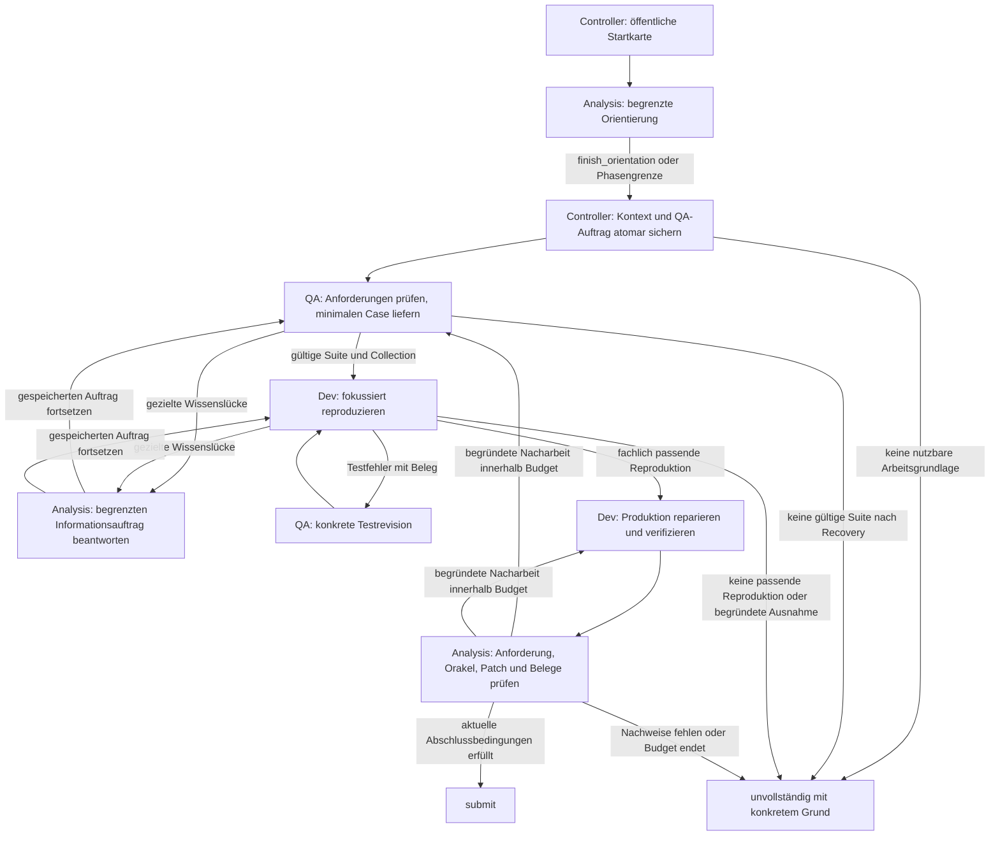

# Agentendesign v7: Begrenzte Orientierung, verlässliche Übergaben

**Status:** Konzept, noch nicht implementiert oder empirisch qualifiziert.  
**Stand:** 12. November 2026.  
**Grundlage:** v6-Pilot `20261112-002038`, drei Aufgabenpaare mit Seed 42.  
**Ziel:** Den testgeleiteten Arbeitsablauf tatsächlich erreichen und dabei die
fachlichen Nachweispflichten aus v6 erhalten.

v7 behält die drei seriell arbeitenden Rollen Analysis, QA und Dev. Der
Controller übernimmt zusätzlich die Verantwortung dafür, dass Orientierung
endet, Arbeitsaufträge entstehen und Recovery den nächsten zulässigen Schritt
verändert. Das Modell liefert fachliche Einschätzungen und Artefakte; es muss
den Ablauf nicht mehr durch mehrere organisatorische Aktionen selbst auslösen.

Die zentrale Hypothese lautet: **Ein zeitlich und mechanisch begrenzter
Analyseauftrag mit atomarer Übergabe erreicht unter gleichem Gesamtbudget
häufiger eine passende Reproduktion und anschließende Reparatur.** Eine
Aktivierung aller Rollen allein gilt nicht als Erfolg.

## 1. Quellen, Befunde und Grenzen

Die Synthese verwendet die drei angefragten Dokumente:

- [Antigravity-Pilotanalyse](PILOTANALYSE-20261112-002038.md).
- [Deskriptive Codex-Analyse](PILOTANALYSE-V6-20261112-002038-CODEX.md).
- [Gemini-Argon-Hypothesen und Quick-Fixes](HYPOTHESIS-V6-GEMINI-ARGON-HIGH.md).

Ergänzend wurden [v6-Design](AGENTENDESIGN-V6.md),
[v6-Konfiguration](v6.toml), [archivierter Bericht](runs/20261112-002038/report.json)
und die aktuellen Schnittstellen in [team.py](testguided_study/team.py),
[team_design.py](testguided_study/team_design.py),
[team_agent.py](testguided_study/team_agent.py) und
[team_workspace.py](testguided_study/team_workspace.py) gelesen. Der aktuelle
Arbeitsstand und der eingefrorene Pilot bleiben unterschiedliche Quellen.

### 1.1 Belastbare Ausgangsbasis

| Befund | Konsequenz für v7 |
| --- | --- |
| Alle sechs Läufe endeten mit `incomplete/stagnation` in `analysis/orient`; QA und Dev hatten null Aufrufe. | Orientierung erhält eine eigene Grenze und einen vom Controller durchgesetzten Ausgang. |
| Keine Kontextveröffentlichung, Übergabe, Testausführung oder Dateiänderung. | Der erste Übergang darf keine selbst initiierte Folge mehrerer Verwaltungsaktionen benötigen. |
| Wiederholte Suchen und Dateilesungen blieben auch nach Recovery bestehen. | Recovery ändert zulässige Aktionen und führt eine konkrete Diagnose aus. |
| Requests suchte durchgehend im selben Pfad und erhielt leere Trefferlisten. | Pfadexistenz, Suchraum und tatsächliche Treffer werden getrennt ausgewiesen. |
| `start` bedeutet bei Suche Treffer-Offset und beim Lesen Startzeile. | Verschiedene Begriffe und explizite Ergebnisverträge beseitigen die Mehrdeutigkeit. |
| Eine Antwort erreichte mit repetitiven Escape-Folgen 8192 Tokens; Reparatur gelang. | `think=false` und begrenzte Ausgabereparatur bleiben erhalten; Antwortdauer wird zusätzlich begrenzt. |
| Alle Produktionspatches blieben leer; privat war keine Aufgabe gelöst. | Ablaufmetriken und tatsächliche Problemlösung werden getrennt beurteilt. |

### 1.2 Präzisierungen gegenüber den Vorlagen

Die Analysen nennen unterschiedliche Aktionssummen: Antigravity 51 Suchen und
14 Lesungen, Codex 53 Suchen und zwölf Lesungen. Für dieses Konzept gelten die
aktionsweise ausgewiesenen Codex-Summen: **65 Werkzeugaktionen, davon 53 Suchen
mit 33 leeren Trefferlisten und zwölf Lesungen; 66 Modellaufrufe**. Die
Architekturentscheidung hängt nicht an dieser Zähldifferenz.

`resolved=false` bedeutet nicht, dass alle privaten Tests scheiterten. Codex
weist für FastAPI 1 fehlgeschlagenen und 8 bestandene, für Requests 1 und 11,
für Rich 16 und 7 Tests aus, jeweils in beiden Armen. Diese Ergebnisse stammen
aus der nachgelagerten privaten Evaluation und dürfen kein Agentenwissen werden.

Der falsche Requests-Pfad `requests/utils.py` gegenüber `src/requests/utils.py`
ist die zusätzliche technische Einordnung der Antigravity-/Gemini-Dokumente.
Die leeren Aktionsresultate allein beweisen diese Ursache nicht. Der aktuelle
Team-Suchpfad in `TeamController._navigate` prüft kanonische Pfade, aber keine
Existenz im Inventar vor der Suche. Diese konkrete Schwäche wird adressiert;
ein bloßer Patch an `workspace.py` würde den Team-Pfad nicht hinreichend abdecken.

Der Pilot belegt den ausgebliebenen Übergang. Er isoliert nicht, ob dessen
Zwei-Schritt-Protokoll, Rollenprompt, Schemaumfang oder Modellfähigkeit die
Hauptursache war. Ebenso ist Token-Starvation nicht allgemein widerlegt, und
ein Überlegenheitsnachweis für Multi-Agenten oder Cubie liegt nicht vor.

## 2. Was aus v6 erhalten bleibt

- Drei getrennte Rollenkontexte und serielle Ausführung im gemeinsamen Workspace.
- Analysis interpretiert Anforderungen und prüft den Abschluss. QA besitzt
  Tests, Fixtures und Testkonfiguration. Dev besitzt Produktionsänderungen.
- Serverseitige Schreibrechte, kanonische öffentliche Pfade, versionsgebundene
  Bereichs-Handles und atomare Syntaxprüfung vor Python-Änderungen.
- Strukturierte Cases mit Anforderungsbezug, begründetem Orakel und konkreten
  Testzielen; passende Vorlagen für pytest und Cubie.
- Unterscheidung von Collection, Setupfehler, fachlichem Rot, Grün und
  vorbestehenden Baselinefehlern. Keine Abschwächung gültiger Anforderungen.
- Gemeinsames Budget, separate Verifikationsreserve und unabhängige private
  Evaluation auch bei unvollständigem internem Abschluss.
- Gleicher Steuerungskern für beide Studienarme. Nur Guide, Testdarstellung und
  notwendige Frameworkprüfungen unterscheiden sich.

Diese Eigenschaften sind fortzuführende Anforderungen. Ihr Vorhandensein im
Konzept ersetzt weder bestehende technische Tests noch neue Modellversuche.

## 3. Architektur und Ablauf

### 3.1 Öffentliche Startkarte ohne Modellaufruf

Vor der ersten Inferenz erzeugt der Controller eine kompakte Karte aus dem
tatsächlich zugänglichen Workspace: Wurzeln und Paketlayouts, relevante
Projekt-/Testkonfiguration, vorhandene Umgebungsmetadaten und die bereits
ermittelte sichtbare Baseline. Ein `src/`-Layout wird damit früh sichtbar.
Die vollständige öffentliche Pfadliste bleibt paginiert lesbar.

Die Karte enthält keine vermutete Lösung und keine semantisch abgeleitete
Anforderung. Die Originalaufgabe bleibt Pflichtkontext. Alle automatischen
Werkzeugoperationen zählen zum gemeinsamen Werkzeug- und Zeitbudget und werden
mit `actor=controller` protokolliert. Die Karte ist größenbegrenzt; eine lange
Dateiliste darf den eigentlichen Arbeitskontext nicht verdrängen.

### 3.2 Atomarer Orientierungsabschluss

`finish_orientation` ersetzt für den ersten Übergang die Kombination aus
`publish_context` und `handoff`. Eine Modellaktion liefert:

| Feld | Vertrag |
| --- | --- |
| `requirements` | Kleine Liste aus ID, Anforderungstext, öffentlicher Belegreferenz und `proposed`/`confirmed`. Die Originalaufgabe erhält eine vom Runner vergebene öffentliche Referenz. |
| `source_refs`, `test_entry_refs` | Bereits vorhandene, lesbare und versionsgebundene Fundstellen; fehlende Testeinstiege dürfen ausdrücklich unbekannt bleiben. |
| `hypotheses` | Als solche markierte Implementierungs- oder Fehlerhypothesen. |
| `unknowns` | Konkrete Wissenslücken mit Arbeitsbezug; keine erfundenen Fakten. |

Der Controller validiert Referenzen, schreibt Kontextrevision und Nachricht und
aktiviert QA in einer atomaren Transaktion. Auftrags-ID, Empfänger, Lieferung
und formale Abnahme entstehen aus dem Zustand; das Modell muss sie nicht
erfinden. Wiederholung desselben Abschlusses erzeugt keinen zweiten Auftrag.
Ein ungültiges Paket bewirkt keine teilweise Veröffentlichung.

Bei Erreichen der Orientierungsgrenze erfolgt ein **mechanischer Abschluss**:
Der Controller stellt aus Originalaufgabe, Startkarte, tatsächlich gelesenen
Fundstellen und expliziten Unbekannten ein vorläufiges Paket zusammen. Freie
`note`-Texte bleiben unbestätigte Modellnotizen. Er erzeugt weder eine
Implementierungsdiagnose noch ein Testorakel. Noch fehlende strukturierte
Anforderungen werden als Aufgabe an QA übertragen, nicht als Fakten ergänzt.

QA darf mit diesem vorläufigen Paket arbeiten und Anforderungen aus der
Originalaufgabe mit der neuen Aktion `confirm_requirements` bestätigen oder
begründet präzisieren. Diese Aktion verlangt Anforderungs-IDs, Texte und gültige
öffentliche Referenzen; sie darf den Originalauftrag nicht abschwächen.
Widersprüche gehen an Analysis. Änderungen invalidieren abhängige Case- und
Reviewfreigaben. Die Bestätigung ist ein fachliches Modellurteil und wird auch
als solches archiviert. Vor `publish_suite` müssen die betroffenen
Anforderungen, Sollwerte und ihre öffentlichen Belege gültig vorliegen. Ein
Rollenwechsel senkt diese fachliche Schwelle nicht. Ist die Originalaufgabe
unbrauchbar oder keine Quelle zugänglich, endet der Lauf mit einer konkreten
Blockadediagnose statt mit einer leeren Übergabe.

### 3.3 Selbstständige, begrenzte Navigation für QA und Dev

QA und Dev erhalten zusätzlich lesenden Zugriff auf `find_paths` und
`search_content` im öffentlichen Workspace. Fehlende Pfadkenntnis allein
benötigt keinen Umweg über Analysis. Schreibrechte bleiben unverändert.
Begrenzte Ausgabe, Navigation innerhalb des jeweiligen Auftragsbudgets und
versionsgebundene Lesungen verhindern einen neuen unbegrenzten Suchauftrag.

`ask_analysis` bleibt für unklare Anforderungen, widersprüchliche Belege,
Pfadklassifikationen und tatsächliche API-/Environmentfragen verfügbar. Eine
Rückfrage speichert Auftrag, Zustand und Rückkehrrolle. Dieselbe Frage mit
denselben Belegen wird nicht erneut zugestellt. Eine unbeantwortete fachlich
blockierende Frage verhindert den erfolgreichen Abschluss.

### 3.4 QA- und Dev-Meilensteine

QA soll zuerst **einen** begründeten, ausführbaren Regressionsfall liefern.
Vorhandene passende Tests können registriert werden. Weitere Kontroll- und
Grenzfälle folgen, wenn die Anforderungen sie benötigen. Ein kleines erstes
Ergebnis ist noch keine vollständige Anforderungsabdeckung.

`publish_suite` übergibt wie in v6 atomar an Dev. Liegen beim QA-Phasenende
bestätigte Cases, vollständige Orakel und passende aktuelle Collection vor,
kann der Controller diese vorhandene Lieferung selbst übergeben. Er darf keine
fehlende fachliche Bestätigung ergänzen. Fehlen Voraussetzungen, folgt eine
begrenzte QA-Recovery und anschließend gegebenenfalls `suite_incomplete`.

Dev erhält im Zustand `reproduce` zuerst die konkreten Testziele; das Schema
priorisiert `run_tests`, Beleglesen und Diagnose. Produktionsänderungen werden
erst nach passendem Rot oder einer dokumentierten, belegten Ausnahme
freigegeben. Collectionfehler und fehlende Abhängigkeiten zählen nicht als Rot.
Nach Testrevisionen wird die finale Suite erneut gegen die ursprüngliche
Produktion geprüft. Ein bereits grüner Ausgangstest rechtfertigt kein
künstliches Rot; Reproduzierbarkeit und Abdeckung werden explizit eingeordnet.

## 4. Eindeutige Werkzeugverträge

### 4.1 Pfadprüfung vor Inhaltssuche

Jeder Suchaufruf unterscheidet folgende Ergebnisse:

| Situation | Ergebnis und nächste zulässige Reaktion |
| --- | --- |
| Öffentliche Datei oder Verzeichnis existiert, Suche findet nichts | `completed`, `hits=[]`, `files_searched`, `files_skipped`, `scope_exists=true`; andere Suchhypothese oder Quelle wählen. |
| Pfad fehlt im öffentlichen Inventar | `scope_not_found`, `scope_exists=false`, bis zu fünf öffentliche Pfadkandidaten; keine Inhaltssuche ausführen. |
| Pfad verletzt die Workspacegrenze | `scope_denied`; keine Informationen über verborgene Pfade oder Vorschläge außerhalb des öffentlichen Inventars. |
| Dateien sind nicht lesbar oder nicht dekodierbar | Explizite Auslassungen bzw. `scope_unreadable`; kein scheinbar vollständig negatives Suchergebnis. |
| Treffer passen nicht vollständig in die Ausgabe | `truncated=true` und gültiger Fortsetzungscursor. |

Verzeichnisse gelten als vorhanden, wenn das öffentliche Inventar passende
Dateien enthält; eine Prüfung nur auf exakte Dateinamen wäre falsch.
Pfadkandidaten sind Vorschläge, keine automatische Umleitung des Aufrufs.
Bei Mehrdeutigkeit muss die aktive Rolle den Pfad prüfen.

Für Requests würde `requests/utils.py` dadurch ein überprüfbares
`scope_not_found` samt vorhandenem `src/requests/utils.py` als Kandidat liefern,
sofern das öffentliche Inventar diesen Pfad enthält. Eine erneute inhaltliche
Suche im unverändert fehlenden Scope wird bis zur Pfadkorrektur abgewiesen.

### 4.2 Zeilen und Pagination trennen

Für v7 gelten neue, ausdrücklich versionierte Schemas:

- `read_file(path, line_start, line_end)`: einbasierte, inklusive Zeilen.
- `search_content(scope, query, cursor?)`: wörtliche Teilstringsuche; erste
  Seite ohne Cursor. Der Runner liefert einen opaken `next_cursor`.
- `find_paths(pattern, cursor?)`: Pfadglob mit demselben Cursorprinzip.

Cursor sind an Werkzeug, Suchparameter und Inventar-/Inhaltsversion gebunden.
Ungültige oder veraltete Cursor erzeugen einen Fehler und einen Hinweis auf
einen Neustart der Suche. Vom Modell erfundene numerische Offsets wie `860`
werden abgewiesen. Interne Offsets dürfen weiter existieren; sie gehören nicht
zum Modellvertrag. Bestehende v6-Schemas behalten ihre historische Bedeutung.

`search_content` wird ausdrücklich als **Literal-Suche** beschrieben. v7 führt
zunächst keinen freien Regexmodus ein. Escape-Werte werden im Originaltext
erhalten und per JSON transportiert. Das vermeidet die zusätzliche Annahme,
dass ein vom Modell erzeugter regulärer Ausdruck hier tatsächlich ausgewertet
würde. Die aktuelle Team-Suche verwendet bereits einen Teilstringvergleich.

## 5. Fortschritt und wirksame Recovery

### 5.1 Zwei getrennte Fortschrittsebenen

**Informationsgewinn** sind neue zugängliche Pfade, neue gelesene Zeilen,
unterschiedliche Fundstellen oder eine neue konkrete Diagnose. Überlappende
Lesebereiche zählen nur für den neuen Anteil; andere Beleg-IDs und Handles
zählen nicht. Negative Suchen werden samt Scope und Suchparametern gemerkt,
sodass verschiedene leere Ergebnisse nicht bedeutungslos zusammenfallen.

**Arbeitsfortschritt** sind ein validierter Kontext, ein bestätigter Case,
passende Collection, qualifiziertes Rot, ein begründeter Produktionspatch,
aktuelle Verifikation oder beantwortete blockierende Fragen. Eine Mutation
allein ist kein Qualitätsnachweis. Rollenwechsel, neue Notizen, umformulierte
Anfragen und kosmetische Edits setzen die Arbeitsgrenze nicht zurück.

Neue Suchtreffer können die lokale Informationsstagnation zurücksetzen, aber
keine Phase unbegrenzt verlängern. So wird das Rich-Muster mit wiederholt neuen
Fundstellen ohne Lieferung durch die Phasengrenze erfasst.

### 5.2 Eskalation mit Zustandsänderung

1. **Identische Aktion bei unveränderten relevanten Versionen:** Ergebnis aus
   Cache mit `duplicate_action` zurückgeben, keinen identischen Backendaufruf
   ausführen; nächsten konkreten Alternativschritt ausweisen. Modellaufruf und
   angenommener Werkzeugversuch bleiben budgetiert und archiviert.
2. **Zwei aufeinanderfolgende Schritte ohne Informations- oder
   Arbeitsfortschritt:** einmalige lokale Recovery für den aktiven Auftrag.
   Der Controller führt eine passende lesende Diagnose aus, etwa Pfadprüfung
   nach fehlendem Scope oder eine Pfadsuche nach einem bekannten Dateinamen.
   Automatische Aktionen zählen zum Werkzeugbudget. Das nächste Schema wird
   auf zustandsgeeignete Alternativen begrenzt.
3. **Weitere Stagnation oder Phasengrenze:** In `orient` folgt das vorläufige
   QA-Paket. QA übergibt nur eine bereits gültige Suite; sonst benennt sie die
   fehlende Voraussetzung. Dev führt vorhandene konkrete Ziele aus oder stellt
   einen belegten Reparatur-/Informationsauftrag. Ohne zulässigen nächsten
   Schritt endet der Auftrag unvollständig.
4. **Wiederkehrende Blockade:** Gleiche Rolle, Auftrag, Ursache und relevante
   Version erhalten keine weitere identische Recovery. Neue Rollen allein
   erneuern das Kontingent nicht; die Gesamtgrenzen für Fragen und
   Revisionsrunden verhindern Pingpong. Endgründe unterscheiden mindestens
   `orientation_incomplete`, `suite_incomplete`, `reproduction_missing`,
   `environment_blocked`, `no_progress_after_recovery` und `budget_exhausted`.

Recovery wird bei einer tatsächlich behobenen Ursache abgeschlossen. Das
Archiv behält die Episode; ein späterer unabhängiger Stillstand erbt keinen
global dauerhaft gesetzten Recovery-Schalter. Begründung und Aktionsparameter
werden gemeinsam angezeigt. Nur ausgeführte Parameter und Runnerbelege
bestimmen Fortschritt; eine Absicht im `note`-Feld genügt nicht.

## 6. Budgets und zustandsabhängige Schemas

Der erste v7-Entwicklungslauf behält Modell, `think=false`, Temperatur,
Kontextfenster sowie **900 Sekunden, 48 Modell- und 96 Werkzeugaufrufe** aus
v6 bei. Die Reserve bleibt bei 180 Sekunden beziehungsweise sechs
Modellaufrufen; sobald eine Grenze greift, beginnt keine neue Reparaturrunde.

Zusätzlich werden folgende Startwerte vor dem Freeze festgelegt:

| Auftrag | Lokale Obergrenze | Folge beim Erreichen |
| --- | --- | --- |
| Erste Orientierung | 6 Modellaufrufe oder 120 Sekunden | Vorläufiges QA-Paket aus vorhandener öffentlicher Evidenz; kein zusätzlicher Abschlussaufruf erforderlich. |
| Erste QA-Spezifikation | 10 Modellaufrufe oder 180 Sekunden | Gültige vorhandene Suite übergeben; andernfalls einmalig höchstens 2 Aufrufe/45 Sekunden zur konkreten Recovery. |
| Informationsaufträge zusammen | 4 Modellaufrufe oder 60 Sekunden | Unbekannt zurückmelden, ursprünglichen Auftrag mit offener Frage fortsetzen; abhängiger Erfolg bleibt gesperrt. |
| Einzelne Modellantwort | höchstens 60 Sekunden, zusätzlich begrenzt durch verbleibende Auftrags- und Gesamtzeit | Timeout archivieren; höchstens eine Ausgabereparatur je Teamlauf, sofern deren Frist und Budget noch reichen. |

Das sind Entwurfsparameter für die Entwicklung, keine aus sechs Läufen
geschätzten optimalen Werte. Alle lokalen Budgets sind Teilmengen desselben
Gesamtbudgets; Reparaturaufrufe zählen mit. Nicht verbrauchte Kontingente bleiben
für Dev und Verifikation verfügbar. Es gibt keinen Budgetreset beim Rollenwechsel.
Spätere Testrevisionen haben eigene gespeicherte Aufträge innerhalb der
Gesamtgrenze von drei Revisionsrunden; höchstens sechs Informationsanfragen
bleiben erlaubt. Die QA-Frist beginnt mit ihrer ersten Aktivierung und läuft
auch während eingeschobener Informationsaufträge weiter; die Fortsetzung
erneuert weder Zeit noch Aufrufkontingent. Lokale Fristen laufen während einer Inferenz weiter und
begrenzen deren Timeout. Bereits erschöpfte Gesamtbudgets haben Vorrang vor
jeder Auto-Übergabe.

Beim nächsten Modellaufruf sieht das Modell nur zum Zustand passende Aktionen:
Orientierung zeigt Navigation und `finish_orientation`, erste Reproduktion
Ausführung und Diagnose, Implementierung Produktion und Testläufe, Review
Belegprüfung und begründete Nacharbeit. Der Dispatcher erzwingt exakt dieselben
Grenzen serverseitig, einschließlich nachträglich ungültiger Aktionen. Beim
letzten Orientierungsaufruf wird das Schema auf Abschluss oder konkrete
Blockademeldung beschränkt; ein abgebrochener Aufruf führt zum mechanischen
Fallback innerhalb derselben Frist.

`num_predict=8192` bleibt für den ersten Vergleich unverändert, damit die
Orchestrierungsänderung nicht gleichzeitig mit einer Tokenlimitänderung
vermischt wird. Eine separate Variante darf kürzere Ausgabelimits für
Navigation als für Code-Edits prüfen. Die Ausgabereparatur ist zustandsabhängig:
Sie bietet einen kurzen gültigen Abschluss oder Diagnoseschritt an und zwingt
das Modell nicht in jeder Phase zum erneuten `read_file`.

Die Reserve führt aus jedem Zustand zu einer Prüfung der vorhandenen
Liefergegenstände. Ohne Suite oder Patch wird der unvollständige Stand direkt
gesichert. Mit geeigneten Artefakten werden noch finanzierbare fokussierte
Tests, Regressionen und Review ausgeführt. Reservierte Zeit garantiert keinen
erfolgreichen Abschluss.

## 7. Fachliche Abschlussbedingungen

Ein automatischer Übergang veröffentlicht niemals automatisch `reproduced`,
`verified` oder `submitted`. Analysis darf nach `verify_completion` nur
abschließen, wenn:

1. Die Anforderungen fachlich geprüft und durch Cases mit begründeten Orakeln
   abgedeckt sind; keine blockierende Frage oder unaufgelöster Dissens besteht.
2. Passendes Verhaltensrot oder eine belegte zulässige Ausnahme vorliegt.
   Nach Teständerungen gilt die finale Test-/Fixture-/Konfigurationsversion
   gegen ursprüngliche und aktuelle Produktion.
3. Fokussierte Tests und relevante Bestandsregressionen zum finalen
   Produktions-, Test- und Environmentstand vorliegen. Neue Fehler bleiben
   anhand ihrer Identität erkennbar, auch bei unveränderter Gesamtfehlerzahl.
4. Im Cubie-Arm die relevante EBT-Ausführung und tatsächlich geprüfte
   Evaluation nachgewiesen sind. Konstruktion eines Cases allein genügt nicht.
5. Patch und Testbelege im abschließenden Review zu denselben Versionen gehören.
   Spätere Änderungen invalidieren betroffene Freigaben.

Interner Abschluss und private Lösung bleiben getrennte Ergebnisachsen.
Auch ein privat gelöster, intern unvollständiger Lauf wird als solcher gezeigt.
Der Agent erhält während der Bearbeitung weder private Diagnosen noch
Referenzpatches. Frühere fehlgeschlagene Piloten liefern dem Konzept Ursachen,
aber keine zusätzlichen lösungsspezifischen Agentenhinweise.

## 8. Beobachtbarkeit und prüfbare Hypothesen

Jeder Übergang protokolliert Auslöser (`model`, `phase_limit`, `recovery`,
`reserve`), Ursprung/Ziel, Auftrag, Kontextrevision, offene Voraussetzungen und
Restbudget. Modellaktionen und automatische Controlleraktionen sind getrennt
erkennbar. Recovery-Episoden halten Diagnose, Schemaänderung und Wirkung fest.

Zusätzlich zu bisherigen Token-, Patch- und Lösungsmetriken werden erfasst:

- Zeit und Aufrufe bis QA, Dev, erstem Case, erstem Testlauf, passendem Rot,
  erster Produktionsänderung und finaler Verifikation.
- Jeweils erreichte Läufe pro allen geplanten Läufen; zusätzlich Übergangsraten
  mit explizitem Nenner, etwa gültige Suiten pro gestarteter QA.
- Anteil vorläufiger Kontextpakete, QA-Korrekturen daran, offene Fragen,
  Rücksprünge, fehlende und veraltete Belege.
- `scope_not_found`, behobene Pfadirrtümer, doppelte Aktionen, Cursorfehler,
  lokale Stillstände, Phasenüberschreitungen und erfolgreiche Recoveryfolgen.
- Testpassung und Orakelqualität anhand einer vorab definierten manuellen
  Belegprüfung; interne Modellbestätigung ersetzt diese Prüfung nicht.

Nicht erreichte Meilensteine bleiben als solche sichtbar. Ihre Zeit wird
nicht als null gemittelt; Zeitangaben nur unter erreichten Läufen erhalten
ihren Nenner. So kann eine gute mittlere QA-Zeit keine Abbrüche verdecken.

| ID | Hypothese | Beobachtung, die sie schwächt |
| --- | --- | --- |
| V7-H1 | Begrenzte Orientierung und atomarer Ausgang beseitigen den Analysis-Lock-in. | Weitere `orient`-Abbrüche trotz zugänglicher Startkarte und verbleibendem Budget. |
| V7-H2 | Explizite Pfadfehler und Cursor erhöhen nutzbaren Informationsgewinn. | Pfade werden erkannt, aber Suchschleifen und Zeit bis zum ersten Test bleiben unverändert. |
| V7-H3 | Zustandsverändernde Recovery erreicht häufiger den nächsten Arbeitsmeilenstein. | Recovery verändert nur die Aktionsart; gültige Cases, Reproduktion und Patches bleiben aus. |
| V7-H4 | QA kann vorläufigen Kontext und eigene Navigation ohne Qualitätsverlust nutzen. | Mehr falsche Orakel, Rückfragen oder zusätzliche Implementierungsfehler trotz höherer Aktivierung. |
| V7-H5 | Nach erreichtem Testprozess wird die Testbedingung überhaupt untersuchbar. | Cubie-/pytest-Arbeit bleibt aus oder Frameworknutzung wird nur formal vorgetäuscht. |

## 9. Technische Abnahmen vor echter Inferenz

Die folgenden Verträge ergänzen die bestehenden v6-Abnahmen. Sie verlangen
beobachtbare Außenwirkung und werden mit deterministischen Modellantworten,
echten lokalen Dateioperationen und passenden pytest-Unterprozessen geprüft.
Das ist ein Implementierungsplan; diese Tests wurden hier nicht erstellt.

| ID | Auslöser | Erwartete Abnahme |
| --- | --- | --- |
| V7-A01 | Modell sucht ausschließlich und veröffentlicht keinen Kontext. | Spätestens nach 6 Aufrufen/120 Sekunden endet `orient`; nutzbare öffentliche Grundlagen erreichen QA, ohne weitere Modellaktion und ohne falsche Bestätigungen. |
| V7-A02 | `finish_orientation` ist gültig, ungültig oder wird doppelt ausgeführt. | Genau eine atomare Übergabe; ungültige Referenzen hinterlassen keinen Teilzustand, Wiederholung keinen zweiten Auftrag. |
| V7-A03 | Requests-artiges `src/`-Layout und falscher Suchpfad. | `scope_not_found` mit öffentlichem Kandidaten statt `completed/hits=[]`; im richtigen Pfad sind reale Treffer lesbar. |
| V7-A04 | Vorhandenes Verzeichnis, fehlender Pfad, verbotener Pfad und nicht lesbare Datei. | Unterschiedliche Ergebnisse; keine privaten Pfadinformationen, keine Verwechslung eines Verzeichnisses mit einem fehlenden Dateinamen. |
| V7-A05 | Suche wird mit `start=860`, erfundenem oder veraltetem Cursor aufgerufen. | Schema-/Cursorfehler; gültige Fortsetzung liefert Treffer ohne Verlust oder Duplikation bei unverändertem Bestand. |
| V7-A06 | Identische Suche oder überlappende Lesungen bei gleichem Stand. | Kein wiederholter Backendaufruf für die identische Aktion; nur neue Zeilen zählen als Informationsgewinn; Budgets laufen weiter. |
| V7-A07 | Stagnation trotz neuer Suchbegriffe; spätere unabhängige Blockade. | Konkrete Recovery und Schemawechsel; nur behobene Ursache beendet die Episode, kein Rollenwechsel erneuert dieselbe Recovery. |
| V7-A08 | QA erhält vorläufigen Kontext ohne bestätigtes Orakel. | Lesen und fachliche Ergänzung erlaubt; Suite-/Erfolgsfreigabe ohne gültige Anforderungen und Orakel abgewiesen. |
| V7-A09 | QA erreicht Grenze mit beziehungsweise ohne gültige aktuelle Suite. | Vorhandene gültige Lieferung geht an Dev; sonst begrenzte Recovery und konkretes unvollständiges Ende. |
| V7-A10 | Dev erhält gültige Suite; nur Collectionfehler oder grüner Ausgangstest. | Fokussierter Testlauf erreicht; kein falsches Rot und keine unberechtigte Produktionsfreigabe. |
| V7-A11 | Informationsfrage unterbricht QA/Dev; identische Frage folgt erneut. | Derselbe Auftrag wird fortgesetzt, Frage dedupliziert, lokale und globale Budgets nicht zurückgesetzt. |
| V7-A12 | Zeit-/Callgrenze während Inferenz, Recovery oder Rollenwechsel. | Engste Frist gilt; Reparaturen zählen mit; Patchsicherung und unabhängige Evaluation bleiben erreichbar. |
| V7-A13 | Reserve beginnt in Orientierung, QA, Implementierung oder Review. | Keine neue Reparaturrunde; nur zulässige Prüfung vorhandener Artefakte oder gesicherter unvollständiger Abschluss. |
| V7-A14 | Komplettes identisches Szenario in beiden Armen. | Gleiche Übergangs-, Rechte- und Budgetregeln; aktuelle Rot-/Grün-Belege, Cubie-Evaluation im Cubie-Arm, unveränderte private Grenze. |

Die v6-Verträge zu Schreibrechten, Testrevision, Baseline, Handles, EBT und
Abschluss bleiben Regressionsanforderungen. Ein technischer Replay kann
zuverlässige Rollenaktivierung nachweisen; echte Modellläufe können weiterhin
vor einer gültigen Suite oder Reparatur scheitern.

## 10. Einführung und empirische Prüfung

### Stufe 1: Werkzeugverträge und atomare Übergabe

Neue v7-Schemas, Existenzprüfung im tatsächlichen Team-Suchpfad,
versionsgebundene Cursor und `finish_orientation` implementieren. Der Controller
erhält eine explizite v7-Policy; v6 bleibt mit den bisherigen Verträgen ladbar.
Historische Freezes werden weder geändert noch nachträglich uminterpretiert.

### Stufe 2: Phasensteuerung und Recovery

Startkarte, lokale Fristen, vorläufigen Kontext, QA-Bestätigung, eingeschränkte
Schemas und deterministische Eskalation ergänzen. Replay-Abnahmen müssen erst
die früheren Schleifen reproduzieren und dann den erwarteten Ausgang zeigen.
Keine Controlleraktion darf als zusätzliche kostenlose Modellarbeit erscheinen.

### Stufe 3: Studienintegration

| Bereich | Geplante Änderung |
| --- | --- |
| `team_design.py`, `design.py`, Versionsauswahl | v7-Rollen-/Zustandsschemas, Policy und Vorlagenidentität explizit einfrieren. |
| `team.py` | Atomare Übergaben, vorläufiger Kontext, QA-Bestätigung, Auftragsfristen und Recovery-Episoden. |
| `team_workspace.py` und genutzte Such-/Ausführungsports | Öffentliche Existenz-/Lesbarkeitsprüfung, Cursorbindung und konsistente Pfadgrenze lokal wie im Container. |
| `team_agent.py` | Begrenzung einzelner Modellaufrufe, zustandsabhängige Ausgabereparatur und automatische Schritte mit denselben Gesamtbudgets. |
| Freeze, Konfiguration, Telemetrie, Monitor und Bericht | Neue Version und Parameter, Übergangsursachen, Meilensteine und getrennte Controllerkosten archivieren. |

Ein späteres `v7.toml` bleibt zunächst `phase="development"`. Dieses Dokument
aktiviert keine neue Standardversion und startet keinen Lauf.

### Stufe 4: Entwicklungsversuche und Variantenvergleich

1. Die drei bekannten Aufgabenpaare als ausdrücklich **verbrauchte
   Entwicklungsaufgaben** erneut ausführen. Prüfen, ob der konkrete Lock-in
   verschwindet und die vorgegebenen Meilensteine erreichbar werden.
2. Für eine Ursachenprüfung vorab Varianten einfrieren: v6 mit nur reparierten
   Suchverträgen; zusätzlich atomare Übergabe; anschließend vollständiges v7
   mit Fristen und Recovery. Modell, Aufgaben, Seeds und Gesamtbudgets bleiben
   je Vergleich gleich. Jede Variante erhält einen neuen Freeze.
3. Auf weiteren, noch nicht zur Anpassung verwendeten Entwicklungsgruppen
   wiederholen. Für eine kleine Robustheitsprüfung drei vorab gewählte Seeds
   je Aufgabe und Arm verwenden; abhängige Seeds nicht als unabhängige
   Aufgaben zählen. Auswertungen nach Aufgabe gruppieren.
4. Erst nach erfolgreicher technischer und fachlicher Qualifikation eine
   Messkampagne mit frischen Aufgabengruppen beginnen. Alle für Anpassungen
   verwendeten Aufgaben und verwandten Gruppen aus dieser Messung ausschließen.

**Vorgeschlagene vorab festzulegende Entwicklungskriterien:** Auf den sechs
bekannten Wiederholungsläufen keine Überschreitung der Orientierungsgrenze und
QA-Aktivierung in allen technisch arbeitsfähigen Läufen; in mindestens vier
von sechs Läufen eine gültige Suite mit Dev-Testausführung. Als nächste
fachliche Schwelle mindestens zwei unabhängig gelöste reale Aufgabengruppen
**je Arm**, mit beobachtetem passenden Rot und anschließendem Grün auf denselben
finalen Testzielen bei geändertem Produktionsstand. Diese Schwellen sind Ziele,
keine Prognose. Laufgründe und Nenner werden vollständig berichtet; technische
Ausfälle verschwinden nicht aus der Erfolgsquote über alle geplanten Läufe.

Die vorhandene Kampagnenqualifikation verlangt dafür passende eingefrorene
Designs, Budgets, Modell- und Imageidentitäten; bloße Resultate einer früheren
Variante lassen sich nicht übertragen. Erstes QA-Erreichen allein qualifiziert
v7 nicht für die Hauptmessung. Aus drei bekannten Aufgaben lässt sich zudem
kein verallgemeinerbarer Lösungsgewinn oder Cubie-Vorteil ableiten.

## 11. Risiken und Entscheidungen

| Risiko | Begrenzung und Entscheidungskriterium |
| --- | --- |
| Zu frühe Übergabe transportiert falsche Annahmen. | Vorläufigen Status erhalten, Originalaufgabe mitgeben und QA-Bestätigung verlangen; falsche Orakel und Kontextkorrekturen auswerten. |
| QA oder Dev übernehmen die Suchschleife. | Auftragsbudgets, getrennte Fortschrittsebenen und konkrete Recovery auch nach dem ersten Rollenwechsel. |
| Controllerkomplexität verlagert den Engpass. | Wenige explizite Übergänge, atomare Artefakte und Außenwirkungsprüfungen; keine fachliche Lösungsgenerierung im Controller. |
| Kurze Fristen schneiden sinnvolle Arbeit ab. | Zeit-/Aufrufverteilungen und fehlende Liefergegenstände prüfen; Grenzen nur in neuer Entwicklungsvariante ändern. |
| Bessere Ablaufzahlen verdecken schlechte Lösungen. | Testpassung, private Lösungsquote, Regressionen und Gesamtaufwand gleichrangig mit Aktivierung berichten. |
| Die Modellfähigkeit begrenzt trotz funktionierendem Ablauf. | Modellwechsel als eigene eingefrorene Variante erst nach erreichtem Testprozess prüfen; keinen Größenschwellwert voraussetzen. |
| Rollenaufteilung bleibt teurer als ihr Nutzen. | Bei Bedarf separaten Vergleich mit vereinfachtem Einzelagenten unter identischen Werkzeug- und Gesamtbudgets durchführen. |

Die vier Gemini-Quick-Fixes werden damit aufgenommen und präzisiert:
Pfadfehler werden explizit, Suchparameter eindeutig, Übergaben atomar und
Recovery wirksam. Die größere v7-Änderung ist die durchgesetzte Verantwortung
des Controllers für den Arbeitsablauf, verbunden mit unveränderten fachlichen
Gates für Reproduktion, Reparatur und Abschluss.
