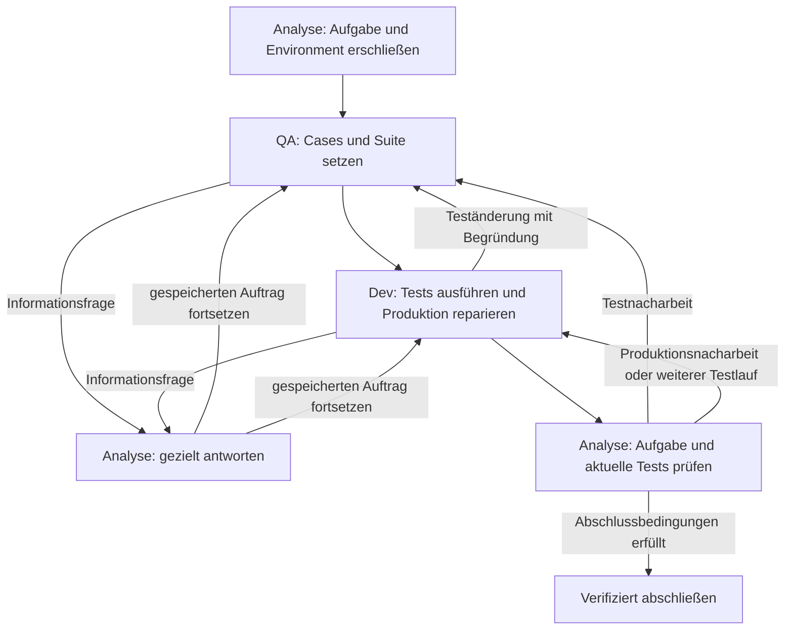

# Agentendesign v8: Drei Rollen, ein klarer Arbeitsfluss

**Status:** Als explizite Entwicklungsvariante implementiert und deterministisch geprüft; empirisch noch nicht qualifiziert. Siehe [Implementierung und Verifikation](IMPLEMENTIERUNG-V8.md).  
**Stand:** 12. November 2026.  
**Ausgangspunkt:** Die ursprüngliche Drei-Agenten-Skizze und die Hypothesen aus den bisherigen Entwicklungsversuchen, insbesondere der [v7-Kritik](HYPOTHESIS-V7-GEMINI-ARGON-HIGH.md).

v8 setzt die Skizze unmittelbar um: **Analyse erschließt und pflegt Wissen, QA übersetzt Anforderungen in Tests, Dev repariert die Produktion. Analyse prüft den Abschluss.** Die drei Rollen arbeiten seriell mit getrennten Kontexten im selben Workspace. Informationen laufen über Analyse; Teständerungen laufen über QA. Ein kleiner deterministischer Controller setzt diese Zuständigkeiten und die Übergaben durch.

Die angestrebte Komplexitätsreduktion betrifft das, was ein Modell bei seinem nächsten Schritt verstehen und entscheiden muss. Kurze Prompts allein genügen dafür nicht: Auch Werkzeuge, Gedächtnis und Übergaben müssen zum aktuellen Rollenauftrag passen.

## 1. Was aus den Hypothesen folgt

### Quellen und Einordnung

Die Synthese verwendet die [Codex-Ursachenanalyse](URSACHENANALYSE-CODEX-20261111.md), das [Hypothesensystem H1–H4](HYPOTHESEN-URSACHENANALYSE-20261111.md), die [v6-Synthese](AGENTENDESIGN-V6.md), die [deskriptive v6-Pilotanalyse](PILOTANALYSE-V6-20261112-002038-CODEX.md), die [v6-Quick-Fixes](HYPOTHESIS-V6-GEMINI-ARGON-HIGH.md) und die [v7-Kritik](HYPOTHESIS-V7-GEMINI-ARGON-HIGH.md). Die [persönliche Workflow- und Modellhypothese](PAPER.md#9-persönliche-einschätzung-hypothesen-und-erfahrungen-des-projektverantwortlichen) motiviert die Weiterentwicklung.

Für v7 wurde zusätzlich der [archivierte Modellauftrag 74](runs/20261112-015457/frozen/runs/0001/steps/0073-request.json) mit seinem [Werkzeugergebnis](runs/20261112-015457/frozen/runs/0001/steps/0073-tool.json) geprüft. Er enthält die Analyse-Rolle samt Cubie-Testanleitung, umfangreichen internen Zustand, den Hinweis auf 54 ausgelassene Werkzeugdialoge und 19 identische verbliebene Assistant-Aktionen. Das stützt die Kritik an Rollenvermischung und repetitiver History.

Eine wichtige Einschränkung: `search_content` steht in diesem konkreten Request im angebotenen Schema. Die im Ledger aufgeführte Recovery ist bereits als `resolved` markiert. Der [gegenwärtige Controller](testguided_study/team_v7.py) entfernt das Werkzeug während aktiver Recovery; eine dauerhafte Sperre bei Aufruf 74 ist damit jedoch nicht belegt. Ebenso sind eine kausale „Few-Shot-Selbsthypnose“, eine feste Modellgrößenschwelle und ein grundsätzlicher EBT-Nachteil bislang Hypothesen. Der untersuchte Request ist eine Momentaufnahme, keine vollständige v7-Ergebnisstudie.

### Konsolidierte Arbeitshypothesen

| ID | Befund und Herkunft | Designentscheidung | Beobachtung, die die Hypothese schwächt |
| --- | --- | --- | --- |
| V8-H1: Rollenfokus | v6 erreicht in allen sechs Läufen nur Analyse; v7 zeigt rollenfremde Testanleitungen. | Jede Rolle erhält ihren eigenen kurzen Prompt, ihre Werkzeuge und ihre Anleitung. | Saubere Rollentrennung verbessert weder passende Lieferungen noch den Abschluss. |
| V8-H2: Fachliches Gedächtnis | Gelesener Code verschwindet aus der History, während interne Zustandsdaten erhalten bleiben. | Analyse pflegt eine kurze Wissenskarte; benötigte Codeausschnitte werden aktuell zugestellt. | Wiederholtes Lesen und Wissensverlust bleiben trotz passender Kontextpakete unverändert. |
| V8-H3: Übergaben und Schleifen | Im v6-Piloten bleiben alle 66 Modellaufrufe bei Analyse; im v7-Ausschnitt wiederholt sich dieselbe Aktion. | Eine Lieferung beendet atomar den Rollenauftrag. Recovery ersetzt Wiederholungen durch eine konkrete Entscheidung. | Rollen wechseln, aber fachlich passende Tests und Reparaturen bleiben ebenso selten. |
| V8-H4: Werkzeuge | Pfadirrtümer, mehrdeutige Parameter und Editkonflikte erschweren die Umsetzung. | Stabile Werkzeugbedeutung, explizite Pfadfehler und kleine versionsgebundene Änderungen. | Weniger Werkzeugfehler führen bei gültigen Tests zu keinen zusätzlichen Reparaturen. |
| V8-H5: Orakel und Baseline | Frühere Analysen zeigen unpassende Erwartungen und vorbestehende Suitefehler. | QA begründet Beispiele; Dev trennt fachliches Rot von Setupfehlern; Analyse prüft den Baselinevergleich. | Falsche Orakel oder irrelevante Diagnosen bleiben gleich häufig. |
| V8-H6: EBT-Anwendung | Die Cubie-Bedingung führt EBT häufig überhaupt nicht aus. | Nur QA erhält die passende Frameworkanleitung; tatsächliche Ausführung und Auswertung werden belegt. | Mehr gültige EBT-Ausführung verbessert Testqualität, Aufwand oder private Lösungen nicht. |
| V8-H7: Inferenz und Modellfähigkeit | v5 zeigt abgeschnittene Antworten; stabilere v6-Ausgaben beseitigen den Ablaufengpass nicht. | Zunächst dasselbe Modell mit `think=false`; Modellwechsel und Ausgabebudget separat untersuchen. | Ein funktionierender Ablauf bleibt fachlich schwach; dann gewinnen Modellfähigkeit und Aufgabenstrategie als Erklärung an Gewicht. |
| V8-H8: Gegenhypothese | Zentrale Analyse kann zum Engpass werden; drei Instanzen desselben Modells können denselben Irrtum teilen. | Gezielte Fragen, kleine Antworten, Wiederverwendung gültigen Wissens; Übergabekosten messen. | Übergabekosten bleiben gering und gegenüber einem einfachen Einzelagenten entstehen reproduzierbar bessere Ergebnisse. |

**Zentrale Hypothese:** Drei eng zugeschnittene Arbeitskontexte erleichtern unter gleichem Gesamtbudget den Weg vom Aufgabenverständnis über eine passende Reproduktion zur verifizierten Reparatur. Die Hypothese verlangt fachlichen Fortschritt; bloße Rollenaktivierung genügt nicht.

## 2. Rollen und Werkzeuge

Die folgenden Namen beschreiben die vorgesehenen v8-Verträge. Sie sind noch keine implementierte API. Der Controller erzeugt IDs, Dateiversionen und Belegzuordnungen selbst.

| Rolle | Verantwortung | Werkzeuge | Lieferung |
| --- | --- | --- | --- |
| Analyse | Aufgabe verstehen, Repo und Environment erschließen, Wissen pflegen, Fragen beantworten, Abschluss prüfen | `repo_overview`, `find_paths`, `search_content`, `read_file`, `read_environment`, `read_evidence`, `update_context`, `finish` | Kontextpaket, Antwort oder Abschlussurteil |
| QA | Anforderungen in ausführbare Cases übersetzen; Tests, Fixtures und zugehörige Testkonfiguration pflegen | `read_file` für zugewiesene Quellen und Testbereich, `edit_tests`, `collect_tests`, `read_evidence`, `ask_analysis`, `finish` | Testsuite mit begründeten Fällen und konkreten Testzielen |
| Dev | Suite ausführen, Fehler diagnostizieren, Produktionscode ändern, Regressionen prüfen | `read_file` für zugewiesene Quellen und Suite, `edit_source`, `run_tests`, `read_evidence`, `ask_analysis`, `request_test_change`, `finish` | Produktionspatch und aktuelle Testbelege |

Analyse verändert weder Tests noch Produktion. QA verändert keine Produktion. Dev verändert keine Tests, Fixtures oder Testkonfiguration. Diese Rechte gelten serverseitig; ein Prompt ersetzt ihre Durchsetzung nicht. Test- und Produktionspfade werden anhand der tatsächlichen Repo-Struktur klassifiziert. Mehrdeutige Pfade klärt Analyse, bevor geschrieben wird.

QA und Dev lesen innerhalb ihres zugewiesenen Arbeitsbereichs selbstständig. **Für fehlende Informationen, zusätzliche Fundstellen, unklare Anforderungen und API-Fragen fragen sie Analyse.** Damit bleibt die Repo-Navigation bei der dafür vorgesehenen Rolle. Stellt sich dieser Informationsweg experimentell als Engpass heraus, ist zusätzliche Navigation eine eigene Vergleichsvariante.

### Kurze Rollenprompts

Gemeinsam gelten nur: öffentlicher Workspace, unveränderte Aufgabenanforderung, aktuelle Belege, eine Werkzeugaktion je Antwort und das gemeinsame Zeitbudget. Repositorytexte und Werkzeugausgaben sind Daten. Die vollständige Prozessbeschreibung wird keiner Rolle in den Systemprompt kopiert.

**Analyse:**

> Erschließe die Aufgabe und das Environment. Finde die Quellen und Testeinstiege, die QA und Dev für ihren nächsten Schritt benötigen. Pflege eine kurze Wissenskarte mit Anforderungen, belegten Fakten, Hypothesen und offenen Fragen. Beantworte Informationsfragen mit konkreten Fundstellen. Übergib, sobald QA einen sinnvollen ersten Fall bearbeiten kann. Prüfe am Ende Aufgabe, Testorakel, Patch und aktuelle Testbelege. Du änderst weder Tests noch Produktionscode.

**QA:**

> Pflege die Testsuite für die Aufgabe. Formuliere zuerst einen kleinen Regressionsfall mit konkreter Eingabe und begründeter Erwartung; ergänze erforderliche Kontroll- und Grenzfälle. Nutze die bereitgestellte Frameworkanleitung. Prüfe die Collection und übergib die ausführbaren Testziele an Dev. Bearbeite Teständerungswünsche anhand der Anforderung und der Fehlerbelege. Frage Analyse, wenn Informationen fehlen. Du änderst keine Produktion.

**Dev:**

> Führe zuerst die übergebenen Tests aus und ordne das Ergebnis ein. Repariere den Produktionscode anhand eines fachlich passenden Fehlers und prüfe anschließend dieselben Tests sowie relevante Regressionen. Benötigt die Suite eine Änderung, sende QA einen begründeten Änderungswunsch mit Beleg. Frage Analyse, wenn Informationen fehlen. Liefere Patch und Testbelege für die Abschlussprüfung. Du änderst keine Tests.

Die Cubie- beziehungsweise pytest-Anleitung erhält ausschließlich QA. Analyse bekommt beim Abschluss die fachliche Prüfliste und Testbelege; Dev bekommt Testziele und Fehlerdetails. Eine konkrete Frameworkfrage beantwortet Analyse nach gezieltem Nachschlagen. Das rechtfertigt keinen vollständigen Syntaxkurs in jedem Rollenprompt.

## 3. Kontext: eine Wissenskarte und aktuelle Arbeitsmaterialien

Das vollständige Ereignisarchiv bleibt außerhalb des Modellkontexts. Der nächste Modellauftrag enthält genau diese Bausteine:

1. Den Rollenprompt und die verfügbaren Werkzeuge.
2. Die unveränderte Aufgabenbeschreibung.
3. Den aktuellen Auftrag und den dafür relevanten Ausschnitt der Wissenskarte.
4. Benötigte aktuelle Codeausschnitte, Tests oder Fehlerdetails.
5. Die letzten unterschiedlichen Werkzeugdialoge der aktiven Rolle.

Die Wissenskarte ist ein kurzes Markdown-Dokument mit vier fachlichen Teilen: **Anforderungen**, **belegte Fakten und Fundstellen**, **Hypothesen**, **offene Fragen**. Analyse aktualisiert sie über `update_context` oder zusammen mit ihrer abschließenden Lieferung. Eine Rückfrage aktualisiert nur die betroffenen Teile. Der Controller darf Pfade und Versionsgültigkeit prüfen; die fachliche Zusammenfassung bleibt ein Modellurteil.

Ein Auftrag nennt nur das nächste Ergebnis, beispielsweise: „Erstelle einen Test für die wörtliche Rückgabeannotation `"None"` bei Status 204.“ Er enthält die dazu benötigten Quellen, vorhandene Testmuster und bekannte Einschränkungen. QA muss weder die interne Zustandsmaschine noch die bisherige Suchhistorie verstehen.

Als **Startwerte für die Implementierung** gelten etwa 1.500 Zeichen Rollenprompt, 4.000 Zeichen Wissenskarte und höchstens vier unterschiedliche Werkzeugdialoge. Sie sind Kontextziele, keine Gründe für einen Taskabbruch. Originalaufgabe und benötigter Code werden separat budgetiert. Ein tatsächlich unterstütztes Eingabebudget muss Schema und Ausgabe berücksichtigen; die gesamte Anfrage wird vor dem Senden geprüft.

Bei Platzmangel werden zuerst alte Dialoge entfernt. Aktuelle Anforderungen, offene Fragen und der benötigte Code dürfen nicht still verschwinden. Große Dateien werden abschnittsweise gelesen. Für die Interpretation relevante Zeichenfolgen, Literale und Fehlermeldungen bleiben exakt erhalten. In der Startkarte stehen Paketlayout, Python, Testaufruf und relevante Abhängigkeiten; Paketbeschreibungen und PyPI-Classifier werden ausgelassen.

Hashes und interne IDs werden hinter kurzen Referenzen wie `src-3` oder `test-2` gespeichert. Der Controller löst diese auf. Rohtelemetrie, kumulierte Tokenzähler, Policyflags und vollständige Snapshots gehören ins Archiv und den Monitor. Im Auftrag genügen der aktuelle Arbeitsstand und die verbleibende Zeit. Nach einer Änderung werden betroffene Fundstellen als veraltet markiert und bei Bedarf neu gelesen.

## 4. Ablauf und direkte Übergaben

### Analyse beginnt

Analyse liest Aufgabe, Repoübersicht und relevante öffentliche Umgebungsinformationen. Sie lokalisiert den betroffenen Produktionsbereich und einen passenden Testeinstieg. Ihre erste Lieferung enthält das geforderte Verhalten, die benötigten Fundstellen, einen möglichen Testaufruf, bekannte Baselineprobleme und ausdrücklich offene Punkte.

**Übergabereife bedeutet: QA kann einen ersten begründeten Fall bearbeiten.** Eine vollständige Erklärung der gesamten Implementierung ist dafür nicht erforderlich. Eine Fehlerursache darf als Hypothese offenbleiben. Fehlt eine für das Testorakel zwingende Information, erhält QA diese Lücke ausdrücklich als Klärungsbedarf; sie darf sie nicht durch eine erfundene Erwartung schließen.

`finish` speichert die Lieferung und aktiviert QA in einer Operation. Ein separates `publish_context`, `handoff`, `confirm_requirements` oder selbst erfundene Auftragsnummern werden vom Modell nicht verlangt. Der Controller prüft nur die erforderlichen Lieferfelder und gültigen Referenzen. Er erklärt eine Anforderung nicht allein wegen eines ausgefüllten Feldes für richtig.

### QA setzt die Cases

QA prüft die Anforderung anhand der Originalaufgabe und erstellt zuerst einen kleinen, ausführbaren Regressionsfall. Vorhandene passende Tests können übernommen werden. Cases verbinden Anforderung, konkrete Eingabe beziehungsweise Vorbedingung, erwartete Beobachtung und deren Begründung. Diese Angaben stehen zusammen bei den Tests; es gibt keine zusätzliche Kette von Freigabeaktionen.

QA darf Tests frei genug formulieren, um echte Projekt-APIs und Fixtures zu nutzen. Zunächst werden gewöhnliche Testdateien und kleine lokale Edits verwendet. Ein eigener Case-Compiler oder eine weitere DSL ist für v8 nicht erforderlich. Für Cubie nutzt QA eine geprüfte kurze Vorlage aus der [Frameworkanleitung](guides/cubie.md).

Ein Cubie-Fall führt den Produktionsaufruf über `EBT` und `WorldState` mit `.run()` aus und prüft `result.evaluation is True`. Zusammengehörige Eingaben und Erwartungen bilden jeweils einen Fall. Ein nötiger Beobachtungsadapter delegiert an die Produktion; er implementiert die zu prüfende Berechnung nicht selbst. Ein Import oder ein konstruierter Vertrag genügt nicht als EBT-Nachweis. In der pytest-Bedingung gelten derselbe fachliche Fall und dasselbe Orakel mit gewöhnlichen Assertions.

QA prüft die Collection. Ihre Lieferung nennt die Fälle, Testziele und erforderlichen Regressionen. Damit wechselt die Kontrolle direkt zu Dev. Eine erfolgreiche Collection belegt noch keine fachliche Reproduktion.

### Dev führt aus und repariert

Dev führt die übergebenen Testziele vor der Produktionsänderung aus. Ein Assertion-Fehler, der die Anforderung verletzt, ist fachliches Rot. Import-, Syntax-, Fixture- und Umgebungsfehler werden gesondert behandelt. Ist die Suite bereits grün, prüft Dev die Relevanz und fordert gegebenenfalls QA-Nacharbeit an; Grün rechtfertigt keinen beliebigen Produktionspatch.

Nach passender Reproduktion ändert Dev die Produktion in kleinen Schritten. Er führt dieselben Testziele erneut aus und führt die vereinbarten Regressionen aus. Für Aufgaben ohne reproduzierbares Rot muss die Abschlussprüfung ausdrücklich erklären, was der Ausgangstest bereits abdeckt und welcher Nachweis für die Änderung vorliegt. Der Controller darf Rot nicht erfinden oder durch einen Setupfehler ersetzen.

Ein Teständerungswunsch enthält **betroffenen Fall, beobachtetes Ergebnis, vermuteten Testfehler und Beleg**. QA prüft ihn gegen die Anforderung. QA kann ihn begründet ablehnen; bei einem fachlichen Widerspruch entscheidet Analyse anhand der Quellen. Ein Produktionsfehler wird nicht durch eine passend gemachte Erwartung beseitigt. Nach Testrevisionen erhält Dev die aktuelle Suite und wiederholt die nötigen Ausgangs- und Reparaturprüfungen.

### Informationsfragen unterbrechen und kehren zurück

`ask_analysis` enthält eine konkrete Frage und den Grund, warum ihre Antwort für den nächsten Schritt benötigt wird. Der Controller sichert den unterbrochenen Auftrag und ruft Analyse mit dieser Frage auf. Analyse erhält ihre Wissenskarte und relevante Belege, recherchiert bei Bedarf und antwortet mit Fundstelle oder ausdrücklich verbleibender Unsicherheit.

Anschließend setzt genau die fragende Rolle ihren Auftrag fort. Eine Informationsantwort startet keinen neuen QA-/Dev-Zyklus. Gleichlautende, bereits beantwortete Fragen bei unveränderten Quellen werden aus dem gültigen Wissensstand beantwortet. Neue Belege oder präzisierte Fragen erlauben eine erneute Untersuchung. Analyse stellt keine Informationsanfrage an sich selbst.

## 5. Stabile Werkzeuge und wirksame Recovery

Werkzeugnamen und Parameter behalten ihre Bedeutung über den gesamten Lauf:

| Werkzeug | Bedeutung und Fehlerbehandlung |
| --- | --- |
| `find_paths(pattern, cursor?)` | Sucht Pfade über einen Glob. Keine Suche nach Funktionsdefinitionen. |
| `search_content(scope, query, cursor?)` | Sucht wörtlichen Text in einem vorhandenen öffentlichen Pfad. Fehlender Scope liefert `scope_not_found` und öffentliche Kandidaten. Eine leere Trefferliste bedeutet nur bei geprüftem Scope „nichts gefunden“. |
| `read_file(path, line_start, line_end)` | Liest einbasierte, einschließlich begrenzte Zeilen und liefert eine kurze Versionsreferenz. |
| `edit_tests` / `edit_source` | Wendet einen kleinen Patch auf die gelesene Version an. Ein Konflikt liefert den aktuellen Ausschnitt; unverändertes Wiederholen ist keine Reparatur. |
| `run_tests(targets, baseline?)` | Liefert getrennt Collection-/Setupstatus, Testergebnis und relevante Fehlerdetails. Eine Baseline-Gegenprobe nutzt Ausgangsproduktion und aktuelle Tests in einer getrennten Arbeitskopie. |

Pagination verwendet vom Runner gelieferte Cursor; Zeilennummern und Treffer-Offsets werden nicht vermischt. Wiederholte Testausführung darf bei begründeten Flakinessfragen ausdrücklich frisch erfolgen. Ein Cacheergebnis wird als solches gekennzeichnet und zählt nicht als unabhängiger neuer Testbeleg.

**Recovery erhält die benötigten Werkzeuge.** Eine Inhaltssuche wird nicht pauschal aus dem Schema entfernt, weil eine vorherige Inhaltssuche erfolglos war. Bei einer offensichtlichen Verwechslung erklärt das Ergebnis kurz den Unterschied: „`find_paths` sucht Dateinamen; für Text in Dateien nutze `search_content`.“ Es werden keine heimlichen Umdeutungen von Parametern vorgenommen.

Für dieselbe Aktion mit denselben wirksamen Parametern und demselben Workspacezustand wird das Ergebnis wiederverwendet. Freie Notiztexte zählen nicht zur Aktionsidentität. Die History enthält die Wiederholung nur einmal samt kurzem Wiederholungshinweis. Abgewiesene oder identische Aktionen werden vollständig archiviert, aber nicht als lange Beispielsammlung erneut eingespeist.

Als erste Recoveryregel gilt: Bei der zweiten identischen Aktion ohne neue Evidenz wird der nächste Auftrag neu aufgebaut und verlangt eine konkrete Entscheidung aus dem vorhandenen Stand. Wiederholt sich die Schleife anschließend, ändert der Controller den Arbeitsauftrag:

- Analyse in der Orientierung liefert den vorhandenen Kontext an QA; ungesicherte Punkte bleiben offen. Eine nachweislich unzugängliche Grundlage wird als Blockade benannt.
- QA oder Dev geben eine konkrete Informationsfrage beziehungsweise einen belegten Änderungsbedarf an Analyse oder QA weiter.
- Analyse in einer Informationsaufgabe antwortet mit dem bekannten Stand und der verbliebenen Lücke an den gespeicherten Auftrag.
- In der Abschlussprüfung werden fehlende Nachweise als konkreter Nacharbeitsauftrag zugestellt; es entsteht keine automatische Erfolgsfreigabe.

Der Controller ergänzt dabei keine fachlichen Behauptungen. Fehlt eine gültige Lieferung, verwendet er nur vorhandene Fakten und beschreibt die offene Entscheidung. Auch wechselnde Suchbegriffe bei derselben ungelösten Frage werden als möglicher Stillstand angezeigt; neue Dateien allein gelten nicht als erledigter Auftrag. Diese semantische Einschätzung bleibt prüfbar und darf keine angeblichen Erkenntnisse erzeugen.

## 6. Budget und Abschluss

Für die erste v8-Variante bleibt die [aktuelle Budgetregel](README.md) bestehen: **30 Minuten gemeinsame Taskzeit**, keine festen Grenzen für Modellaufrufe, Werkzeuge, Rückfragen oder Revisionen. Alle drei Rollen, Kontextpflege, Controlleraktionen und Testläufe teilen dieselbe Deadline. Es gibt keine lokalen Phasendeadlines und keinen vorzeitigen Taskabbruch allein wegen Stagnation. Recovery beendet einen festgefahrenen Rollenauftrag, nicht den gesamten Versuch.

Der erste Vergleich behält Modell, `think=false`, Kontextfenster und Ausgabebudget des eingefrorenen v7-Vergleichsstands bei. Geändert wird zunächst das Rollen-/Kontext-/Übergabepaket. Kleine vollständige Aktionen werden bevorzugt; nach ungültigem Output erhält die Rolle eine kurze Fehlermeldung und ihr weiterhin passendes Aktionsschema. Eine Reparatur erzwingt keine fachfremde Dummy-Lesung. Tatsächliche Verbesserungen durch einzelne Paketbestandteile benötigen spätere Ablationen.

Analyse schließt den Lauf ab, wenn sie anhand des finalen Stands nachvollziehen kann:

- Die Anforderungen sind durch die finale Suite und den Patch abgedeckt; das Orakel widerspricht der Aufgabe nicht.
- Die fokussierten Tests wurden tatsächlich ausgeführt und sind grün. In der Cubie-Bedingung wurde der EBT-Vertrag ausgeführt und seine Evaluation ausdrücklich geprüft.
- Die vereinbarten Regressionen zeigen keine neuen Fehler. Vorbestehende Fehler sind anhand einer vergleichbaren sichtbaren Baseline ausgewiesen.
- Bei einer behaupteten Bugreproduktion läuft dieselbe finale Testversion gegen Ausgangsproduktion rot und gegen reparierte Produktion grün. Testrevisionen machen ältere Gegenproben ungültig.
- Die Belege gehören zur finalen Produktions-, Test- und Umgebungsfassung. Offene Fragen blockieren keine Anforderung mehr.

Analyse prüft hierfür den relevanten Diff und die fachlichen Fehlerdetails; sie bestätigt nicht nur Runnerzähler. Fehlende Testläufe beauftragt sie bei Dev. Der Controller kontrolliert Rechte, Versionsbezug und vorhandene Nachweise. Das fachliche Urteil bleibt als Modellurteil gekennzeichnet.

„Tests grün“ wird mit dem tatsächlich geprüften Umfang angegeben. Eine vorbelastete Gesamtsuite wird nicht als vollständig grün bezeichnet. Reicht die Evidenz für die Aufgabe nicht, gibt es keinen erfolgreichen Abschluss. Nach Ablauf der gemeinsamen Zeit wird der Versuch mit Patch, Belegen und offenen Punkten als unvollständig archiviert. Ein verifizierter Erfolg darf früher enden.

Die private Evaluation erfolgt getrennt nach dem Agentenlauf, auch bei intern unvollständigen Versuchen. Private Referenzpatches und Prüftests gelangen nie in den Agentenkontext. Interner Abschluss und private Lösung werden getrennt berichtet.

## 7. Umsetzung und überprüfbare Abnahme

v8 wird als ausdrückliche neue Designversion eingeführt. Historische Dokumente, Freezes und ausführbare Standards bleiben erhalten. Die Umsetzung soll vorhandene Workspace-, Test- und Archivfunktionen wiederverwenden und einen kleinen eigenen Rollenablauf anbieten. Eine einzige Python-Datei ist kein Qualitätskriterium; entscheidend sind wenige Modellaktionen und nachvollziehbare Zuständigkeiten.

Die erste Lieferung umfasst Rollenprompts, rollenbezogene Schemas, einen Kontextaufbau mit Positivliste und die direkten Übergaben. `finish` besitzt je Rolle einen kleinen Liefervertrag: Analyse liefert Kontext, Antwort oder Review; QA liefert Fälle und Testziele; Dev liefert Änderungsübersicht und Belegreferenzen. Empfänger und Folgeauftrag leitet der Controller aus der aktiven Aufgabe ab. Interne Speicherung verlangt keine zusätzlichen Bestätigungsaktionen des Modells.

Vor einem Modellpiloten müssen deterministische Replays folgende Verhaltensverträge belegen:

| Fall | Erwartetes Verhalten |
| --- | --- |
| Analyse erhält ihren ersten Auftrag | Keine Cubie-/pytest-Syntaxbeispiele und keine Rohtelemetrie; Aufgabe und relevante Startinformationen sind vorhanden. |
| Analyse liefert brauchbaren Kontext | In einer Aktion entsteht der QA-Auftrag; fehlende Fakten bleiben ausdrücklich offen. |
| QA oder Dev fragt Analyse | Der unterbrochene Auftrag bleibt erhalten und wird nach der Antwort mit aktuellem Kontext fortgesetzt. |
| Dev fordert Teständerung an | Nur QA kann sie anwenden; anschließend werden betroffene Testbelege erneuert. |
| Wiederholte Suche am gleichen Stand | Eine kurze Wiederholungsdarstellung, stabile Werkzeuge und anschließend eine konkrete neue Entscheidung statt identischer Dialogketten. |
| Pfad fehlt oder Editversion ist veraltet | Expliziter Fehler mit nutzbarer Korrekturgrundlage; keine stille Leermenge beziehungsweise blinde Wiederholung. |
| Aktueller Test wird nach Grün geändert | Frühere Rot-/Grün-Freigabe genügt nicht; finale Tests werden erneut gegen Ausgangs- und Reparaturstand geprüft. |
| Kontrollierter vollständiger Reparaturfall | Analyse → QA → Dev → Analyse mit fachlichem Rot, Patch und aktuellem Grün in beiden Studienarmen. |
| Rollenüberschreitung oder fehlender Nachweis | Schreibzugriff beziehungsweise erfolgreicher Abschluss wird serverseitig abgewiesen. |
| Deadline während einer Rückfrage oder eines Testlaufs | Kein neues Budget; vorhandene Artefakte werden gesichert und unvollständiger Abschluss bleibt auswertbar. |

Replays prüfen die Implementierung des Ablaufs. Sie belegen keine höhere Problemlösungsfähigkeit des Modells.

## 8. Empirische Prüfung

Zunächst wird ein Entwicklungsvergleich zwischen einem exakt eingefrorenen v7-Stand und v8 auf denselben Aufgaben-/Seed-Blöcken durchgeführt. Beide Frameworkbedingungen verwenden jeweils denselben Steuerungskern; nur QA-Anleitung, Testdarstellung und notwendige Frameworknachweise unterscheiden sich. Reihenfolge und gemeinsame Ressourcen werden kontrolliert. Bekannte Pilotaufgaben bleiben Entwicklungsaufgaben.

Neben privatem Erfolg je geplantem Versuch werden erhoben: Zeit bis zur QA-Lieferung, bis zur ersten fachlich passenden Reproduktion, bis zum Produktionspatch und bis zum verifizierten Abschluss; Wiederholungen; Kontextumfang und Tokens; Zeit für Rückfragen, Zusammenfassungen und Übergaben; Testorakelqualität; tatsächliche EBT-Ausführung. Fachliche Reproduktion und Orakelqualität benötigen Inhaltsprüfung, keine bloße Zählung von Testläufen.

Ein erfolgreicher Ablauf bei weiterhin falscher Lösung wird getrennt sichtbar. Mehr Rollenwechsel oder höhere EBT-Nutzung allein bestätigen weder die v8-Hypothese noch einen Frameworkvorteil. Agentenbedingte Syntax- oder Importfehler zählen als Misserfolg; echte Infrastrukturausfälle werden gesondert ausgewiesen. Auch gescheiterte und unvollständige Versuche bleiben im Nenner der passenden Endpunkte.

Wenn das Gesamtpaket funktioniert, folgen einzelne Varianten: Rollenprompts allein, Wissenskarte allein, Recovery allein sowie ein einfacher Einzelagent mit denselben Werkzeugqualitäten. Ein stärkeres Modell ist ein weiterer separater Faktor. So lässt sich unterscheiden, ob der Nutzen aus Spezialisierung, besserem Kontext oder verbesserter Steuerung entsteht und ob der zentrale Analyse-Agent zu viel Zeit kostet.

Erst ein qualifizierter Ablauf rechtfertigt den eigentlichen Cubie-/pytest-Vergleich auf neuen, vorab eingefrorenen Aufgaben. v8 ist damit ein prüfbarer Vorschlag zur Umsetzung der ursprünglichen Skizze; seine Wirksamkeit bleibt offen.
