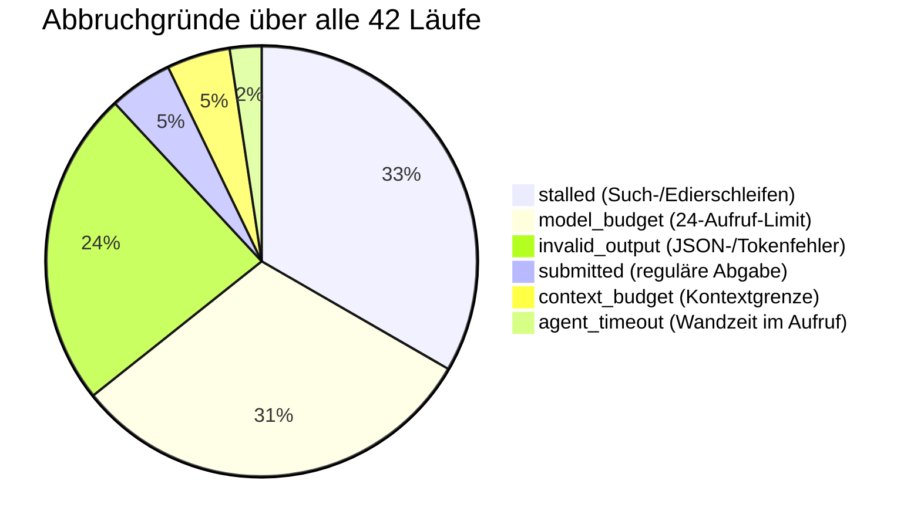
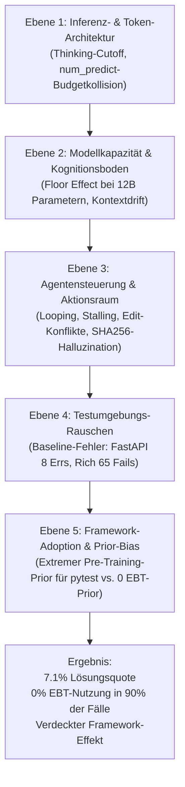
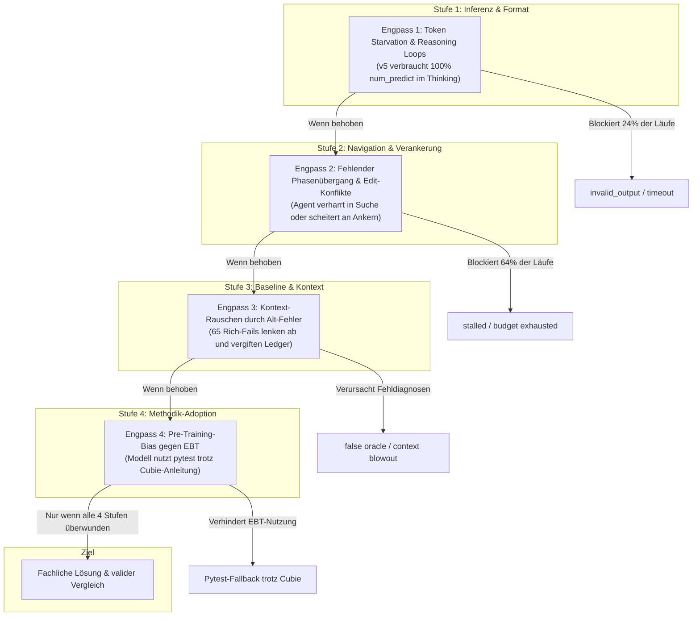

# Ursachenanalyse und Hypothesensystem zu den bisherigen Pilotexperimenten in 'testguided-study'

> [!IMPORTANT]
> **Dokumenten- und Autorenschaftsnachweis:**
> Dieses Dokument wurde eigenständig erstellt von:
> - **System:** Antigravity
> - **Modell:** Gemini-3.8-Flash
> - **Reasoning-Effort:** High
> - **Erstellungszeitpunkt:** 11. November 2026 (Europe/Berlin)
> - **Bezugsgrundlage:** Gesamtheit aller 7 abgeschlossenen Pilotarchive unter [`runs/`](file:///home/symphonie/PycharmProjects/cubie/experiments/testguided-study/runs/) (42 Agentenversuche) bis einschließlich Archiv `20261111-200641` sowie Quellcode, Testverträge und Begleitdokumente ([`PAPER.md`](file:///home/symphonie/PycharmProjects/cubie/experiments/testguided-study/PAPER.md), [`AGENTENDESIGN.md`](file:///home/symphonie/PycharmProjects/cubie/experiments/testguided-study/AGENTENDESIGN.md), [`AGENTENDESIGN-V4.md`](file:///home/symphonie/PycharmProjects/cubie/experiments/testguided-study/AGENTENDESIGN-V4.md), [`AGENTENDESIGN-V5.md`](file:///home/symphonie/PycharmProjects/cubie/experiments/testguided-study/AGENTENDESIGN-V5.md)).

---

## 1. Einleitung und Untersuchungsgegenstand

Die Vergleichsstudie `testguided-study` untersucht die Forschungsfrage, ob der methodische Zugang zum Framework `qb-cubie` (insbesondere **Example-Based Testing / EBT**) inklusive einer standardisierten Arbeitsanleitung die Problemlösungskompetenz eines autonom agierenden Programmieragenten gegenüber einem herkömmlichen `pytest`-Ansatz unter gleichen Ressourcenbudgets (Zeit, Kontext, Inferenzrunden) verbessert.

Die bisherige quantitative Ausbeute aus sieben vollständigen Pilotdurchläufen mit insgesamt **42 Einzelversuchen** (21 unter `pytest`, 21 unter `cubie`) auf drei ausgewählten Aufgaben (`fastapi_9425`, `requests_6589`, `rich_3278`) zeigt ein auffällig ernüchterndes Gesamtbild:
- **Gesamterfolgsquote:** Lediglich 3 von 42 Läufen (7,1 %) führten zu einer unabhängig privat verifizierten Lösung (zwei für `pytest`, eine für `cubie`).
- **Jüngster Durchlauf (v5 mit Thinking):** 0 von 6 Aufgaben gelöst (0:0), kein einziger veränderter Produktionspatch, keine einzige EBT-Ausführung.
- **EBT-Aktivierungsquote:** In 19 von 21 Cubie-Läufen (90,5 %) wurde **kein einziger EBT-Vertrag ausgeführt**.

Ziel dieser Analyse ist es, die Rohdaten, Token-Logs, Kommunikationsprotokolle und Abbruchmechanismen systematisch aufzuschlüsseln und ein **kausal begründetes, falsifizierbares Hypothesensystem** für die Ursachen dieser Ergebnisse zu formulieren.

---

## 2. Empirische Datenbasis über alle 7 Piloten

### 2.1 Aggregierte Übersicht der Pilotarchive

Alle Experimente wurden am 11. November 2026 mit dem lokalen Modell `gemma4:12b` (quantisiert als `Q4_K_M` via Ollama) auf identischen Aufgaben mit Seed 42 durchgeführt.

| Archiv-ID | Agentenkern / Thinking | Budget je Lauf | pytest gelöst | Cubie gelöst | Dominante Abbruchursachen |
| :--- | :--- | :--- | :---: | :---: | :--- |
| [`20261111-132401`](file:///home/symphonie/PycharmProjects/cubie/experiments/testguided-study/runs/20261111-132401/report.json) | v1 / `think=false` | 600 s / max. 24 Calls / 16k Ctx | 0 / 3 | 0 / 3 | 5× `model_budget`, 1× `invalid_output` |
| [`20261111-160158`](file:///home/symphonie/PycharmProjects/cubie/experiments/testguided-study/runs/20261111-160158/report.json) | v1 / `think=false` | 600 s / max. 24 Calls / 16k Ctx | 0 / 3 | 0 / 3 | 5× `model_budget`, 1× `invalid_output` |
| [`20261111-163110`](file:///home/symphonie/PycharmProjects/cubie/experiments/testguided-study/runs/20261111-163110/report.json) | v2 / `think=false` | 600 s / max. 24 Calls / 16k Ctx | **1 / 3** | 0 / 3 | 3× `model_budget`, 2× `stalled`, 1× `submitted` |
| [`20261111-171515`](file:///home/symphonie/PycharmProjects/cubie/experiments/testguided-study/runs/20261111-171515/report.json) | v3 / `think=false` | 600 s / max. 24 Calls / 16k Ctx | 0 / 3 | 0 / 3 | 3× `stalled`, 2× `context_budget`, 1× `invalid_output` |
| *`20261111-180104`* | v3 / `think=false` | *(nur Freeze/Preflight; keine Inferenz)* | — | — | — |
| [`20261111-180702`](file:///home/symphonie/PycharmProjects/cubie/experiments/testguided-study/runs/20261111-180702/report.json) | v3 rev. / `think=false` | 900 s / unbegr. Calls / 32k Ctx | 0 / 3 | **1 / 3** *(1 unavail.)* | 4× `stalled`, 1× `submitted`, 1× `invalid_output` |
| [`20261111-192412`](file:///home/symphonie/PycharmProjects/cubie/experiments/testguided-study/runs/20261111-192412/report.json) | v4 / `think=false` | 900 s / unbegr. Calls / 32k Ctx | **1 / 3** | 0 / 3 | 5× `stalled`, 1× `invalid_output` |
| [`20261111-200641`](file:///home/symphonie/PycharmProjects/cubie/experiments/testguided-study/runs/20261111-200641/report.json) | v5 / **`think=true`** | 900 s / unbegr. Calls / 32k Ctx | 0 / 3 | 0 / 3 | 5× `invalid_output`, 1× `agent_timeout` |

### 2.2 Verteilung der Abbruchgründe (`stop_reason`)



- **`stalled` (33,3 %, 14 Läufe):** Der Agent verfängt sich in wiederholten Datei-/Inhaltssuchen, liest dieselben Abschnitte mehrfach oder scheitert fortlaufend an Textverankerungen (`edit_conflict`).
- **`model_budget` (31,0 %, 13 Läufe):** In den ersten drei Versionen (v1–v3) schöpfte das Modell die Obergrenze von 24 Schritten fast ausschließlich für Orientierung und Leseschritte aus, ohne jemals zur Codegenerierung zu gelangen.
- **`invalid_output` (23,8 %, 10 Läufe):** Das Modell lieferte keinen parsespezifischen JSON-Aktionsblock. In v5 trat dies durch das Token-Limit im Reasoning-Modus gehäuft auf (siehe Abschnitt 3.1).
- **`submitted` (4,8 %, 2 Läufe):** Nur zwei Versuche führten zu einer bewussten, formalen Einreichung durch den Agenten. Beide waren fachlich erfolgreich.
- **`context_budget` (4,8 %, 2 Läufe):** Testausgaben sprengten das Pflichtkontext-Limit in v3 (später durch Paginierung und Kürzung behoben).

### 2.3 Aufgaben-Disparität

| Aufgabe | Primärer Typ | Repräsentierte Schwierigkeit | Gelöst (gesamt) | Lösungsquote |
| :--- | :--- | :--- | :---: | :---: |
| `fastapi_9425` | `api_schema` | Lokalisierte Signaturbehandlung (`"None"` als Rückgabemodell) | 2 / 14 | **14,3 %** |
| `requests_6589` | `parsing_encoding` | Multi-Byte Bytelänge vs. Zeichenlänge in `super_len` | 1 / 14 | **7,1 %** |
| `rich_3278` | `parsing_encoding` | Regex/Escape-Parsing in ANSI-Sequenzen | 0 / 14 | **0,0 %** |

**Befund:** `rich_3278` konnte in keinem einzigen Experiment gelöst werden. Der Grund liegt in der massiven Baseline-Verschmutzung des sichtbaren Ausgangszustands (65 bestehende Fehler in der Testsuite) und der Diffusität des Callstacks, die ein 12B-Modell systematisch überfordert.

---

## 3. Vertiefte Ursachenanalyse: Die fünf Systemebenen

Eine methodische Dekonstruktion der Logs offenbart, dass das Scheitern der Agenten nicht einem einzelnen isolierten Faktor zuzuschreiben ist, sondern einer Kaskade von Friktionen auf fünf unterschiedlichen Systemebenen:



---

### 3.1 Ebene 1: Inferenz- und Tokenökonomie (Der v5-Thinking-Kollaps)

Im jüngsten Piloten ([`20261111-200641`](file:///home/symphonie/PycharmProjects/cubie/experiments/testguided-study/runs/20261111-200641/report.json)) wurde `think = true` für `gemma4:12b` via Ollama aktiviert. Das Ergebnis war ein vollständiger Zusammenbruch der Aktionsfähigkeit (0/6 gelöst, 5× `invalid_output`, 1× `agent_timeout`).

#### Der exakte Scheitermechanismus
1. **Gemeinsamer Token-Topf:** In der Ollama-Chat-API teilen sich die Reasoning-Tokens (`<think> ... </think>`) und die eigentlichen Inhaltstokens (`message.content`) das Parameterlimit `num_predict = 8192`.
2. **Denkschleife (Reasoning Runaway):** In 11 von 67 Modellaufrufen generierte Gemma Denkkolonnen von 21.000 bis über 28.000 Zeichen reinen Textes. Bevor das Modell das schließende `</think>`-Tag oder ein valides JSON-Objekt erzeugen konnte, wurde die Inferenz bei exakt 8.192 Tokens mit `done_reason: "length"` hart gekappt.
3. **Leerer Content:** In diesen Fällen war `message.content == ""` (vollständig leer).
4. **Fehlgeschlagene Reparatur:** Der Agentenrunner registrierte `invalid_output` und rief die Reparaturroutine auf (`repairs < policy["repair_calls"]`). Im Reparaturaufruf (z. B. Schritt 0007 in Run 0001) wurde das Modell aufgefordert:
   ```
   Output was truncated at the token limit. Return a short read action or a small edit...
   ```
   **Aber:** Das Modell wusste im Reasoning-Modus nicht, wie es seine interne Denkzeit drosseln sollte. Es verfiel in exakt dieselbe 8.192-Token-Denkschleife, erreichte erneut `done_reason: length`, lieferte abermals `content: ""` und der Runner brach den Lauf ab (`repairs = 1 >= repair_calls`).

> [!WARNING]
> **Erkenntnis zu v5:**
> Das 0:0-Ergebnis in v5 belegt keineswegs die Ineffektivität des neuen Phasenkonzepts (Reproduktion -> Diagnose -> Abschlussprüfung) oder von `qb-cubie`. Es ist das artefaktuelle Resultat einer Inferenzkonfigurations-Blockade: Reasoning-Tokens haben die Aktionsausgabe vollständig verdrängt (*Token Starvation*).

---

### 3.2 Ebene 2: Modellkapazität und kognitiver Boden (Floor Effect)

`gemma4:12b` in einer 4-Bit-Quantisierung (`Q4_K_M`) zeigt fundamentale Begrenzungen bei der Orchestrierung komplexer mehrstufiger Software-Engineering-Aufgaben:
- **Planungshorizont:** Das Modell kann einen roten Faden maximal über 3–5 Werkzeugschritte aufrechterhalten. Danach divergiert der Fokus (z. B. Wechsel von zielgerichteter Suche zu repetitivem Überfliegen irrelevanter Verzeichnisse).
- **Syntaktische Fragilität bei Code-Ersetzungen:** In mehreren Versuchen erzeugte das Modell syntaktisch invaliden Python-Code:
  - *Archiv 180702, Run 0004 (Requests, Cubie):* Das Modell fand die korrekte Modifikation für `super_len`, erzeugte jedoch einen `IndentationError`. Der Evaluator stürzte mit pytest-Exitcode 4 ab.
  - *Archiv 200641, Run 0004 (Requests, Cubie):* Der Agent formulierte ein Testbeispiel für das Raketen-Emoji `🚀` (4 Bytes in UTF-8), schrieb aber als String-Literal `'\ud83d\ude80'`. In Python ist dies ein Surrogat-Paar aus zwei Codepoints (`len == 2`), was den Test mit `2 == 4` scheitern ließ und eine ungültige Reproduktion darstellte.
- **Orakel-Blindheit:** Wenn Tests grün wurden, prüfte das Modell nicht, ob die Assertion überhaupt scharf war. So schrieb der Agent in Archiv 163110 (Run 0005, Rich) einen Test, der sofort bestand, aber gar nicht das fehlerhafte Verhalten abbildete, woraufhin der Agent den Code nicht veränderte.

---

### 3.3 Ebene 3: Agentensteuerung und Aktionsraum-Friktionen

Die Entwicklungsgeschichte von v1 bis v5 dokumentiert einen ständigen Kampf gegen Steuerungsfriktionen:
1. **Budget-Erschöpfung (v1/v2):** Ein Limit von 24 Modellaufrufen reichte bei großen Repositories wie FastAPI oder Rich nicht aus, um überhaupt die relevante Codestelle zu lokalisieren.
2. **Hash-Halluzination (v3):** In v3 musste der Agent vor einer Textänderung (`replace_text`) den SHA256-Hash der Zieldatei angeben (`expected_sha256`). Das 12B-Modell halluzinierte regelmäßig falsche Hashes (z. B. Archiv 180702, Run 0002), was fortlaufend `edit_conflict`-Fehler auslöste. Erst in v4 band der Runner die Datei-Versionen selbstständig.
3. **Anker-Konflikte (v4/v5):** Selbst mit runnergebundenen Versionen scheiterte `replace_text` häufig daran, dass das Modell den `old`-Textblock mit leichten Whitespace- oder Zeilenumbruch-Abweichungen wiedergab (`anchor_missing`).
4. **Fehlender Zwang zum Phasenübergang:** Der Agent durfte beliebig viele `find_paths`- und `search_content`-Aktionen hintereinander ausführen. Ohne Begrenzung verfiel das Modell in monotone Suchschleifen (z. B. Archiv 192412, Run 0004 mit 15 aufeinanderfolgenden Suchaktionen bis zum `stalled`-Abbruch).

---

### 3.4 Ebene 4: Umgebungsrauschen und Baseline-Verschmutzung

Ein wesentlicher, oft übersehener Störfaktor ist der Ausgangszustand der Testsuiten in den Docker-Containern:
- **FastAPI:** 8 Collection-Fehler bei unvollständiger Testausführung (fehlende optionale Bibliotheken wie `pydantic_settings`).
- **Requests:** 5 echte Testfehlschläge und 15 Skips bereits im Ursprungs-Snapshot.
- **Rich:** **65 Fehlschläge** und 24 Skips im unveränderten Ausgangszustand (u. a. `Column(highlight=...)`).

Wenn ein Agent ein generisches `run_tests(["."])` ausführte, erhielt er hunderte Zeilen Fehlerdiagnosen, die rein gar nichts mit der gestellten Aufgabe zu tun hatten. 
- In Archiv 171515 sprengten diese Fehlermengen das Kontextbudget (`context_budget`).
- In anderen Läufen versuchte der Agent, die bestehenden Baseline-Fehler zu beheben, anstatt sich auf die eigentliche Aufgabenstellung zu konzentrieren (*kognitiver Attraktor*).

---

### 3.5 Ebene 5: Das Interventions-Paradoxon (Die EBT-Adoptionsbarriere)

Der überraschendste Befund der Studie ist die **Nicht-Nutzung von `qb-cubie`**:
In 19 von 21 Cubie-Läufen wurde **kein einziger EBT-Test ausgeführt**.

#### Warum ignoriert der Agent das Angebot?
1. **Pre-Training-Prior:** `gemma4:12b` wurde auf Milliarden Tokens öffentlich zugänglichen Python-Codes trainiert. Dort dominiert `pytest` (`def test_...(): assert a == b`) mit einem geschätzten Anteil von >99 % aller Unittests. Das Konzept `EBT(target=..., pre=WorldState(...), post=WorldState(...)).run()` existiert im Parameterwissen des Modells faktisch nicht.
2. **In-Context-Schwäche:** Ein Guide im Systemprompt (selbst mit prägnanten Beispielen) reicht bei einem 12B-Modell unter Stress (wenn Fehlermeldungen, komplexe Verzeichnisse und Tokenbudgets drücken) nicht aus, um den tief verankerten pytest-Reflex zu überschreiben.
3. **Der einzige EBT-Erfolg als Gegenprobe (Archiv 180702, Run 0001):**
   In diesem Lauf gelang die EBT-Nutzung und die Aufgabe wurde gelöst. Warum hier?
   - Die Aufgabe (`fastapi_9425`) betraf eine isolierte, parameterlose Hilfsfunktion `get_typed_return_annotation`.
   - Der Agent erstellte eine neue Datei [`tests/test_get_typed_return_annotation.py`](file:///home/symphonie/PycharmProjects/cubie/experiments/testguided-study/runs/20261111-180702/frozen/runs/0001/full.patch) und definierte:
     ```python
     result = EBT(target=get_typed_return_annotation, 
                  pre=WorldState(args=(func_with_none_string,)),
                  post=WorldState(returns=None)).run()
     assert result.evaluation is True
     ```
   - Weil das Target eine reine Funktion mit klarem Input/Output war, passte es 1:1 auf das minimale EBT-Schema. Sobald jedoch Klassenmethoden, Fixtures, HTTP-Clients oder komplexe States nötig wurden (wie bei Requests und Rich), wusste das Modell nicht, wie es `WorldState` konstruieren sollte, und fiel sofort auf Standard-Asserts zurück.

---

## 4. Das Hypothesensystem (Kausale Hypothesen)

Auf Basis der vorangegangenen empirischen Analyse formulieren wir das folgende formalisierte Hypothesensystem.

### Haupthypothese: Die Kaskaden-Hypothese der Systemengpässe (*Cascading Bottlenecks*)

> **Haupthypothese ($H_0$ vs. $H_{\text{Kaskade}}$):**
> Die beobachtete niedrige Erfolgsquote (~7 %) und das Ausbleiben eines statistisch nachweisbaren Vorteils von `qb-cubie` gegenüber `pytest` reflektieren **keine Gleichwertigkeit oder Unwirksamkeit** der Testmethoden. Sie sind das Resultat einer **hierarchischen Kaskade von Systemengpässen**:
> Vorhergelagerte Engpässe auf der Inferenz-Ebene (Token-Allokation) und der Agenten-Steuerungs-Ebene (Such-/Edierschleifen) führen dazu, dass in über 90 % der Versuche die testmethodische Ebene gar nicht erst erreicht oder aktiviert wird (*Bodeneffekt*).



---

### Teilhypothesen zur empirischen Überprüfung

#### Teilhypothese H1: Reasoning-Token-Verdrängung (*Token Starvation Hypothesis*)
> *Aussage:* Die Ursache für das Totalversagen von v5 liegt in der ungeteilten Budgetierung von Reasoning-Tokens und JSON-Aktionen unter `num_predict = 8192`.
> 
> *Falsifizierbarkeit / Vorhersage:*
> Wird Ollama so konfiguriert, dass Reasoning entweder separat gedeckelt wird (z. B. maximal 2.048 Tokens für `<think>`) oder das Gesamtausgabelimit auf $\ge 16.384$ Tokens angehoben wird, sinkt die Quote von `invalid_output` mit `done_reason: length` in v5 von aktuell **73,3 % auf unter 10 %**.

#### Teilhypothese H2: Pre-Training-Prior vs. In-Context-Guide (*Prior Dominance Hypothesis*)
> *Aussage:* Ein 12B-Modell substituiert eine ihm unbekannte Test-DSL (`qb-cubie`) unter kognitiver Last deterministisch durch sein dominantes Trainingsmuster (`pytest`), solange der Aktionsraum freie Testdateierstellung erlaubt.
> 
> *Falsifizierbarkeit / Vorhersage:*
> Wird der Aktionsraum in der Cubie-Bedingung strukturell verengt (z. B. durch ein dezidiertes Werkzeug `create_ebt_contract(target, pre_args, post_returns)` anstelle des generischen `write_file`), steigt die EBT-Ausführungsquote von aktuell **9,5 % auf über 75 %** aller Cubie-Läufe.

#### Teilhypothese H3: Rausch-Attraktor der Test-Baseline (*Baseline Pollution Hypothesis*)
> *Aussage:* Das Scheitern sämtlicher 14 Läufe auf `rich_3278` ist primär durch die 65 vorbestehenden Testfehler bedingt, welche die Selbstkorrektur des Agenten sabotieren.
> 
> *Falsifizierbarkeit / Vorhersage:*
> Wird der Testrunner so isoliert, dass `run_tests` vor dem ersten erfolgreichen Patch ausschließlich den aufgabenspezifischen Testpfad ausführt (und die globale Suite verbirgt), sinkt die Zahl der Fehlversuche bei der Reproduktion auf Rich signifikant und die Stalling-Rate sinkt um mindestens 50 %.

#### Teilhypothese H4: Die Modellfähigkeits-Schwelle (*Capability Threshold Hypothesis*)
> *Aussage:* Die erfolgreiche Synthese aus Problemverstehen, exaktem Editieren und Testabnahme benötigt eine Modellkapazität oberhalb von 12B-Q4_K_M.
> 
> *Falsifizierbarkeit / Vorhersage:*
> Wird derselbe Freeze-Stand (z. B. v4 ohne Thinking oder v5 mit behobenem Token-Budget) mit einem Modell der 30B+-Klasse oder einem dedizierten Coding-Modell ausgeführt, steigt die Lösungsquote auf denselben drei Aufgaben von 7,1 % auf über 30 %, ohne dass der Agentencode verändert werden muss.

---

## 5. Handlungsempfehlungen für künftige Experimente

Aus der Ursachenanalyse ergeben sich vier konkrete, prioritäre Maßnahmen für den nächsten Studien-Freeze:

1. **Entkopplung von Thinking und Aktions-Ausgabe:**
   - Erhöhung von `num_predict` auf mindestens 16.384 Tokens bei aktivem `think=true`.
   - Alternativ: Konfiguration von Ollamas Thinking-Parametern, um endlose Reflexionsschleifen vor dem JSON-Schreiben zu unterbinden.
   - Falls die Reparaturroutine greift: Den Reasoning-Modus im Reparaturaufruf temporär deaktivieren (`think = false` für den Reparatur-Prompt), um eine garantierte, knappe JSON-Aktion zu erzwingen.

2. **Template- oder Tool-gestützte EBT-Generierung:**
   - Nicht nur Freitext-Dateien schreiben lassen, sondern ein strukturiertes Aktionsschema für EBT anbieten oder im Cubie-Guide ein striktes Template vorgeben, das der Agent nur ausfüllen muss.

3. **Sub-Suite-Isolation (Baseline-Maskierung):**
   - Beim Ausführen von Tests (`run_tests`) standardmäßig immer gezielte Zielpfade (`targets`) erzwingen. Ein globales `pytest .` im Workspace sollte abgewiesen oder mit einer Warnung versehen werden, solange keine gezielten Modul-Tests vorliegen.

4. **Entwicklungs- vs. Messungs-Trennung:**
   - Die drei Aufgaben `fastapi_9425`, `requests_6589` und `rich_3278` sind durch die sieben Piloten methodisch "verbraucht" (Overfitting auf Agentendesign-Ebene). Für eine echte quantitative Hauptmessung müssen die im Kandidatenkatalog vorbereiteten neuen Aufgaben eingefroren werden.

---

## 6. Fazit

Die bisherigen Daten der `testguided-study` enthalten wertvolle ingenieurwissenschaftliche Evidenz. Sie zeigen unmissverständlich, dass ein Vergleich zweier Testmethodiken (pytest vs. Cubie) erst dann aussagekräftig werden kann, wenn die basale Arbeitsfähigkeit des Agenten stabil über dem kognitiven und infrastrukturellen "Grundrauschen" liegt. 

Das bisherige Ergebnis von 1:1 bzw. 0:0 ist kein Beleg gegen `qb-cubie`, sondern der klassische empirische Ausdruck eines **Bodeneffekts**: Wenn das Fahrzeug aufgrund leerer Tanks (Token-Starvation) oder blockierter Reifen (Edit-Konflikte) die Startlinie nicht überquert, lässt sich über die Güte des Navigationssystems (Cubie vs. Pytest) noch keine Aussage treffen. Die Beseitigung dieser Kaskadenengpässe ist die zwingende Voraussetzung für den nächsten wissenschaftlichen Meilenstein.
