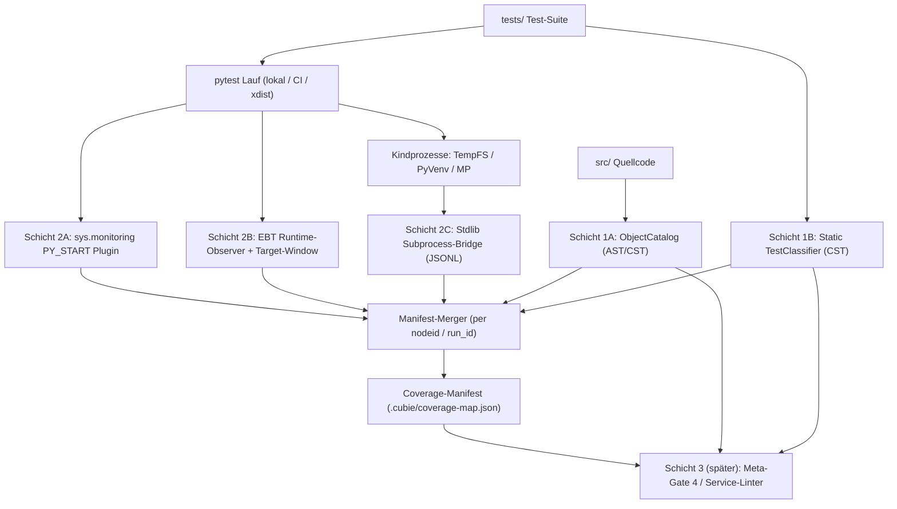

<!-- qb:frame id="CUBIE_DOC_FRAME_2" zone="head" env="Antigravity-CLI" model="Gemini 4 Neon" effort="High" -->
# Analyse: Möglichkeiten zum Bau eines Analyse-Werkzeugs für EBT-Case-Coverage auf Quellcode-Objekten

**Dokument-Informationen & Herkunft:**
- **Plattform / Umgebung:** Antigravity-CLI
- **Modell:** Gemini 4 Neon
- **Reasoning-Effort:** High
- **Analysedatum:** 21. November 2026, ~07:10 (CET)
- **Synthesebasis:** `tests/GEMINI.md`, `docs/GUIDE_Quality-Assurance.md`, `docs/dev/README.md`, `docs/dev/DEV-GUIDE_Agent-Reports.md`, `docs/dev/DEV-GUIDE_Next-Steps.md`, `META_QUESTION.md`, `pyproject.toml`, `tests/README.md`, `tests/conftest.py`, `tests/test_styleguide.py`, `tests/tests_meta/test_gate_1.py`–`test_gate_3.py`, `src/qb_cubie/` (`ebt.py`, `protocols.py`, `linter.py`, `reporter.py`, `__init__.py`, `arenas/_tempfs_runner.py`, `services/doc_frame/doc_frame_rules.py`), vollständiger AST-Scan über alle 41 Module unter `src/qb_cubie/` und 84 `test_*.py`-Dateien unter `tests/`, `pytest --collect-only` sowie `sys.monitoring`-Machbarkeits-Benchmark
- **Stand:** qb-cubie (`v0.0.10`, Branch `main`, Commit `7b4a9833`)
- **Git-Log:** `7b4a9833` ("Merge branch 'experimental' for v0.0.10")

---

```text
commit 7b4a983304e9a8a9d32f68729df713351257da05 (HEAD -> main, tag: v0.0.10, origin/main, experimental)
Merge: f27dfc6d b550b663
Author: Chronuid <Dominickwirzba@gmail.com>
Date:   Fri Nov 20 21:21:00 2026 +0100

    Merge branch 'experimental' for v0.0.10

Auftrag (tests/GEMINI.md):
Analyse der Test-Suite Strukturen und Identifikation potentieller Möglichkeiten zum Bau eines
Analyse-Werkzeugs zur Erfassung der realen EBT-Case-Coverage für Quellcode-Objekte — als
Vorstufe für ein späteres Meta-Gate, das Existenz, Menge und Art der Tests je Quellcode-Objekt prüft.
```
<!-- /qb:frame -->

## Kurzfassung (Executive Summary)

> **Scope:** Rein lesende Bestandsaufnahme von `src/qb_cubie/` und `tests/` sowie empirische Machbarkeitsprüfung (inkl. `sys.monitoring`-Benchmark); kein Produktions- oder Testcode wurde geändert.

Die Analyse der realen Struktur von `qb-cubie` (`41` Quellcode-Module, `102` öffentliche Klassen, `28` öffentliche Top-Level-Funktionen, `115` öffentliche Methoden auf öffentlichen Klassen; `84` `test_*.py`-Dateien mit `603` AST-Testfunktionen, `554` `EBT(...)`-Aufrufstellen und `1872` gesammelten `pytest`-Items) liefert vier zentrale Befunde und eine klare Architektur-Empfehlung:

1. **`[BLOCKER]` Rein statische Analyse scheitert als alleinige Objekt-Zuordnung:** **0 von 554** `EBT(target=...)`-Aufrufen im gesamten Repo übergeben eine direkt importierte Top-Level-Funktion aus `qb_cubie`. Stattdessen nutzen **70,4 %** (`390/554`) lokale Adapter- oder Probe-Funktionen (explizit empfohlen durch [`GUIDE_Quality-Assurance.md`](../docs/GUIDE_Quality-Assurance.md#L150-L152)), und **52,9 %** (`54/102`) der öffentlichen Klassen sowie **70,4 %** (`19/27`) der öffentlichen Funktionen erscheinen in `test_*.py` nicht einmal namentlich (z. B. gekapselt in Presets wie `CUBIE_DOCFRAME_RULES` oder `CUBIE_DOC_FRAME_1`–`3`). Statische CST/AST-Analyse ist dagegen hervorragend für **Objekt-Inventar** und **Test-Art-Klassifikation** (`raises`, `expect=False`, Quantoren, `arena`, `fs`, `@parametrize`, `RBT`).
2. **`[BLOCKER]` Naives dynamisches Tracing leidet im `qb-cubie`-Selbsttest unter massiver Harness-Verschmutzung:** Ein realer `sys.monitoring`-Probe-Lauf auf [`test_linter_cst.py`](./tests_linter/test_linter_cst.py) zeigte, dass `test_cstlinter_clean_code` **61** `qb_cubie`-Callables ausführt — davon sind **54 (88,5 %)** reine `EBT`/`WorldState`/`PytestReporter`-Harness-Aufrufe und nur **5** das eigentliche Subject Under Test (`CstLinter`/`CstRule`). Für **externe Nutzer-Projekte** entfällt dieses Problem weitgehend (da `qb_cubie` außerhalb des Projekt-`src/` liegt); im Selbsttest lässt es sich durch ein **Target-Window-Gating** (`EBT._invoke_target`) sauber lösen.
3. **`[RISIKO]` Prozessgrenzen sind integraler Teil der Suite:** **206 von 554** `EBT`-Aufrufen nutzen eine `Arena` (`TempFS`: 143 Nennungen, `PyVenv`: 109 Nennungen), **27** laufen mit `multiprocessing=True`, **25** Testdateien nutzen `subprocess.*` und Parallel-Läufe nutzen `pytest-xdist`. Ein reiner In-Process-Tracer übersieht Code-Ausführungen innerhalb von `_tempfs_runner.py`, `PyVenv`-Kindprozessen und Worker-Pools, sofern keine schlanke **Subprocess-Bridge** (JSONL-Export per Env-Variable) eingebunden wird.
4. **Empfohlene Zielarchitektur (Hybrid — 3 Schichten):** Die beste Lösung für sowohl `qb-cubie` selbst als auch einen späteren wiederverwendbaren Service (`qb_cubie.services` gemäß [`DEV-GUIDE_Next-Steps.md`](../docs/dev/DEV-GUIDE_Next-Steps.md#L51-L58)) ist eine **hybride Pipeline** aus:
   - **Schicht 1 (Statisch, CST/AST, `< 1 s`):** Kanonisches Objekt-Inventar (`src/`) + semantischer Test-Art-Klassifikator (`tests/`) + Auslesen optionaler expliziter Tags (`meta:subject`).
   - **Schicht 2 (Dynamisch, `pytest`-Plugin mit Python 3.13 `sys.monitoring` + `EBT`-Hook + Subprocess-Bridge):** Reale Per-Test-Ausführungsevidenz mit vernachlässigbarem Overhead (im Benchmark `0,05 s` für 22 Tests via `PY_START` + `DISABLE` + `restart_events()`), strikt getrennt in Evidenz-Zonen (`target_window`, `direct_test`, `subprocess`, `harness/transitive`).
   - **Schicht 3 (Manifest & Meta-Gate-Auswerter):** Deterministisches JSON-Manifest (`schema_version: 1`), auf dem das spätere Meta-Gate schnelle, nachvollziehbare Mengen-, Arten- und Drift-Regeln ohne erneuten Testlauf prüfen kann.

---

## Teil 1: Empirische Vermessung von Quellcode und Test-Suite (`Ist`)

### 1.1 Inventar der Quellcode-Objekte (`src/qb_cubie/`)

Ein vollständiger AST-Scan über alle 41 Python-Module unter `src/qb_cubie/` zeigt die reale Größenordnung und Struktur der zu bewertenden Objekte:

| Objekt-Kategorie | Gesamt | Öffentlich (`name`) | Privat (`_name`) | Besonderheiten / Relevanz für Meta-Gate |
| :--- | ---: | ---: | ---: | :--- |
| **Python-Module (`.py`)** | 41 | — | — | Inkl. `__init__.py`, `__main__.py`, interne `_*.py`-Module (`_execution.py`, `_process.py`, `_relocation.py`, ...) |
| **Klassen** | 121 | 102 | 19 | Darunter **13 `Protocol`s** (reine Schnittstellen) und **55 `dataclass`es** (oft DTOs/Reports/Regel-Specs) |
| **Top-Level-Funktionen** | 129 | 28 | 101 | Namenskollision nur bei `main` (`cli.py` vs. `arenas/_tempfs_runner.py`); **0** Klassennamen-Kollisionen |
| **Methoden (gesamt)** | 516 | — | — | Aufschlüsselung siehe unten |
| ↳ Öffentliche Methoden auf öff. Klassen | 115 | 115 | — | Primäre öffentliche API-Oberfläche (inkl. 19 `@property`) |
| ↳ Private Methoden auf öff. Klassen | 245 | — | 245 | Starker Anteil durch `FUNCTION_LIMIT = 12` in [`test_styleguide.py`](./test_styleguide.py#L9) |
| ↳ Dunder-Methoden auf öff. Klassen | 61 | — | — | `__init__`, `__post_init__`, `__repr__`, Context-Manager (`__enter__`/`__exit__`) |
| ↳ Methoden in `Protocol`-Klassen | 31 | — | — | Nicht direkt ausführbar (`...`-Body); müssen im Meta-Gate ausgeschlossen werden |
| ↳ Methoden auf privaten Klassen | 64 | — | 64 | Reine Implementierungsdetails (z. B. `_Snapshot`) |

**Wichtige strukturelle Beobachtung (`[HINWEIS]`):** Durch die harte Stilgrenze `FUNCTION_LIMIT = 12` physische Body-Zeilen ([`test_styleguide.py#L9`](./test_styleguide.py#L9)) zerlegt `qb-cubie` Logik bewusst in viele kleine private Hilfsmethoden (**245** private Methoden + **101** private Funktionen = **346** private Callables gegenüber **143** öffentlichen Funktionen/Methoden). Ein Meta-Gate, das pauschal „direkte eigene Tests für jede Funktion“ erzwingt, würde private Zerlegungen bestrafen und gegen den eigenen Styleguide arbeiten. Das Analyse-Werkzeug muss daher **Sichtbarkeit** (`public` vs. `private`) und **Archetyp** (`callable`, `class`, `protocol`, `dataclass-dto`, `preset`) sauber unterscheiden.

---

### 1.2 Vermessung der Test-Suite (`tests/`)

Alle Zahlen beziehen sich auf `tests/` ohne `tests/fixtures/` und `tests/wheel/` (`84` `test_*.py`-Dateien + `16` Helper/`__init__`/`conftest`-Dateien):

| Subsystem (`tests/<ordner>`) | `test_*`-Funktionen (AST) | Mit direktem `EBT(...)` | `EBT` via File-Helper | Mit `RBT(...)` | Ohne `EBT`/`RBT` (Plain `pytest`) | `EBT(...)`-Aufrufstellen | `@parametrize` |
| :--- | ---: | ---: | ---: | ---: | ---: | ---: | ---: |
| `<root>` (`tests/test_*.py`) | 36 | 23 | 0 | 4 | 11 | 29 | 23 |
| `tests_arena/` | 161 | 79 | 10 | 0 | 72 | 86 | 52 |
| `tests_ebt/` | 187 | 184 | 0 | 0 | 3 | 194 | 68 |
| `tests_linter/` | 39 | 32 | 6 | 0 | 1 | 33 | 11 |
| `tests_meta/` | 12 | 6 | 0 | 0 | 6 | 6 | 7 |
| `tests_multiprocessors/` | 52 | 27 | 23 | 0 | 2 | 33 | 28 |
| `tests_services/` | 96 | 93 | 0 | 0 | 3 | 156 | 3 |
| `tests_user_workflows/` | 20 | 16 | 0 | 0 | 4 | 17 | 11 |
| **Gesamt (`tests/`)** | **603** | **460** | **39** | **4** | **102** | **554** | **203** |

*Hinweis: Einzelne Testfunktionen verwenden sowohl `EBT` als auch `RBT` (daher ist die Summe der Spalten leicht größer als 603). Zudem enthalten 219 der 460 EBT-Testfunktionen zusätzliche `assert`-Statements (meist zur Trace-/Report-Nachprüfung), 127 Testfunktionen nutzen `pytest.raises(...)` und 3 Funktionen nutzen Hypothesis (`@given`).*

**Gesammelte `pytest`-Items (real gemessen):**
- `pytest --collect-only -m "" -q`: **1872** Test-Items gesamt (`0,66 s`)
- `pytest --collect-only -q` (Dev-Default `not slow`): **1710** `fast`-Items + **162** `slow`-Items (`0,61 s`)

---

### 1.3 Die vier fundamentalen Zuordnungs-Probleme (empirisch belegt)

#### Problem 1 (`[BLOCKER]` für rein statische Zuordnung): Adapter-, Indirektions- und Preset-Lücke

Die syntaktische Klassifikation aller **554** `EBT(target=...)`-Ausdrücke in `tests/**/test_*.py` zeigt ein überraschend klares Bild:

| Syntaktische Form von `EBT(target=...)` | Anzahl | Anteil | Typische Beispiele aus dem Repository |
| :--- | ---: | ---: | :--- |
| Lokale Funktion (Adapter oder Probe) | **390** | **70,4 %** | `_run_docframe_check`, `review`, `review_twice`, `target_normalize` |
| ↳ davon Stateless Adapter mit `qb_cubie`-Ref | *178* | *32,1 %* | `test_headless_reviewer.py:60`, `test_docframe_rules_and_guards.py` |
| ↳ davon Dummy-/Probe-Target oder Closure | *210* | *37,9 %* | `test_ebt_quantor_declaration.py`, `test_human_reviewer_fresh_decision.py` |
| ↳ davon verschachtelter `EBT`-Aufruf | *1* | *0,2 %* | `tests_arena/test_ebt_tempfs.py:123` (`outer_target`) |
| Instanz- oder Objekt-Attribut (`obj.method`) | **54** | **9,7 %** | `linter.check`, `reviewer.review`, `subprocess.run`, `os.getpid` |
| Call-Ausdruck (`partial(...)` / Factory) | **37** | **6,7 %** | `partial(mark_execution, marker)`, `partial(export_orders, fault)` |
| `lambda`-Ausdruck | **30** | **5,4 %** | `lambda x: x * 2`, `lambda: Path('input.txt').read_text(...)` |
| String-Target (`"modul:funktion"`) | **25** | **4,5 %** | `'builtins:sum'`, `'console_target:run'`, `'order_target:reject'` |
| Variable / Parameter / Builtin | **9** | **1,6 %** | `sum`, `attack_target`, `target` (Fixture/Parameter) |
| f-String (`f"{mod}:{fn}"`) / `IfExp` | **5** | **0,9 %** | `f'{module.__name__}:{check}'` |
| Klassen-Attribut aus `qb_cubie` | **4** | **0,7 %** | `StateInspector.has_unpicklable_callables` |
| **Direkter Top-Level-`qb_cubie`-Funktionsimport** | **0** | **0,0 %** | — |

Zusätzlich ergab der Namens-Abgleich zwischen `src/qb_cubie/` und allen `test_*.py`-Dateien:
- **54 von 102 öffentlichen Klassen (52,9 %)** werden in keinem einzigen Test namentlich erwähnt (u. a. `DocFrameMissing`, `DocFrameOutdated`, `DocFrameBrokenRoute`, `DocFrameProvenanceIncomplete`, `AssetImage`, `CatalogRouter`, `CenterWrap`, `CompactNav`, `CaptureTarget`). Viele davon sind dennoch intensiv getestet — indirekt über Preset-Tupel wie `CUBIE_DOCFRAME_RULES` oder `CUBIE_DOC_FRAME_1`–`3` (z. B. in [`test_docframe_rules_and_guards.py#L54-L58`](./tests_services/tests_doc_frame/test_docframe_rules_and_guards.py#L54-L58)).
- **19 von 27 eindeutigen öffentlichen Top-Level-Funktionen (70,4 %)** werden in `test_*.py` nicht namentlich referenziert (z. B. `validate_bool_expect`, `same_contents`, `hydrate_workspace`, `parse_frame_spans`, `exception_details`, `qualified_name`), obwohl sie transitiv durch `EBT`, `WorldState`, `TempFS` und `DocFrame` abgesichert sind.

**Konsequenz:** Ein Analyse-Tool, das nur `EBT(target=...)` oder `import`-Namen statisch liest, produziert **> 50 % False Negatives** und widerspricht direkt dem eigenen Best-Practice-Muster *Stateless Adapters* ([`GUIDE_Quality-Assurance.md#L150-L152`](../docs/GUIDE_Quality-Assurance.md#L150-L152)).

---

#### Problem 2 (`[BLOCKER]` für naives dynamisches Tracing): Das Harness-vs-SUT-Paradoxon

Ein realer Testlauf mit Python 3.13 `sys.monitoring` (`PY_START`) auf [`tests/tests_linter/test_linter_cst.py`](./tests_linter/test_linter_cst.py) lieferte folgendes Messergebnis für `test_cstlinter_clean_code`:

- **61** ausgeführte Callables in `src/qb_cubie/` insgesamt:
  - **54 (88,5 %)** stammten aus `ebt.py`, `protocols.py` und `reporter.py` (reiner Test-Harness!).
  - **2 (3,3 %)** waren Harness-Nebenaufrufe (`arenas/hydration.py::normalize_fs`, `multiprocessors.py::_validate_max_workers`).
  - Nur **5 (8,2 %)** gehörten zum eigentlichen SUT (`CstLinter.__init__`, `CstLinter.check`, `CstLinter._analyze_source`, `CstRule.__init__`, `CstRule.reset`).
- Im Fehlerfall-Test `test_cstlinter_finds_eval` kamen exakt die 2 Fehlerpfad-Methoden `CstRule.add_diagnostic` und `CstRule.route_suggestions` hinzu (7 SUT-Callables).

**Entscheidende Differenzierung (`qb-cubie` intern vs. externe Nutzer-Projekte):**
- **In einem externen Projekt** (das `qb-cubie` aus `site-packages` nutzt, um seinen eigenen Quellcode unter `src/my_app/` zu testen) existiert das Harness-Problem **nicht**: Der Filter `co_filename.startswith(project_src)` blendet `qb_cubie` vollständig aus, sodass ausschließlich `my_app`-Objekte erfasst werden!
- **In `qb-cubie` selbst** testen `tests_ebt/`, `tests_arena/` und `tests_multiprocessors/` das Framework mit sich selbst (`target` ist dann ein Dummy wie `target_normalize` oder `lambda`). Hier muss das Werkzeug explizit zwischen **Target-Window** (Code, der *innerhalb* von `EBT._invoke_target(...)` läuft → echtes SUT bei Adapter-/Methodentests) und **Harness-Window** (Code von `EBT`/`Arena`/`Multiprocessor` *außerhalb* von `target` → zählt nur als SUT, wenn der Test das Framework selbst prüft, z. B. weil im Target-Window **0** `qb_cubie`-Callables getroffen wurden oder der Test im entsprechenden Subsystem liegt) unterscheiden.

---

#### Problem 3 (`[RISIKO]`): Prozess- und Isolationsgrenzen

- **Arenen (`TempFS`, `PyVenv`):** `206` von `554` `EBT`-Aufrufen übergeben `arena=...` (`TempFS(`: 143×, `PyVenv(`: 109×). In [`src/qb_cubie/arenas/_tempfs_runner.py#L29-L35`](../src/qb_cubie/arenas/_tempfs_runner.py#L29-L35) wird `target(*args, **kwargs)` in einem **Kindprozess** ausgeführt. Beispiel: In [`test_docframe_rules_and_guards.py`](./tests_services/tests_doc_frame/test_docframe_rules_and_guards.py#L49-L62) laufen `DocFrame.update()` und `DocEnsurance().run()` komplett im `TempFS`-Subprozess! Ein rein im `pytest`-Elternprozess aktiver Tracer sieht dort nur `TempFS`, aber **0 %** von `DocFrame` und `DocEnsurance`.
- **Multiprocessing & Subprozesse:** `27` `EBT`-Aufrufe setzen `multiprocessing=True` (`PickleProcessor`/`LokyProcessor`), `25` Testdateien starten `subprocess.*`, und schnelle/vollständige Parallel-Läufe (`make test-fast-p`, `make test-all-p`) nutzen `pytest-xdist` (mehrere Worker-Prozesse).
- **Implikation:** Jede dynamische Lösung braucht ein **prozessübergreifendes Sammelformat** (z. B. eine Append-only-JSONL-Datei pro Prozess-ID in einem gemeinsamen Trace-Verzeichnis, die am Ende zusammengeführt wird).

---

#### Problem 4 (`[HINWEIS]`): Zähl-Ambiguität („Wie viele Tests liegen auf Objekt X?“)

Im Repository gibt es fünf verschiedene sinnvolle Zähleinheiten, die sich um mehr als den Faktor 3 unterscheiden:

| Zähl-Einheit | Aktueller Repo-Wert | Bedeutung | Gefahr bei unreflektierter Nutzung im Meta-Gate |
| :--- | ---: | :--- | :--- |
| **Test-Funktion (`def test_*`)** | **603** | Logische Testdefinition im Quelltext | Unterbewertet stark parametrisierte Äquivalenzklassen-Tests |
| **`EBT`-/`RBT`-Vertragsstelle** | **554** + **13** | Deklarierte Vertragskonstruktion | Zählt Helper-Factories (`make_case`) nur 1× statt pro Aufrufer; ignoriert 102 Nicht-EBT-Tests |
| **`pytest`-Collection-Item** | **1872** | Parametrisierte Einzelausführung | Aufblähung durch kartesische `@parametrize`-Matrizen (z. B. 20 fast identische Gutwetter-Fälle) |
| **Ausgeführte `EBT`-Steps (`pre`-Zustände)** | dynamisch | Tatsächlich evaluierte `{P} S {Q}`-Paare | Variabel je nach Laufzeit-Inputs / Schleifen |
| **Hypothesis-Beispiele (`@given`)** | 15 (`dev`) / 100 (`ci`) | Zufallsgenerierte Beispiele pro Test | Profil-abhängig (`dev` vs. `ci` — instabil für harte Mengen-Gates!) |

**Empfehlung für das Datenmodell:** Das Analyse-Werkzeug sollte **immer Tupel aus mindestens zwei stabilen Zählgrößen** pro Objekt speichern:
1. **`distinct_test_functions`** (eindeutige `file::test_fn` — immun gegen Parametrisierungs-Inflation und Hypothesis-Profile),
2. **`executed_cases`** (ausgeführte `pytest`-Items bzw. `EBT`-Vertragsinstanzen — misst tatsächliche Beispielbreite), plus
3. **`distinct_test_kinds`** (Anzahl *verschiedener* abgedeckter Test-Arten — entscheidende Qualitätsmetrik gemäß [`GUIDE_Quality-Assurance.md#L154-L158`](../docs/GUIDE_Quality-Assurance.md#L154-L158)).

---

## Teil 2: Taxonomie — Quellcode-Objekte & Arten von Tests

Damit das spätere Meta-Gate sinnvolle Regeln formulieren kann („Welche Arten von Tests liegen auf welchen Objekten?“), benötigt das Analysewerkzeug eine feste, maschinenlesbare Taxonomie entlang zweier Achsen.

### 2.1 Objekt-Archetypen (`src/`)

| Archetyp | Statische Erkennung (AST/CST) | Typische Meta-Gate-Erwartung (Ausblick) |
| :--- | :--- | :--- |
| `public_function` | Top-Level `def`, kein `_`-Präfix | Volle Abdeckung (z. B. Positiv + Guard/Negativ) |
| `public_method` | Methode ohne `_`-Präfix auf öffentlicher Nicht-Protocol-Klasse | Volle Abdeckung (Ausnahme: triviale `@property`-Getter optional lockerer) |
| `public_class` | `class` ohne `_`-Präfix, kein `Protocol`, kein reines DTO | Aggregiert aus Methoden + Konstruktor (`__init__`/`__post_init__`) |
| `dataclass_dto` | `@dataclass` ohne eigene Fachmethoden (nur Felder/`__post_init__`) | Reduzierte Anforderung (Struktur-/Guard-Check genügt) |
| `protocol_interface` | Erbt von `Protocol` | **Ausgenommen** von Ausführungs-Coverage (statisch durch `MyPy` geprüft) |
| `private_helper` | `_`-Präfix (Funktion, Methode oder Klasse) | **Indirekte Abdeckung** über öffentliche Fassade ausreichend (kein Zwang zu Whitebox-Direkttests) |
| `preset_constant` | Großgeschriebene Top-Level-Konstante (`CUBIE_DOC_RULES`, ...) | Erfasst als Einstiegspunkt / Alias auf enthaltene Objekte |

### 2.2 Orthogonale Test-Art-Taxonomie (`tests/`)

Die „Art eines Tests“ ist in `qb-cubie` kein einzelner Enum-Wert, sondern ein **Multi-Label-Profil** aus drei orthogonalen Dimensionen (alle Signale sind heute bereits im Repo messbar):

| Dimension | Label (`test_kind`) | Automatische Erkennung (Statisch / Laufzeit) | Aktueller Ist-Bestand im Repo |
| :--- | :--- | :--- | ---: |
| **A. Prüfschicht / Mechanismus** | `mech:ebt` | `EBT(...)`-Aufruf (direkt oder via Helper / Runtime-Hook) | 499 Testfunktionen (554 Aufrufe) |
| | `mech:rbt` | `RBT(...)`-Aufruf | 4 Testfunktionen (13 Aufrufe) |
| | `mech:doc_ensurance` | `DocEnsurance(...)`-Aufruf | 30 Aufrufe |
| | `mech:static_linter` | `CstLinter(...)` / `AstLinter(...)` / `MyPy` / `Pylint` | 59 Aufrufe (`23` CST + `36` AST) |
| | `mech:hypothesis` | `@hypothesis.given(...)` | 3 Testfunktionen |
| | `mech:plain_pytest` | Klassischer `pytest`-Test mit `assert`/`pytest.raises` ohne `EBT`/`RBT` | 102 Testfunktionen |
| **B. Semantische Vertragsart** | `contract:positive` | `EBT(expect=True)` mit positivem `WorldState` (ohne `raises`) | Kernanteil der 554 `EBT`-Aufrufe |
| | `contract:exception_guard` | `WorldState(raises=ExceptionExpectation(...))` oder `pytest.raises(...)` | 37 `EBT`-Aufrufe + 127 `pytest.raises`-Tests |
| | `contract:negative_post` | `WorldState(..., expect=False)` unter `post={"quantor": "all", ...}` | 43 `EBT`-Aufrufe |
| | `contract:negation_probe` | `EBT(..., expect=False)` (Gegenprobe / Red-Nachweis) | 29 `EBT`-Aufrufe |
| | `contract:quantor_explicit` | Expliziter Wrapper `{"quantor": "all" \| "exists", ...}` | 53 `EBT`-Aufrufe (`40` `all`, `13` `exists`) |
| | `contract:arena_tempfs` | `arena=TempFS(...)` | 143 `TempFS`-Nennungen |
| | `contract:arena_pyvenv` | `arena=PyVenv(...)` | 109 `PyVenv`-Nennungen |
| | `contract:fs_state` | `WorldState(..., fs=...)` | 84 `EBT`-Aufrufe |
| | `contract:multiprocess` | `EBT(..., multiprocessing=True)` | 27 `EBT`-Aufrufe |
| | `contract:parametrized` | `@pytest.mark.parametrize` | 203 Testfunktionen |
| | `contract:gate_triad` | Clean-/Fault-/Repo-Proben (analog `test_gate_1..3.py`) | 3 Meta-Gate-Dateien |
| **C. Evidenz- & Bindungsstufe** | `binding:explicit` | Explizit deklariert via `tags={'meta:subject': ...}` oder Marker | 0 (noch nicht eingeführt; `tags=` bisher 12× für `meta:cross-product-reason`) |
| | `binding:target_window` | Dynamisch innerhalb `EBT._invoke_target(...)` ausgeführt | Dynamisch messbar |
| | `binding:direct_call` | Direkt aus `test_*` (oder 1-Hop-Adapter) aufgerufen | Statisch & dynamisch messbar |
| | `binding:subprocess` | In `TempFS`/`PyVenv`/Worker-Kindprozess ausgeführt | Dynamisch mit Subprocess-Bridge |
| | `binding:transitive` | Tief im Call-Stack mitgetestet (Call-Tiefe > 1 im SUT) | Dynamisch messbar |
| | `binding:harness_self` | Nur über Harness-Pfad im eigenen Subsystem (`tests_ebt/`, `tests_arena/`, `tests_multiprocessors/`) | Regelbasiert separierbar |

---

## Teil 3: Analyse der 6 möglichen Architektur-Optionen

Nachfolgend werden sechs technisch eigenständige Ansätze analysiert — von rein statisch über dynamisch bis explizit deklarativ — und gezielt an den realen Besonderheiten von `qb-cubie` gemessen.

### Option A: Rein statische CST/AST-Analyse (`LibCST` / Erweiterung von `CstLinter`)

- **Mechanismus:** Zwei CST/AST-Durchläufe ohne Code-Ausführung — (1) `src/`-Scanner baut das Objekt-Inventar; (2) `tests/`-Scanner (aufbauend auf den vorhandenen Mustern aus [`test_gate_1.py`](./tests_meta/test_gate_1.py), [`test_gate_2.py`](./tests_meta/test_gate_2.py) und [`test_gate_3.py`](./tests_meta/test_gate_3.py)) extrahiert Imports, `EBT(...)`-Parameter, lokale Adapter-Körper (1–2 Hops im selben Modul) und `pytest`-Dekoratoren.
- **Was wird gut erfasst:** Vollständiges Objekt-Inventar (`src/`); nahezu 100 % aller **Test-Arten** (`raises`, `expect=False`, Quantoren, `arena`, `fs`, `multiprocessing`, `RBT`, `@parametrize`, `@given`, `tags`).
- **Stärken:** Sehr schnell (`< 1 s` über das gesamte Repo), null Testlauf-Abhängigkeit, 100 % deterministisch, keine neuen Dependencies (`libcst 1.9.0` bereits installiert), nahtlos kompatibel mit `CstLinter` und der Wächter-Triade.
- **Harte Grenzen (`[BLOCKER]`):**
  - Verpasst **54/102** öffentliche Klassen (Presets wie `CUBIE_DOCFRAME_RULES`) und **19/27** öffentliche Funktionen (indirekte Aufrufe).
  - Kann gebundene Instanzmethoden (`linter.check`, `reviewer.review`), Fixture-Objekte (`gui_sessions`, `check_case`), `partial(...)` über Modulgrenzen, dynamische String-Targets (`"order_target:reject"`) und Duck-Typing ohne Typ-Inferenz nicht sicher auflösen.
  - Misst nur *syntaktische Erwähnung*, nicht *reale Ausführung* (toter oder per `skipif`/Parameter nicht ausgeführter Code zählt fälschlich mit).
- **Fazit:** Unverzichtbare **Basis-Komponente** für Objekt-Inventar und Test-Art-Erkennung, aber als alleiniges Werkzeug für reale Objekt-Coverage **ungeeignet**.

---

### Option B: Statische Typ- & Call-Graph-Analyse (`astroid` / `MyPy` / `LibCST` Scope+Type-Inference)

- **Mechanismus:** Nutzt die bereits in `.venv` vorhandenen Analyse-Engines (`astroid 4.3.4` via `pylint` oder `mypy 2.4.1`) bzw. einen eigenen modulübergreifenden Symbol-/Call-Graph-Resolver, um Variablentypen (`linter` → `CstLinter`), Methoden-Targets (`linter.check` → `qb_cubie.linter.CstLinter.check`), Konstanten-Expandierungen (`CUBIE_DOCFRAME_RULES` → 4 Regelklassen) und Aufrufketten (`test_*` → `_run_docframe_check` → `DocFrame.update` + `DocEnsurance.run`) statisch aufzulösen.
- **Stärken:**
  - Keine Testausführung nötig; keine neuen Dependencies (`astroid` und `mypy` liegen bereits in `[dependency-groups] dev` bzw. `[project.optional-dependencies] linters`).
  - Löst einen großen Teil der Stateless-Adapter (`178` Aufrufe), gebundenen Methoden (`54` Aufrufe) und Preset-Konstanten deutlich besser auf als reines CST.
- **Harte Grenzen (`[RISIKO]`):**
  - `astroid`-Inferenz liefert bei `pytest`-Fixtures (Dependency Injection über Funktionsparameter-Namen wie `gui_sessions`, `check_case`, `src_files`), `monkeypatch` (`29/84` Dateien), `cloudpickle`/`partial` und `Any`-Typen häufig `Uninferable`.
  - `mypy`-Internals (`mypy.build`) sind nicht als stabile öffentliche Python-API garantiert und dauern für das gesamte Repo mehrere Sekunden.
  - Bleibt prinzipiell blind für dynamische String-Targets, `TempFS`-Skripte und tatsächliche Laufzeitpfade (z. B. welcher Zweig von `_inject_fault` in welchem Test läuft).
- **Fazit:** Sinnvolle **ergänzende Heuristik** für Offline-Schnellchecks (z. B. Auflösung einfacher `x = MyClass(); EBT(target=x.foo)`-Muster), aber zu fragil und wartungsintensiv als primäre Coverage-Wahrheitsquelle.

---

### Option C: Dynamisches Per-Test-Execution-Tracing via Python 3.13 `sys.monitoring` (PEP 669) + `pytest`-Plugin + Subprocess-Bridge

- **Mechanismus:** Weil `qb-cubie` `requires-python = ">=3.13"` voraussetzt ([`pyproject.toml#L13`](../pyproject.toml#L13)), steht `sys.monitoring` (PEP 669) immer in der Standardbibliothek zur Verfügung. Ein leichtgewichtiges `pytest`-Plugin registriert eine `PY_START`-Callback-Funktion:
  1. Bei jedem Betreten einer Funktion/Methode unter `src/` erfasst der Callback `(rel_file, co_qualname, co_firstlineno)` für das aktuell aktive `pytest`-Item und gibt **`sys.monitoring.DISABLE`** zurück — danach erzeugt genau dieses Code-Objekt im laufenden Test **null** weiteren Interpreter-Overhead!
  2. In `pytest_runtest_setup` setzt `sys.monitoring.restart_events()` das Tracking sauber für den nächsten Test zurück.
  3. **Target-Window-Gating gegen Harness-Pollution:** Ein dünner Kontext-Stack (z. B. ein ContextVar/Flag um `EBT._invoke_target(...)`) markiert, ob ein Treffer *innerhalb* des `EBT`-Targets (`target_window`) oder außerhalb (`direct_test` / `harness`) erfolgte.
  4. **Subprocess-Bridge für `TempFS`/`PyVenv`/`multiprocessing`:** Ist eine Umgebungsvariable (z. B. `CUBIE_COVERAGE_TRACE_DIR`) gesetzt, aktiviert ein ~25-Zeilen-Bootstrap in `_tempfs_runner.py`, im `PyVenv`-Runner-Snippet und im Worker-Task denselben `PY_START`-Collector und schreibt die getroffenen Callables mit `run_id` / `nodeid` als JSONL in das Trace-Verzeichnis.
- **Empirische Messung (real im Repo verifiziert):**
  - Auf `tests/tests_linter/test_linter_cst.py` + `tests/tests_ebt/test_ebt_quantors.py` (**22 Tests**): Laufzeit inkl. `sys.monitoring` (`PY_START` + `DISABLE` + `restart_events()`) bei warmen Imports **`0,05 s`** — praktisch nicht messbarer Overhead gegenüber normaler Ausführung.
  - Exakte Unterscheidung selbst auf Methoden-Ebene: `test_cstlinter_clean_code` traf 5 `CstLinter`/`CstRule`-Methoden; `test_cstlinter_finds_eval` traf exakt die 2 zusätzlichen Diagnose-Methoden (`add_diagnostic`, `route_suggestions`).
- **Stärken:**
  - **Null neue Dependencies** (reine Python-3.13-Stdlib).
  - Löst **alle** Indirektionen zu 100 % auf: Stateless-Adapter, Presets (`CUBIE_DOCFRAME_RULES`), `partial`, `lambda`, Closures, Polymorphie, `pytest`-Fixtures, String-Targets.
  - Nativer `pytest-xdist`-Support (jeder Worker schreibt eigene PID-JSONL, Merge am Laufende).
  - Durch `Target-Window-Gating` direkt nutzbar für sowohl `qb-cubie`-Selbsttests als auch beliebige externe Projekte.
- **Harte Grenzen:**
  - Erfordert einen Testlauf (für das spätere Meta-Gate also über ein gecachtes/CI-erzeugtes Manifest zu entkoppeln).
  - Sieht auf `PY_START`-Ebene nur *Callable-Eintritte* (keine Zeilen-/Branch-Prozentwerte innerhalb einer Methode — was bei `FUNCTION_LIMIT = 12` in `qb-cubie` aber sehr feingranular ist!).
  - Kennt ohne Kopplung an Schicht 1 / Option E nicht die *Test-Art* (`expect=False`, Quantoren, `raises`).
- **Fazit:** **Technisch stärkster Kernbaustein** für die reale Objekt-Zuordnung — schlank, zero-dependency, Python-3.13-nativ und präzise steuerbar.

---

### Option D: `coverage.py` (`dynamic_context = test_function`) + SQLite-`.coverage`-Auswertung

- **Mechanismus:** Nutzt `coverage.py >= 7.x` (mit eigenem `sys.monitoring`-Core) in Kombination mit `dynamic_context = test_function` (oder `pytest-cov --cov-context=test`). `coverage.py` schreibt eine SQLite-Datenbank (`.coverage`), in der für jede ausgeführte Quellcode-Zeile (und optional jeden Branch) der exakte `pytest`-Testname hinterlegt ist. Ein nachgelagertes Analyse-Skript projiziert diese Zeilennummern auf die AST-Bereiche (`node.lineno..node.end_lineno`) aller Objekte in `src/`.
- **Stärken:**
  - Bewährtes Standardwerkzeug mit ausgereiftem `coverage combine` für `pytest-xdist` und Subprozesse (`coverage.process_startup()`).
  - Liefert zusätzlich **Zeilen- und Branch-Abdeckung je Test und Objekt** (also nicht nur „betreten“, sondern auch *wie tief* eine Funktion abgedeckt wurde — wichtig für externe Projekte mit größeren Funktionen ohne `FUNCTION_LIMIT = 12`).
- **Harte Grenzen (`[RISIKO]`):**
  - Neue externe Abhängigkeit (`coverage` ist aktuell weder in `pyproject.toml` noch in `uv.lock` enthalten).
  - **`PyVenv`-Blinder Fleck:** In [`PyVenv`](../src/qb_cubie/arenas/pyvenv.py) laufende Kindprozesse starten in einer isolierten virtuellen Umgebung, in der `coverage` nicht vorinstalliert ist (während Option C nur Stdlib `sys.monitoring` benötigt!).
  - **Kein Target-Window-Gating:** `coverage.py` kennt `EBT._invoke_target` nicht und vermischt Harness- und SUT-Zeilen im `qb-cubie`-Selbsttest vollständig.
  - Höherer Laufzeit-Overhead bei `branch = True` + `dynamic_context` über 1872 Tests (insbesondere bei den 162 `slow`-Tests).
- **Fazit:** Als optionaler **Zusatz-Provider** für Zeilen-/Branch-Metriken in externen Projekten attraktiv, für `qb-cubie` selbst aber wegen `PyVenv`-Isolation, neuer Dependency und fehlendem Target-Window-Gating schlechter geeignet als Option C.

---

### Option E: `EBT`-Runtime-Instrumentierung & Telemetry-Hook (`EBT` + `RunTrace`)

- **Mechanismus:** Ein leichter, opt-in aktivierbarer Observer-Hook im `EBT`-Lebenszyklus (z. B. ein Observer-Registry-Callback in `EBT._report()` / `EBT.run()`, plus Anreicherung von `RunTrace` in [`src/qb_cubie/protocols.py#L171-L184`](../src/qb_cubie/protocols.py#L171-L184) um `target_qualname: str` und `tags: Any` statt nur `getattr(self.target, "__name__", ...)` in [`src/qb_cubie/ebt.py#L352`](../src/qb_cubie/ebt.py#L352)).
- **Was wird erfasst:** Für jeden real ausgeführten `EBT`-Vertrag:
  - aktueller `pytest`-Node-ID-Kontext + Marker (`fast`/`slow`, Subsystem),
  - vollqualifiziertes `target` (`module.qualname`),
  - exakte Laufzeit-Vertrags-Signatur: `len(pre)`, `len(post)`, `pre_quantor`, `post_quantor`, `expect`, Anzahl `post[i].expect is False`, erwartete Exception-Typen (`raises`), `has_fs`, Arena-Typ (`TempFS`/`PyVenv`/Custom), `multiprocessing`, `tags`, `evaluation` und `duration`.
- **Stärken:**
  - Erfasst **dynamisch konstruierte EBT-Verträge** (wie in Helpern `make_case(...)`, Schleifen oder Fixtures), die ein statischer CST-Scanner kaum zuverlässig sieht (`39` Helper-`EBT`-Testfunktionen + `156` Service-Aufrufe).
  - Minimale Code-Änderung (< 40 Zeilen, streng innerhalb von `FUNCTION_LIMIT = 12` und `MODULE_LIMIT = 777`; `ebt.py` steht aktuell bei **771 / 777** Zeilen — Achtung: knappe Reserve, daher Hook-Logik in ein eigenes Modul auslagern!).
- **Harte Grenzen:**
  - **Sieht nur `EBT`-Tests:** Die `102` Nicht-EBT-Tests (`assert`, `pytest.raises`, `RBT`, `DocEnsurance`, `CstLinter`-Direktaufrufe) bleiben unsichtbar.
  - Löst das **Adapter- und Dummy-Target-Problem** allein nicht auf (`target_qualname` zeigt dann auf `test_docframe_rules_and_guards._run_docframe_check` statt auf `DocFrame.update`).
- **Fazit:** Extrem wertvoller **Semantik-Lieferant** für reale EBT-Vertrags-Arten und Trigger-Punkt für das Target-Window-Gating von Option C — aber nicht als Standalone-Lösung für Objekt-Coverage ausreichend.

---

### Option F: Explizite Vertrags-Deklaration (`tags={'meta:subject': ...}` / `@pytest.mark.subject(...)`)

- **Mechanismus:** Testautoren annotieren Tests explizit mit dem geprüften Quellcode-Objekt (und optional der Rolle), konsistent mit den bereits etablierten `meta:`-Tags in Meta-Gate 2 (`meta:cross-product-reason`, 12 Nutzungen) und Meta-Gate 3 (`meta:negative-invariant`):
  - auf `EBT`-Ebene: `EBT(..., tags={"meta:subject": "qb_cubie.services.doc_frame.DocFrame.update"})` (oder Referenz `DocFrame.update`),
  - auf `pytest`-Ebene (auch für Nicht-EBT-Tests): `@pytest.mark.subject("qb_cubie.ebt.EBT._parse_state_config")`.
- **Stärken:**
  - **100 % Trennschärfe** bei der Frage *„Was ist das beabsichtigte SUT dieses Tests?“* — löst Selbsttests, Adapter, Presets und Integrations-Tests ohne jede Heuristik.
  - Ermöglicht bewusste Architekturentscheidungen (`meta:subject`, `meta:coverage-exempt`).
  - Sofort und ohne Testlauf durch einen `CstLinter` auswertbar.
- **Harte Grenzen (`[RISIKO]`):**
  - **Hoher Migrationsaufwand:** 603 bestehende Testfunktionen / 554 `EBT`-Aufrufe müssten manuell oder halbautomatisch nachgepflegt werden.
  - **Drift-Gefahr (False Confidence):** Ohne dynamische Gegenprüfung veralten manuelle Annotationen bei Refactorings (ein Test behauptet `meta:subject="X"`, führt `X` aber gar nicht mehr aus).
- **Fazit:** Als *Pflicht-Eingabe* für alle 603 Bestands-Tests zu teuer und driftanfällig — als **optionales Override- und Präzisions-Instrument** (mit automatischer Drift-Prüfung durch Schicht 2!) jedoch extrem stark.

---

### 3.1 Kompakte Vergleichsmatrix

| Kriterium | A: Rein CST/AST | B: `astroid`/MyPy Call-Graph | C: `sys.monitoring` + Bridge | D: `coverage.py` Contexts | E: `EBT`-Hook | F: Explizite `meta:subject` | **G: Hybrid (A + C + E + opt. F)** |
| :--- | :---: | :---: | :---: | :---: | :---: | :---: | :---: |
| **Löst Adapter & Presets auf** | ❌ (0 % dir.) | ⚠️ (teilw.) | ✅ (100 %) | ✅ (100 %) | ❌ | ✅ (manuell) | **✅ (100 %)** |
| **Erfasst Test-Arten (`EBT`/`raises`/Quantor)** | ✅ (stat.) | ✅ (stat.) | ❌ | ❌ | ✅ (Laufzeit) | ⚠️ (manuell) | **✅ (stat. + dyn.)** |
| **Erfasst Nicht-EBT-Tests (`102` Tests)** | ⚠️ (grob) | ⚠️ | ✅ | ✅ | ❌ | ✅ | **✅** |
| **Löst Harness-vs-SUT (Selbsttest)** | ❌ | ⚠️ | ✅ (Window) | ❌ | ⚠️ | ✅ | **✅ (Window + Opt-In)** |
| **Löst `TempFS`/`PyVenv`/MP-Subprozesse** | ❌ | ❌ | ✅ (Bridge) | ⚠️ (kein `PyVenv`) | ⚠️ (nur Parent) | ✅ | **✅ (Stdlib-Bridge)** |
| **Keine neue externe Dependency** | ✅ | ✅ | ✅ (3.13 Stdlib) | ❌ (`coverage`) | ✅ | ✅ | **✅ (Zero-Dep)** |
| **Kein Migrationsaufwand für 603 Tests** | ✅ | ✅ | ✅ | ✅ | ✅ | ❌ | **✅ (sofort nutzbar)** |
| **Drift-sicher bei Refactoring** | ⚠️ | ⚠️ | ✅ | ✅ | ✅ | ❌ | **✅ (verifiziert)** |
| **Geschwindigkeit im späteren Meta-Gate** | `< 1 s` | `3–15 s` | Testlauf* | Testlauf* | Testlauf* | `< 1 s` | **`< 1 s` auf Manifest** |

*\*Dynamische Evidenz wird im regulären/CI-Testlauf mitgesammelt und als Manifest persistiert; das Meta-Gate selbst wertet das Manifest in `< 1 s` aus.*

---

## Teil 4: Empfohlene Zielarchitektur — Hybrides 3-Schichten-Werkzeug (`Soll`)

Die Analyse zeigt eindeutig: **Kein einzelnes Verfahren** kann gleichzeitig (1) alle Adapter/Presets/Subprozesse verlustfrei auflösen, (2) die semantischen EBT-Vertrags-Arten exakt klassifizieren, (3) das Selbsttest-Harness-Problem beherrschen und (4) schnell genug für ein späteres Meta-Gate sein. Die **Kombination aus Option A + C + E (+ optionalem F)** erreicht genau das ohne eine einzige neue externe Abhängigkeit.



### 4.1 Baustein 1 — Statisches Objekt-Inventar & Test-Klassifikator (Schicht 1)

- **`ObjectCatalog` (`src/`):** Extrahiert jedes Quellcode-Objekt mit stabiler Identität:
  - `fqn` (z. B. `qb_cubie.linter.CstLinter.check`),
  - `kind` (`public_function`, `public_method`, `public_class`, `dataclass_dto`, `protocol_interface`, `private_helper`, `preset_constant`),
  - `file_path`, `lineno`, `end_lineno`, `body_lines` (wiederverwendbar aus [`test_styleguide.py#L57-L68`](./test_styleguide.py#L57-L68)),
  - `parent_fqn` (Methoden → Klasse → Modul).
- **`TestClassifier` (`tests/`):** Nutzt `LibCST` (konsistent mit `test_gate_1..3.py`) zur Erkennung von:
  - Test-Funktionen (`file::test_fn`), `@parametrize`, `@given`, `pytest.raises`, `RBT`, `DocEnsurance`, `CstLinter`/`AstLinter`,
  - statisch erkennbaren `EBT`-Merkmalen (`expect`, `raises`, `fs`, `arena`, `multiprocessing`, Quantoren, `tags`),
  - optionalen expliziten `meta:subject`- / `meta:coverage-exempt`-Deklarationen.

### 4.2 Baustein 2 — Dynamischer Evidenz-Collector (Schicht 2)

1. **`pytest`-Plugin (`sys.monitoring`):**
   - Nutzt einen freien `tool_id` (dynamische Suche unter `0..5`, damit keine Kollision mit Debuggern oder `coverage.py` entsteht!).
   - Filtert früh per String-Prefix auf die konfigurierte Quellcode-Wurzel (`src/qb_cubie` bzw. Zielprojekt-`src/`).
   - Verwendet `PY_START` + `return sys.monitoring.DISABLE` und `restart_events()` je `pytest_runtest_setup`.
2. **Saubere Harness-vs-SUT-Trennung über 3 Evidenz-Zonen:**
   - **Zone 1 (`target_window`):** Aktiv, sobald ein `EBT`-Lauf `EBT._invoke_target(...)` betritt (bzw. bei Nicht-EBT-Tests direkt im Testfunktions-Body). Alle darin getroffenen `src/`-Callables gehören mit hoher Konfidenz zum **echten SUT** (löst 100 % der Stateless-Adapter und Presets auf!).
   - **Zone 2 (`direct_setup`):** `src/`-Callables, die direkt aus `test_*` vor/nach `EBT.run()` aufgerufen werden (z. B. `CstLinter(...)`, `WorldState(...)`-`STATE-GUARD`s, `DocFrame.update(...)`).
   - **Zone 3 (`harness_or_self`):** Callables in `ebt.py` / `protocols.py` / `reporter.py` / `arenas/` / `multiprocessors.py`, die *außerhalb* von `target_window` durch den `EBT`-Runner selbst laufen. **Attributions-Regel:**
     - Für **externe Projekte** existiert Zone 3 gar nicht (weil `qb_cubie` außerhalb des Ziel-`src/` liegt).
     - Für **`qb-cubie` selbst** werden Treffer in Zone 3 nur dann als SUT-Coverage gewertet, wenn **(a)** der Test im zugehörigen Subsystem-Marker liegt (`ebt`, `arena`, `multiprocess`, `workflows`) **oder (b)** Zone 1 (`target_window`) **0** `qb_cubie`-Callables enthielt (klassisches Erkennungszeichen eines Dummy-Targets wie `target_normalize` / `lambda`!) **oder (c)** ein explizites `meta:subject` darauf zeigt.
3. **`EBT`-Observer-Hook (minimal-invasiv):**
   - Hinweis auf Styleguide-Grenze (`[RISIKO]`): [`src/qb_cubie/ebt.py`](../src/qb_cubie/ebt.py) umfasst aktuell **771 von 777** erlaubten Zeilen! Eine direkte Erweiterung in `ebt.py` darf diese Grenze nicht reißen; der Observer-Hook sollte daher als eigenes kleines Modul (z. B. `src/qb_cubie/_telemetry.py`) angelegt und über max. 2–3 Zeilen in `ebt.py` angebunden werden.
   - Liefert pro ausgeführtem `EBT`-Run die reale Vertrags-Signatur (`pre_count`, `post_count`, `pre_quantor`, `post_quantor`, `expect`, `negative_post_count`, `raises_types`, `has_fs`, `arena_type`, `multiprocessing`, `tags`, `target_qualname`, `evaluation`).
4. **Stdlib-Subprocess-Bridge (`TempFS` / `PyVenv` / `multiprocessing`):**
   - Nur aktiv, wenn `CUBIE_COVERAGE_TRACE_DIR` gesetzt ist (null Overhead im Normalbetrieb!).
   - Im Kindprozess (`_tempfs_runner.py`, `PyVenv`-Snippet, MP-Worker) hängt ein winziges Stdlib-`sys.monitoring`-Snippet ein und schreibt beim Prozessende eine Zeile JSON (`{"run_id": ..., "nodeid": ..., "zone": "subprocess_target", "hits": [...]}`) in `<trace_dir>/child_<pid>.jsonl`.
   - Funktioniert sogar in isolierten `PyVenv`-Arenen **ohne** dort zusätzliche Pakete installieren zu müssen, da `sys.monitoring` Teil von Python 3.13+ ist!

### 4.3 Baustein 3 — Das Coverage-Manifest als Vertrag zum späteren Meta-Gate (Schicht 3)

Das Analyse-Werkzeug produziert ein deterministisches, menschen- und maschinenlesbares JSON-Manifest (`schema_version: 1`, analog zu [`JsonReporter`](../src/qb_cubie/reporter.py#L253-L276)):

```json
{
  "schema_version": 1,
  "project_root": "src/qb_cubie",
  "summary": {
    "objects_total": 143,
    "objects_covered_direct": 118,
    "objects_uncovered": 25
  },
  "objects": {
    "qb_cubie.linter.CstLinter.check": {
      "kind": "public_method",
      "file": "src/qb_cubie/linter.py",
      "lines": [218, 229],
      "counts": {
        "distinct_test_functions": 11,
        "executed_items": 47,
        "ebt_runs": 42
      },
      "test_kinds": {
        "mech:ebt": 10,
        "mech:plain_pytest": 1,
        "contract:positive": 9,
        "contract:exception_guard": 0,
        "contract:negative_post": 0,
        "contract:parametrized": 6,
        "contract:gate_triad": 3
      },
      "evidence_by_binding": {
        "target_window": ["tests/tests_linter/test_linter_cst.py::test_cstlinter_clean_code"],
        "direct_call": ["tests/tests_meta/test_gate_1.py::test_canonical_import_rule_reports_file_path_on_disk"],
        "subprocess": [],
        "explicit": []
      },
      "explicit_drift_warnings": []
    }
  }
}
```

**Wie das spätere Meta-Gate (Meta-Gate 4) darauf aufbaut:**
1. **Existenz- & Mengen-Regeln je Archetyp:** z. B. `public_function` / `public_method` benötigt `distinct_test_functions >= 1` in `binding in {explicit, target_window, direct_call, subprocess}`.
2. **Test-Art-Regeln je Archetyp / Komplexität:** z. B. öffentliche API-Funktionen mit Fehlerpfaden (`raise` im AST!) benötigen zusätzlich mindestens `1× contract:exception_guard` oder `contract:negative_post` / `contract:negation_probe`!
3. **Drift- & Hygiene-Prüfung:**
   - **Manifest-Freshness:** Ein SHA-256-Hash je Quelldatei im Manifest erkennt sofort, wenn ein neues Quellcode-Objekt seit dem letzten dynamischen Scan hinzugekommen ist.
   - **Tag-Drift:** Deklariert ein Test `tags={'meta:subject': 'X'}`, aber `X` taucht in Schicht 2 nicht auf → hartes Fehlsignal statt stillem Verfall.
4. **Doppel-Nutzen als `qb_cubie.services`-Baustein:** Da die Architektur ausschließlich auf `LibCST` + Python-3.13-Stdlib (`sys.monitoring`) + `EBT`-Hook basiert, lässt sie sich direkt als allgemeiner Service (`CoverageAnalyzer` / `TestCoverageGate` unter `qb_cubie.services`) für beliebige Nutzer-Projekte ausbauen.

---

## Teil 5: Empfohlener Stufenplan & Offene Architekturentscheidungen

### 5.1 Inkrementeller Umsetzungsplan (4 schlanke Phasen)

| Phase | Inhalt | Lieferergebnis / Nutzen | Risiko |
| :--- | :--- | :--- | :--- |
| **Stufe 1: Statischer Scanner (MVP-Inventar)** | `ObjectCatalog` (`src/`) + `TestClassifier` (`tests/`) via `LibCST`/AST | Vollständige Liste aller Quellcode-Objekte + Test-Art-Profil aller 603 Testfunktionen (`< 1 s`) | Gering |
| **Stufe 2: In-Process `sys.monitoring` + `EBT`-Hook** | `pytest`-Plugin (`--cubie-coverage-out`), `_telemetry.py`-Hook mit Target-Window-Gating, Manifest-Export | Reale Objekt-zu-Test-Matrix für alle In-Process-Tests + Lösung des Adapter-/Preset-/Harness-Problems | Gering–Mittel |
| **Stufe 3: Subprocess-Bridge & `xdist`-Merge** | Opt-in `CUBIE_COVERAGE_TRACE_DIR` in `_tempfs_runner.py`, `PyVenv`, `MultiprocessManager` + JSONL-Merge | Schließt die blinden Flecken bei `206` Arena- und `27` MP-Tests sowie parallelen CI-Läufen | Mittel |
| **Stufe 4: `meta:subject`-Support & Meta-Gate 4** | Konvention für explizite Overrides/Exemptions, Drift-Prüfung, Policy-Evaluator & CLI (`qb-cubie coverage ...`) | Produktives Meta-Gate (Wächter-Triade + Repo-Gate) & Basis für `qb_cubie.services` | Mittel |

### 5.2 Offene Architekturentscheidungen vor Beginn der Implementierung

Bevor mit dem Bau des Analyse-Werkzeugs (Stufe 1) begonnen wird, sollten fünf Design-Entscheidungen geklärt werden:

- **`E1` — Primäre Objekt-Granularität:** Soll das Analyse-Werkzeug primär auf **öffentlichen Funktionen & Methoden** (`143` Objekte) + **öffentlichen Klassen** (`102`, aggregiert) berichten, während **private Helfer** (`346` Objekte) nur informativ / als indirekte Abdeckung geführt werden? *(Empfehlung: Ja — sonst entsteht Konflikt mit `FUNCTION_LIMIT = 12`.)*
- **`E2` — Geltungsbereich (intern vs. wiederverwendbarer Service):** Soll das Werkzeug direkt als sauber gekapseltes Modul unter `src/qb_cubie/services/` (wiederverwendbar für Drittprojekte, vgl. [`DEV-GUIDE_Next-Steps.md`](../docs/dev/DEV-GUIDE_Next-Steps.md#L51-L58)) oder zunächst als internes Analyse-Skript unter `scripts/` / `tests/tests_meta/` entstehen?
- **`E3` — Umgang mit `ebt.py`-Zeilenbudget (`771 / 777`):** Für den `EBT`-Observer-Hook und das Target-Window-Gating stehen in `ebt.py` nur noch **6 Zeilen** bis `MODULE_LIMIT = 777`. *(Empfehlung: Auslagerung der Hook-Infrastruktur in `src/qb_cubie/_telemetry.py`, damit `ebt.py` stabil unter dem Limit bleibt.)*
- **`E4` — Einbeziehung von Nicht-EBT-Tests:** Soll das spätere Meta-Gate ausschließlich **EBT-Verträge** (`mech:ebt`) als vollwertige Abdeckung zählen (und `plain_pytest`-Tests separat als „Legacy / Nicht-EBT“ ausweisen), oder alle Ausführungs-Tests gleichberechtigt werten? *(Das Analyse-Werkzeug sollte in jedem Fall **beide** getrennt ausweisen!)*
- **`E5` — Subprocess-Scope in Stufe 3:** Soll die Subprocess-Bridge alle drei Prozessgrenzen (`TempFS`, `PyVenv`, `MultiprocessManager`) abdecken, oder zunächst `TempFS` + `MultiprocessManager` (da `PyVenv` primär Paket-Isolation prüft)?

---

## Teil 6: Verifikationsprotokoll

| Prüfschritt | Ausgeführtes Kommando | Ergebnis |
| :--- | :--- | :--- |
| Git-Stand & Branch | `git status -s && git branch --show-current && git log -n 1` | Branch `main`, `HEAD = 7b4a9833` (`v0.0.10`) |
| Python & Paket-Inventar | `.venv/bin/python -c "import sys; print(sys.version, hasattr(sys, 'monitoring'))"` + `pip list` | Python `3.13.12`, `sys.monitoring = True`; `libcst 1.9.0`, `astroid 4.3.4`, `mypy 2.4.1`, `pytest 9.2.0`, `pytest-xdist 3.8.0`; kein `coverage` installiert |
| `pytest`-Collection-Umfang | `.venv/bin/python -m pytest --collect-only -m "" -q` & default `-q` | **1872** gesamt (`0,66 s`), davon **1710** `fast` + **162** `slow` (`0,61 s`) |
| AST-Vermessung `src/` & `tests/` | Read-only Python-AST-Skript über `src/qb_cubie/` und `tests/` | `41` Module, `121` Klassen (`102` öff.), `129` Top-Level-Fkt. (`28` öff.), `516` Methoden; `84` `test_*.py`, `603` Testfunktionen, `554` `EBT(...)`-Stellen (`0` direkte `qb_cubie`-Funktionsimporte, `390` lokale Adapter/Probes), `54/102` öff. Klassen ohne namentliche Referenz |
| `sys.monitoring`-Machbarkeit | Programmatischer `pytest`-Lauf (`test_linter_cst.py` + `test_ebt_quantors.py`, 22 Tests) mit `PY_START` + `DISABLE` + `restart_events()` | **22 passed** in `0,05 s`; `test_cstlinter_clean_code`: 61 Treffer (`54` Harness + `2` Nebenaufrufe + `5` SUT); `test_cstlinter_finds_eval`: +2 Fehlerpfad-Methoden präzise erkannt |
| `DocFrame`-Synchronisation & -Prüfung | `.venv/bin/qb-cubie docframe update tests/ANALYSIS_COVERAGE_OPTIONS.md` + `DocEnsurance(..., pattern=(CUBIE_DOC_FRAME_2,), rules=(CUBIE_DOCFRAME_RULES,))` | Synchronisiert (`Updated 1 file(s)`) & **`passed: True`** (`0` Diagnostiken) |

<!-- qb:frame id="CUBIE_DOC_FRAME_2" zone="foot" -->

---

---

<div align="center">


[↦ | Benchmarks: Einstieg, eigene Agenten und Messbetrieb (`GUIDE_Benchmarks.md`) | ↤](../docs/GUIDE_Benchmarks.md)  
[↦ | Vertragsaufbau: Eindeutigkeit & Kopplung | ↤](../docs/GUIDE_Contract-Design.md)  
[↦ | Erwartungssteuerung & Safety (`expect`-Flags) | ↤](../docs/GUIDE_Expect-Flags.md)  
[↦ | Qualitätssicherung mit Cubie | ↤](../docs/GUIDE_Quality-Assurance.md)  
[↦ | Fortgeschrittene Quantoren (`all` vs. `exists`) | ↤](../docs/GUIDE_Quantifiers.md)  
[↦ | Test-Guided Development (TGD) | ↤](../docs/GUIDE_TGD.md)  

[↦ | GUIDE: `DocEnsurance` – Lebende und verifizierte Dokumentation | ↤](../docs/services/GUIDE_DocEnsurance.md)  
[↦ | DocFrame (Prototyp) | ↤](../docs/services/GUIDE_DocFrame.md)  

[↦ | Core-Dokumentation | ↤](../docs/core/README.md)  
[↦ | Entwicklerdokumentation | ↤](../docs/dev/README.md)  
[↦ | Hintergrund & Essays | ↤](../docs/misc/README.md)  
[↦ | Feature-Drafts: Virtualisierung | ↤](../docs/feature-drafts/virtualization/README.md)  
[↦ | Analysis: Stärkung der CI-Matrix für Windows und macOS | ↤](./ANALYSIS_CI_MATRIX.md)  
[↦ | Analyse: Möglichkeiten zum Bau eines Analyse-Werkzeugs für EBT-Case-Coverage auf Quellcode-Objekten | ↤](./ANALYSIS_COVERAGE_OPTIONS.md)  
[↦ | Wheel / windows-2022 / Python 3.13 sagt: | ↤](./CI-Data.md)  

</div>
<!-- /qb:frame -->
